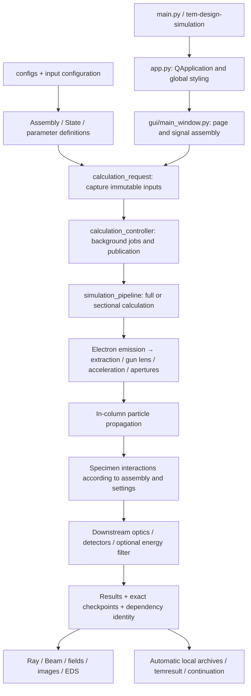
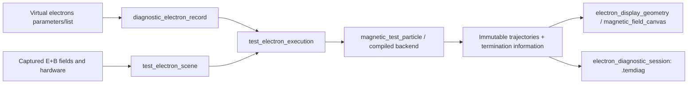

# TEM Design & Simulation Project Map

2026-10-18 Descan mode verification: Finite-particle comparisons in Normal and Large Angle have been performed for the shared Image/Diffraction two-stage deflector
at its current installation position in C3 + Probe Corrector.
Large Angle requires recalibration of AC affected by the TL12 fringe field; held drives continue to retain the actual mismatch.
For modes, common intersections, finite beam waists, positions/mechanical angles and numerical verification, see the
[Normal study](development/descan-normal-2026-10-18.md) and
[Large Angle study](development/descan-large-angle-2026-10-18.md).

2026-10-15 Hexapole parameter validation and local channels: `optics/corrector_channels.py` calibrates independent physical drives for
A1/A2 coarse/fine through actual propagation; `gui/corrector_channels.py` provides explicit calculation and atomic application.
Effective hexapole thickness continues to participate in propagation; the full wave phase retains tilt, defocus and coupled aberrations. Inputs must be recalculated after modification.
This is simulator operating-point calibration, not manufacturer hardware calibration. For usage and verification scope, see the
[physical channel notes](corrector_channels.md).

2026-10-08 CM/objective/scan design: `optics/mini_condenser.py` unifies equal-magnitude positive and negative excitation;
`optics/condenser_objective_design.py` analyzes the existing combined fields, mechanical position bounds and common incidence conditions;
`optics/scan_coil_design.py` solves the full dual-axis AC drives and scan pivot;
`gui/condenser_scan_design.py` displays candidates in a Design Explorer subpage.
The corresponding new tests are `test_mini_condenser_modes.py`,
`test_condenser_objective_design.py`, `test_scan_coil_design.py`,
and `test_condenser_scan_design_gui.py`. These are bounded first-order design diagnostics; they do not automatically alter live geometry
or treat control signs as having passed Microprobe/Nanoprobe beam acceptance. See
[CM, objective and scan notes](stigmator-and-scan.md#cm-objective-and-scan-design).

2026-10-08 Scan execution fix: `physics/finite_scan_response.py` derives a local dual-axis response from actual finite-length
deflection fields for AC/Descan calibration in `scan_geometry.py` and the design page;
`physics/scan_preparation.py` prepares and reuses scan drives for the same captured inputs in the wave worker.
`gui/paired_beam_controller.py` passes the calibration matrices actually used by particles to the wave calculation and checks execution-drive identity.
New regressions are `test_finite_scan_response.py` and `test_scan_preparation.py`, included respectively in the
`field-ui` and `coherent-development` acceptance scopes. Local-response and drive consistency do not replace finite-probe
focusing, complete specimen diffraction or experimental qualification.

2026-10-17 Main-screen Image and sampling fixes: `optics/projector_reference.py` solves first-order specimen image conjugacy at the actually inserted
TEM receiving plane, committing D/I after an independent fine-step check. Switching to Image and explicitly invoking
**Focus Image at receiver** run as background jobs, preserving current illumination, Objective and held scanning.
`detector/receiver_image.py` and `gui/receiver_imaging.py` provide optional
32²–1024² viewport rebinning for static receiver images (default 512²), preserve raw impacts, and distinguish detector broadening from full-screen current.
Sampling hints report particles within the viewport, occupied pixels and weighted effective sample count; they are not statistical-error or convergence evidence.
`scripts/validate_image_intensity_convergence.py` varies actual emitted-particle count and integration step independently;
`scripts/analyse_image_intensity_convergence.py` checks pixel, step and
particle-count differences on retained impacts in a fixed viewport. Zero differences are explicitly marked unresolved; smoothing does not replace raw-intensity convergence.
See [Camera / screen operation and physical limits](RECEIVER_IMAGING.md).

2026-10-08 Projector switching and independent Descan calibration (Image behavior was updated by the preceding entry): `operating_modes.apply_projector_mode()`
is called by `gui/main_window.py` when the condenser is unchanged and the Image/Diffraction selection changes;
it changes only D/I/P1/P2 strengths, preserving Tip, CM/Objective, AC held records and receiver state.
Reapplying the same selection still reloads the full preset. Diffraction continues to load stored strengths; Image now resolves them for the receiving plane.
**Calibrate Descan (keep AC)** in `gui/scan_panel.py` explicitly invokes
`physics.scan_geometry.recalibrate_descan_only()`, retaining held AC (including accepted
canonical-pivot drives), recalibrating only Descan at the selected physical receiving plane and updating held records.
STEM display magnification is determined by display size and specimen scan FOV; it is not the physical imaging magnification from specimen to screen.
Regression entry points are `test_projector_mode_switch.py` and `test_held_scan_calibration.py`;
operation semantics do not imply that finite-FOV beam transport or screen imaging has been validated. See
[projector switching with held AC](stigmator-and-scan.md#projector-switching-with-held-ac).

Updated: 2026-09-28. Code baseline: `19ff33edc294e1ad316eed19086eb9e92dca12b7`.

2026-09-29 Local update: Section 8.1 records the current deduplication results; see the [code cleanup verification record](CODE_CLEANUP_AUDIT.md). All other file and line counts remain navigation snapshots of the baseline above.

2026-10-03 Local update: The user explicitly resumed coherent development on 2026-10-02. The separate Coherent beam page, implemented by `gui/coherent_beam.py` and `physics/tip_wave_pipeline.py`, provides development observations of tip-origin propagation, shared electromagnetic fields and selected Z; classical particles remain the default workflow. Eight acceptance scopes are currently registered, including the new `coherent-development`. Bounded-operator and offscreen CPU software validation do not establish full TEM/STEM, real-GPU, native-desktop or experimental qualification. For inputs and support limits, see the [coherent calculation notes](COHERENT_BEAM.md). Other file statistics retain the historical baseline above.

2026-10-04 Multiple initial-state observation: `gui/coherent_state_list.py` manages the initial-state list, names, weights and visibility; `gui/coherent_state_controller.py` captures applied tip initial states and handles individual calculations, caching and cancellation in the current optical configuration; `physics/coherent_state_set.py` enforces geometry identity and incoherent intensity addition at the same Z on a common physical grid. These modules reuse the existing propagation engine and preserve each member's complex field; they do not create downstream independent sources or a total phase for a mixed state. The three corresponding test files are included in `field-ui/FU-10` and `coherent-development/CW-03`. Operation and support scope are described in the coherent calculation notes; original file statistics were not recounted.

2026-10-04 Tip parameter entry: The interface consistently uses Tip / Tip parameters; geometry, emission and phase parameters belong to the same Tip. `TipEmissionSettings` in `physics/coherent_inputs.py` represents only pending emission-parameter edits; `candidate_tip_emission` validates edits, while calculations read the applied Tip. The multiple-initial-state list records different emission initial states of that Tip. `gui/gun_source_dialog.py` always exposes the existing Gaussian-Schell emission model, which can be selected in the Tip editor even when not enabled. Historical configuration identifiers are unchanged, and the propagation model's applicability was not expanded.

2026-10-15 Local cleanup: Removed the invalid `scripts/validate_illumination.py` and two historical Python files already excluded from default collection, `illumination_wp03_contract.py` and `cache_projection_assumptions.py`. Original texts at fixed commits and current mathematics, source-admission and cache regressions are documented in the [wave-entry migration record](../tests/historical/WAVE_ENTRY_MIGRATION.md#retired-files-15-october-2026). Only these three entries and their local counts were removed from the relevant appendices; directory totals below retain the 2026-09-28 historical baseline, without a project-wide recount.

This map locates features, interfaces, models, tests and potential refactoring boundaries. The first version provides static navigation only, not physical acceptance; subsequent local changes and their verification are recorded in the updates above.

2026-10-03 Selected-plane outlines: `gui/plane_hardware_geometry.py` extracts aperture, column-wall/gun-body passage and detector geometry, preserving actual Z. The upstream-looking axial projection displays only apertures and inserted detectors/cameras, excluding gun-body and column-wall passages. `gui/plane_cutoff_events.py` caches recorded actual cutoff positions, so changing Z does not repeat path interpolation. `gui/plane_hardware_overlay.py` handles position/intensity overlays, name/Z labels, independent visibility, display reset and side-by-side Fit beam / Fit cutoff. Detector-sensitive regions have translucent fills; annular inner holes remain transparent and inner/outer boundaries share a color. Hiding the outer boundary also hides the fill; independently hiding the inner boundary does not fill the physical hole. Edited hardware previews are explicitly distinguished from calculated beam/stops, and reopening a hidden panel retains the latest preview. These modules do not recalculate electrons; related geometry, cutoff, UI and deferred-publication tests are all included in `field-ui/FU-11`. Outlines from other planes are not valid receiving masks at the current Z; cutoff points are neither arrivals at the current plane nor an electron-count readout.

## 1. Usage and scope

- To change a page: start with the UI location table in Section 4, then use Section 3 to find the data and calculation owners.
- To improve speed or reduce duplication: start with Sections 8 and 9; distinguish drawing simplification, cache reuse and physical-algorithm changes.
- To delete files: start with Sections 2, 6 and 7; absence of ordinary `import` references does not establish absence of configuration, command-line, packaging or dynamic-call dependencies.
- To find any file: Section 11 lists the baseline commit's **1,208 version-controlled files** individually, collapsed by directory. This map itself is excluded from that baseline count.

Counting method: `git ls-files`, reading source and configuration, and extracting definitions/static imports with Python AST. Line counts include comments and blank lines; test-function definition counts are neither pytest-parametrized case counts nor pass counts. Import relationships are not a complete runtime call graph. The full test suite, GUI, GPU and coherent-wave calculations were not rerun.

## 2. Directory map

| Location | File count | Contents | Required for ordinary startup? |
| --- | ---: | --- | --- |
| `main.py`, `setup_env.py`, `pyproject.toml` | 3 | Startup entry point, environment setup, dependencies and packaging rules | Used for startup, installation and building respectively |
| `src/temsim/` | 498 | 488 Python files, 9 SVGs and 1 acquisition-interface catalog JSON | Main application; individual modules are used by feature |
| `configs/` | 40 | Instrument structure, sources, operating modes, materials, EDS, specimens and reference inputs | Required by default configuration and relevant features; the entire directory must not be deleted |
| `tests/` | 531 | 521 `test_*.py` files, 7 helper Python files and 3 historical notes | Not needed for startup; needed for validation after changes |
| `scripts/` | 86 | Acceptance, performance measurement, calibration, diagnostics and some paused wave-research tools | Not run with ordinary GUI startup; some are used by CI/tests |
| `tools/` | 1 | Acquisition-interface catalog builder | Used for development and maintenance |
| `docs/` | 34 | User/model notes, current verification summaries, reference images and necessary historical fixtures | Mostly not used at startup; some are read by tests or tools |
| `profiles/` | 4 | Reference operating configurations and saved working points | Loaded on demand; not authoritative calibration |
| `requirements/` | 2 | CPU verification-environment locks and constraints | Used by verification/CI environments |
| `.github/` | 1 | Windows CPU scoped acceptance workflow | Used by GitHub CI |
| `instrument_records/` | 1 | Description of the raw acquisition directory; actual records are not calculation caches | Acquisition/evidence-retention scope |
| `wheels/` | 1 | Description of the local dependency directory | Environment setup tools depend on this directory convention |
| Other root files | 6 | README, AGENTS, functional acceptance specification, license and Git rules | Documentation, legal and development constraints |

### Inside the application package

| Location | Python file count | Responsibility |
| --- | ---: | --- |
| Direct children of `src/temsim/` | 107 | Application coordination, inputs/state, caches, jobs, archives, parameter definitions and diagnostics |
| `gui/` | 97 | Qt pages, panels, controllers, plotting, interaction and layout |
| `column/` | 5 | Building and resolving column components and layout from configuration |
| Direct children of `optics/` | 68 | Lenses, multipole fields, deflectors, correctors, alignment and energy filters |
| `optics/electron_gun/` | 23 | Tip, electron emission, extraction/acceleration, gun lenses, apertures and gun tracing |
| `physics/` | 141 | Particle/field/scan and coherent-wave numerical calculations; the file count is a baseline snapshot, while current development scope is described in the local updates above |
| `specimen/` | 22 | Specimens, CIF, supports, scattering, in-material and downstream propagation |
| `detector/` | 18 | Electron counting, STEM, cameras, EDS/EELS response and readout |
| `recorder/` | 7 | Independent experimental-instrument recording tools, not a simulator solver |

### Local directories outside the source map

`.venv/` is the environment; `build/` and `*.egg-info/` are build artifacts; `outputs/`, `tmp/`, `environment/`, `.temsim-wave-cache/`, all `__pycache__/` directories and test caches are local artifacts. `tmp/repository-cleanup-20260928/archive/` is a local archive from the preceding cleanup. They are excluded from the full source appendix, which does not establish that user-saved results inside them may be deleted.

## 3. Features and data flow



The diagram shows responsibilities, **not a fixed order requiring every electron to pass every detector/energy filter**. Actual paths depend on assembly, axial positions and stopping conditions. Display toggles should not change modeled physical interactions.

| User feature | UI/dispatch entry | Main implementation | Boundaries when editing |
| --- | --- | --- | --- |
| Instrument selection and Optical/Mechanical/Assembly navigation | `gui/assembly_panel.py`, `instrument_configuration_dialog.py`, `instrument_tree.py` | `instrument_configuration.py`, `assembly_catalog.py`, `column/module_assembly.py`, `module_manifest.py` | View categories are not separate hardware states |
| Tip, extraction, acceleration and gun propagation | `gui/gun_source_dialog.py`, `tip_geometry_preview.py` | `optics/electron_gun/source.py`, `field_emission.py`, `emitter.py`, `tracing.py`; `physics/*gun_field.py` | Main-beam source input exists only at the physical tip; downstream caches are not new sources |
| Preview / High accuracy | `gui/calculation_request.py`, `calculation_controller.py` | `simulation_pipeline.calculate()`, `physics/simulation.run()`, `core.py`, `ray_integrator.py` | Accuracy settings, physical-model selection and display subsampling are different dimensions |
| Stop-plane selection, sections and continuation | `gui/interactive_calculation.py`, `calculation_controller.py` | `simulation_pipeline.calculate_particle_section()`, `physics/particle_sections.py`, `completed_particle_section.py` | Only exact, executed upstream states with matching dependencies may be reused |
| Live tuning | `gui/interactive_calculation.py`, `interactive_controller.py` | `interactive_calculation.py` | Select participating parameters, ranges, stop planes and reuse; includes the working-point subpage |
| Hardware tuning | `gui/hardware_tuning_panel.py` | `hardware_tuning.py`, `hardware_tuning_feedback.py` | Manual tasks bind to hardware parameters; observation is not automatic tuning |
| Direct Alignment | `gui/direct_alignment_panel.py`, `direct_alignment_controller.py` | `optics/direct_alignment.py`, `alignment_transaction.py`, `beam_alignment.py`, `stigmator_alignment.py` | Automatic solving, cancellation/staleness checks and application after the commit gate passes |
| Ray / transverse beam / TOF | `gui/visualization.py`, `diagnostic_tabs.py`, `beam_analysis.py` | `beam_plane_data.py`, `emission_source_data.py`, `beam_tracking_modes.py`, and color/trajectory drawing modules | Ray display geometry must not write back to calculation arrays; TOF is not coherent phase |
| 2D/3D magnetic fields and field lines | `gui/magnetic_field_canvas.py`, `magnetic_field_3d.py` | `magnetic_field_scene.py`, `magnetic_field_lines.py`, `physics/lens_field_provider.py` | Field calculation is separate from field-line display sampling |
| Independent virtual electrons and multiple-path overlays | `gui/virtual_electron_panel.py`, `magnetic_test_electron.py` | `test_electron_scene.py`, `test_electron_execution.py`, `magnetic_test_particle.py`, `test_electron_compiled*.py` | Diagnostic E+B paths, not substitutes for complete main-beam/specimen simulation |
| Specimen/CIF, local environment and scattering | `gui/sample_panel.py`, `sample_interactions_3d.py`, `cell_environment_editor.py` | `specimen/source.py`, `scene.py`, `interaction_engine.py`, `rutherford.py`, `inelastic.py`, `vacuum.py` | Distinguish physical specimen state, display region and interaction region |
| Scanning and detector counts/images | `gui/scan_panel.py`, `diagnostic_tabs.py` | `physics/scan_geometry.py`, `scan_calibration.py`, `detector/stem_signal.py`, `particle_readout.py` | Scan images and single-position counts are different readouts; main propagation must not be repeated |
| CIF non-wave atomic-projection STEM | Particle model / Calculate STEM in `gui/scan_panel.py` | `specimen/projected_scattering.py`, `detector/projected_response.py`, `detector/projected_stem.py` | Uses executed probe covariance; thin-specimen independent-atom approximation, without Bragg interference/channeling; does not replace exact material-continuation states; tests: `test_projected_scattering.py`, `test_projected_response.py`, `test_projected_stem_integration.py` |
| EDS | `gui/eds_panel.py` | `detector/eds_signal.py`, `eds_photon_transport.py`, `eds_response.py`, `specimen/overlap_sampling.py` | Arrival counts, in-material paths, geometry and spectral response have different dependencies |
| Energy filter | Energy Filter page in `gui/diagnostic_tabs.py` | `optics/energy_filter*.py`, `simulation_pipeline.py` | Assembly and path arrival determine participation; filters that must be traversed cannot be skipped |
| Physical layout, 3D parts and material editing | `gui/assembly_model_page.py`, `part_model_editor.py`, `part_geometry_editor.py` | `part_model_3d.py`, `part_model_features.py`, `part_model_document.py`, `component_persistence.py` | Render meshes are not automatically valid electromagnetic-field models |
| Design Explorer and parameter sweeps/comparisons | `gui/design_explorer.py`, `design_sweep_controller.py` | `design_experiments.py`, `design_sweep_execution.py`, `geometry_experiments.py` | Run on detached states and explicitly adopt after validation; do not claim experimental completion |
| Numerical evidence/model inspection | `gui/model_inspector.py`, `qualification_dialog.py`, `magnetic_validation.py` | `acceptance.py`, `sampling_qualification.py`, `magnetic_validation.py`, `topology_evidence.py` | Local numerical passes cannot establish full-instrument physical qualification |

Specialized entry points for source particle counts and screen differences:
[tip_joint_sampling.py](../src/temsim/optics/electron_gun/tip_joint_sampling.py)
provides explicit source sampling whose energy mapping is independent of particle count;
[validate_image_intensity_convergence.py](../scripts/validate_image_intensity_convergence.py)
collects independently propagated results;
[analyse_image_intensity_convergence.py](../scripts/analyse_image_intensity_convergence.py)
separates surviving-particle displacement from intensity gained/lost at apertures;
[source_radial_quadrature.py](../scripts/source_radial_quadrature.py)
provides actual aperture-boundary partitioning and complete probability integration for offline validation.
[validate_conditional_source_convergence.py](../scripts/validate_conditional_source_convergence.py)
performs conditional integration of the full source probability;
[source_azimuth_orbit.py](../scripts/source_azimuth_orbit.py)
adds common azimuthal quadrature at emission;
[source_energy_strata.py](../scripts/source_energy_strata.py)
stratifies sampling of rare aperture-critical energy intervals while retaining the full source probability;
[analyse_conditional_source_convergence.py](../scripts/analyse_conditional_source_convergence.py)
separately checks independent source base-point count, azimuthal order and radial quadrature order.
For method identities, historical compatibility and numerical-evidence boundaries, see
[RECEIVER_IMAGING.md](RECEIVER_IMAGING.md#source-sampling-and-rare-aperture-interception).
| Experimental recording | `gui/instrument_recorder.py`; `tem-design-simulation-recorder` | `recorder/backend.py`, `snapshot.py`, `records.py` | Raw acquisition is separate from simulation results; an interface catalog does not establish a real-device connection |

### Data chain for independent virtual electrons



`diagnostic_field_identity.py` identifies captured fields; `diagnostic_execution_identity.py` identifies path-execution conditions; `electron_execution_protocol.py` validates interprocess data; `electron_execution_diagnostics.py` records faults; `electron_execution_performance.py` records timings. These are different responsibilities, not five integrators.

## 4. Where to change the interface

The UI is built primarily with **Python + PySide6 layout code**; the project has no Qt Designer `.ui` files. 2D plots use pyqtgraph, and some 3D views use OpenGL. Do not look for page layouts in `main.py`.

| Requirement | Primary file | Supporting files/notes |
| --- | --- | --- |
| Global colors, fonts and control appearance | `APPLICATION_STYLE` in [app.py](../src/temsim/app.py) | Checkbox icons in `gui/assets/`; individual panels also contain local styles |
| Main window, top tools and Dock registration | `MainWindow` in [main_window.py](../src/temsim/gui/main_window.py) | Workspace assembly and signal connections; central tabs are registered in `VisualizationWorkspace` |
| Layout save/restore and window docking | [workspace_layouts.py](../src/temsim/gui/workspace_layouts.py) | Separate from scientific-parameter/calculation-result persistence |
| Left-side Instrument setup and parameters | [assembly_panel.py](../src/temsim/gui/assembly_panel.py), [parameter_panel.py](../src/temsim/gui/parameter_panel.py) | `instrument_tree.py`, `assembly_structure_tree.py`, `aligned_control_table.py` |
| Parameter meanings, units and impact hints | `parameter_semantics.py`, `parameter_registry.py`, `parameter_impact.py` | Non-GUI definitions; `gui/input_policy.py` handles wheel/input behavior |
| Central-tab assembly, Ray Diagram main layout, toolbar and linked projections | `VisualizationWorkspace` in [visualization.py](../src/temsim/gui/visualization.py) | `ray_scene.py` manages drawing state; `ray_curve_item.py` manages efficient curves |
| Trajectory display simplification and drag/zoom performance | `gui/ray_curve_simplification.py`, `ray_curve_item.py`, `electron_display_geometry.py` | Only display geometry is compressed; results retain exact paths |
| The transverse-plane and emission-source plots | `gui/beam_analysis.py`, `emission_source_plot.py` | `transverse_plot_layout.py` manages sizing; `beam_analysis.py` manages Plot presets, and `beam_tracking_modes.py` manages interaction-category display labels |
| Position/angle/TOF colors | `gui/beam_colours.py`, `flight_time_colours.py`, `ray_flight_time_colours.py`, `ray_scalar_colours.py` | Source properties are fixed along each ray, while TOF changes during propagation; they must not share an inappropriate coloring contract |
| Narrow progress bar for the calculation stop position | `gui/ray_calculation_extent.py`, `ray_extent_data.py` | Marks actual calculated extent; the current viewport width must not stand in for computed extent |
| Magnetic-field canvas and 3D controls | `gui/magnetic_field_canvas.py`, `magnetic_field_3d.py` | `visualization.py` initiates projection linkage; `MagneticFieldView` in `diagnostic_tabs.py` handles axis-range/pixel-edge synchronization (`_sync_plot_pixel_edges`) |
| Virtual electrons Dock and continuous editing | `gui/virtual_electron_panel.py`, `magnetic_test_electron.py` | `electron_session_actions.py` saves/loads; distinguish edited values from completed results |
| Three tuning entry points | `gui/hardware_tuning_panel.py`, `direct_alignment_panel.py`, `interactive_calculation.py` | See Section 8 for their different responsibilities |
| Specimen / scanning / EDS | `gui/sample_panel.py`, `scan_panel.py`, `eds_panel.py` | Numerical implementations are in `specimen/`, `physics/` and `detector/` |
| Physical Layout / Energy Filter / Transverse Beam / Optical Transfer / Magnetic Field | [diagnostic_tabs.py](../src/temsim/gui/diagnostic_tabs.py) | Largest UI file; a priority candidate for later separation by page |
| Optical Transfer graphical overview | [optical_transfer_overview.py](../src/temsim/gui/optical_transfer_overview.py) | Reads calculated J_img/J_diff; shows responses of position circles and canonical momentum-angle cones, and conjugacy types classified from matrices. Uses a reference trajectory and independent coordinate scales; these are not beam intensities or diffraction spots. Raw matrices and mode comparisons remain in the `OpticalTransferView` subpage |
| Conjugate-plane search for any selected Z | `physics/conjugate_planes.py`, `gui/conjugate_plane_panel.py`, `gui/conjugate_plane_overlay.py`, `gui/conjugate_plane_context.py` | First-order transfer cache of captured optical state; with reference Z fixed, searches upstream/downstream real conjugates, approximate planes and single-direction focal planes. Full 2D B criterion, self-exclusion, coordinate and interpolation-error checks; clicking a list entry moves only the observation cursor without changing the reference plane, and reads actual Z from recorded paths and stopping components. Background cancellation and stale-result isolation; no full particle-beam or electron-wave repropagation, and no claim of qualified transmission or diffraction intensity. `tests/test_conjugate_planes.py`, `test_conjugate_plane_gui.py`, `test_conjugate_plane_workspace.py` are registered in `field-ui/FU-09`. |
| Illuminating Image camera/screen receiver images | `gui/receiver_imaging.py`, `detector/receiver_image.py`, `detector/receiver_scan.py` | Actual particle first-interception images; single-frame scanning is explicitly labeled a geometric preview. See `RECEIVER_IMAGING.md` |
| Historical coherent images and diffraction references | `WaveImagingView` in `gui/visualization.py` | Illuminating Image > Stored wave / reference; `aberration_view.py` displays aberrations. Readable historical wave data do not imply that coherent calculations have resumed |
| Result opening/export and summaries | `gui/result_files.py`, `result_readout.py` | See the next section for archive internals |

`Optical` shows components participating in optical execution; `Mechanical` shows mechanical parts without independent optical runtime objects; `Assembly` provides the complete assembly hierarchy. All three should share one assembly identity, rather than maintaining a separate instrument per view.

The 13 central tabs are assembled together in `VisualizationWorkspace` (`visualization.py`): Ray Diagram, Electron beam, Hardware tuning, Physical Layout, Energy Filter, Sample, Vacuum map, EDS, Scanning Image, Illuminating Image, Optical Transfer, Model Inspector and Design Explorer. EDS subpages Spectrum, Interactions 3D and Parameters contain the energy spectrum, local-interaction diagnostics and the single set of EDS/local-transport parameters respectively; switching subpages does not start calculation. Four Docks are assembled in `MainWindow`: Instrument setup and parameters, Live tuning, Virtual electrons, and Status and calculation log. Working points is a Live tuning subpage, not another independent top-level tab.

The shared entry point for plane types is `diffraction_transfer(s)` in `optics/direct_alignment.py`: input is position and canonical momentum at the specimen center, and output is column-coordinate X/Y. Classifiers in `physics/scan_geometry.py` unify criteria and reject mechanical-input matrices. Optical Transfer, Selected Z, scan/Descan and Camera wave-result labels use this entry point together. Actual particle transport and scan displacements still use mechanical directions, so their propagation matrices must not be directly replaced; `TransverseTransfer.input_basis` explicitly records this distinction. Old caches without coordinate labels require new diagnostics and cannot inherit their old classification.

`gui/plane_equations.py` provides shared symbolic-equation hover hints for Selected Z status/cursors, conjugate-candidate lists/markers and Optical Transfer type labels. The hints explain existing criteria for the selected-plane classifier and conjugate search, reference planes, canonical coordinates and higher-order-aberration limits; they display text only and do not classify, propagate or substitute current numerical values.

Two actual layout owners deserve attention: `TransverseBeamView` in `diagnostic_tabs.py` owns the containers for the two right-side plots; `magnetic_test_electron.py` owns the full virtual-electron form and controller, while `virtual_electron_panel.py` currently mainly lays out Dock content. Confirm the actual widget owner before changing sizing/layout.

## 5. Configuration, caches and saved formats

| Layer | Files/directories | Responsibility |
| --- | --- | --- |
| Authoritative structural inputs | `configs/instruments/`, `configs/subassemblies/`, `module_manifest.py` | Assembly, geometry, materials and component structure; UI defaults must not become a second authoritative source |
| Source and operating modes | `configs/sources/`, `configs/operating_modes/`, `shared_tip.py`, `operating_modes.py` | Tip definitions, operating modes and mode-dependent settings |
| Single runtime model | `optics/model.py`, `configuration.py`, `runtime_parameters.py` | Runtime parameters and editable targets; `state.py` is one save/load entry point, not the owner of every model |
| Request inputs and provenance | `instrument_snapshot.py`, `input_assets.py`, `input_io.py`, `calculation_manifest.py` | Captured inputs, read-only arrays, dependency and implementation identity |
| Memory cache | `calculation_cache.py`, `cache_memory.py`, `cache_preferences.py` | Dependency-aware reuse and memory budgets |
| Specialized atomic-data/specimen/EDS caches | `physics/prepared_specimen_cache.py`, `specimen/display_cache.py`, `detector/eds_signal.py`, `eds_photon_transport.py`, `eds_response.py` | Each consumes different inputs; management principles should be shared without merging distinct physical cache keys |
| Exact particle sections | `physics/particle_sections.py`, `completed_particle_section.py`, `particle_section_io.py` | Checkpoints, stop extents, quality and continuation validity |
| On-disk numerical objects | `artifact_store.py` | Checks, size limits and persistent numerical assets; distinct from the user-interface result index |
| Working points and evidence | `working_point.py`, `working_point_archive.py`, `working_point_export.py`, `working_point_evidence.py` | Exact states, indexing, export scope and acceptance-evidence checks |
| User result library | `result_library.py`, `gui/result_files.py` | A small navigation index and UI actions for exported results |
| Virtual-electron history | `electron_diagnostic_session.py` | Independent `.temdiag` archives, preserving the distinction between provenance and current field state |
| Resources and jobs | `cpu_resources.py`, `gui/job_coordinator.py`, `job_events.py` | Numerical-thread budgets, preventing concurrent workloads from accumulating, and lifecycle records |

Main formats: operating-parameter TOML is not the same as an exact executed result. `.temresult` supports user exports and `.temsection` automatic particle-section archives; both reuse the underlying format in `particle_section_io.py`. `.temwp` represents a working-point package, and `.temdiag` stores independent diagnostic-electron sessions. Their common ability to “save/load” does not make them interchangeable. Actual recovery capabilities depend on package quality, dependencies and actual checkpoints.

The **complete section-calculation entry point** is `simulation_pipeline.calculate_particle_section()`: it connects optical sections to specimen/material, EDS, downstream, scan and filter operations according to the actual stop position. `physics/particle_sections.run_particle_section()` is its low-level optical helper; invoking it alone cannot establish completion of a full-physics section including a specimen.

## 6. Tests, acceptance and development tools

`pyproject.toml` configures pytest collection from `tests/`; `tests/conftest.py` supplies offscreen Qt, fonts and widget cleanup support.

**Names can be misleading:** `src/temsim/test_electron_*.py`, `gui/test_electron_types.py` and `magnetic_test_particle.py` implement the application's diagnostic-electron feature and must not be removed as “test files.” `tests/test_test_electron_*.py` contains some of the corresponding automated tests.

The baseline has 521 `test_*.py` files; AST found 4,380 `test_*` function definitions under `tests/`. This includes test definitions in different states and **does not mean that 4,380 tests were executed in this review, much less that they all passed**.

### Current scoped acceptance

| Scope | Main responsibilities and representative tests |
|---|---|
| `classical` | Source admission, complete-instrument capture, transactional adjustments, vacuum opt-in, current-result ownership, calculation background jobs and GPU-unavailable policy; `test_source_admission.py`, `test_working_point_contract.py`, `test_job_lifecycle.py`, `test_background_preview_gui.py`, `test_backend_failure_semantics.py` |
| `gun-fields` | Tip geometry, conductor boundaries, electric-field cache/identity, curvature and field-domain comparisons; `test_closed_gun_field.py`, `test_axisymmetric_cut_field.py`, `test_continuous_tip_curvature.py`, `test_diagnostic_field_identity.py`, `test_diagnostic_gun_domains.py` |
| `electron-execution` | Independent E+B reference, compiled/reference execution consistency, actual isolated subprocesses, stop/cancel/fault recovery and session files; `test_magnetic_test_particle.py`, `test_test_electron_execution.py`, `test_electron_execution_faults.py`, `test_electron_diagnostic_session.py` |
| `field-ui` | Superposed magnetic fields, field lines, display caches, Ray Diagram linkage, continuous electron editing, Docks, hardware controls and historical sessions; `test_magnetic_field_3d.py`, `test_magnetic_navigation_link.py`, `test_continuous_electron_gui.py`, `test_hardware_tuning_feedback.py`, `test_electron_session_gui.py` |
| `particle-continuation` | Executed sections, material-section continuation, EDS reuse, lossless compact archives and file-request ownership; `test_particle_sections.py`, `test_material_section_resume.py`, `test_particle_section_eds_reuse.py`, `test_particle_archive_compression.py`, `test_result_files_gui.py` |
| `performance-observation` | Correctness of timing evidence and measurement paths, without directly declaring qualified performance; `test_electron_execution_performance.py`, `test_electron_response_benchmark.py`, `test_continuous_electron_response_benchmark.py`, `test_particle_benchmark.py` |
| `acceptance-policy` | Collection completeness; missing/empty collection/timeouts/failures must not be recorded as PASS; subprocess cleanup, installer compatibility and offline wheel installation; `test_acceptance_scopes.py`, `test_acceptance_runner.py`, `test_validation_process.py`, `test_setup_env.py` |
| `full-report` | Reports uncovered and paused items only; does not start pytest or full coherent calculations, and results remain `NOT_RUN` / `UNQUALIFIED` |

### Finding tests by feature

The following are navigation examples, not a complete file list or a new execution scope.

| Feature | Main file families / examples |
|---|---|
| Tip and electron gun | `test_tip_*`, `test_gun_*`, `test_closed_gun_*`, `test_planar_gun_*`, `test_accelerator_*`, `test_surface_direction_sampling.py`; distinguish particles, geometry, electric fields and historical coherent mathematics |
| Column optics, lenses, correctors and centering | `test_canonical_ray_integration.py`, `test_first_order_transfer.py`, `test_direct_alignment*.py`, `test_probe_corrector_calibration.py`, `test_stigmator_tensor.py`, `test_qualitative_control_trends.py` |
| Mechanical assembly and editable configuration | `test_toml_authority.py`, `test_subassemblies.py`, `test_assembly_*.py`, `test_manifest_*.py`, `test_part_model_*.py`, `test_part_geometry*.py`, `test_instrument_configuration.py` |
| Field calculation and independent electrons | `test_magnetic_field_*.py`, `test_test_electron_*.py`, `test_vector_field_transport.py`, `test_static_energy_lorentz.py`, `test_diagnostic_*` |
| Specimens and scattering | `test_specimen_*.py`, `test_sample_*.py`, `test_elastic_transport.py`, `test_rutherford_*.py`, `test_virtual_specimen.py` |
| EDS / EELS / energy filtering | `test_eds_*.py`, `test_eels_forward.py`, `test_energy_filter_*.py`, `test_filter_plane_analysis.py`; separate layers for geometry, probability accounting, spectral lines, caches and UI |
| Scanning, detection and images | `test_stem_*.py`, `test_tem_*.py`, `test_fourdstem*.py`, `test_record_plane*.py`, `test_detector_*.py`; some include coherent or independent-GPU assumptions and cannot all automatically join the classical-particle Scope |
| Caches, checkpoints and save/load | `test_calculation_cache*.py`, `test_particle_section*.py`, `test_section_*.py`, `test_working_point_*.py`, `test_result_*.py`, `test_input_assets.py`, `test_portable_inputs.py` |
| Background jobs and resources | `test_job_*.py`, `test_background_*.py`, `test_cpu_resources.py`, `test_backend_*.py`, `test_electron_execution_*.py`; `tests/electron_fault_worker.py` is a fault-injection subprocess, not an ordinary test module |
| Display and interaction | `test_ray_*.py`, `test_transverse_*.py`, `test_live_*`, `test_workspace_layouts.py`, `test_hardware_tuning_*.py`, `test_virtual_electron_dock.py` |
| Installation, inputs and recorder | `test_setup_env.py`, `test_project_artifact_fallback.py`, `test_sample_sources.py`, `test_sample_source_*.py`, `test_instrument_recorder*.py` |
| Historical wave and mathematical evidence | `test_wave_*.py`, `test_radial_*.py`, `test_galerkin_*.py`, `test_covariant_*.py`, `test_modal_covariant_slab.py`, `test_multislice.py`; retains algorithm/source-rejection evidence without implying completion of the current production chain |

### Development-tool groups

No `scripts/` command is a dependency of ordinary GUI startup, but some are necessary test or CI dependencies. “Not a GUI runtime file” must not be equated with “deletable.”

| Purpose | Entry points and limits |
|---|---|
| Current acceptance and independent installation | `validate_classical_scope.py`; `installation_diagnostic_smoke.py::installation_checks` checks an installed wheel, classical tip-origin column propagation, an independent virtual-electron fixture, session round trips and offscreen panels, without starting coherent calculations |
| Continuous interaction and particle performance | `benchmark_particle_stages.py`, `benchmark_test_electron_responsiveness.py`, `validate_continuous_electron_response.py`; measure production stages, isolated diagnostic execution and response from Qt adjustment to actual drawing respectively; not duplicate scripts for a single metric |
| Display and preparation costs | `benchmark_incremental_ray_scene.py`, `benchmark_ray_display_cache.py`, `benchmark_live_tuning_edits.py`, `benchmark_request_preparation.py`, `validate_test_electron_navigation.py`; explicitly distinguish publication/drawing/editing/request preparation, often using fixed fixtures; not overall physical-computation speed |
| Electron-gun and acceleration diagnostics | `audit_accelerator_envelope.py`, `analyze_accelerator_turns.py`, `diagnose_accelerator_mechanism.py`, `diagnose_planar_gun.py`, `audit_gun_*`, `check_gun_*`, `compare_diagnostic_gun_domains.py`, `validate_closed_gun_transport.py`, `validate_tip_particles.py` |
| Illumination/column transfer/candidate calibration | `calibrate_assembly_illumination.py`, `calibrate_nanoprobe_corrector.py`, `check_column_matching.py`, `check_crossover_chain.py`, `fit_gun_column_candidate.py`, `fit_matched_tip_preset.py`, `survey_*`, `validate_assembly_illumination.py`; produce candidates and verification evidence without automatically overwriting default configuration |
| Reuse, specimen and EDS timing | `cache_high_accuracy.py`, `benchmark_eds_photon_cache.py`, `benchmark_specimen_transport.py`, `benchmark_prepared_specimen_cache.py`, `benchmark_report_workflows.py` |
| Existing coherent-research tools | `trace_tip_wave.py`, `gun_wave_cli.py`, `inspect_surface_column.py`, `benchmark_stem_wave.py`, `benchmark_carrier_slab.py`, `benchmark_mixed_slab.py`, `compare_gun_boundaries.py`, `inspect_basis_support.py`, `inspect_moving_radial_frame.py`; retained for reading/mathematical evidence, not automatic routine validation during the pause |
| Coherent-image batch processing | `generate_si110_cif_stem_scan.py`, `run_stem_profile_scan.py`, `run_stem_profile_ensemble.py`, `verify_stem_profile_ensemble.py`; explicit execution/verification tools that must not run implicitly through README startup instructions |
| Historical acceptance/topic-specific evidence | `validate_development_spec.py`, `validate_tem_p0.py`, `validate_aberrations.py`, `validate_review_p0.py`; different scopes. `CRITERIA` / `SOURCE_MIGRATION_BLOCKERS` in `validate_development_spec.py` are still read by the current reporting entry point. For the removed WP-03 runner and why it became invalid, see the [wave-entry migration record](../tests/historical/WAVE_ENTRY_MIGRATION.md#retired-files-15-october-2026) |
| Frozen numerical-input evidence | `freeze_physics_run.py`, `reuse_frozen_physics.py`, `physics_driver_log.py`, `surface_mode_evidence.py`; prefix/field evidence is not a configurable new electron source |
| Recorder-catalog generation | `tools/build_recorder_catalog.py::build` statically reads AST from a user-supplied SDK wheel to generate property/type/unit/exclusion-list JSON; it does not import/execute the SDK. The generated `src/temsim/recorder/autoscript_1_18.json` is a runtime package resource |

Historical/pause boundaries: `tests/historical/` now retains three migration notes; two historical Python files that did not use default `test_*.py` names were removed on 2026-10-15, with originals still traceable through [fixed-commit links](../tests/historical/WAVE_ENTRY_MIGRATION.md#retired-files-15-october-2026). Many wave-related tests remain in the `tests/` root, so “root-level test” must not be interpreted as “current classical-particle scope.” Do not run all pytest tests, enable coherent mode or start long historical calculations merely to organize this map. For current verification results and uncovered items, see [VALIDATION.md](VALIDATION.md).

Use a registered acceptance entry point appropriate to the change, for example:

```powershell
.venv\Scripts\python.exe scripts\validate_classical_scope.py --scope field-ui --output outputs\agent-validation\field-ui
```

This is a validation example for future changes, not a passing report. Available scopes are defined by `acceptance.py` and the actual command line; CI currently uses `classical`, `acceptance-policy`, `gun-fields`, `electron-execution`, `field-ui`, `particle-continuation`, `performance-observation` and `coherent-development`. `full-report` reports uncovered full-scope items only; it does not start complete coherent calculations or confer physical qualification.

The GitHub Windows CPU runner uses `--allow-gpu-skips`: real GPU tests explicitly registered in `acceptance_gpu.py` retain collection and results, and are recorded as `gpu_hardware.NOT_RUN` when no device is available, without pretending that GPU validation passed. GPU-test failures, missing execution phases and ordinary CPU-test skips still fail the job. Without this argument, the strict rule that every test must pass completely remains; these tests still execute locally when a GPU is available.

## 7. Non-runtime files that must be retained

- `docs/development/evidence/default-assembly-identity-map-v1.json`: assembly-identity regression fixture.
- `docs/development/tip_curvature_193_20260915.json`: reference input for existing validation tools.
- `docs/references/`, `instrument_records/`: provenance and raw evidence, not calculation caches.
- `requirements/`, `wheels/README.md`, `src/temsim/_build.py`: development support required for environments and clean installation.
- Paused wave source/tests/historical configurations: retain readability; this does not imply enabled-by-default behavior or complete physical qualification.

## 8. Are there duplicate features?

### 8.1 Confirmed implementation duplication

Two static comparisons were performed: SHA-256 of all version-controlled files, and cross-file comparison of function AST bodies spanning at least 21 lines in application source. The latter ignores formatting and comments and does not automatically establish equivalence under every calling condition.

Only three empty package-initialization files were identical as whole files: `detector/__init__.py`, `optics/__init__.py` and `physics/__init__.py`. They define their respective package boundaries and **are not duplicate functionality and should not be deleted for that reason**. No other byte-for-byte identical files were found; this does not rule out semantic duplication.

| Consolidated duplication | Current shared implementation | Consumers | Preserved differences |
| --- | --- | --- | --- |
| Mechanical centers, optical reference planes, installation switching and anchor relocation | `optics/component_position.py`: `InstallationReferencedPosition` | Diffraction Lens, Diffraction Stigmator | Axial versus quadrupole fields, geometry types and validation rules |
| Linked positions in tip-referenced coordinates | `optics/component_position.py`: `TipReferencedPosition` | Round Lens, Adapter Lens, Hexapole, Quadrupole, Single Plane Deflector | Each element's physical algorithms, initialization fields and restoration mechanisms |
| Round-lens excitation ratios, focal-length interfaces, field support and layout readouts | `optics/round_lens.py`: `TipReferencedRoundLensBehavior` | Round Lens, Adapter Lens | Peak normalization, validation and dataclass field sets |

The three hidden assembly dropdowns in `gui/assembly_panel.py` have been replaced by catalog-validated immutable `AssemblySelection`. `current_selection()`, `set_selection()` and `reload_catalog()` share this state; main-window and working-point restoration no longer depend on hidden controls. `_request_selection`, its dedicated signals and main-window connections, which had no trigger entry point, were removed as a group; the Configure instrument path remains.

Position and assembly regressions are in `tests/test_component_position_contract.py` and `tests/test_assembly_selection_state.py`, alongside existing working-point, catalog-reload, configuration and persistence tests. Shared position classes do not define persistent fields.

Two algorithm/workflow overlaps found by reading callers also warrant separate optimization:

- Code beginning at `physics/simulation.py:382` and `_events()` in `physics/particle_sections.py:75` both enumerate deflector/corrector `kick_events` and handle time parameters and paired events. A side-effect-free shared event enumerator could be extracted, followed by consistency checks for full/sectional and scanning/non-scanning paths. This overlapping logic was not counted among the three identical function-body groups above.
- `gui/ray_curve_item.py`/`ray_curve_simplification.py` and `electron_display_geometry.py` both use RDP-style screen-curve simplification. The latter also retains work budgets, extrema and reversal protection; they could share a core while retaining different policies, but one cannot simply replace the other.

### 8.2 Similar appearances, different responsibilities

| Apparently similar features | Current responsibilities | Optimization limits |
| --- | --- | --- |
| Hardware tuning / Direct Alignment / Live tuning | Manual field mapping / automatic solving and transactional commit / range, stop-plane and reuse selection | May share parameter descriptions and editors, but must retain operation semantics |
| Optical / Mechanical / Assembly / Physical Layout | Optical navigation / mechanical navigation / full hierarchy / geometry visualization and editing entry | Share assembly identity; avoid separate private models per page |
| `simulation_pipeline.calculate` / `calculate_particle_section` | Complete products / user stop-plane and continuation products | Share upstream algorithms; section entry points must retain downstream interactions such as finite specimens |
| `physics/vector_field_transport.py` / `specimen/vector_field_transport.py` / `specimen/axial_field_transport.py` | Column integration along Z / Lorentz flight in material-local SI coordinates / independent uniform-field analytical reference | Units, integration variables and domains differ; matching names do not justify a direct merger |
| `analytic_gun_field` / `planar_gun_field` / `closed_gun_field` / `grounded_tip_field` | Different gun geometries, potential boundaries, solver approximations and verification purposes | A shared provider contract can be considered; algorithm switches require revalidation of physical applicability |
| `optics/objective_aperture.py` / `physics/objective_aperture.py` | Physical aperture component / wave pupil and ownership plan | A clearer wave name could be considered for the latter; these are not duplicate apertures |
| `magnetic_test_particle.py` / `test_electron_compiled.py` | General reference execution / compiled acceleration with explicit field-law admission | Retain the independent reference and consistency tests; deduplication must not remove the reference implementation |
| `eds_signal.py` / `eds_response.py` / `eds_photon_transport.py` | Excitation source / spectral instrument response / photon geometry and absorption | Layered caches can improve speed; direction, energy and paths cannot all be ignored |
| `working_point_archive` / `particle_section_io` / `electron_diagnostic_session` | Working-point container / exact main-particle results / independent diagnostic history | May share bounded ZIP/JSON/array readers; schemas, identities and recovery capabilities remain separate |
| `calculation_cache` / `diagnostic_field_identity` / `diagnostic_execution_identity` | Main-product dependencies / field identity / execution identity | A single generic key must not replace different invalidation scopes |
| Multiple color, source-plot and section modules | Fixed emission properties, interaction categories, clock color scales, along-path gradients and projections have separate roles | Maintain the existing shared scalar palettes and TOF scale; do not consolidate solely to reduce file count |
| `installation_smoke.py` / `installation_diagnostic_smoke.py` | Old entry includes an independent multislice kernel / current entry runs only classical and diagnostic scopes | Current CI uses the latter; old acceptance definitions still depend on the former |
| `validate_classical_scope.py` / `validate_development_spec.py` / `validate_tem_p0.py` | Current explicit allowlist / retained old acceptance declarations / early topic-specific batches | Migrate dependencies and evidence semantics first; declarations still being read cannot simply be deleted |
| `specimen/source.py` / `optics/electron_gun/source.py` | Specimen-structure provenance / unified electron-source calls | Not two configurable electron sources |

### 8.3 Questions still requiring dynamic evidence

Multiple UI pages independently create tables and local color/sizing policies; multiple scripts separately handle test subprocesses, report files and resource limits. Shared implementations could be extracted, but this review did not establish that they perform duplicate calculations or that any can be deleted without replacement. Future decisions should follow request-count, cache-hit and stage-timing measurements during actual user operations.

## 9. Optimization locations and recommended order

These are refactoring candidates, not measured performance bottlenecks. Large source files and many imports indicate broad maintenance scope, not slow execution.

| File | Lines | Distinct direct static importers in other application modules | Optimization focus |
| --- | ---: | ---: | --- |
| [gui/diagnostic_tabs.py](../src/temsim/gui/diagnostic_tabs.py) | 5,994 | 2 | Multiple independent pages, graphics and data adapters are concentrated here; prioritize splitting by page |
| [gui/visualization.py](../src/temsim/gui/visualization.py) | 4,270 | 1 | Central-page assembly, Ray control/synchronization and image display are concentrated here |
| [module_manifest.py](../src/temsim/module_manifest.py) | 4,088 | 43 | Geometry/configuration core with many dependencies; first clarify schema and validation boundaries |
| [column/layout.py](../src/temsim/column/layout.py) | 3,105 | 3 | Whole-column layout resolution; avoid conflating visual layout with physical layout |
| [gui/main_window.py](../src/temsim/gui/main_window.py) | 2,785 | 1 | Signals, editing, result publication and restoration are concentrated here; separate feature routing first |
| [gui/scan_panel.py](../src/temsim/gui/scan_panel.py) | 2,701 | 1 | Combines scan parameters, image/4D-STEM and aberration controls |
| [optics/model.py](../src/temsim/optics/model.py) | 2,684 | 22 | Shared runtime model; field renames require synchronized configuration, snapshots and cache identity |
| [optics/probe_corrector.py](../src/temsim/optics/probe_corrector.py) | 2,201 | 6 | Combines component state, geometry and corrector behavior |
| [optics/direct_alignment.py](../src/temsim/optics/direct_alignment.py) | 2,158 | 17 | Multiple automatic-alignment tasks; preserve transactions and acceptance scope |
| [gui/calculation_controller.py](../src/temsim/gui/calculation_controller.py) | 2,009 | 5 | Combines preparation, execution, cancellation, publication and archive lifecycles |
| [gui/sample_panel.py](../src/temsim/gui/sample_panel.py) | 1,985 | 1 | Combines specimen editing and structural-scene display |
| [column/module_assembly.py](../src/temsim/column/module_assembly.py) | 1,890 | 9 | Component assembly and validation; any split must retain unique hardware identity |

Import counts include distinct importing files within `src/`, including static imports inside conditional branches, but exclude tests and scripts and do not measure execution frequency. `component_keys.py` (85 importers), `immutable_json.py` (67), `input_io.py` (48) and `instrument_snapshot.py` (45) are also high-impact shared boundaries: even small changes can have broad effects.

| Order | Work package | Suggested change | Acceptance focus |
| --- | --- | --- | --- |
| 1 | Remove hidden UI compatibility state (implemented 2026-09-29) | Explicit assembly-selection object replaces hidden ComboBoxes; restoration/application still use a single entry point | Configuration selection, cancellation, working-point restoration and retention of edited values |
| 2 | Shared position contract (implemented 2026-09-29) | Position duplication and identical round-lens helpers in Section 8.1 are consolidated, preserving each element's physical model | Mechanical movement, optical reference planes, both installation modes and serialization round trips |
| 3 | Split oversized UI files | Split `diagnostic_tabs.py` by page and `visualization.py` by scene/control/layout | Page switching, axis synchronization, color identity, size persistence and no extra calculations |
| 4 | Clarify jobs and result publication | Separate request, worker, cancellation/staleness decisions, archiving and UI publication; reuse existing coordinators | Rapid consecutive edits, old-job cancellation, final-result ownership and automatic-archive identity |
| 5 | Optimize caches from measurements | Measure hits and recalculation reasons separately for gun, column propagation, specimen, EDS and drawing | Exact reuse for identical inputs; relevant parameter changes invalidate the correct stage |
| 6 | Share development-tool infrastructure | Unify CLI result directories, report formats and resource limits while retaining each experiment's independent physical question | Original script acceptance scopes, exit codes, failure evidence, CI and independent installation |

Refactor only one boundary at a time, recording existing behavior before running the corresponding acceptance checks. Do not simplify by skipping extraction, acceleration, apertures, specimen or detector interactions; terminal sources, historical PASS labels and cache labels are not evidence of executed upstream propagation. Independent coherent development runs only on explicit request and within registered scopes; numerical work continues to respect the limit of half the process-available logical CPUs.

## 10. Structure retained for AI for experiments

The current project can serve as a basis for offline control exploration, trend checking and experimental workflow development, helping allocate valuable instrument time more effectively; this file review did not quantify actual time savings.

Future AI tuning interfaces should attach to existing responsibility boundaries:

| AI capability needed | Existing entry points | Contracts still to define |
| --- | --- | --- |
| Query adjustable parameters, units and ranges | `parameter_registry.py`, `runtime_parameters.py`, `hardware_tuning.py` | Allowed actions, dependencies, ranges and failure semantics |
| Obtain well-defined observations | `checkpoint_observables.py`, `hardware_tuning_feedback.py`, `result_readout.py` | Observation section, result quality, time/input identity and staleness |
| Run reproducible candidate calculations | `calculation_request.py`, `simulation_pipeline.py`, `design_sweep_execution.py` | CPU/time budgets, cancellation and one-to-one result/input correspondence |
| Review, compare and continue | `instrument_snapshot.py`, `working_point.py`, `particle_section_io.py`, `experiment_records.py` | Exact checkpoints versus display-only history, and valid cache dependencies |
| Connect to actual experiment records | `recorder/` | Real-device capabilities, connections, permissions and experimental validation; these cannot be inferred from successful simulation |

The project is not currently a validated autonomous microscope-control system. Simulation parameters and display interfaces also cannot directly confer permission to control real hardware.

## 11. Complete file inventory

The following is the complete inventory at the baseline commit. Each path occurs once; purpose summaries preferentially use original module descriptions from source for easy comparison with the program. Where no module description exists, top-level classes/functions are listed; static dependencies shown beside tests are navigation clues, **not coverage evidence**. Counts in collapsed headings and line counts in each row are snapshots from this review.

<details>
<summary>Root directory · 7 files (removed old documents are no longer listed)</summary>

| File | Lines | Purpose / source location |
| --- | ---: | --- |
| [.gitattributes](../.gitattributes) | 2 | Git file attributes and scientific-data byte conventions |
| [.gitignore](../.gitignore) | 28 | Exclusion rules for local environments, caches and generated artifacts |
| [LICENSE](../LICENSE) | 674 | Full GNU GPLv3 license text; this project uses GPL-3.0-only, see COPYRIGHT and THIRD_PARTY_NOTICES.md |
| [README.md](../README.md) | 52 | Documentation: TEM Design & Simulation |
| [main.py](../main.py) | 8 | PyCharm-friendly application entry point. |
| [pyproject.toml](../pyproject.toml) | 86 | Operating configuration / dependency and build declarations |
| [setup_env.py](../setup_env.py) | 143 | Install the project using local wheels and, unless offline, the package index.; entry points: venv_python, run, runtime_info |

</details>

<details>
<summary>.github/workflows · 1 files</summary>

| File | Lines | Purpose / source location |
| --- | ---: | --- |
| [tem-p0.yml](../.github/workflows/tem-p0.yml) | 79 | CI workflow: Windows CPU acceptance, clean installation and scoped evidence |

</details>

<details>
<summary>src/temsim · 107 files</summary>

| File | Lines | Purpose / source location |
| --- | ---: | --- |
| [__init__.py](../src/temsim/__init__.py) | 7 | TEM Design & Simulation package. |
| [_build.py](../src/temsim/_build.py) | 31 | Wheel build isolation; imported by setuptools without the runtime package.; entry points: FreshWheel |
| [acceptance.py](../src/temsim/acceptance.py) | 249 | Fail-closed, namespaced software evidence; never physical qualification.; entry points: scope_test_files, merge_criteria, software_report |
| [acceptance_pytest.py](../src/temsim/acceptance_pytest.py) | 24 | Exact collection and three-phase outcomes for the bounded acceptance CLI.; entry points: pytest_collection_finish, pytest_deselected, pytest_runtest_logreport |
| [alignment_constraints.py](../src/temsim/alignment_constraints.py) | 323 | Optional joint constraints on executed tip-origin condenser transport.; entry points: BeamConstraint, ConstrainedAlignment, constraint_assessment |
| [alignment_transaction.py](../src/temsim/alignment_transaction.py) | 317 | One Direct Alignment transaction contract for desktop and synchronous APIs.; entry points: AlignmentCancelled, check_alignment_cancelled, AlignmentRequest |
| [app.py](../src/temsim/app.py) | 131 | Qt application composition root.; entry points: create_application, run |
| [artifact_store.py](../src/temsim/artifact_store.py) | 1069 | Checksum-verified persistent storage for numeric calculation artifacts.; entry points: ArtifactStoreError, ArtifactIntegrityError, ArtifactTooLargeError |
| [assembly_catalog.py](../src/temsim/assembly_catalog.py) | 337 | Catalog-backed selection of complete TEM assemblies.; entry points: AssemblyOption, AssemblySelection, AssemblyCatalog |
| [assembly_model_3d.py](../src/temsim/assembly_model_3d.py) | 242 | Renderer-neutral physical assembly surfaces in global column millimetres.; entry points: AssemblyModel3D, assembly_model_fingerprint, assembly_model_from_assembly |
| [assembly_navigation.py](../src/temsim/assembly_navigation.py) | 77 | Named physical sections and anchor identities from the captured assembly.; entry points: AssemblySection, component_anchor, assembly_sections |
| [assembly_structure.py](../src/temsim/assembly_structure.py) | 190 | Read-only assembly navigation and path-independent component identities.; entry points: stable_id, ComponentIdentity, AssemblyStructure |
| [beam_alignment.py](../src/temsim/beam_alignment.py) | 221 | Direct Alignment of actual paired-deflector controls at specimen entrance.; entry points: BeamAlignmentOptions, capability, allowed_state |
| [cache_memory.py](../src/temsim/cache_memory.py) | 115 | Retained-memory estimates for shared numeric calculation products.; entry points: retained_memory_inventory, estimate_result_cache_bytes, RetainedMemoryLedger |
| [cache_preferences.py](../src/temsim/cache_preferences.py) | 160 | Bounded cache preferences, independent of physical state and workspace layouts.; entry points: Settings, detect_total_memory_bytes, CachePreferences |
| [calculation_cache.py](../src/temsim/calculation_cache.py) | 968 | Stable cache identities for expensive simulator calculation products.; entry points: live_lens_parameters, incident_field_dependencies, explain_product_reuse |
| [calculation_manifest.py](../src/temsim/calculation_manifest.py) | 867 | Immutable provenance for one scientific calculation request.; entry points: solver_source_identity, WaveExecutionManifest, resolved_assembly_geometry_fingerprints |
| [calculation_performance.py](../src/temsim/calculation_performance.py) | 100 | Small, read-only performance summaries; never inspect numerical array data.; entry points: calculation_performance_lines |
| [cell_geometry.py](../src/temsim/cell_geometry.py) | 90 | Read-only cell surfaces from the same applied layers used by particles.; entry points: CellPhysicalContext |
| [checkpoint_observables.py](../src/temsim/checkpoint_observables.py) | 61 | Read-only diagnostics from retained, current-weighted incident rays.; entry points: incident_checkpoint_observables |
| [component_keys.py](../src/temsim/component_keys.py) | 413 | Current component identifiers and explicit input validation.; entry points: require_current_component_key, require_current_lens_key, require_current_aperture_key |
| [component_names.py](../src/temsim/component_names.py) | 207 | Canonical display names for physical column components.; entry points: normalise_component_names |
| [component_operations.py](../src/temsim/component_operations.py) | 307 | Mechanical component drafts, independent of historical module categories.; entry points: PartChangeSet, source_document, validate_component_graph |
| [component_persistence.py](../src/temsim/component_persistence.py) | 127 | Validate component drafts in an isolated catalog before replacing a file.; entry points: save_component_changes |
| [configuration.py](../src/temsim/configuration.py) | 87 | Application module; entry points: available_electron_gun_types, canonical_corrector_mode, corrector_mode_for_hardware |
| [cpu_resources.py](../src/temsim/cpu_resources.py) | 195 | Process-wide numerical CPU budget; this is not a CPU-utilisation target.; entry points: retain_unreaped_numerical_process, available_cpu_count, numerical_thread_budget |
| [design_experiments.py](../src/temsim/design_experiments.py) | 830 | State recipes, undo history and bounded Design Explorer experiments.; entry points: parameter_tokens, replace_parameter, parameter_value |
| [design_explorer.py](../src/temsim/design_explorer.py) | 1060 | Pure data models for comparing microscope designs and cached products.; entry points: HighAccuracyRequest, DesignSnapshot, EmptyContainer |
| [design_sweep_execution.py](../src/temsim/design_sweep_execution.py) | 917 | Executable, detached parameter sweeps for the Design Explorer.; entry points: SweepExecutionCancelled, SweepMetricDefinition, SweepProgress |
| [diagnostic_electron_record.py](../src/temsim/diagnostic_electron_record.py) | 102 | Independent virtual-electron records and executed-result ownership.; entry points: ElectronRecord, record_request_key, request_matches_record |
| [diagnostic_execution_identity.py](../src/temsim/diagnostic_execution_identity.py) | 113 | Identity of a diagnostic path, distinct from field data and worker ownership.; entry points: transport_context_identity, trajectory_execution_identity |
| [diagnostic_field_identity.py](../src/temsim/diagnostic_field_identity.py) | 276 | Expose identities of existing solved fields without creating another cache.; entry points: identity_digest, field_array_digest, ElectricFieldIdentity |
| [diagnostic_gun_comparison.py](../src/temsim/diagnostic_gun_comparison.py) | 204 | Measurements for a bounded gun-domain comparison, never a transport model.; entry points: emission_samples, field_difference, first_plane_crossing |
| [diagnostics.py](../src/temsim/diagnostics.py) | 840 | Shared mechanical, magnetic-field and ray-stop diagnostics.; entry points: PhysicalLayoutRecord, LensFieldRecord, ImagePlaneRotationRecord |
| [dimension_audit.py](../src/temsim/dimension_audit.py) | 268 | Read-only dimensional meanings/evidence audit of saved module documents.; entry points: DimensionRecord, DimensionIssue, DimensionAudit |
| [electron_diagnostic_session.py](../src/temsim/electron_diagnostic_session.py) | 589 | Bounded, dependency-based virtual-electron history archives (.temdiag).; entry points: DiagnosticSessionLimits, DiagnosticDependency, DiagnosticDisplayState |
| [electron_execution_diagnostics.py](../src/temsim/electron_execution_diagnostics.py) | 460 | Bounded evidence for diagnostic electron workers; no physics or recovery.; entry points: default_diagnostics_root, redact_local_paths, format_failure_report |
| [electron_execution_performance.py](../src/temsim/electron_execution_performance.py) | 221 | Opt-in, bounded observations of existing diagnostic execution boundaries.; entry points: ExecutionPerformance, validate_performance_payload |
| [electron_execution_protocol.py](../src/temsim/electron_execution_protocol.py) | 152 | Validate detached diagnostic payloads without changing numerical results.; entry points: ElectronProtocolValueError, validate_scene_metadata, validate_trajectory_payload |
| [excitation_calibration.py](../src/temsim/excitation_calibration.py) | 102 | Electrical control calibration, independent of the magnetic B(I) model.; entry points: ExcitationCalibration, calibration_from_recipe, validate_excitation_recipe |
| [execution_evidence.py](../src/temsim/execution_evidence.py) | 57 | Build one structured result description from operations that actually ran.; entry points: attach_execution_evidence |
| [experiment_records.py](../src/temsim/experiment_records.py) | 239 | Declared perturbations, resumable scalar receipts and experiment exports.; entry points: Perturbation, plan_robustness, experiment_document |
| [geometry_effects.py](../src/temsim/geometry_effects.py) | 66 | Machine-queryable geometry participation and axisymmetric-model admission.; entry points: geometry_effects, field_geometry_admission, admit_state_geometry |
| [geometry_experiments.py](../src/temsim/geometry_experiments.py) | 150 | Detached TOML candidates using the existing editor and assembly validation.; entry points: plan_geometry_sweep, validate_optimization, candidate_state |
| [hardware_tuning.py](../src/temsim/hardware_tuning.py) | 254 | Manual tuning tasks bound to the existing, unique hardware state.; entry points: TunableField, TuningBinding, TuningTask |
| [hardware_tuning_feedback.py](../src/temsim/hardware_tuning_feedback.py) | 129 | Read-only observations of retained particle histories for manual tuning.; entry points: HardwareObservation, observe_retained_beam, captured_hardware_values |
| [illumination_apply.py](../src/temsim/illumination_apply.py) | 104 | Explicit illumination-control patches over complete captured instruments.; entry points: IlluminationPatch, prepare_illumination_patch |
| [immutable_json.py](../src/temsim/immutable_json.py) | 102 | Small helpers for immutable, deterministic JSON-like records.; entry points: freeze_json, thaw_json, canonical_json_bytes |
| [input_array_validation.py](../src/temsim/input_array_validation.py) | 46 | Validate embedded NPY/NPZ lengths before any array allocation.; entry points: validate_input_arrays |
| [input_assets.py](../src/temsim/input_assets.py) | 138 | Content-addressed immutable input buffers with explicit request ownership.; entry points: freeze_numeric_array, InputAssetStore, InputAssetLease |
| [input_design.py](../src/temsim/input_design.py) | 72 | Portable input-only designs; never authorizes reuse of historical results.; entry points: restore_input_design |
| [input_io.py](../src/temsim/input_io.py) | 312 | Read-only, request-local resolution of explicitly captured model inputs.; entry points: runtime_identity, InputArchive, archive_for |
| [instrument_configuration.py](../src/temsim/instrument_configuration.py) | 111 | Unit-level instrument choices resolved through the existing TOML assembler.; entry points: InstrumentUnits, CheckedInstrumentAssembly, check_instrument_configuration |
| [instrument_snapshot.py](../src/temsim/instrument_snapshot.py) | 404 | Exact current working-point records, separate from operating profiles.; entry points: encode_instrument, decode_instrument, InstrumentSnapshot |
| [interactive_calculation.py](../src/temsim/interactive_calculation.py) | 546 | Bounded, detached optical banks and independent physical signal readout.; entry points: InteractiveCancelled, RangeControl, CalculationRange |
| [job_events.py](../src/temsim/job_events.py) | 55 | Bounded scalar lifecycle evidence, independent of widgets and physical state.; entry points: JobEvents, traced_job, job_event |
| [magnetic_circuits.py](../src/temsim/magnetic_circuits.py) | 228 | Explicit magnetic circuits, independent of the number of optical controls.; entry points: part_data, is_custom_mechanical_part, optical_owner |
| [magnetic_field_lines.py](../src/temsim/magnetic_field_lines.py) | 298 | Bounded display geometry for integral curves of a captured magnetic field.; entry points: MagneticFieldScene, MagneticFieldLines, field_strength_fraction |
| [magnetic_field_scene.py](../src/temsim/magnetic_field_scene.py) | 925 | Finite, snapshot-owned vector fields for a display-only magnetic scene.; entry points: MagneticSourceRegion, MagneticDiagnosticSamplingRegion, MagneticFieldSupport |
| [magnetic_geometry.py](../src/temsim/magnetic_geometry.py) | 16 | Shared physical material intervals, independent of display envelopes.; entry points: objective_layer_intervals_mm |
| [magnetic_materials.py](../src/temsim/magnetic_materials.py) | 118 | Sourced, serializable SI material snapshots; no inferred OEM assignments.; entry points: validate_bh_material, reference_materials, lens_material_defaults |
| [magnetic_test_particle.py](../src/temsim/magnetic_test_particle.py) | 777 | An isolated relativistic test electron in captured electromagnetic fields.; entry points: TestElectronSettings, TestElectronTrajectory, electron_momentum_and_speed |
| [magnetic_validation.py](../src/temsim/magnetic_validation.py) | 464 | Detached, dependency-keyed magnetic mesh/domain studies.; entry points: ValidationCancelled, ValidationOptions, FieldProblem |
| [manifest_editor.py](../src/temsim/manifest_editor.py) | 355 | Safe generic editing and anchor auditing for module TOMLs.; entry points: ManifestField, ManifestTarget, AnchorRecord |
| [mechanical_axis.py](../src/temsim/mechanical_axis.py) | 222 | Canonical source-referenced mechanical-axis validation primitives.; entry points: MechanicalNestingPermission, ResolvedMechanicalPlacement, ResolvedMechanicalClearance |
| [mechanical_profiles.py](../src/temsim/mechanical_profiles.py) | 40 | Canonical names for concentric electron-optical mechanical layers.; entry points: pole_piece_keys, lens_mechanical_part_keys |
| [module_manifest.py](../src/temsim/module_manifest.py) | 4088 | Read mechanical component geometry from the TOML module manifests.; entry points: PartGeometry, read_document, part_data |
| [numba_cache.py](../src/temsim/numba_cache.py) | 75 | Select native-code caches for the complete installed Python implementation.; entry points: configure_numba_cache |
| [operating_modes.py](../src/temsim/operating_modes.py) | 575 | Load and apply assembly-aware condenser/projector operating modes.; entry points: OperatingModeDefinition, CrossoverConstraint, DirectAlignmentDefinition |
| [parameter_impact.py](../src/temsim/parameter_impact.py) | 478 | Read-only explanations of existing parameter consumers, never a field solve.; entry points: ParameterImpact, ComponentImpactSummary, describe_parameter_impact |
| [parameter_registry.py](../src/temsim/parameter_registry.py) | 381 | Small adapter-backed parameter registry; existing validators remain owners.; entry points: unmapped_public_inputs, ParameterDefinition, parameter_definition |
| [parameter_semantics.py](../src/temsim/parameter_semantics.py) | 308 | Conservative parameter meanings and declared provenance, without a GUI.; entry points: ParameterSemantics, parameter_unit, describe_parameter |
| [part_geometry.py](../src/temsim/part_geometry.py) | 154 | TOML-backed mechanical shapes, independent of any GUI or rendering engine.; entry points: AnnularPartGeometry, geometry_from_part |
| [part_materials.py](../src/temsim/part_materials.py) | 184 | Persisted material responses for existing mechanical parts and regions.; entry points: material_catalog, validated_material_regions, material_for_region |
| [part_model_3d.py](../src/temsim/part_model_3d.py) | 497 | Read-only, renderer-neutral meshes of existing module-local geometry.; entry points: DimensionSpec, TriangleMesh, PartModel3D |
| [part_model_apertures.py](../src/temsim/part_model_apertures.py) | 141 | Thin aperture-plate previews, separate from their mechanism envelopes.; entry points: is_strip_aperture, plate_thickness_field, dimension_semantics |
| [part_model_document.py](../src/temsim/part_model_document.py) | 457 | Transactional drafts of existing TOML dimensions and material regions.; entry points: PartModelDocument |
| [part_model_features.py](../src/temsim/part_model_features.py) | 466 | Explicit 3-D solids and subtractive features, with Boolean provenance.; entry points: default_model_3d, validate_model_3d, feature_dimension_specs |
| [particle_benchmark.py](../src/temsim/particle_benchmark.py) | 284 | Receipts for the existing bounded particle benchmark, without model changes.; entry points: array_receipt, array_inventory, source_arrays |
| [particle_section_io.py](../src/temsim/particle_section_io.py) | 757 | Executed particle sections, stored as checked JSON and numeric arrays.; entry points: normalise_section_request, section_result_quality, section_archive_identity |
| [paths.py](../src/temsim/paths.py) | 31 | Project and editable configuration paths.; entry points: project_root |
| [profile_io.py](../src/temsim/profile_io.py) | 553 | TOML persistence for operating parameters.; entry points: save_profile, read_profile, apply_profile_values |
| [result_library.py](../src/temsim/result_library.py) | 288 | Small navigation index for exported, executed classical calculation results.; entry points: ResultLibrary |
| [runtime_parameters.py](../src/temsim/runtime_parameters.py) | 512 | Discover editable operating parameters without making them geometry owners.; entry points: RuntimeTarget, RuntimeParameter, runtime_targets |
| [sampling_convergence.py](../src/temsim/sampling_convergence.py) | 359 | Bounded, detached classical convergence checks using the existing audit.; entry points: SamplingCancelled, ConvergenceRequest, refine_state |
| [sampling_diagnostics.py](../src/temsim/sampling_diagnostics.py) | 126 | Scalar observations of an executed population, never a replacement source.; entry points: sampling_summary, checkpoint_sampling_summary, working_point_description |
| [sampling_qualification.py](../src/temsim/sampling_qualification.py) | 313 | Resumable scalar evidence around the existing classical comparison engine.; entry points: qualification_thresholds, validate_thresholds, design_identity |
| [shared_tip.py](../src/temsim/shared_tip.py) | 141 | One editable tip definition, consumed by every explicitly linked assembly.; entry points: raw_document, definition_path, dependencies |
| [simulation_modes.py](../src/temsim/simulation_modes.py) | 192 | Explicit column-lens fidelity, independent of numerical accuracy and specimen physics.; entry points: SimulationMode, validate_mode, mode_key |
| [simulation_pipeline.py](../src/temsim/simulation_pipeline.py) | 1386 | Application-facing simulation pipeline, independent of the GUI.; entry points: CalculationResult, aperture_stop_records, calculate_stem_scan_frame |
| [state.py](../src/temsim/state.py) | 13 | Application module; entry points: save, load |
| [stigmator_alignment.py](../src/temsim/stigmator_alignment.py) | 110 | Bounded geometric twofold beam-shape alignment with executed tip rays.; entry points: StigmatorAlignmentOptions, component, capability |
| [subassemblies.py](../src/temsim/subassemblies.py) | 217 | Reusable physical part files and explicit module-local axial placements.; entry points: sources, definitions, dependencies |
| [test_electron_compiled.py](../src/temsim/test_electron_compiled.py) | 435 | Optional compiled scalar E+B step for captured analytic particle scenes.; entry points: prepare_compiled_fields, compiled_fields, compiled_step |
| [test_electron_compiled_laws.py](../src/temsim/test_electron_compiled_laws.py) | 105 | Explicit field laws admitted by the virtual-electron compiled backend.; entry points: lens_family, multipole_is_supported, magnetic_provider_is_supported |
| [test_electron_execution.py](../src/temsim/test_electron_execution.py) | 849 | Persistent isolated execution of unchanged diagnostic electron physics.; entry points: ElectronExecutionError, ElectronExecutionCancelled, ElectronExecutionPolicy |
| [test_electron_intercepts.py](../src/temsim/test_electron_intercepts.py) | 209 | Optional compiled chronological contacts for captured diagnostic hardware.; entry points: prepare_compiled_intercepts, compiled_intercept |
| [test_electron_scene.py](../src/temsim/test_electron_scene.py) | 511 | Frozen full-field scene for one independent diagnostic electron.; entry points: TestElectronScene, prepare_test_electron_scene |
| [tip_emission_view.py](../src/temsim/tip_emission_view.py) | 141 | Read-only view of the analytic tip's active launch geometry.; entry points: emission_view_values, analytic_emission, emission_dimensions |
| [tip_model_3d.py](../src/temsim/tip_model_3d.py) | 100 | Physical tip surfaces with an explicitly bounded, selectable emitting cap.; entry points: tip_dimension_overrides, tip_meshes |
| [topology_evidence.py](../src/temsim/topology_evidence.py) | 74 | Scoped topology targets and comparisons, never a passed model certificate.; entry points: topology_reference, topology_run, compare_topology |
| [vacuum.py](../src/temsim/vacuum.py) | 463 | Editable beam-path environments, separate from mechanical vacuum bores.; entry points: Medium, VacuumRegion, CellWindow |
| [validation_process.py](../src/temsim/validation_process.py) | 156 | Bounded owned validation processes, including Windows venv launchers.; entry points: ValidationCleanupError, run_bounded |
| [working_point.py](../src/temsim/working_point.py) | 332 | Immutable, inspectable working points over the existing artifact store.; entry points: ObservableRecord, CheckpointObservables, WorkingPointCheckpoint |
| [working_point_archive.py](../src/temsim/working_point_archive.py) | 197 | Manifest-only index and bounded readers for existing working-point archives.; entry points: prepare_manifest, read_manifest, validate_numeric_entry |
| [working_point_evidence.py](../src/temsim/working_point_evidence.py) | 19 | Evidence identity checks; a saved PASS label is never qualification.; entry points: assess_evidence |
| [working_point_export.py](../src/temsim/working_point_export.py) | 99 | Explicit export scope; removing assets never creates a restorable state.; entry points: export_checkpoint, make_portable_inputs |

</details>

<details>
<summary>src/temsim/column · 5 files</summary>

| File | Lines | Purpose / source location |
| --- | ---: | --- |
| [__init__.py](../src/temsim/column/__init__.py) | 20 | Python package boundary/initialization |
| [builder.py](../src/temsim/column/builder.py) | 1 | Application module |
| [layout.py](../src/temsim/column/layout.py) | 3105 | Parameterized mechanical optical-column layouts.; entry points: CorrectorAssembly, C3Hardware, Branch |
| [module_assembly.py](../src/temsim/column/module_assembly.py) | 1890 | Application module; entry points: ModulePart, ModuleDefinition, AssemblyPart |
| [state_layout.py](../src/temsim/column/state_layout.py) | 828 | State adapters for the standalone mechanical column layout.; entry points: resolve_selected_area_downstream_anchors, layout_configuration_from_state, apply_physical_layout_to_state |

</details>

<details>
<summary>src/temsim/detector · 18 files</summary>

| File | Lines | Purpose / source location |
| --- | ---: | --- |
| [__init__.py](../src/temsim/detector/__init__.py) | 1 | Python package boundary/initialization |
| [camera.py](../src/temsim/detector/camera.py) | 300 | Canonical square Camera detector and recording stop.; entry points: CameraDetectorDefinition, CameraDetectorComponent, create_camera_detector |
| [eds_atomic.py](../src/temsim/detector/eds_atomic.py) | 186 | Electron-impact inner-shell ionisation using Bote--Salvat fits.; entry points: BoteElementData, load_bote_salvat_coefficients, bote_element_data |
| [eds_geometry.py](../src/temsim/detector/eds_geometry.py) | 338 | TOML-backed geometry for one sample-adjacent TEM EDS detector array.; entry points: load_eds_detector_definition, resolve_eds_detector_part_data, EDSDetectorArrayGeometry |
| [eds_line_library.py](../src/temsim/detector/eds_line_library.py) | 170 | Shared offline characteristic-line data and simulated-peak annotations.; entry points: CharacteristicLine, PeakAnnotation, radiative_lines |
| [eds_photon_transport.py](../src/temsim/detector/eds_photon_transport.py) | 1284 | Geometry-aware EDS photon transport with explicit evidence boundaries.; entry points: PhotonAttenuationMaterial, EDSPhotonRay, PhotonMaterialInterval |
| [eds_response.py](../src/temsim/detector/eds_response.py) | 355 | Dose-linear expectations retained from one executed EDS calculation.; entry points: EDSResponseRates, capture_eds_response, form_eds_spectrum |
| [eds_signal.py](../src/temsim/detector/eds_signal.py) | 1475 | Generic, detector-geometry-aware characteristic EDS signal model.; entry points: EDSMaterial, ElectronTrackSegment, EDSVacancySignal |
| [eels_forward.py](../src/temsim/detector/eels_forward.py) | 704 | Probability-conserving EELS/EFTEM forward model.; entry points: EELSDetectorResponse, SpectrometerTransmission, EELSForwardResult |
| [fluorescent_screen.py](../src/temsim/detector/fluorescent_screen.py) | 239 | Canonical retractable fluorescent-screen recording stop.; entry points: FluorescentScreenDefinition, FluorescentScreenComponent, create_fluorescent_screen |
| [input_controls.py](../src/temsim/detector/input_controls.py) | 32 | Strict operating records for the current physical detector components.; entry points: restore_detector_controls |
| [particle_readout.py](../src/temsim/detector/particle_readout.py) | 111 | Current-pixel electron signals from executed physical detector intercepts.; entry points: ParticleDetectorReadout, measure_particle_detectors |
| [plane_image.py](../src/temsim/detector/plane_image.py) | 154 | Ray-density images at physical recording and observation planes.; entry points: DetectorResponseImage, detector_response_image |
| [point_spread.py](../src/temsim/detector/point_spread.py) | 157 | Forward point-spread models for physical detector readout planes.; entry points: DetectorPointSpread, validate_component_point_spread, gaussian_kernel |
| [recording_system.py](../src/temsim/detector/recording_system.py) | 85 | Current detector topology and its independent operating controls.; entry points: default_recording_planes, ensure_recording_system, serialise_recording_system |
| [stem_detector.py](../src/temsim/detector/stem_detector.py) | 352 | Shared canonical BF, DF and HAADF recording-stop components.; entry points: StemDetectorDefinition, StemDetectorComponent, create_stem_detectors |
| [stem_signal.py](../src/temsim/detector/stem_signal.py) | 1871 | Sequential BF/DF/HAADF signal integration and raster preview.; entry points: CollectionAngle, BeamCurrentSignal, DetectorSignal |
| [wave_readout.py](../src/temsim/detector/wave_readout.py) | 348 | Optional observables of an incident mixed electron wave.; entry points: WaveReadoutOptions, ModeWaveReadout, WaveDetectorReadout |

</details>

<details>
<summary>src/temsim/gui · 97 files</summary>

| File | Lines | Purpose / source location |
| --- | ---: | --- |
| [__init__.py](../src/temsim/gui/__init__.py) | 1 | PySide6 user interface package. |
| [aberration_dialog.py](../src/temsim/gui/aberration_dialog.py) | 87 | Edit configured coefficients without evaluating a field fit on the UI thread.; entry points: AberrationSettingsDialog |
| [aberration_view.py](../src/temsim/gui/aberration_view.py) | 234 | System and component aberration diagnostics.; entry points: AberrationComparisonView |
| [accelerator_gap_overlay.py](../src/temsim/gui/accelerator_gap_overlay.py) | 173 | Cached accelerator annotations from a displayed calculation's snapshot.; entry points: AcceleratorGapRecord, accelerator_gap_records, AcceleratorGapOverlay |
| [aligned_control_table.py](../src/temsim/gui/aligned_control_table.py) | 181 | Identity-matched control rows aligned with a separate range table.; entry points: AlignedControlTable |
| [alignment_constraints.py](../src/temsim/gui/alignment_constraints.py) | 83 | Request-owned optional constraints, never independent beam-state inputs.; entry points: AlignmentConstraintsEditor |
| [assembly_model_page.py](../src/temsim/gui/assembly_model_page.py) | 304 | Read-only whole-column 3D view of the resolved, saved assembly.; entry points: AssemblyModelPage |
| [assembly_panel.py](../src/temsim/gui/assembly_panel.py) | 637 | Complete TEM assembly selector.; entry points: AssemblyPanel |
| [assembly_structure_tree.py](../src/temsim/gui/assembly_structure_tree.py) | 142 | Complete assembly tree over legacy manifests, with stable selection IDs.; entry points: AssemblyStructureTree |
| [beam_alignment.py](../src/temsim/gui/beam_alignment.py) | 123 | Physical beam alignment targets and explicit unsupported observation tasks.; entry points: BeamAlignmentEditor, StigmatorAlignmentEditor |
| [beam_analysis.py](../src/temsim/gui/beam_analysis.py) | 700 | Cached-plane analysis controls for the right-hand beam panel.; entry points: BeamAnalysisControls |
| [beam_colours.py](../src/temsim/gui/beam_colours.py) | 22 | Shared display colours for immutable physical tip emission quantities.; entry points: emission_colour |
| [beam_display_source.py](../src/temsim/gui/beam_display_source.py) | 34 | Choose completed display trajectories without mutating physics results.; entry points: downstream_display_branches |
| [beam_plane_data.py](../src/temsim/gui/beam_plane_data.py) | 393 | Qt-free, display-only sampling of completed ray histories at one plane.; entry points: BeamPlaneData, sample_beam_plane, spatial_histogram |
| [beam_tof_analysis.py](../src/temsim/gui/beam_tof_analysis.py) | 99 | Per-path classical arrival-time view of completed transport only.; entry points: BeamTimeOfFlight |
| [beam_tracking_modes.py](../src/temsim/gui/beam_tracking_modes.py) | 108 | Qt-free display classification of recorded electron interaction histories.; entry points: branch_interaction_style |
| [cache_settings.py](../src/temsim/gui/cache_settings.py) | 233 | Modeless, presentation-only cache settings and on-demand statistics.; entry points: CacheSettingsDialog |
| [calculate_setup.py](../src/temsim/gui/calculate_setup.py) | 86 | Central calculation readouts; physical hardware remains independently owned.; entry points: CalculateSetupDialog |
| [calculation_controller.py](../src/temsim/gui/calculation_controller.py) | 2009 | Single-worker asynchronous simulation controller.; entry points: default_artifact_cache_root, project_artifact_fallback_root, HighAccuracyReusePlan |
| [calculation_request.py](../src/temsim/gui/calculation_request.py) | 201 | Small GUI-owned request capture, with independent background preparation.; entry points: PreparationCancelled, reconstruct_calculation_state, apply_request_numerics |
| [calculation_timing_view.py](../src/temsim/gui/calculation_timing_view.py) | 91 | Read-only timings and reuse evidence for the displayed calculation.; entry points: timing_details, CalculationTimingView |
| [cell_environment_editor.py](../src/temsim/gui/cell_environment_editor.py) | 254 | Window controls and a specimen-relative cell section (+Z down).; entry points: readable_label, WindowEditor, CellGeometryDialog |
| [cell_layout_overlay.py](../src/temsim/gui/cell_layout_overlay.py) | 69 | Exact applied X-Z cell projection; selection markers never change geometry.; entry points: CellLayoutOverlay |
| [component_dialog.py](../src/temsim/gui/component_dialog.py) | 337 | Review a component insertion, placement or independent copy before staging it.; entry points: ComponentDialog |
| [design_explorer.py](../src/temsim/gui/design_explorer.py) | 892 | Compact dependency and A/B comparison page for microscope designs.; entry points: DesignExplorerPage |
| [design_sweep_controller.py](../src/temsim/gui/design_sweep_controller.py) | 181 | Single-worker Qt controller for detached Design Explorer sweeps.; entry points: DesignSweepController |
| [diagnostic_tabs.py](../src/temsim/gui/diagnostic_tabs.py) | 5994 | PyQtGraph views for resolved TEM mechanics and axial magnetic fields.; entry points: EnergyFilterView, PhysicalLayoutView, InitialDirectionColourWheel |
| [dimension_audit.py](../src/temsim/gui/dimension_audit.py) | 132 | Read-only, searchable dimensions and evidence audit with source navigation.; entry points: DimensionAuditDialog |
| [direct_alignment_controller.py](../src/temsim/gui/direct_alignment_controller.py) | 110 | Single-worker background controller for coupled Direct Alignment solves.; entry points: DirectAlignmentWorkerSignals, DirectAlignmentWorker, DirectAlignmentController |
| [direct_alignment_panel.py](../src/temsim/gui/direct_alignment_panel.py) | 724 | User-level coupled lens adjustments for the Direct Alignment page.; entry points: DirectAlignmentPanel |
| [eds_panel.py](../src/temsim/gui/eds_panel.py) | — | EDS spectrum, interactions and shared-parameter subpages; entry points: EDSPage |
| [eds_peak_labels.py](../src/temsim/gui/eds_peak_labels.py) | 206 | Display-only EDS line annotations backed by the shared offline line library.; entry points: EDSPeakLabels |
| [electron_display_geometry.py](../src/temsim/gui/electron_display_geometry.py) | 101 | Bounded display-only reduction of one connected chronological polyline.; entry points: simplify_screen_vertices |
| [electron_session_actions.py](../src/temsim/gui/electron_session_actions.py) | 176 | Transactional diagnostic-session actions, separate from calculation ownership.; entry points: scene_dependency, ElectronSessionActions |
| [emission_source_data.py](../src/temsim/gui/emission_source_data.py) | 178 | Immutable, Qt-free lookup of recorded tip emission for display only.; entry points: EmissionSourceData |
| [emission_source_plot.py](../src/temsim/gui/emission_source_plot.py) | 307 | Read-only view of recorded emission positions, independent of downstream loss.; entry points: EmissionSourcePlot |
| [excitation_dialog.py](../src/temsim/gui/excitation_dialog.py) | 72 | Sourced electrical calibration and explicit current edits.; entry points: ExcitationDialog |
| [experiment_tools.py](../src/temsim/gui/experiment_tools.py) | 266 | Read-only experiment plots/exports and explicit captured-input resumption.; entry points: ExperimentTools |
| [filter_plane_data.py](../src/temsim/gui/filter_plane_data.py) | 147 | Read physical filter crossings; global Z is not an outgoing filter axis.; entry points: sample_filter_plane |
| [flight_time_colours.py](../src/temsim/gui/flight_time_colours.py) | 77 | A shared time colour scale from executed, physically covered histories.; entry points: FlightTimeColourScale |
| [garbage_collection.py](../src/temsim/gui/garbage_collection.py) | 45 | Collect Python widget cycles on the Qt thread, including embedded panels.; entry points: GuiGarbageCollector, install_gui_gc |
| [geometry_experiments.py](../src/temsim/gui/geometry_experiments.py) | 74 | Explicit detached geometry requests; selecting a candidate edits no state.; entry points: GeometryExperimentEditor |
| [gun_source_dialog.py](../src/temsim/gui/gun_source_dialog.py) | 497 | Draft edits to the physical FEG tip; no independent exit-source controls.; entry points: GunSourceDialog |
| [hardware_tuning_panel.py](../src/temsim/gui/hardware_tuning_panel.py) | 540 | Manual alignment-to-actuator controls over the instrument's live state.; entry points: HardwareTuningPanel |
| [illumination_dialog.py](../src/temsim/gui/illumination_dialog.py) | 33 | Read-only inspection of retired specimen-entrance source definitions.; entry points: IlluminationDialog |
| [input_policy.py](../src/temsim/gui/input_policy.py) | 69 | Keep scrolling separate from changing an input's value.; entry points: install_numeric_input_policy, WheelSafeSpinBox, WheelSafeDoubleSpinBox |
| [instrument_configuration_dialog.py](../src/temsim/gui/instrument_configuration_dialog.py) | 223 | Unit-based assembly draft with a linked, read-only physical review.; entry points: InstrumentConfigurationDialog |
| [instrument_recorder.py](../src/temsim/gui/instrument_recorder.py) | 316 | Three signal-collection buttons and a last-signal preview; no acquisition presets.; entry points: label, RecorderWorker, InstrumentRecorderWindow |
| [instrument_tree.py](../src/temsim/gui/instrument_tree.py) | 322 | Filtered, TOML-backed instrument navigation trees.; entry points: TreeSelection, InstrumentTree |
| [interactive_calculation.py](../src/temsim/gui/interactive_calculation.py) | 1020 | Explicit range planning and independent cached signal inspection.; entry points: InteractiveCalculationPage |
| [interactive_controller.py](../src/temsim/gui/interactive_controller.py) | 132 | Transactional worker for the independent Interactive Calculation page.; entry points: InteractiveController |
| [job_coordinator.py](../src/temsim/gui/job_coordinator.py) | 514 | FIFO resource admission around the application's existing Qt workers.; entry points: ResourceClaim, Job, WorkerAdapter |
| [magnetic_field_3d.py](../src/temsim/gui/magnetic_field_3d.py) | 375 | Lazy, bounded field-line presentation of a captured magnetic-field state.; entry points: MagneticField3DPage |
| [magnetic_field_canvas.py](../src/temsim/gui/magnetic_field_canvas.py) | 944 | Bounded orthographic 3-D display of already calculated magnetic field lines.; entry points: MagneticFieldCanvas |
| [magnetic_test_electron.py](../src/temsim/gui/magnetic_test_electron.py) | 1402 | Independent electron records with selected or overlaid electromagnetic paths.; entry points: TestElectronController |
| [magnetic_validation.py](../src/temsim/gui/magnetic_validation.py) | 336 | Explicit background validation, separate from microscope calculations.; entry points: MagneticValidationPage |
| [main_window.py](../src/temsim/gui/main_window.py) | 2785 | Main TEM Design & Simulation desktop window.; entry points: MainWindow |
| [model_inspector.py](../src/temsim/gui/model_inspector.py) | 489 | Compact model evidence and explicit numerical-model controls.; entry points: ModelInspectorPage |
| [operating_preset_controller.py](../src/temsim/gui/operating_preset_controller.py) | 129 | Background assembly/preset calculations on isolated microscope states.; entry points: OperatingPresetController |
| [parameter_panel.py](../src/temsim/gui/parameter_panel.py) | 1325 | Operating, TOML and anchor parameters for the selected component.; entry points: ParameterPanel |
| [part_feature_dialog.py](../src/temsim/gui/part_feature_dialog.py) | 63 | Create or edit one parametric material-removal feature.; entry points: PartFeatureDialog |
| [part_geometry_editor.py](../src/temsim/gui/part_geometry_editor.py) | 529 | Interactive 2-D axisymmetric section editor for simple annular parts.; entry points: GeometryEditorDialog |
| [part_model_editor.py](../src/temsim/gui/part_model_editor.py) | 1684 | Physical Layout's file-backed three-dimensional dimension workspace.; entry points: PartModelEditorPage |
| [part_model_view.py](../src/temsim/gui/part_model_view.py) | 905 | A software-rendered, freely rotatable CAD mesh viewport.; entry points: PartModelView |
| [qualification_dialog.py](../src/temsim/gui/qualification_dialog.py) | 77 | Explicit budgets for the existing Sampling &amp; Convergence workflow.; entry points: QualificationDialog, PlanSignals, QualificationWorker |
| [ray_calculation_extent.py](../src/temsim/gui/ray_calculation_extent.py) | 314 | A spatial execution extent aligned with the ray plot's physical Z axis.; entry points: RayCalculationExtentBar |
| [ray_curve_item.py](../src/temsim/gui/ray_curve_item.py) | 230 | Screen-resolution rendering of already-computed, disconnected ray paths.; entry points: finite_runs, screen_path_indices, RayCurveItem |
| [ray_curve_simplification.py](../src/temsim/gui/ray_curve_simplification.py) | 49 | Optional single-thread compilation of a display-only RDP traversal. |
| [ray_extent_data.py](../src/temsim/gui/ray_extent_data.py) | 69 | Read completed axial coverage without deriving it from displayed ray tails.; entry points: completed_ray_extent |
| [ray_flight_time_colours.py](../src/temsim/gui/ray_flight_time_colours.py) | 138 | Gradient rendering of the captured ray clocks, without transport work.; entry points: TimeColourPayload, path_times, RayFlightTimeColours |
| [ray_scalar_colours.py](../src/temsim/gui/ray_scalar_colours.py) | 158 | Bounded-palette scalar colours for already executed ray polylines.; entry points: scalar_colour_indices, scalar_colour_palette, scalar_rgb |
| [ray_scene.py](../src/temsim/gui/ray_scene.py) | 83 | Value-keyed ownership of static Ray Diagram graphics (no physics cache).; entry points: StaticRayLayers |
| [result_files.py](../src/temsim/gui/result_files.py) | 435 | Result-file actions and transactional presentation of executed calculations.; entry points: format_data_size, ResultFiles |
| [result_readout.py](../src/temsim/gui/result_readout.py) | 126 | Compact observations of an explicitly selected retained result only.; entry points: result_readout, ResultReadout |
| [sample_display_source.py](../src/temsim/gui/sample_display_source.py) | 169 | Select specimen display provenance without calculating or loading atoms.; entry points: SampleDisplaySource, resolve_sample_display_source |
| [sample_interactions_3d.py](../src/temsim/gui/sample_interactions_3d.py) | 1766 | Interactive 3-D view of cached specimen-local interactions.; entry points: ScenePath, SceneEvents, SampleInteractionScene |
| [sample_panel.py](../src/temsim/gui/sample_panel.py) | 1985 | Central finite-sample editor and ball-and-stick structure workspace.; entry points: ElementLegend, SampleSceneView, SamplePage |
| [sample_scene_labels.py](../src/temsim/gui/sample_scene_labels.py) | 41 | Short, unit-explicit labels for physical and rendered sample geometry.; entry points: sample_scene_labels |
| [sampling_panel.py](../src/temsim/gui/sampling_panel.py) | 338 | Detached two-run sampling checks; never installs a result into the column.; entry points: SamplingPanel |
| [scan_panel.py](../src/temsim/gui/scan_panel.py) | 2701 | STEM scan/descan geometry, detector images and acquisition controls.; entry points: ScanControlView |
| [scientific_equipment_names.py](../src/temsim/gui/scientific_equipment_names.py) | 51 | Functional presentation of legacy equipment labels, without editing evidence.; entry points: scientific_equipment_text |
| [simulation_menu.py](../src/temsim/gui/simulation_menu.py) | 68 | Compact fidelity menu; model changes are explicit, not accuracy presets.; entry points: SimulationMenu |
| [subassembly_dialog.py](../src/temsim/gui/subassembly_dialog.py) | 136 | Review persistent axial placement in the Physical Layout workspace.; entry points: SubassemblyPlacementDialog |
| [surface_wave_dialog.py](../src/temsim/gui/surface_wave_dialog.py) | 173 | Non-blocking viewer for an explicit coherent-tip draft, separate from images.; entry points: SurfaceWaveDialog |
| [test_electron_types.py](../src/temsim/gui/test_electron_types.py) | 51 | Detached display records for independently calculated virtual electrons.; entry points: ElectronPath |
| [tip_geometry_preview.py](../src/temsim/gui/tip_geometry_preview.py) | 126 | Equal-scale apex cross-section; a geometry view, not a ray calculation.; entry points: TipGeometryPreview |
| [transport_adjustment_readout.py](../src/temsim/gui/transport_adjustment_readout.py) | 65 | Small, selectable explanation of the captured condenser adjustment.; entry points: TransportAdjustmentReadout |
| [transverse_plot_layout.py](../src/temsim/gui/transverse_plot_layout.py) | 190 | Fixed display sizes for cached beam plots; no numerical model inputs.; entry points: TransversePlotLayout |
| [transverse_projection.py](../src/temsim/gui/transverse_projection.py) | 75 | Shared display basis for transverse electron-beam projections.; entry points: format_projection_angle, projection_axis_name, orthogonal_axis_name |
| [vacuum_axial_view.py](../src/temsim/gui/vacuum_axial_view.py) | 290 | Vacuum intervals on Physical Layout's shared, millimetre-valued Z axis.; entry points: VacuumAxialView |
| [vacuum_map_page.py](../src/temsim/gui/vacuum_map_page.py) | 522 | Beam-path vacuum map and finite insertable cell editor.; entry points: VacuumMapPage |
| [virtual_electron_panel.py](../src/temsim/gui/virtual_electron_panel.py) | 50 | Compact, dockable layout for virtual-electron records and their editor.; entry points: VirtualElectronPanel |
| [visualization.py](../src/temsim/gui/visualization.py) | 4270 | Central ray-path visualization workspace.; entry points: WaveImagingView, VisualizationWorkspace |
| [wave_beam_analysis.py](../src/temsim/gui/wave_beam_analysis.py) | 269 | Read-only wave counterpart of the existing transverse ray panel.; entry points: WaveBeamAnalysis |
| [working_point_loader.py](../src/temsim/gui/working_point_loader.py) | 49 | Deferred archive verification, isolated from live instrument inputs.; entry points: Signals, ArchiveLoader |
| [working_point_panel.py](../src/temsim/gui/working_point_panel.py) | 502 | Read-only cache browser. Restore/fork are explicit main-window transactions.; entry points: WorkingPointPanel |
| [workspace_layouts.py](../src/temsim/gui/workspace_layouts.py) | 331 | Named, presentation-only workspace layouts with per-ray-panel size variants.; entry points: WorkspaceLayouts |

</details>

<details>
<summary>src/temsim/gui/assets · 9 files</summary>

| File | Lines | Purpose / source location |
| --- | ---: | --- |
| [checkbox_checked.svg](../src/temsim/gui/assets/checkbox_checked.svg) | 4 | GUI control icon resource |
| [checkbox_checked_disabled.svg](../src/temsim/gui/assets/checkbox_checked_disabled.svg) | 4 | GUI control icon resource |
| [checkbox_checked_hover.svg](../src/temsim/gui/assets/checkbox_checked_hover.svg) | 4 | GUI control icon resource |
| [checkbox_indeterminate.svg](../src/temsim/gui/assets/checkbox_indeterminate.svg) | 4 | GUI control icon resource |
| [checkbox_indeterminate_disabled.svg](../src/temsim/gui/assets/checkbox_indeterminate_disabled.svg) | 4 | GUI control icon resource |
| [checkbox_indeterminate_hover.svg](../src/temsim/gui/assets/checkbox_indeterminate_hover.svg) | 4 | GUI control icon resource |
| [checkbox_unchecked.svg](../src/temsim/gui/assets/checkbox_unchecked.svg) | 3 | GUI control icon resource |
| [checkbox_unchecked_disabled.svg](../src/temsim/gui/assets/checkbox_unchecked_disabled.svg) | 3 | GUI control icon resource |
| [checkbox_unchecked_hover.svg](../src/temsim/gui/assets/checkbox_unchecked_hover.svg) | 3 | GUI control icon resource |

</details>

<details>
<summary>src/temsim/optics · 68 files</summary>

| File | Lines | Purpose / source location |
| --- | ---: | --- |
| [__init__.py](../src/temsim/optics/__init__.py) | 1 | Python package boundary/initialization |
| [aberration_basis.py](../src/temsim/optics/aberration_basis.py) | 103 | Shared wave convention and Cartesian polynomial basis (lengths in mm).; entry points: WaveTerm, cartesian_coefficients, coefficient_fields |
| [aberration_validation.py](../src/temsim/optics/aberration_validation.py) | 191 | Explicit numerical studies; reports do not tune or certify the microscope.; entry points: compare_refinements, convergence_study, CorrectorControl |
| [aberrations.py](../src/temsim/optics/aberrations.py) | 501 | Traceable intrinsic and system-level electron-optical aberrations.; entry points: IntrinsicLensAberrationProfile, EffectiveAberrationSet, intrinsic_lens_aberration_profile |
| [ac_deflector.py](../src/temsim/optics/ac_deflector.py) | 751 | Canonical paired AC Scan Coil and its downstream mechanical anchors.; entry points: AcDeflectorDefinition, AcDeflectorComponent, resolve_ac_scan_coil_installation |
| [aperture_policy.py](../src/temsim/optics/aperture_policy.py) | 20 | Non-retractable stops keep their opening active when hardware is installed.; entry points: ApertureInsertionPolicy |
| [assembly_illumination.py](../src/temsim/optics/assembly_illumination.py) | 425 | Detached, bounded illumination calibration for assembled particle columns.; entry points: IlluminationTarget, load_targets, diameter_gate |
| [beam_deflector.py](../src/temsim/optics/beam_deflector.py) | 467 | Beam Shift/Tilt Deflector with one canonical physical coordinate.; entry points: BeamDeflectorDefinition, BeamDeflectorComponent, create_beam_deflector |
| [beam_path_audit.py](../src/temsim/optics/beam_path_audit.py) | 441 | Current-weighted, tip-origin spot and crossover diagnostics.; entry points: SpotMeasurement, uniform_cap_footprint, spot_measurement |
| [calibration_beam.py](../src/temsim/optics/calibration_beam.py) | 28 | Virtual transmitted illumination for optical solves on calculation state.; entry points: transmitted_calibration_beam |
| [column.py](../src/temsim/optics/column.py) | 202 | Application module; entry points: image_corrector_lenses, default_state |
| [condenser_aperture.py](../src/temsim/optics/condenser_aperture.py) | 375 | Single-source condenser-aperture components.; entry points: ContinuousApertureDefinition, ContinuousApertureComponent, create_condenser_aperture_2 |
| [condenser_deflector.py](../src/temsim/optics/condenser_deflector.py) | 130 | Single-source condenser double-deflector component.; entry points: CondenserDeflectorDefinition, CondenserDeflectorComponent, create_condenser_deflector |
| [condenser_lens.py](../src/temsim/optics/condenser_lens.py) | 804 | Single-source condenser-lens components and system.; entry points: GaussianTermDefinition, AxialFieldTerm, CondenserLensState |
| [condenser_recalibration.py](../src/temsim/optics/condenser_recalibration.py) | 164 | Recalculate condenser presets for the optional gun-to-column Electrostatic beam blanker.; entry points: recalibrate_nanopulser_condenser |
| [condenser_stigmator.py](../src/temsim/optics/condenser_stigmator.py) | 274 | Canonical shared-column Condenser Stigmator.; entry points: CondenserStigmatorDefinition, CondenserStigmatorComponent, create_condenser_stigmator |
| [corrector_structure.py](../src/temsim/optics/corrector_structure.py) | 265 | Application module; entry points: CorrectorElement, default_corrector_elements, ensure_corrector_structure |
| [descan_deflector.py](../src/temsim/optics/descan_deflector.py) | 658 | Post-sample AC Descan Coil with image-plane raster compensation.; entry points: DescanDeflectorDefinition, DescanDeflectorComponent, create_descan_deflector |
| [diffraction_lens.py](../src/temsim/optics/diffraction_lens.py) | 558 | Independent topology-aware Diffraction Lens.; entry points: DiffractionLensGeometry, DiffractionLensDefinition, DiffractionLensComponent |
| [diffraction_stigmator.py](../src/temsim/optics/diffraction_stigmator.py) | 518 | Independent topology-aware Diffraction Stigmator.; entry points: DiffractionStigmatorGeometry, DiffractionStigmatorDefinition, DiffractionStigmatorComponent |
| [direct_alignment.py](../src/temsim/optics/direct_alignment.py) | 2158 | User-level coupled Direct Alignment controls.; entry points: DirectAlignmentMeasurement, DirectAlignmentResult, diffraction_reference_plane |
| [direct_alignment_precalibration.py](../src/temsim/optics/direct_alignment_precalibration.py) | 283 | Precalculated Direct Alignment branches and local response ratios.; entry points: PrecalculatedAlignmentPoint, PrecalculatedAlignmentRatio, precalculated_alignment_points |
| [energy_filter.py](../src/temsim/optics/energy_filter.py) | 582 | Application module; entry points: EnergyFilterSystem, EnergyFilterVoltageMatchResult, ensure_energy_filter |
| [energy_filter_detector.py](../src/temsim/optics/energy_filter_detector.py) | 303 | Energy filter detector-end electrostatics and EELS camera model.; entry points: EnergyFilterBiasTube, EnergyFilterShutter, EnergyFilterCameraDeflector |
| [energy_filter_entrance_aperture.py](../src/temsim/optics/energy_filter_entrance_aperture.py) | 325 | Canonical continuously adjustable Energy filter spectrometer entrance aperture.; entry points: EnergyFilterEntranceApertureDefinition, EnergyFilterEntranceApertureComponent, create_energy_filter_entrance_aperture |
| [energy_filter_m12.py](../src/temsim/optics/energy_filter_m12.py) | 403 | Ten independent multipole carriers for the energy filter.; entry points: magnetic_rigidity_t_m, rigidity_scale, M12VoltageCalibration |
| [energy_filter_metrics.py](../src/temsim/optics/energy_filter_metrics.py) | 160 | Measured optical properties at the Energy Filter slit plane.; entry points: SlitPlaneMetrics, measure_slit_plane_metrics |
| [energy_filter_optimizer.py](../src/temsim/optics/energy_filter_optimizer.py) | 253 | Explicit joint tuning of the seven pre-slit Energy filter multipoles.; entry points: EnergyFilterOptimizationResult, optimize_energy_filter_m12 |
| [energy_filter_raytrace.py](../src/temsim/optics/energy_filter_raytrace.py) | 1093 | Continuous relativistic ray tracing through the Energy Filter.; entry points: EntranceRay, EnergyFilterTraceBatch, FilterPlaneArrival |
| [energy_filter_sector.py](../src/temsim/optics/energy_filter_sector.py) | 487 | Finite sector-magnet geometry and Energy Filter local frames.; entry points: beam_frame, SectorMagnetElement, sector_plateau_field_t |
| [energy_filter_slit.py](../src/temsim/optics/energy_filter_slit.py) | 219 | Physical two-blade energy-selection slit.; entry points: EnergySelectionSlitComponent, create_energy_selection_slit, serialise_energy_selection_slit |
| [energy_filter_validation.py](../src/temsim/optics/energy_filter_validation.py) | 179 | Explicit high-accuracy validation of Energy Filter Boris tracing.; entry points: EnergyFilterIntegratorValidation, validate_energy_filter_boris_reference |
| [equivalent_image_lenses.py](../src/temsim/optics/equivalent_image_lenses.py) | 288 | Equivalent focal-length events for coordinated TEM image presets.; entry points: EquivalentImageLensCalibration, EquivalentImageLensEvent, equivalent_image_lenses_enabled |
| [excitation_policy.py](../src/temsim/optics/excitation_policy.py) | 48 | Shared headroom policy for calibrated magnetic-lens operating points.; entry points: is_saturated_excitation, rebase_peak_field |
| [field_aberrations.py](../src/temsim/optics/field_aberrations.py) | 206 | Finite-aperture field-ray fits with independent holdout and energy checks.; entry points: fit_wave_gradient, fit_options, pupil_rays |
| [gun_matching.py](../src/temsim/optics/gun_matching.py) | 197 | Small-signal proposals from the executed electrostatic gun field.; entry points: input_working_point, candidate_with_gun_geometry, axis_variational_map |
| [hexapole.py](../src/temsim/optics/hexapole.py) | 211 | Reusable distributed paraxial hexapole-field component.; entry points: HexapoleComponent, restore_hexapole |
| [illumination_checkpoint.py](../src/temsim/optics/illumination_checkpoint.py) | 103 | Private executed-prefix reuse during detached lens-preset fitting.; entry points: IlluminationCheckpoint |
| [illumination_current.py](../src/temsim/optics/illumination_current.py) | 97 | Explicit source-flux setting and physical pupil/current acceptance.; entry points: CurrentApertureLimits, load_current_aperture_limits, aperture_gate |
| [illumination_search.py](../src/temsim/optics/illumination_search.py) | 107 | First-order focus-branch proposals, never accepted illumination presets.; entry points: FocusProposal, focus_grid_proposals |
| [image_corrector.py](../src/temsim/optics/image_corrector.py) | 1143 | Modular CETCOR-style TEM image-corrector assembly.; entry points: ImageCorrectorComponentDefinition, default_image_corrector_offsets_from_ol_post_mm, ImageCorrectorOlPostLensComponent |
| [image_diffraction_deflector.py](../src/temsim/optics/image_diffraction_deflector.py) | 446 | Owned post-objective Image/Diffraction double-deflector component.; entry points: ImageDiffractionDeflectorDefinition, ImageDiffractionDeflectorComponent, create_image_diffraction_deflector |
| [intermediate_lens.py](../src/temsim/optics/intermediate_lens.py) | 165 | Intermediate Lens anchored to the downstream Diffraction Lens section.; entry points: IntermediateLensDefinition, IntermediateLensComponent, create_intermediate_lens |
| [lens_focal_length.py](../src/temsim/optics/lens_focal_length.py) | 141 | Equivalent focal length for each isolated three-Gaussian magnetic lens.; entry points: electron_momentum, unit_field_peak, unit_field_integral |
| [magnetic_lens_aberration.py](../src/temsim/optics/magnetic_lens_aberration.py) | 8 | Compatibility imports for round magnetic-lens aberrations. |
| [magnification_controller.py](../src/temsim/optics/magnification_controller.py) | 93 | Compatibility facade for the TOML-backed Direct Alignment solver.; entry points: actual_value, slider_to_target, target_to_slider |
| [mini_condenser.py](../src/temsim/optics/mini_condenser.py) | 331 | Canonical Mini Condenser with integrated and standalone installations.; entry points: MiniCondenserGeometry, MiniCondenserDefinition, MiniCondenserComponent |
| [model.py](../src/temsim/optics/model.py) | 2684 | Application module; entry points: Gaussian, Lens, Aperture |
| [nanopulser.py](../src/temsim/optics/nanopulser.py) | 188 | Optional electrostatic beam blanker with a physical downstream stop.; entry points: electrostatic_deflection_rad, NanoPulser, nanopulser_from_dict |
| [objective_aperture.py](../src/temsim/optics/objective_aperture.py) | 368 | Objective-aperture mechanics and its co-located hard-edge stop.; entry points: ObjectiveApertureDefinition, ObjectiveApertureComponent, create_objective_aperture |
| [objective_lens.py](../src/temsim/optics/objective_lens.py) | 847 | Coupled objective field with separate pole-piece mechanics and optical planes.; entry points: ObjectiveLensDefinition, ObjectiveLensComponent, reference_objective_image_plane_z_mm |
| [objective_stigmator.py](../src/temsim/optics/objective_stigmator.py) | 263 | Canonical owned Objective Stigmator with a distributed quadrupole field.; entry points: ObjectiveStigmatorDefinition, ObjectiveStigmatorComponent, create_objective_stigmator |
| [paired_deflector.py](../src/temsim/optics/paired_deflector.py) | 282 | Reusable mechanics and thin-plane physics for double deflectors.; entry points: PairedDeflectorComponent, restore_paired_deflector |
| [probe_calibration.py](../src/temsim/optics/probe_calibration.py) | 155 | Physical two-hexapole calibration against the incident source bundle.; entry points: IncidentProbeMeasurement, IncidentProbeModel, fit_probe_hexapoles |
| [probe_corrector.py](../src/temsim/optics/probe_corrector.py) | 2201 | Modular probe-corrector assembly, built in physical column order.; entry points: AdapterLensDefinition, AdapterLensComponent, Dph2DeflectorDefinition |
| [projector_lens_p1.py](../src/temsim/optics/projector_lens_p1.py) | 165 | Projector Lens P1 anchored to the Diffraction Lens.; entry points: ProjectorLensP1Definition, ProjectorLensP1Component, create_projector_lens_p1 |
| [projector_lens_p2.py](../src/temsim/optics/projector_lens_p2.py) | 165 | Projector Lens P2 anchored to the Diffraction Lens.; entry points: ProjectorLensP2Definition, ProjectorLensP2Component, create_projector_lens_p2 |
| [quadrupole.py](../src/temsim/optics/quadrupole.py) | 184 | Reusable distributed paraxial quadrupole-field component.; entry points: QuadrupoleComponent, restore_quadrupole |
| [round_lens.py](../src/temsim/optics/round_lens.py) | 468 | Reusable continuous axial-field round-lens component.; entry points: RoundLensComponent, restore_round_lens, AnchoredRoundLensGeometry |
| [selected_area_aperture.py](../src/temsim/optics/selected_area_aperture.py) | 644 | Topology-aware Selected Area Aperture and its two installation stations.; entry points: SelectedAreaApertureGeometry, SelectedAreaApertureDefinition, SelectedAreaApertureComponent |
| [selected_area_downstream.py](../src/temsim/optics/selected_area_downstream.py) | 132 | TOML-backed stations downstream of the Selected Area Aperture.; entry points: downstream_offset_mm, downstream_optical_offset_mm, downstream_mechanical_center_mm |
| [single_plane_deflector.py](../src/temsim/optics/single_plane_deflector.py) | 183 | Reusable mechanics and thin-plane physics for one-plane deflectors.; entry points: SinglePlaneDeflectorComponent, restore_single_plane_deflector |
| [stigmator_field.py](../src/temsim/optics/stigmator_field.py) | 42 | Twofold stigmation in the fixed column X/Y frame.; entry points: validate_stigmator_field, quadrupole_tensor_components |
| [surface_probe_focus.py](../src/temsim/optics/surface_probe_focus.py) | 184 | Measure a tip-origin incident particle probe at the specimen upper surface.; entry points: SurfaceFocusMeasurement, surface_z_mm, local_waist_from_radii |
| [tip_curvature_comparison.py](../src/temsim/optics/tip_curvature_comparison.py) | 83 | Detached, equal-projected-D95 classical tip comparisons.; entry points: flat_tip_d95_nm, matched_cap_angle_deg, matched_curved_candidate |
| [transport_matching.py](../src/temsim/optics/transport_matching.py) | 240 | Explicit particle transport recovery, not a probe/image-focus calibration.; entry points: target_plane, transport_measurement, solve_transport_candidate |
| [twelve_pole_element.py](../src/temsim/optics/twelve_pole_element.py) | 181 | Mechanical carrier and coordinate transform for a twelve-pole field.; entry points: LocalMagneticFieldBackend, LocalCoordinateFrame, TwelvePoleElement |
| [upper_objective_package.py](../src/temsim/optics/upper_objective_package.py) | 27 | Compatibility access to the TOML-owned Objective assembly.; entry points: resolve_upper_objective_package |

</details>

<details>
<summary>src/temsim/optics/electron_gun · 23 files</summary>

| File | Lines | Purpose / source location |
| --- | ---: | --- |
| [__init__.py](../src/temsim/optics/electron_gun/__init__.py) | 59 | Modular, replaceable electron-gun assemblies. |
| [alignment.py](../src/temsim/optics/electron_gun/alignment.py) | 268 | Finite magnetic alignment components inside a field-emission gun.; entry points: GunDeflector, GunStigmator, FegMagneticField |
| [aperture.py](../src/temsim/optics/electron_gun/aperture.py) | 230 | Continuous hard apertures physically owned by an electron gun.; entry points: GunAperture, create_dpa_aperture, create_c1_aperture |
| [base.py](../src/temsim/optics/electron_gun/base.py) | 249 | Public electron-gun interfaces shared by every gun family.; entry points: EmissionBundle, GunExitBundle, GunEqualTimeFront |
| [effective_source.py](../src/temsim/optics/electron_gun/effective_source.py) | 261 | Historical Gaussian--Schell exit-source data and numerical representation.; entry points: EffectiveGunSource, gun_binding_digest, bind_effective_source |
| [electrostatic.py](../src/temsim/optics/electron_gun/electrostatic.py) | 393 | Finite axisymmetric electrostatic fields for a cold FEG.; entry points: ExtractorElectrode, ElectrostaticGunLens, AcceleratorStage |
| [emitter.py](../src/temsim/optics/electron_gun/emitter.py) | 310 | Cold field-emitter geometry and deterministic emission phase space.; entry points: EmissionQuadrature, ColdFieldEmitter |
| [field_emission.py](../src/temsim/optics/electron_gun/field_emission.py) | 1043 | Canonical cold field-emission gun assembly.; entry points: FieldEmissionGun, field_emission_gun_from_dict |
| [monochromator.py](../src/temsim/optics/electron_gun/monochromator.py) | 463 | Finite crossed-field Wien monochromator owned by a cold FEG.; entry points: speed_from_kinetic_energy_ev, WienFieldProvider, FiniteWienElement |
| [profile_controls.py](../src/temsim/optics/electron_gun/profile_controls.py) | 114 | Current non-scalar gun controls, independent of TOML electrode geometry.; entry points: PreparedGunProfileControls, capture_gun_profile_controls, prepare_gun_profile_controls |
| [source.py](../src/temsim/optics/electron_gun/source.py) | 17 | Single model dispatch for column and alignment source particles.; entry points: trace_source_to_exit |
| [source_policy.py](../src/temsim/optics/electron_gun/source_policy.py) | 27 | Emission starts at the physical emitter; computed checkpoints are caches.; entry points: UnsupportedSourceModel, require_physical_gun_source, require_tip_coherent_source |
| [thermionic.py](../src/temsim/optics/electron_gun/thermionic.py) | 558 | Physics-based thermionic source using the common gun-exit contract.; entry points: ThermionicEmitter, ThermionicGun, thermionic_gun_from_dict |
| [tip_assembly.py](../src/temsim/optics/electron_gun/tip_assembly.py) | 202 | Physical tip definitions owned by the same TOML part as its placement.; entry points: default_tip_emission, is_tip_part, model_from_part |
| [tip_coherence.py](../src/temsim/optics/electron_gun/tip_coherence.py) | 270 | A positive mutual intensity specified ONLY at the physical FEG launch plane.; entry points: wavelength_m, TipCoherence, TipWaveNumerics |
| [tip_curvature.py](../src/temsim/optics/electron_gun/tip_curvature.py) | 63 | Centre-anchored classical tip emission with unchanged local distributions.; entry points: support_radius_nm, validate_curvature, curve_bundle |
| [tip_edit.py](../src/temsim/optics/electron_gun/tip_edit.py) | 33 | Transactional edits at the tip; no propagation or downstream source.; entry points: candidate_tip_edit, tip_model_label |
| [tip_patch.py](../src/temsim/optics/electron_gun/tip_patch.py) | 54 | Spherical emitting-cap geometry, shared by particle launch and the editor.; entry points: patch_dimensions, sample_cap_frame |
| [tip_sampling.py](../src/temsim/optics/electron_gun/tip_sampling.py) | 180 | Importance quadrature of the same uniform physical emitting cap.; entry points: flat_product_bundle, surface_product_samples, tangent_cell_ids |
| [tip_source_domain.py](../src/temsim/optics/electron_gun/tip_source_domain.py) | 78 | Shared forward/paraxial admission for the declared Gaussian tip law.; entry points: TipSourceDomainError, validate_tip_source_domain |
| [tip_surface.py](../src/temsim/optics/electron_gun/tip_surface.py) | 473 | Versioned, prescribed emission from a curved physical tip surface.; entry points: reference_path_for_gun, TipGeometry, SurfaceEmission |
| [tracing.py](../src/temsim/optics/electron_gun/tracing.py) | 1330 | Relativistic tip-to-exit tracing with stops at their physical planes.; entry points: trace_feg_to_exit |
| [validation.py](../src/temsim/optics/electron_gun/validation.py) | 40 | High-accuracy reference checks for the production FEG Boris trace.; entry points: trace_reference_ray_to_c1 |

</details>

<details>
<summary>src/temsim/physics · 141 files</summary>

| File | Lines | Purpose / source location |
| --- | ---: | --- |
| [__init__.py](../src/temsim/physics/__init__.py) | 1 | Python package boundary/initialization |
| [acceleration.py](../src/temsim/physics/acceleration.py) | 13 | Relativistic electron momentum after the active gun exit.; entry points: voltage_profile_kv, momentum_profile |
| [adaptive_scattering.py](../src/temsim/physics/adaptive_scattering.py) | 91 | Locally refined two-port propagation, with no fitted phase or flux repair.; entry points: AxialRefinement, scattering_distance, adaptive_cf4 |
| [affine_cell_histogram.py](../src/temsim/physics/affine_cell_histogram.py) | 125 | Conservative display of cell-integrated values on an affine wave lattice.; entry points: affine_cell_histogram |
| [all_lens_crossovers.py](../src/temsim/physics/all_lens_crossovers.py) | 116 | Application module; entry points: detect_all_lens_crossovers |
| [analytic_gun_field.py](../src/temsim/physics/analytic_gun_field.py) | 61 | Compiled evaluation of the existing compact polynomial gun potential.; entry points: evaluate |
| [analytic_particle_batch.py](../src/temsim/physics/analytic_particle_batch.py) | 252 | Bounded consecutive analytic gun steps between physical/history events.; entry points: AnalyticParticleBatch, prepare_analytic_batch |
| [analytic_particle_step.py](../src/temsim/physics/analytic_particle_step.py) | 679 | Optional compiled form of the analytic gun's existing adaptive Boris step.; entry points: AnalyticParticleExecution, prepare_analytic_execution, try_analytic_time_step |
| [aperture_clipping.py](../src/temsim/physics/aperture_clipping.py) | 93 | Segment-local, forward-only aperture clipping.; entry points: clip_segment |
| [axial_mesh_seed.py](../src/temsim/physics/axial_mesh_seed.py) | 134 | Numerical subdivision hints, never cached fields or replacement sources.; entry points: validate_mesh_seed, read_mesh_seed, export_mesh_seed |
| [axis_field_interpolation.py](../src/temsim/physics/axis_field_interpolation.py) | 56 | Compiled evaluation of the existing cut-cell/regular-axis scalar field. |
| [axis_regular_potential.py](../src/temsim/physics/axis_regular_potential.py) | 94 | Stable near-axis interpolation of an executed axisymmetric potential solve.; entry points: AxisRegularPotential |
| [axisymmetric_cut_field.py](../src/temsim/physics/axisymmetric_cut_field.py) | 215 | Boundary-conforming P1 electrostatics in (s=r**2, z) coordinates.; entry points: tip_surface_z, AxisymmetricCutField |
| [axisymmetric_magnetostatics.py](../src/temsim/physics/axisymmetric_magnetostatics.py) | 266 | Axisymmetric A-phi finite elements on authoritative R-Z geometry.; entry points: MagnetostaticSolution, solve_axisymmetric, solve_geometry_field_map |
| [backend_execution.py](../src/temsim/physics/backend_execution.py) | 80 | Scalar execution receipts and inexpensive capability preflight, not physics.; entry points: backend_receipts, record_backend, capture_worker_backends |
| [beam_current.py](../src/temsim/physics/beam_current.py) | 72 | Shared conversion from dimensionless ray weights to physical current.; entry points: column_current_limit_percent, effective_source_current_a, effective_source_current_pa |
| [beam_observation.py](../src/temsim/physics/beam_observation.py) | 169 | Beam phase-space slices and cached AC-kick response at an observation plane.; entry points: BeamObservationSlice, observation_slices, transverse_kick_response_path |
| [beam_statistics.py](../src/temsim/physics/beam_statistics.py) | 228 | Rotation-invariant sample-plane statistics for a weighted ray bundle.; entry points: TransverseBeamStatistics, transverse_beam_statistics, branch_sample_statistics |
| [beam_waist.py](../src/temsim/physics/beam_waist.py) | 41 | Application module; entry points: branch_waist_candidates, detect_beam_waist |
| [camera_wave.py](../src/temsim/physics/camera_wave.py) | 600 | Paraxial wave transfer from the specimen exit surface to the camera.; entry points: CameraWaveProjection, project_wave_to_recording_plane, project_wave_to_camera |
| [canonical_action.py](../src/temsim/physics/canonical_action.py) | 122 | Phase of an affine canonical path, not merely its endpoint ray matrix.; entry points: reference_frame, principal_reference_phase, validate_reference_phase |
| [canonical_phase.py](../src/temsim/physics/canonical_phase.py) | 86 | SI mechanical/canonical boundaries and sampled phase-carrier admission.; entry points: canonical_basis_matrix, validate_canonical_map, mechanical_map_to_canonical |
| [carrier_subspaces.py](../src/temsim/physics/carrier_subspaces.py) | 61 | Current-orthogonal coordinates of a complete propagating two-way slab.; entry points: graph_current_subspaces, refine_current_graph |
| [chromatic.py](../src/temsim/physics/chromatic.py) | 258 | Application module; entry points: cold_feg_energy_offsets, objective_chromatic_kick, configured_objective_chromatic_focal_mm |
| [closed_gun_field.py](../src/temsim/physics/closed_gun_field.py) | 424 | Electrically closed scalar field for the classical electron gun.; entry points: closed_field_request, mesh_axes, electrode_boundary_arrays |
| [column_wall.py](../src/temsim/physics/column_wall.py) | 181 | Hard-edge clipping against the position-dependent TEM vacuum bore.; entry points: clip_column_wall |
| [column_wave.py](../src/temsim/physics/column_wave.py) | 308 | Distributed stationary scalar column operator acting on an executed beam. |
| [completed_particle_section.py](../src/temsim/physics/completed_particle_section.py) | 220 | Retain executed full-pipeline particle states for section continuation.; entry points: incident_section_segment, capture_completed_particle_section, compatible_material_eds |
| [compute_backend.py](../src/temsim/physics/compute_backend.py) | 326 | Optional compute-backend discovery and selection.; entry points: GPUExecutionError, gpu_failure_category, gpu_failure_evidence |
| [condensed_wave_boundary.py](../src/temsim/physics/condensed_wave_boundary.py) | 93 | Exact static condensation for repeated, fully coupled wave boundary solves.; entry points: system_identity, CondensedBoundary, solve_cached_boundary |
| [continuous_curvature_conductor.py](../src/temsim/physics/continuous_curvature_conductor.py) | 130 | Conductor geometry for the existing continuous-curvature particle emitter.; entry points: ContinuousCurvatureConductor, continuous_curvature_conductor |
| [continuous_gun_field.py](../src/temsim/physics/continuous_gun_field.py) | 256 | Joint electrode field for unchanged continuous-curvature tip emission.; entry points: continuous_field_request, mesh_axes, ContinuousGunField |
| [core.py](../src/temsim/physics/core.py) | 1071 | Application module; entry points: PropagationCheckpoints, AxialPropagationPlan, electron |
| [corrector_crossovers.py](../src/temsim/physics/corrector_crossovers.py) | 25 | Application module; entry points: detect_corrector_crossovers |
| [coupled_low_energy.py](../src/temsim/physics/coupled_low_energy.py) | 187 | Two-way stationary scalar wave propagation with transverse mode coupling.; entry points: CoupledBoundaryResult, propagate_coupled_boundary |
| [covariant_boundary.py](../src/temsim/physics/covariant_boundary.py) | 234 | Lossless two-way scalar boundary operator with a longitudinal connection.; entry points: CovariantBoundaryResult, propagate_covariant_boundary |
| [crossovers.py](../src/temsim/physics/crossovers.py) | 113 | Application module; entry points: first_crossover_after_lens |
| [cuda_multislice_plan.py](../src/temsim/physics/cuda_multislice_plan.py) | 662 | Reusable CuPy execution plan for repeated multislice propagation.; entry points: PreparedCuPyTransmission, CuPyMultislicePlan |
| [dark_field_geometry.py](../src/temsim/physics/dark_field_geometry.py) | 183 | Conservative annular DF sizing from an immutable recording-plane map.; entry points: DarkFieldGeometryProposal, propose_dark_field_geometry |
| [diffraction_memory.py](../src/temsim/physics/diffraction_memory.py) | 126 | Bounded in-memory, pre-detector STEM intensity capture and recollection.; entry points: MemoryDiffractionSink, can_recollect_stem, recollect_stem |
| [electrostatic_wave_channels.py](../src/temsim/physics/electrostatic_wave_channels.py) | 166 | Sample the installed gun's electric potential into coupled transverse modes.; entry points: ElectrostaticChannelLayers, potential_matrix_v, sample_feg_electrostatic_channels |
| [embedded_wave_chunks.py](../src/temsim/physics/embedded_wave_chunks.py) | 87 | Deterministic subinterval parallelism for costly global mesh comparisons.; entry points: evaluate_chunk, evaluate_embedded_interval, refine_embedded_process_intervals |
| [finite_multipole_field.py](../src/temsim/physics/finite_multipole_field.py) | 288 | Finite-length analytic multipole fields with compact soft edges.; entry points: SoftEdgeEnvelope, FiniteMultipoleField |
| [first_order.py](../src/temsim/physics/first_order.py) | 441 | Signed first-order transverse transfer and orientation calibration.; entry points: transverse_position_response_path, LinearMapProperties, DetectorFrameCalibration |
| [flight_time.py](../src/temsim/physics/flight_time.py) | 54 | Read executed classical clocks; never reconstruct time from drawing paths.; entry points: sample_flight_time |
| [fourdstem.py](../src/temsim/physics/fourdstem.py) | 1033 | Streaming 4D-STEM storage, detector response, and virtual detectors.; entry points: FourDSTEMCancelled, FourDSTEMCalibration, PixelatedDetectorResponse |
| [fourdstem_workflow.py](../src/temsim/physics/fourdstem_workflow.py) | 261 | Narrow high-accuracy adapter for optional 4D-STEM products.; entry points: FourDSTEMRequest, PreparedFourDSTEMCapture, FourDSTEMProducts |
| [galerkin_potential.py](../src/temsim/physics/galerkin_potential.py) | 97 | Non-circular finite-basis potential action, with an exponential error bound.; entry points: potential_action |
| [global_embedded_refinement.py](../src/temsim/physics/global_embedded_refinement.py) | 185 | Development global-mesh comparison for the complete reflected tip BVP.; entry points: EmbeddedInterval, boundary_difference_details, boundary_difference |
| [grounded_particle_step.py](../src/temsim/physics/grounded_particle_step.py) | 170 | Compiled evaluation of the existing discrete-gradient gun step.; entry points: try_step |
| [grounded_tip_field.py](../src/temsim/physics/grounded_tip_field.py) | 401 | Axisymmetric vacuum Laplace field for an idealised, grounded FEG assembly.; entry points: field_request, grounded_field, solve_axisymmetric_laplace |
| [gun_field_environment.py](../src/temsim/physics/gun_field_environment.py) | 38 | Bind electrical enclosure geometry from the same resolved assembly as optics.; entry points: bind_gun_field_environment, ensure_gun_field_environment |
| [gun_wave_cache.py](../src/temsim/physics/gun_wave_cache.py) | 171 | Gun-wave payload codec for the existing quota/checksum ArtifactStore.; entry points: gun_wave_manifest, gun_wave_payload, save_gun_wave_checkpoint |
| [gun_wave_transport.py](../src/temsim/physics/gun_wave_transport.py) | 357 | Historical exit-wave mathematics through the linear column field graph.; entry points: canonical_magnus_step, specimen_entrance_z_mm, upstream_component_events |
| [illumination.py](../src/temsim/physics/illumination.py) | 304 | Historical illumination metadata and explicit production-migration gates.; entry points: PupilState, SourceNode, gaussian_quadrature |
| [incremental_scattering_load.py](../src/temsim/physics/incremental_scattering_load.py) | 99 | Exact suffix reuse in the same right-to-left reflected-load algorithm.; entry points: IncrementalOutgoingLoad |
| [inelastic_wave.py](../src/temsim/physics/inelastic_wave.py) | 221 | Conditional wave trajectories of the existing material transport model. |
| [interaction_budget.py](../src/temsim/physics/interaction_budget.py) | 323 | Interaction and current budget at an arbitrary axial plane.; entry points: PlaneInteractionChannel, PlaneInteractionBudget, plane_interaction_budget |
| [joint_boundary_assembly.py](../src/temsim/physics/joint_boundary_assembly.py) | 107 | Input-bound fixed FEM assembly for repeated physical tip/load solves.; entry points: assembly_identity, prepare_joint_assembly |
| [lens_field_provider.py](../src/temsim/physics/lens_field_provider.py) | 1712 | Geometry-bound magnetic-field maps and runtime lens-field selection.; entry points: FieldMapError, FieldMapGeometryMismatch, CoordinateRegistration |
| [liouville_wave.py](../src/temsim/physics/liouville_wave.py) | 63 | Exact longitudinal-coordinate transformation, not a WKB truncation.; entry points: coordinate_terms, derivative_jump, PhysicalCoordinateLoad |
| [low_energy_boundary.py](../src/temsim/physics/low_energy_boundary.py) | 119 | Two-way, nonparaxial stationary propagation in a stratified scalar field.; entry points: BoundaryPropagation, propagate_low_energy_boundary |
| [magnus_scattering.py](../src/temsim/physics/magnus_scattering.py) | 36 | Fourth-order commutator-free Magnus step in a common flux chart.; entry points: cf4_slab |
| [magnus_sixth.py](../src/temsim/physics/magnus_sixth.py) | 59 | CF6:5Opt in the complete two-way covariant current chart.; entry points: quadrature, cf6_slab |
| [modal_covariant_slab.py](../src/temsim/physics/modal_covariant_slab.py) | 87 | Complete mixed propagating/evanescent constant-slab scattering coordinates.; entry points: modal_covariant_slab |
| [multiplane_wave.py](../src/temsim/physics/multiplane_wave.py) | 315 | Coherent sampled LCTs and aperture masks on physical intermediate planes.; entry points: PlaneWave, propagate_plane_wave, intermediate_apertures |
| [multipole_field.py](../src/temsim/physics/multipole_field.py) | 227 | Ideal two-dimensional magnetic multipole fields.; entry points: MultipoleField |
| [multipole_wave.py](../src/temsim/physics/multipole_wave.py) | 82 | Phase operators for the column's existing normal/skew hexapole and Cs laws.; entry points: multipole_action, apply_multipole_phase |
| [multislice.py](../src/temsim/physics/multislice.py) | 485 | CPU reference multislice propagation for elastic electron scattering.; entry points: MultisliceDiagnostics, propagate_multislice_cupy_device, propagate_multislice |
| [nonlinear_circuits.py](../src/temsim/physics/nonlinear_circuits.py) | 167 | Joint nonlinear field routing: one field, one contribution to transport.; entry points: nonlinear_state_fingerprint, operator_settings, resolve_nonlinear_provider |
| [nonlinear_magnetostatics.py](../src/temsim/physics/nonlinear_magnetostatics.py) | 163 | Static isotropic A-phi P1 FEM with a consistent tangent and damped Newton.; entry points: FEMMesh, prepared_mesh, solve_linear |
| [objective_aperture.py](../src/temsim/physics/objective_aperture.py) | 61 | Exclusive ownership of the objective aperture in TEM wave propagation.; entry points: ObjectiveAperturePlan, objective_aperture_plan |
| [occupied_axial_refinement.py](../src/temsim/physics/occupied_axial_refinement.py) | 413 | Source-specific two-way axial refinement with repeated boundary solves.; entry points: OccupiedAxialRefinement, apply_two_port, internal_incoming |
| [occupied_tree_certificate.py](../src/temsim/physics/occupied_tree_certificate.py) | 101 | Bounded full-port certificates for an executed adaptive interval.; entry points: compress_tree, certificate_indicator, restore_partition |
| [occupied_wave_processes.py](../src/temsim/physics/occupied_wave_processes.py) | 190 | Bounded process scheduling of independent, already-defined wave intervals.; entry points: balanced_interval_groups, refine_process_intervals |
| [optical_tuning.py](../src/temsim/physics/optical_tuning.py) | 164 | Numerical budgets for optical diagnostics and physical particle tuning.; entry points: TuningProfile, is_tuning_quality, resolve_tuning_ray_count |
| [particle_sections.py](../src/temsim/physics/particle_sections.py) | 453 | Executed, tip-origin optical-preview sections; never downstream sources.; entry points: particle_section_downstream_signature, ParticleSectionSegment, ParticleSectionCheckpoint |
| [patent_gun_reference.py](../src/temsim/physics/patent_gun_reference.py) | 274 | Opt-in proportional electrode study, referenced to US8803411B2 Fig. 2.; entry points: patent_reference_request, mesh_axes, electrode_boundary_arrays |
| [phase_space_statistics.py](../src/temsim/physics/phase_space_statistics.py) | 38 | Common current-weighted population covariance; no current renormalisation.; entry points: weighted_phase_space_statistics |
| [planar_gun_field.py](../src/temsim/physics/planar_gun_field.py) | 418 | Opt-in vacuum electrostatics for an explicitly idealised planar cathode.; entry points: request_digest, planar_field_request, mesh_axes |
| [prepared_specimen_cache.py](../src/temsim/physics/prepared_specimen_cache.py) | 271 | Bounded process-local retention of immutable specimen-potential products.; entry points: content_identity, exact_identity, PreparedSpecimenCache |
| [probe_state.py](../src/temsim/physics/probe_state.py) | 140 | Observable probe state at the physical sample plane.; entry points: ProbeEnergyBin, ProbeState, probe_state_from_simulation |
| [quadratic_axisymmetric_fem.py](../src/temsim/physics/quadratic_axisymmetric_fem.py) | 88 | Quadratic, body-fitted cylindrical finite elements in nanometres.; entry points: mesh, triangle_basis, volume |
| [quartic_radial_phase.py](../src/temsim/physics/quartic_radial_phase.py) | 136 | Exact finite-basis operators for a numerical quadratic + quartic phase.; entry points: radial_envelope, quartic_operators, quartic_wave_moments |
| [radial_cartesian_handoff.py](../src/temsim/physics/radial_cartesian_handoff.py) | 152 | Checked change of representation of an executed axisymmetric wave.; entry points: RadialColumnNumerics, radial_to_cartesian |
| [radial_column_wave.py](../src/temsim/physics/radial_column_wave.py) | 417 | Round-column propagation with the complete radial complex field.; entry points: RadialDomainError, RadialWave, expand_radial_domain |
| [radial_coordinates.py](../src/temsim/physics/radial_coordinates.py) | 57 | Smooth numerical radial charts, without changing a physical source.; entry points: RadialCoordinateBlend, radial_chart, blended_radial_chart |
| [radial_current_projection.py](../src/temsim/physics/radial_current_projection.py) | 146 | Read-only X-Z/Y-Z current projection of an executed axisymmetric wave.; entry points: hermite_root_weights, RadialCurrentProjection, radial_current_projection |
| [radial_fftlog.py](../src/temsim/physics/radial_fftlog.py) | 106 | Cached complex, zero-order FFTLog with explicit float64 CPU/CUDA choice.; entry points: hankel_backend, Hankel, complex_hankel |
| [radial_gun_wave.py](../src/temsim/physics/radial_gun_wave.py) | 556 | Two-way scalar orbital wave operator for the grounded, round FEG.; entry points: RadialGunNumerics, squared_wave_number, laguerre_operators |
| [radial_integral_kernel.py](../src/temsim/physics/radial_integral_kernel.py) | 43 | Compiled float64 form of the same analytic Laguerre disk identities. |
| [radial_mask_ledger.py](../src/temsim/physics/radial_mask_ledger.py) | 35 | Separate disk absorption from occupied-wave Galerkin projection loss.; entry points: mask_loss_budget, physical_to_chart |
| [radial_phase_fem.py](../src/temsim/physics/radial_phase_fem.py) | 61 | Exact radial phase-coordinate terms for the cylindrical weak equation.; entry points: radial_phase_terms, interface_gram |
| [radial_potential_batch.py](../src/temsim/physics/radial_potential_batch.py) | 80 | Batched analytic radial integrals, not a separate physics model.; entry points: disk_projections, multiply_x, piecewise_potential |
| [radial_wave_observables.py](../src/temsim/physics/radial_wave_observables.py) | 138 | Read-only observables of an executed, flux-normalised radial gun mode.; entry points: normal_derivative_coefficients, RadialModeObservables, radial_mode_observables |
| [ray_device_cache.py](../src/temsim/physics/ray_device_cache.py) | 233 | Process-local CUDA RK4 storage; no device handles enter scientific records.; entry points: device_budget, plan_identity, last_device_receipt |
| [ray_identity.py](../src/temsim/physics/ray_identity.py) | 161 | Display-only source lineage for weighted electron trajectories.; entry points: emission_reference, source_identity, emitted_source_identity |
| [ray_integrator.py](../src/temsim/physics/ray_integrator.py) | 382 | Fourth-order post-gun transport in canonical transverse coordinates.; entry points: canonical_rk4_step, canonical_rk4_step_with_time, parallel_rk4 |
| [record_plane.py](../src/temsim/physics/record_plane.py) | 783 | Signed mixed-plane propagation to physical recording stops.; entry points: PlaneStop, ProjectedPhaseSpace, project_sample_phase_space |
| [recording_clipping.py](../src/temsim/physics/recording_clipping.py) | 72 | Application module; entry points: clip_recording_planes |
| [recording_stop.py](../src/temsim/physics/recording_stop.py) | 141 | Application module; entry points: active_tem_recording_plane, active_tem_recording_plane_z, tem_projection_reference_plane |
| [reference_benchmarks.py](../src/temsim/physics/reference_benchmarks.py) | 64 | Independent discretizations and analytic fields for validation, not production.; entry points: finite_solenoid_axis, independent_flux_fvm |
| [refinement_progress.py](../src/temsim/physics/refinement_progress.py) | 17 | Optional read-only round diagnostics, separate from source acceptance.; entry points: emit_refinement_record |
| [relativistic_lorentz.py](../src/temsim/physics/relativistic_lorentz.py) | 589 | Relativistic Lorentz propagation for static electromagnetic fields.; entry points: MagneticFieldProvider, ElectricFieldProvider, ParticleSpecies |
| [residual_medium.py](../src/temsim/physics/residual_medium.py) | 456 | Classical residual-medium transport using independent-atom screened Coulomb events.; entry points: atomic_cross_section, medium_coefficients, region_rate_bound |
| [round_column_checkpoint.py](../src/temsim/physics/round_column_checkpoint.py) | 68 | Execute and cache the round prefix before the ordinary 2-D column stage.; entry points: execute_round_prefix |
| [scan_calibration.py](../src/temsim/physics/scan_calibration.py) | 97 | Persistent drive calibration, not an independent downstream beam state.; entry points: held, sample_reference_z_mm, validate_record |
| [scan_geometry.py](../src/temsim/physics/scan_geometry.py) | 1018 | First-order AC scan and image-referenced descan geometry.; entry points: DescanCalibrationResult, ScanGeometryResult, ScanRayPathResult |
| [scattering_load.py](../src/temsim/physics/scattering_load.py) | 237 | Reusable two-way loads in a fixed current chart.; entry points: compose, covariant_carrier_slab, hermitian_slab |
| [simulation.py](../src/temsim/physics/simulation.py) | 1056 | Application module; entry points: Branch, Simulation, validate_flight_time_array |
| [source_admission.py](../src/temsim/physics/source_admission.py) | 125 | Honest admission for the gun-to-specimen coherent source-chain migration.; entry points: UnsupportedWaveSource, gun_phase_readiness, require_gun_wave_source |
| [spatial_embedded_mesh.py](../src/temsim/physics/spatial_embedded_mesh.py) | 126 | Adaptive numerical leaves; immutable physical events are never subdivided.; entry points: size, SpatialLeaf, PhysicalBoundarySubset |
| [spatial_embedded_refinement.py](../src/temsim/physics/spatial_embedded_refinement.py) | 116 | Local mesh adaptation with unchanged full-boundary acceptance checks.; entry points: refine_spatial_mode |
| [specimen_wave_channels.py](../src/temsim/physics/specimen_wave_channels.py) | 64 | Exclusive bookkeeping when a mode leaves the coherent zero-loss branch. |
| [specimen_wave_transport.py](../src/temsim/physics/specimen_wave_transport.py) | 361 | Finite-specimen wave coupling with the installed column still present. |
| [static_energy_lorentz.py](../src/temsim/physics/static_energy_lorentz.py) | 61 | Implicit discrete-gradient Lorentz step for a static electric potential.; entry points: static_energy_step |
| [stem_batching.py](../src/temsim/physics/stem_batching.py) | 54 | Bound STEM GPU batches by scratch space, not by the number of scan pixels.; entry points: estimate_stem_cuda_batch_size, resident_stem_batch_size |
| [stem_cuda_pipeline.py](../src/temsim/physics/stem_cuda_pipeline.py) | 605 | Device-resident CUDA pipeline for angle-resolved STEM observables.; entry points: ResidentStemCudaResult, release_cupy_memory_pools, run_resident_stem_cuda |
| [stem_sampling.py](../src/temsim/physics/stem_sampling.py) | 179 | Conservative STEM detector sampling checks; never change signal values.; entry points: detector_angular_bounds, detector_sampling_report, frame_sampling_report |
| [stem_wave_imaging.py](../src/temsim/physics/stem_wave_imaging.py) | 1478 | Angle-resolved STEM wave imaging.; entry points: AngularDetector, PhysicalAngularDetector, AngleResolvedStemResult |
| [surface_gun_wave.py](../src/temsim/physics/surface_gun_wave.py) | 371 | Joint curved-tip reservoir / two-way grounded round-gun calculation.; entry points: validate_joint_radial_domain, solve_joint_boundary, build_surface_gun_checkpoint |
| [surface_mode_cache.py](../src/temsim/physics/surface_mode_cache.py) | 58 | Internal completed-energy cache; a single energy is never a full source.; entry points: mode_key, restore_mode, preserve_mode |
| [surface_wave.py](../src/temsim/physics/surface_wave.py) | 394 | Executed coherent tip near field, not a complete gun/column checkpoint.; entry points: SurfaceWaveNumerics, SurfaceWaveMode, SurfaceWaveCheckpoint |
| [surface_wave_export.py](../src/temsim/physics/surface_wave_export.py) | 66 | Inspect/export executed near fields; never import them as a new source.; entry points: export_surface_wave, draw_surface_wave |
| [tip_gun_wave.py](../src/temsim/physics/tip_gun_wave.py) | 415 | Executed tip-to-exit wave transport in the installed analytic FEG fields.; entry points: GunWaveNumerics, TipGunCheckpoint, build_tip_gun_checkpoint |
| [tip_wave_pipeline.py](../src/temsim/physics/tip_wave_pipeline.py) | 318 | Explicit development request: physical FEG tip -&gt; column -&gt; specimen -&gt; sensor.; entry points: TipWaveRequest, TipWaveResult, simulate_tip_wave |
| [tip_wave_scan.py](../src/temsim/physics/tip_wave_scan.py) | 141 | Stream physical raster/dwell samples through the tip-origin wave pipeline.; entry points: ScanWaveSample, ScanResponseAccumulator, physical_scan_samples |
| [vector_field_transport.py](../src/temsim/physics/vector_field_transport.py) | 139 | CPU reference transport for imported vector fields in the column.; entry points: vector_map_rk4 |
| [wave_checkpoint_store.py](../src/temsim/physics/wave_checkpoint_store.py) | 235 | Private executed-checkpoint store with streaming arrays and bound dependencies.; entry points: ExecutedWaveStore, resident_wave_bytes |
| [wave_execution.py](../src/temsim/physics/wave_execution.py) | 92 | Numerical execution budgets; no electron or downstream optical inputs.; entry points: available_physical_memory, check_available_memory, WaveExecutionOptions |
| [wave_export.py](../src/temsim/physics/wave_export.py) | 46 | Lossless numeric TEM export, independent of display contrast controls.; entry points: export_wave_image |
| [wave_fft.py](../src/temsim/physics/wave_fft.py) | 166 | Optional CuPy acceleration for image-formation and detector FFTs.; entry points: WaveFftDiagnostics, form_tem_image, apply_coherent_transfer |
| [wave_flux.py](../src/temsim/physics/wave_flux.py) | 218 | Explicit boundary between legacy wave shapes and electron probability.; entry points: check_lossless_norm, WaveMode, BeamState |
| [wave_following_chart.py](../src/temsim/physics/wave_following_chart.py) | 214 | Numerical radial charts derived from an executed, complete complex wave.; entry points: radial_wave_moments, WaveFollowingNumerics, ExecutedWaveChart |
| [wave_grid.py](../src/temsim/physics/wave_grid.py) | 174 | Bounded refinement of an executed complex field, never a new source.; entry points: WaveSamplingError, check_combined_phase_sampling, WaveGridNumerics |
| [wave_imaging.py](../src/temsim/physics/wave_imaging.py) | 1771 | Declared or ray-conditioned reduced-order TEM illumination.; entry points: WaveImagingResult, ProjectorWaveCheckpoint, bind_wave_request_manifest |
| [wave_observables.py](../src/temsim/physics/wave_observables.py) | 68 | Read-only mixed-mode diagnostics on retained affine wave grids.; entry points: mixed_wave_observable |
| [wave_plane_observables.py](../src/temsim/physics/wave_plane_observables.py) | 158 | Read-only transverse diagnostics of an executed forward column mode.; entry points: mode_phase_samples, ColumnModeObservables, column_mode_observables |
| [wave_process_packets.py](../src/temsim/physics/wave_process_packets.py) | 37 | Private temporary transport, not a persistent cache or external importer.; entry points: write_packet, read_packet, read_worker_result |
| [wave_reference.py](../src/temsim/physics/wave_reference.py) | 24 | Carried axial reference of a stationary mode, distinct from a wavepacket.; entry points: AxialWaveReference |
| [wave_sampling.py](../src/temsim/physics/wave_sampling.py) | 111 | Allocation-free planning of a padded wave domain at fixed spatial sampling.; entry points: WaveSamplingPlan, plan_wave_sampling |

</details>

<details>
<summary>src/temsim/recorder · 8 files</summary>

| File | Lines | Purpose / source location |
| --- | ---: | --- |
| [__init__.py](../src/temsim/recorder/__init__.py) | 1 | Independent real-instrument recording; never modifies simulator state. |
| [__main__.py](../src/temsim/recorder/__main__.py) | 24 | Run the recorder without constructing or calculating a simulator workspace.; entry points: run |
| [autoscript_1_18.json](../src/temsim/recorder/autoscript_1_18.json) | 2072 | Catalog of readable acquisition-interface properties; runtime package resource |
| [backend.py](../src/temsim/recorder/backend.py) | 296 | Collect existing microscope streams without supplying acquisition settings.; entry points: load_client, InstrumentRecorder |
| [frame_metadata.py](../src/temsim/recorder/frame_metadata.py) | 52 | Audited image readbacks, kept separate from the current system snapshot.; entry points: collect_frame_metadata, frame_timing |
| [paths.py](../src/temsim/recorder/paths.py) | 17 | Project-local defaults for real instrument records.; entry points: prepare_output_directory |
| [records.py](../src/temsim/recorder/records.py) | 157 | Lossless image/parameter bundles with unique, non-overwriting identities.; entry points: CaptureRequest, slug, digest |
| [snapshot.py](../src/temsim/recorder/snapshot.py) | 226 | Audited AutoScript 1.18 passive getter catalog and tolerant snapshots.; entry points: utc_now, catalog, Cancelled |

</details>

<details>
<summary>src/temsim/specimen · 22 files</summary>

| File | Lines | Purpose / source location |
| --- | ---: | --- |
| [__init__.py](../src/temsim/specimen/__init__.py) | 54 | Real CIF specimen sources, shared geometry and numerical wave templates. |
| [atomistic.py](../src/temsim/specimen/atomistic.py) | 810 | Atomistic independent-atom specimen potentials for multislice.; entry points: AtomisticCapability, AtomisticPotentialEnsemble, AtomisticBackendUnavailable |
| [axial_field_transport.py](../src/temsim/specimen/axial_field_transport.py) | 262 | Axial field diagnostics and an analytical uniform-field test reference.; entry points: SampleAxialFieldDiagnostic, sample_axial_field_diagnostic, axial_rotation_rate_rad_per_nm |
| [cif_io.py](../src/temsim/specimen/cif_io.py) | 16 | Read atomic structures from CIF and MCIF through the same CIF parser.; entry points: read_cif_atoms |
| [display_cache.py](../src/temsim/specimen/display_cache.py) | 117 | Bounded, exact CIF display-data cache; independent of physics results.; entry points: configure_sample_display_cache, sample_display_cache_info, retained_sample_display_roots |
| [downstream_transport.py](../src/temsim/specimen/downstream_transport.py) | 756 | Finite-specimen electron exit states for geometric downstream imaging.; entry points: GeometricSpecimenExit, validated_geometric_specimen_exit, build_geometric_specimen_exit |
| [elastic_transport.py](../src/temsim/specimen/elastic_transport.py) | 1352 | Event-driven elastic electron trajectories for finite TEM specimens.; entry points: screened_rutherford_parameter, screened_rutherford_total_cross_section_cm2, screened_rutherford_angle_cdf |
| [envelope.py](../src/temsim/specimen/envelope.py) | 142 | Finite lateral sample-envelope geometry shared by all specimen models.; entry points: canonical_sample_envelope_shape, sample_envelope_shape, envelope_contains_xy |
| [geometry.py](../src/temsim/specimen/geometry.py) | 732 | Canonical finite-sample geometry shared by rendering and calculation.; entry points: SampleRegionSnapshot, SampleGeometrySnapshot, normalise_quaternion_wxyz |
| [inelastic.py](../src/temsim/specimen/inelastic.py) | 719 | Probability-conserving real-specimen inelastic electron transport.; entry points: RealInteractionChannel, RealInteractionDistribution, RealInelasticRayBranch |
| [interaction_engine.py](../src/temsim/specimen/interaction_engine.py) | 1094 | Unified orchestration boundary for specimen-interaction solvers.; entry points: run_specimen_interactions |
| [interaction_types.py](../src/temsim/specimen/interaction_types.py) | 505 | Shared contracts for specimen-local electron and signal calculations.; entry points: SpecimenObservable, InteractionProcess, IncidentElectronRay |
| [overlap_sampling.py](../src/temsim/specimen/overlap_sampling.py) | 257 | EDS-only importance quadrature for an under-sampled finite specimen.; entry points: OverlapSamplingPlan, build_overlap_sampling_plan |
| [presets.py](../src/temsim/specimen/presets.py) | 265 | Load analytic projected-column specimen definitions from TOML.; entry points: SpecimenColumn, AtomisticCrystal, InelasticMaterial |
| [rutherford.py](../src/temsim/specimen/rutherford.py) | 337 | Structure-derived inputs for the approximate, incoherent high-angle tail.; entry points: CIFComposition, TailElement, TailMaterial |
| [sample_region.py](../src/temsim/specimen/sample_region.py) | 828 | Manual, bounded specimen-region transport and downstream handoff.; entry points: SampleRegionElectronPath, SampleRegionPhotonPath, SampleRegionResult |
| [scene.py](../src/temsim/specimen/scene.py) | 285 | Immutable specimen scene shared by particle, EDS and wave calculations.; entry points: SceneMaterialRegion, SpecimenScene |
| [source.py](../src/temsim/specimen/source.py) | 64 | Vacuum by default; materials come only from user-imported CIF / MCIF.; entry points: specimen_mode, active_specimen_source, active_cif_path |
| [support.py](../src/temsim/specimen/support.py) | 225 | TOML-backed TEM support-grid geometry and material lookup.; entry points: SupportMaterial, SupportMesh, SupportGrid |
| [vector_field_transport.py](../src/temsim/specimen/vector_field_transport.py) | 234 | Specimen-local SI transport using the column's registered vector fields.; entry points: SpecimenFieldTransport |
| [virtual.py](../src/temsim/specimen/virtual.py) | 732 | Finite virtual specimens with explicit, probability-conserving channels.; entry points: VirtualScatteringBranch, VirtualInteractionComponent, VirtualAngularDistribution |

</details>

<details>
<summary>configs/design_candidates · 4 files</summary>

| File | Lines | Purpose / source location |
| --- | ---: | --- |
| [README.md](../configs/design_candidates/README.md) | 14 | Documentation: Experimental input designs |
| [matched_tip_d95_20260915.json](../configs/design_candidates/matched_tip_d95_20260915.json) | 14 | Design-candidate reference record |
| [matched_tip_d95_20260915_flat.temwp](../configs/design_candidates/matched_tip_d95_20260915_flat.temwp) | — | Saved reference working-point/result input; load capabilities depend on package identity and state |
| [matched_tip_d95_20260915_r500.temwp](../configs/design_candidates/matched_tip_d95_20260915_r500.temwp) | — | Saved reference working-point/result input; load capabilities depend on package identity and state |

</details>

<details>
<summary>configs/detectors/eds · 1 files</summary>

| File | Lines | Purpose / source location |
| --- | ---: | --- |
| [EDS.toml](../configs/detectors/eds/EDS.toml) | 24 | Structure/parameter/material input (configs\detectors\eds) |

</details>

<details>
<summary>configs/environments · 2 files</summary>

| File | Lines | Purpose / source location |
| --- | ---: | --- |
| [cell_window_materials.toml](../configs/environments/cell_window_materials.toml) | 14 | Structure/parameter/material input (configs\environments) |
| [vacuum_map.toml](../configs/environments/vacuum_map.toml) | 111 | Structure/parameter/material input (configs\environments) |

</details>

<details>
<summary>configs/instruments · 1 files</summary>

| File | Lines | Purpose / source location |
| --- | ---: | --- |
| [catalog.toml](../configs/instruments/catalog.toml) | 87 | Structure/parameter/material input (configs\instruments) |

</details>

<details>
<summary>configs/instruments/beam_blanker · 1 files</summary>

| File | Lines | Purpose / source location |
| --- | ---: | --- |
| [ElectrostaticBeamBlanker.toml](../configs/instruments/beam_blanker/ElectrostaticBeamBlanker.toml) | 64 | Structure/parameter/material input (configs\instruments\beam_blanker) |

</details>

<details>
<summary>configs/instruments/column · 5 files</summary>

| File | Lines | Purpose / source location |
| --- | ---: | --- |
| [C2.toml](../configs/instruments/column/C2.toml) | 859 | Structure/parameter/material input (configs\instruments\column) |
| [C3.toml](../configs/instruments/column/C3.toml) | 1023 | Structure/parameter/material input (configs\instruments\column) |
| [C3_ImageCorrector.toml](../configs/instruments/column/C3_ImageCorrector.toml) | 1890 | Structure/parameter/material input (configs\instruments\column) |
| [C3_ProbeCorrector.toml](../configs/instruments/column/C3_ProbeCorrector.toml) | 1734 | Structure/parameter/material input (configs\instruments\column) |
| [C3_ProbeCorrector_ImageCorrector.toml](../configs/instruments/column/C3_ProbeCorrector_ImageCorrector.toml) | 2601 | Structure/parameter/material input (configs\instruments\column) |

</details>

<details>
<summary>configs/instruments/gun · 3 files</summary>

| File | Lines | Purpose / source location |
| --- | ---: | --- |
| [FEG.toml](../configs/instruments/gun/FEG.toml) | 211 | Structure/parameter/material input (configs\instruments\gun) |
| [FEG_Mono.toml](../configs/instruments/gun/FEG_Mono.toml) | 254 | Structure/parameter/material input (configs\instruments\gun) |
| [Thermionic.toml](../configs/instruments/gun/Thermionic.toml) | 171 | Structure/parameter/material input (configs\instruments\gun) |

</details>

<details>
<summary>configs/instruments/project_and_recording_system · 2 files</summary>

| File | Lines | Purpose / source location |
| --- | ---: | --- |
| [EnergyFilter.toml](../configs/instruments/project_and_recording_system/EnergyFilter.toml) | 79 | Structure/parameter/material input (configs\instruments\project_and_recording_system) |
| [NoEnergyFilter.toml](../configs/instruments/project_and_recording_system/NoEnergyFilter.toml) | 890 | Structure/parameter/material input (configs\instruments\project_and_recording_system) |

</details>

<details>
<summary>configs/materials · 1 files</summary>

| File | Lines | Purpose / source location |
| --- | ---: | --- |
| [lens_defaults.toml](../configs/materials/lens_defaults.toml) | 12 | Structure/parameter/material input (configs\materials) |

</details>

<details>
<summary>configs/materials/magnetic · 1 files</summary>

| File | Lines | Purpose / source location |
| --- | ---: | --- |
| [femm_pure_iron.toml](../configs/materials/magnetic/femm_pure_iron.toml) | 14 | Structure/parameter/material input (configs\materials\magnetic) |

</details>

<details>
<summary>configs/operating_modes · 3 files</summary>

| File | Lines | Purpose / source location |
| --- | ---: | --- |
| [catalog.toml](../configs/operating_modes/catalog.toml) | 134 | Structure/parameter/material input (configs\operating_modes) |
| [illumination_targets.toml](../configs/operating_modes/illumination_targets.toml) | 46 | Structure/parameter/material input (configs\operating_modes) |
| [topology_references.toml](../configs/operating_modes/topology_references.toml) | 18 | Structure/parameter/material input (configs\operating_modes) |

</details>

<details>
<summary>configs/physics/eds · 1 files</summary>

| File | Lines | Purpose / source location |
| --- | ---: | --- |
| [bote_salvat.json](../configs/physics/eds/bote_salvat.json) | 1 | EDS atomic cross-section physical data |

</details>

<details>
<summary>tests/fixtures/cif · 5 files</summary>

| File | Lines | Purpose / source location |
| --- | ---: | --- |
| [Au.cif](../tests/fixtures/cif/Au.cif) | 29 | Original crystal-structure input; retains provenance and is not treated as a calculation cache |
| [Au.toml](../tests/fixtures/cif/Au.toml) | 10 | Structure/parameter/material input (tests\fixtures\cif) |
| [README.md](../tests/fixtures/cif/README.md) | 28 | Test-data and original-file provenance notes; not a runtime specimen library |
| [Si.cif](../tests/fixtures/cif/Si.cif) | 222 | Original crystal-structure input; retains provenance and is not treated as a calculation cache |
| [Si.toml](../tests/fixtures/cif/Si.toml) | 10 | Structure/parameter/material input (tests\fixtures\cif) |

</details>

<details>
<summary>configs/sources · 2 files</summary>

| File | Lines | Purpose / source location |
| --- | ---: | --- |
| [FEG_tip.toml](../configs/sources/FEG_tip.toml) | 63 | Structure/parameter/material input (configs\sources) |
| [cold_feg_tip.toml](../configs/sources/cold_feg_tip.toml) | 65 | Structure/parameter/material input (configs\sources) |

</details>

<details>
<summary>configs/specimen_supports · 1 files</summary>

| File | Lines | Purpose / source location |
| --- | ---: | --- |
| [catalog.toml](../configs/specimen_supports/catalog.toml) | 106 | Structure/parameter/material input (configs\specimen_supports) |

</details>

<details>
<summary>configs/specimens · 4 files</summary>

| File | Lines | Purpose / source location |
| --- | ---: | --- |
| [00_vacuum.toml](../configs/specimens/00_vacuum.toml) | 14 | Structure/parameter/material input (configs\specimens) |
| [10_si_110.toml](../configs/specimens/10_si_110.toml) | 67 | Structure/parameter/material input (configs\specimens) |
| [20_au_001.toml](../configs/specimens/20_au_001.toml) | 50 | Structure/parameter/material input (configs\specimens) |
| [30_amorphous_carbon.toml](../configs/specimens/30_amorphous_carbon.toml) | 64 | Structure/parameter/material input (configs\specimens) |

</details>

<details>
<summary>configs/subassemblies · 3 files</summary>

| File | Lines | Purpose / source location |
| --- | ---: | --- |
| [detector_chamber.toml](../configs/subassemblies/detector_chamber.toml) | 235 | Structure/parameter/material input (configs\subassemblies) |
| [energy_filter.toml](../configs/subassemblies/energy_filter.toml) | 527 | Structure/parameter/material input (configs\subassemblies) |
| [projector_stack.toml](../configs/subassemblies/projector_stack.toml) | 754 | Structure/parameter/material input (configs\subassemblies) |

</details>

<details>
<summary>tests · 524 files</summary>

| File | Lines | Purpose / source location |
| --- | ---: | --- |
| [conftest.py](../tests/conftest.py) | 52 | Test helper/fixture; entry points: pytest_runtest_teardown, qapp_cls |
| [electron_fault_worker.py](../tests/electron_fault_worker.py) | 152 | Test helper/fixture: Deterministic private-IPC fault fixture; does not simulate electron physics.; static dependencies: magnetic_test_particle.py, test_electron_execution.py |
| [local_wave_operator_fixture.py](../tests/local_wave_operator_fixture.py) | 29 | Test helper/fixture: Explicit test-only finite Fourier pupil for isolated downstream operators.; static dependencies: optics/aberrations.py, physics/stem_wave_imaging.py |
| [test_aberration_model.py](../tests/test_aberration_model.py) | 175 | Automated tests; static dependencies: gui/parameter_panel.py, optics/aberrations.py, optics/column.py and others |
| [test_aberration_wp04.py](../tests/test_aberration_wp04.py) | 310 | Automated tests: WP-04 analytic, independent-kernel and production-field acceptance.; static dependencies: assembly_catalog.py, calculation_cache.py, gui/aberration_dialog.py and others |
| [test_accelerator_gap_overlay.py](../tests/test_accelerator_gap_overlay.py) | 150 | Automated tests: Overlay regressions use captured synthetic geometry; no physics execution.; static dependencies: gui/accelerator_gap_overlay.py |
| [test_accelerator_mechanism_diagnostic.py](../tests/test_accelerator_mechanism_diagnostic.py) | 57 | Automated tests: Independent checks of the diagnostic's trajectory acceptance measurements. |
| [test_accelerator_turns.py](../tests/test_accelerator_turns.py) | 91 | Automated tests: Physical event definitions must not confuse force, slope and position. |
| [test_acceptance_runner.py](../tests/test_acceptance_runner.py) | 140 | Automated tests: Real child-process checks for acceptance evidence, not microscope physics.; static dependencies: acceptance.py |
| [test_acceptance_scopes.py](../tests/test_acceptance_scopes.py) | 153 | Automated tests: Scope receipts are software evidence, never whole-instrument qualification.; static dependencies: acceptance.py |
| [test_adaptive_scattering.py](../tests/test_adaptive_scattering.py) | 66 | Automated tests: Independent ODE reference and strict adaptive failure/resource checks.; static dependencies: physics/adaptive_scattering.py, physics/magnus_scattering.py, physics/scattering_load.py |
| [test_affine_cell_histogram.py](../tests/test_affine_cell_histogram.py) | 46 | Automated tests: Analytic cell areas and equivalent CPU display backends, not optics.; static dependencies: physics/affine_cell_histogram.py |
| [test_alignment_panel_layout.py](../tests/test_alignment_panel_layout.py) | 90 | Automated tests: Navigation size regressions; GUI-only, no electron or alignment calculation.; static dependencies: assembly_catalog.py, gui/assembly_panel.py, gui/main_window.py and others |
| [test_alignment_transactions.py](../tests/test_alignment_transactions.py) | 215 | Automated tests: Transaction/permission tests; synthetic candidates do not certify optics.; static dependencies: alignment_transaction.py, assembly_catalog.py, gui/direct_alignment_controller.py and others |
| [test_analytic_gun_field.py](../tests/test_analytic_gun_field.py) | 36 | Automated tests; static dependencies: optics/column.py, physics/analytic_gun_field.py |
| [test_analytic_gun_transport.py](../tests/test_analytic_gun_transport.py) | 33 | Automated tests: Complete physical tip transport stays equivalent with compiled stepping.; static dependencies: optics/column.py, optics/electron_gun/tracing.py, physics/analytic_particle_step.py |
| [test_analytic_particle_batch.py](../tests/test_analytic_particle_batch.py) | 183 | Automated tests: Small deterministic checks for bounded, event-preserving gun batches.; static dependencies: optics/electron_gun/tracing.py, physics/analytic_particle_batch.py, physics/analytic_particle_step.py and others |
| [test_analytic_particle_step.py](../tests/test_analytic_particle_step.py) | 278 | Automated tests: Compiled analytic tracing retains the existing physical step and budgets.; static dependencies: optics/electron_gun/electrostatic.py, optics/electron_gun/field_emission.py, optics/electron_gun/tracing.py and others |
| [test_application_style.py](../tests/test_application_style.py) | 89 | Automated tests; static dependencies: app.py |
| [test_archive_budget_gui.py](../tests/test_archive_budget_gui.py) | 117 | Automated tests: Archive size admission and GUI routing; no electron transport is executed.; static dependencies: gui/calculation_controller.py, gui/working_point_loader.py, gui/working_point_panel.py and others |
| [test_artifact_quota.py](../tests/test_artifact_quota.py) | 198 | Automated tests: Quota admission must not destroy usable artifacts on a rejected write.; static dependencies: artifact_store.py, calculation_manifest.py |
| [test_assembly_illumination.py](../tests/test_assembly_illumination.py) | 235 | Automated tests; static dependencies: assembly_catalog.py, gui/assembly_panel.py, optics/assembly_illumination.py and others |
| [test_assembly_model_3d.py](../tests/test_assembly_model_3d.py) | 284 | Automated tests: Small renderer-neutral assembly checks; no GUI or optical solve.; static dependencies: assembly_model_3d.py, column/module_assembly.py, gui/part_model_editor.py and others |
| [test_assembly_navigation.py](../tests/test_assembly_navigation.py) | 192 | Automated tests; static dependencies: assembly_catalog.py, assembly_navigation.py, gui/assembly_panel.py and others |
| [test_assembly_structure.py](../tests/test_assembly_structure.py) | 177 | Automated tests: Identity/navigation migration preserves the already resolved physical state.; static dependencies: assembly_catalog.py, assembly_structure.py, gui/assembly_panel.py and others |
| [test_atomistic_specimen.py](../tests/test_atomistic_specimen.py) | 338 | Automated tests; static dependencies: optics/column.py, physics/compute_backend.py, physics/multislice.py and others |
| [test_axial_mesh_seed.py](../tests/test_axial_mesh_seed.py) | 101 | Automated tests: Safe reuse of numerical partitions; all physical complex waves re-execute.; static dependencies: immutable_json.py, physics/axial_mesh_seed.py, physics/occupied_axial_refinement.py |
| [test_axis_regular_potential.py](../tests/test_axis_regular_potential.py) | 205 | Automated tests: Near-axis force precision, scalar consistency and real-boundary checks.; static dependencies: instrument_snapshot.py, optics/column.py, optics/electron_gun/tip_surface.py and others |
| [test_axisymmetric_cut_field.py](../tests/test_axisymmetric_cut_field.py) | 73 | Automated tests: Independent analytic and boundary checks for the conforming gun field.; static dependencies: optics/column.py, optics/electron_gun/tip_surface.py, physics/axisymmetric_cut_field.py |
| [test_backend_failure_semantics.py](../tests/test_backend_failure_semantics.py) | 234 | Automated tests: Policy/ownership fixtures, NOT CuPy wave or physical GPU qualification.; static dependencies: calculation_performance.py, gui/calculation_controller.py, job_events.py and others |
| [test_background_calculation_requests.py](../tests/test_background_calculation_requests.py) | 281 | Automated tests: Frozen tuning requests and generation-safe off-thread preparation.; static dependencies: calculation_cache.py, gui/calculation_controller.py, gui/calculation_request.py and others |
| [test_background_preview_gui.py](../tests/test_background_preview_gui.py) | 266 | Automated tests: Main-window routing and interaction during detached request preparation.; static dependencies: gui/calculation_controller.py, gui/calculation_request.py, gui/gun_source_dialog.py and others |
| [test_bank_readout_bridge.py](../tests/test_bank_readout_bridge.py) | 191 | Automated tests: Advanced-bank publication and provenance; no high-accuracy calculations.; static dependencies: gui/interactive_calculation.py, interactive_calculation.py, optics/column.py |
| [test_basis_support.py](../tests/test_basis_support.py) | 24 | Automated tests: Best-approximation diagnostics must not fit away lost wave content. |
| [test_beam_alignment.py](../tests/test_beam_alignment.py) | 94 | Automated tests: Physical response checks and separately labelled transaction fixtures.; static dependencies: alignment_constraints.py, alignment_transaction.py, assembly_catalog.py and others |
| [test_beam_analysis_modes.py](../tests/test_beam_analysis_modes.py) | 257 | Automated tests: Presentation-only cached-plane analysis; no field or specimen solve.; static dependencies: gui/beam_analysis.py, gui/beam_tracking_modes.py, gui/diagnostic_tabs.py and others |
| [test_beam_path_audit.py](../tests/test_beam_path_audit.py) | 219 | Automated tests; static dependencies: optics/beam_path_audit.py, optics/electron_gun/tip_surface.py, optics/surface_probe_focus.py and others |
| [test_beam_plane_data.py](../tests/test_beam_plane_data.py) | 374 | Automated tests: Selected-plane geometry and probability accounting from cached histories.; static dependencies: gui/beam_plane_data.py, physics/interaction_budget.py, specimen/downstream_transport.py |
| [test_beam_tracking_modes.py](../tests/test_beam_tracking_modes.py) | 107 | Automated tests: Recorded interaction categories remain displayable after lens focusing.; static dependencies: gui/beam_tracking_modes.py, gui/visualization.py |
| [test_boundary_error_diagnostics.py](../tests/test_boundary_error_diagnostics.py) | 35 | Automated tests: Read-only error classification must never phase-fit acceptance values.; static dependencies: physics/global_embedded_refinement.py |
| [test_cache_preferences.py](../tests/test_cache_preferences.py) | 193 | Automated tests: Cache configuration persistence without physical models or calculations.; static dependencies: cache_preferences.py, gui/cache_settings.py |
| [test_cache_settings_integration.py](../tests/test_cache_settings_integration.py) | 61 | Automated tests: Cache preferences affect retention, not physical state or calculation jobs.; static dependencies: cache_preferences.py, gui/calculation_controller.py, gui/interactive_calculation.py and others |
| [test_calculation_cache_reuse.py](../tests/test_calculation_cache_reuse.py) | 891 | Automated tests; static dependencies: calculation_cache.py, gui/calculation_controller.py, gui/visualization.py and others |
| [test_calculation_controller.py](../tests/test_calculation_controller.py) | 1326 | Automated tests; static dependencies: assembly_catalog.py, calculation_cache.py, calculation_manifest.py and others |
| [test_calculation_external_input_guard.py](../tests/test_calculation_external_input_guard.py) | 216 | Automated tests: External-file edits must not publish a mixed-input complete result.; static dependencies: calculation_cache.py, calculation_manifest.py, gui/calculation_controller.py and others |
| [test_calculation_manifest_artifacts.py](../tests/test_calculation_manifest_artifacts.py) | 733 | Automated tests; static dependencies: artifact_store.py, assembly_catalog.py, calculation_manifest.py and others |
| [test_calculation_performance.py](../tests/test_calculation_performance.py) | 95 | Automated tests: Deterministic timing/readout tests; no physical acquisition is run.; static dependencies: calculation_performance.py, simulation_pipeline.py |
| [test_calculation_stage_progress.py](../tests/test_calculation_stage_progress.py) | 170 | Automated tests: Honest stage/local progress without running physical calculations.; static dependencies: gui/interactive_calculation.py, optics/column.py, simulation_pipeline.py and others |
| [test_calculation_timing_view.py](../tests/test_calculation_timing_view.py) | 118 | Automated tests: Timing display uses current request metadata and cannot initiate physics.; static dependencies: gui/calculation_controller.py, gui/calculation_timing_view.py, particle_section_io.py |
| [test_camera_pixel_validation.py](../tests/test_camera_pixel_validation.py) | 58 | Automated tests: Runtime camera edits and profiles must preserve clonable current state.; static dependencies: gui/parameter_panel.py, optics/column.py, profile_io.py and others |
| [test_canonical_action.py](../tests/test_canonical_action.py) | 158 | Automated tests: Full complex phase checks, isolated from any production illumination input.; static dependencies: physics/canonical_action.py, physics/multiplane_wave.py |
| [test_canonical_ray_integration.py](../tests/test_canonical_ray_integration.py) | 171 | Automated tests: Accuracy gates for the physical ray solver, independent of lens presets.; static dependencies: optics/column.py, physics/core.py, physics/ray_integrator.py |
| [test_carrier_subspaces.py](../tests/test_carrier_subspaces.py) | 49 | Automated tests: Independent operator comparisons, not physical source acceptance.; static dependencies: physics/carrier_subspaces.py, physics/covariant_boundary.py, physics/scattering_load.py |
| [test_cell_environment.py](../tests/test_cell_environment.py) | 250 | Automated tests: Bounded cell geometry/transport checks; no full coherent-source execution.; static dependencies: assembly_catalog.py, calculation_cache.py, instrument_snapshot.py and others |
| [test_cell_environment_gui.py](../tests/test_cell_environment_gui.py) | 117 | Automated tests; static dependencies: gui/cell_environment_editor.py, gui/vacuum_map_page.py, optics/column.py |
| [test_cell_layout_navigation.py](../tests/test_cell_layout_navigation.py) | 67 | Automated tests: Single applied geometry editor; viewing never launches a calculation.; static dependencies: gui/cell_environment_editor.py, gui/main_window.py |
| [test_cell_physical_integration.py](../tests/test_cell_physical_integration.py) | 197 | Automated tests: Applied cell geometry, pressure and transport share one source of truth.; static dependencies: calculation_cache.py, cell_geometry.py, gui/assembly_model_page.py and others |
| [test_checkpoint_array_identity_cache.py](../tests/test_checkpoint_array_identity_cache.py) | 169 | Automated tests: Content checksums are reused only for detached immutable numeric payloads.; static dependencies: immutable_json.py, instrument_snapshot.py, optics/column.py and others |
| [test_cif_import_formats.py](../tests/test_cif_import_formats.py) | 140 | Automated tests: Advertised CIF/MCIF imports retain atoms across GUI and numerical inputs.; static dependencies: calculation_cache.py, detector/stem_signal.py, gui/scan_panel.py and others |
| [test_cif_roi_enumeration.py](../tests/test_cif_roi_enumeration.py) | 188 | Automated tests: Finite CIF enumeration against the previous small covering-cube reference.; static dependencies: specimen/atomistic.py |
| [test_classical_acceptance.py](../tests/test_classical_acceptance.py) | 133 | Automated tests: Receipt policy fixtures, not image/particle/GPU scientific qualification.; static dependencies: acceptance.py, validation_process.py |
| [test_closed_gun_execution.py](../tests/test_closed_gun_execution.py) | 57 | Automated tests: Execution and persistence contracts for the production electrode field.; static dependencies: instrument_snapshot.py, optics/column.py, optics/electron_gun/field_emission.py and others |
| [test_closed_gun_field.py](../tests/test_closed_gun_field.py) | 263 | Automated tests: Geometry and electrostatic boundaries for the executed gun-field provider.; static dependencies: optics/column.py, physics/closed_gun_field.py, physics/continuous_curvature_conductor.py and others |
| [test_column_time_of_flight.py](../tests/test_column_time_of_flight.py) | 221 | Automated tests: Time-of-flight fixtures use explicit test origins, never downstream sources.; static dependencies: optics/column.py, physics/compute_backend.py, physics/core.py and others |
| [test_column_transport_matching.py](../tests/test_column_transport_matching.py) | 115 | Automated tests: Recovery transaction/readout tests; physical acceptance is a separate CLI run.; static dependencies: alignment_transaction.py, gui/calculation_controller.py, gui/interactive_calculation.py and others |
| [test_column_wall.py](../tests/test_column_wall.py) | 134 | Automated tests; static dependencies: physics/column_wall.py |
| [test_column_wave_transport.py](../tests/test_column_wave_transport.py) | 68 | Automated tests; static dependencies: optics/column.py, optics/electron_gun/tip_coherence.py, physics/canonical_action.py and others |
| [test_completed_material_section_bridge.py](../tests/test_completed_material_section_bridge.py) | 82 | Automated tests: Actual short-column material fixtures bridge archived and complete runs.; static dependencies: physics/completed_particle_section.py, physics/particle_sections.py, physics/simulation.py and others |
| [test_completed_particle_sections.py](../tests/test_completed_particle_sections.py) | 80 | Automated tests: Full classical results retain executed restart data, without a new source.; static dependencies: assembly_catalog.py, instrument_snapshot.py, optics/column.py and others |
| [test_component_operations.py](../tests/test_component_operations.py) | 335 | Automated tests: Independent mechanical insertion, placement and cross-file copy transactions.; static dependencies: component_operations.py, part_model_3d.py, part_model_document.py and others |
| [test_component_operations_gui.py](../tests/test_component_operations_gui.py) | 290 | Automated tests: Real component dialogs stage structural edits without writing source files.; static dependencies: gui/part_model_editor.py, module_manifest.py, paths.py and others |
| [test_component_persistence.py](../tests/test_component_persistence.py) | 137 | Automated tests: Structural edits preserve TOML and validate all assembly combinations first.; static dependencies: column/state_layout.py, component_operations.py, manifest_editor.py and others |
| [test_component_save_integration.py](../tests/test_component_save_integration.py) | 116 | Automated tests: Saving inactive geometry must not install its preset or replace live state.; static dependencies: assembly_catalog.py, assembly_model_3d.py, component_operations.py and others |
| [test_compute_backend.py](../tests/test_compute_backend.py) | 124 | Automated tests; static dependencies: optics/column.py, physics/compute_backend.py, physics/core.py |
| [test_condensed_wave_boundary.py](../tests/test_condensed_wave_boundary.py) | 105 | Automated tests: Exact full-state reconstruction, cache invalidation and independent sparse solves.; static dependencies: optics/column.py, optics/electron_gun/tip_surface.py, physics/condensed_wave_boundary.py and others |
| [test_condenser_field_calibration.py](../tests/test_condenser_field_calibration.py) | 143 | Automated tests; static dependencies: assembly_catalog.py, module_manifest.py, optics/column.py and others |
| [test_continuous_electron_gui.py](../tests/test_continuous_electron_gui.py) | 635 | Automated tests: Continuous trajectory publication and honest previous/provisional states.; static dependencies: gui/magnetic_field_canvas.py, gui/test_electron_types.py, magnetic_test_particle.py |
| [test_continuous_electron_response_benchmark.py](../tests/test_continuous_electron_response_benchmark.py) | 332 | Automated tests: Synthetic benchmark accounting/Qt paint tests; no field solve or transport.; static dependencies: gui/test_electron_types.py, magnetic_test_particle.py |
| [test_continuous_tip_curvature.py](../tests/test_continuous_tip_curvature.py) | 379 | Automated tests: One particle emission law, continuous geometry, and executed gun transport.; static dependencies: assembly_catalog.py, calculation_cache.py, gui/calculation_controller.py and others |
| [test_control_geometry_contract.py](../tests/test_control_geometry_contract.py) | 112 | Automated tests: WP-05: sourced current, explicit geometry scope and compatible state.; static dependencies: assembly_catalog.py, excitation_calibration.py, geometry_effects.py and others |
| [test_corrector_calibration.py](../tests/test_corrector_calibration.py) | 194 | Automated tests; static dependencies: assembly_catalog.py, optics/column.py, optics/magnetic_lens_aberration.py and others |
| [test_coupled_low_energy.py](../tests/test_coupled_low_energy.py) | 153 | Automated tests: Two-way operator references, not full tip-to-gun or image acceptance.; static dependencies: physics/coupled_low_energy.py, physics/low_energy_boundary.py |
| [test_covariant_boundary.py](../tests/test_covariant_boundary.py) | 119 | Automated tests: Gauge and current checks of the internal kernel, not full-gun acceptance.; static dependencies: physics/coupled_low_energy.py, physics/covariant_boundary.py |
| [test_cpu_resources.py](../tests/test_cpu_resources.py) | 181 | Automated tests: Bounded scheduling/thread masks, not a promise of 50% CPU utilisation.; static dependencies: cpu_resources.py, gui/job_coordinator.py, physics/occupied_axial_refinement.py |
| [test_cuda_fresnel_norm.py](../tests/test_cuda_fresnel_norm.py) | 49 | Automated tests: Complex64 CUDA Fresnel norm control on a non power-of-two grid.; static dependencies: physics/compute_backend.py, physics/cuda_multislice_plan.py |
| [test_cuda_multislice_plan.py](../tests/test_cuda_multislice_plan.py) | 164 | Automated tests; static dependencies: physics/compute_backend.py, physics/cuda_multislice_plan.py, physics/multislice.py |
| [test_cuda_transmission_cache.py](../tests/test_cuda_transmission_cache.py) | 233 | Automated tests: Bounded transmission snapshots, raw-array mutation safety and CUDA parity.; static dependencies: physics/compute_backend.py, physics/cuda_multislice_plan.py, physics/multislice.py and others |
| [test_current_archive_contract.py](../tests/test_current_archive_contract.py) | 263 | Automated tests: Current-only schemas and compact, exact executed-record storage.; static dependencies: calculation_manifest.py, detector/particle_readout.py, detector/stem_signal.py and others |
| [test_current_component_keys.py](../tests/test_current_component_keys.py) | 104 | Automated tests: Current component identity checks; no ray propagation or calibration.; static dependencies: assembly_catalog.py, component_keys.py, optics/column.py and others |
| [test_current_dialog_contract.py](../tests/test_current_dialog_contract.py) | 57 | Automated tests: Current dialog constructors with optional hardware; no transport is run.; static dependencies: assembly_catalog.py, excitation_calibration.py, gui/aberration_dialog.py and others |
| [test_current_profile_contract.py](../tests/test_current_profile_contract.py) | 170 | Automated tests: Current profiles reject obsolete inputs without implicit model changes.; static dependencies: assembly_catalog.py, optics/column.py, optics/energy_filter.py and others |
| [test_current_recording_controls.py](../tests/test_current_recording_controls.py) | 45 | Automated tests: Current detector controls cannot be silently migrated or partially installed.; static dependencies: detector/recording_system.py, optics/column.py |
| [test_current_result_contract.py](../tests/test_current_result_contract.py) | 35 | Automated tests: Current result producers and consumers share one unambiguous schema.; static dependencies: optics/column.py, simulation_pipeline.py |
| [test_custom_mechanical_validation.py](../tests/test_custom_mechanical_validation.py) | 170 | Automated tests: CAD copies preserve declared solids without becoming optical/FEM bodies.; static dependencies: column/module_assembly.py, component_operations.py, magnetic_circuits.py and others |
| [test_dark_field_geometry.py](../tests/test_dark_field_geometry.py) | 201 | Automated tests: Small independent ray fixtures; no source tracing or wave calculation.; static dependencies: physics/dark_field_geometry.py, physics/first_order.py, physics/record_plane.py |
| [test_design_experiments.py](../tests/test_design_experiments.py) | 191 | Automated tests; static dependencies: calculation_manifest.py, design_experiments.py, design_explorer.py and others |
| [test_design_explorer.py](../tests/test_design_explorer.py) | 803 | Automated tests; static dependencies: calculation_cache.py, design_explorer.py, gui/calculation_controller.py and others |
| [test_design_explorer_orientation_controls.py](../tests/test_design_explorer_orientation_controls.py) | 18 | Automated tests: Quaternion-derived sweep controls are discoverable; no execution.; static dependencies: gui/design_explorer.py |
| [test_design_sweep_execution.py](../tests/test_design_sweep_execution.py) | 497 | Automated tests; static dependencies: assembly_catalog.py, calculation_cache.py, design_experiments.py and others |
| [test_detailed_ray_presentation_guards.py](../tests/test_detailed_ray_presentation_guards.py) | 174 | Automated tests: Presentation-only safeguards when detailed rays replace optical references.; static dependencies: gui/visualization.py, physics/interaction_budget.py, physics/ray_identity.py and others |
| [test_detector_orientation_manifest.py](../tests/test_detector_orientation_manifest.py) | 66 | Automated tests; static dependencies: assembly_catalog.py, module_manifest.py, optics/column.py |
| [test_detector_point_spread.py](../tests/test_detector_point_spread.py) | 213 | Automated tests; static dependencies: assembly_catalog.py, detector/plane_image.py, detector/point_spread.py and others |
| [test_development_acceptance.py](../tests/test_development_acceptance.py) | 87 | Automated tests: Acceptance evidence must not turn retired or partial image tests green. |
| [test_df_geometry_gui.py](../tests/test_df_geometry_gui.py) | 222 | Automated tests: DF fitting reviews current optics and saves one real module transaction.; static dependencies: assembly_catalog.py, calculation_cache.py, detector/stem_signal.py and others |
| [test_diagnostic_electron_record.py](../tests/test_diagnostic_electron_record.py) | 140 | Automated tests: Ownership rules only; no field preparation or numerical integration.; static dependencies: diagnostic_electron_record.py, gui/magnetic_test_electron.py, magnetic_test_particle.py |
| [test_diagnostic_execution_identity.py](../tests/test_diagnostic_execution_identity.py) | 139 | Automated tests: Identity plumbing fixtures; no field solve, child process or particle run.; static dependencies: diagnostic_execution_identity.py, magnetic_test_particle.py, optics/model.py and others |
| [test_diagnostic_field_identity.py](../tests/test_diagnostic_field_identity.py) | 253 | Automated tests: Provenance and cache admission, using tiny arrays without a field solve.; static dependencies: diagnostic_field_identity.py, optics/column.py, physics/axisymmetric_cut_field.py and others |
| [test_diagnostic_gun_domains.py](../tests/test_diagnostic_gun_domains.py) | 223 | Automated tests: Comparison accounting fixtures; no field solve or full-gun qualification.; static dependencies: diagnostic_gun_comparison.py, optics/column.py |
| [test_diagnostic_scene_identity.py](../tests/test_diagnostic_scene_identity.py) | 169 | Automated tests: Identity integration and cache reuse with tiny non-solved field fixtures.; static dependencies: diagnostic_field_identity.py, magnetic_field_scene.py, optics/column.py and others |
| [test_diagnostics.py](../tests/test_diagnostics.py) | 426 | Automated tests; static dependencies: assembly_catalog.py, column/state_layout.py, diagnostics.py and others |
| [test_dimension_audit.py](../tests/test_dimension_audit.py) | 150 | Automated tests: Saved-catalog audits retain source locations without rewriting geometry.; static dependencies: dimension_audit.py, part_model_features.py |
| [test_dimension_impact_editor.py](../tests/test_dimension_impact_editor.py) | 225 | Automated tests: Editor explanations track the active mode without altering drafts or physics.; static dependencies: gui/part_model_editor.py, parameter_semantics.py, paths.py and others |
| [test_direct_alignment.py](../tests/test_direct_alignment.py) | 867 | Automated tests; static dependencies: assembly_catalog.py, detector/eds_signal.py, detector/stem_signal.py and others |
| [test_direct_alignment_controller.py](../tests/test_direct_alignment_controller.py) | 66 | Automated tests: Controller ownership and terminal-state tests without a physical solver.; static dependencies: gui/direct_alignment_controller.py |
| [test_direct_alignment_precalibration.py](../tests/test_direct_alignment_precalibration.py) | 94 | Automated tests; static dependencies: operating_modes.py, optics/direct_alignment_precalibration.py |
| [test_downstream_transport.py](../tests/test_downstream_transport.py) | 414 | Automated tests; static dependencies: specimen/downstream_transport.py, specimen/elastic_transport.py |
| [test_eds_detector_geometry.py](../tests/test_eds_detector_geometry.py) | 305 | Automated tests; static dependencies: assembly_catalog.py, column/state_layout.py, component_keys.py and others |
| [test_eds_ledger_flight_index.py](../tests/test_eds_ledger_flight_index.py) | 122 | Automated tests: Indexing stored flights preserves the full-scan deterministic event ledger.; static dependencies: specimen/interaction_engine.py |
| [test_eds_line_library.py](../tests/test_eds_line_library.py) | 139 | Automated tests: Offline database parity and signal-only EDS annotation aggregation.; static dependencies: detector/eds_line_library.py, detector/eds_signal.py |
| [test_eds_overlap_integration.py](../tests/test_eds_overlap_integration.py) | 141 | Automated tests: EDS quadrature must retain rare-overlap mass and original electron history.; static dependencies: assembly_catalog.py, component_keys.py, detector/eds_geometry.py and others |
| [test_eds_overlap_sampling.py](../tests/test_eds_overlap_sampling.py) | 216 | Automated tests: Density/normalization tests; no column propagation or multislice needed.; static dependencies: optics/column.py, specimen/interaction_types.py, specimen/overlap_sampling.py |
| [test_eds_peak_labels.py](../tests/test_eds_peak_labels.py) | 168 | Automated tests: EDS annotations are display-only and separate simulated/reference lines.; static dependencies: detector/eds_line_library.py, gui/eds_panel.py, optics/column.py |
| [test_eds_photon_geometry_cache.py](../tests/test_eds_photon_geometry_cache.py) | 181 | Automated tests: Photon geometry reuse never reuses energy-dependent attenuation or counts.; static dependencies: detector/eds_geometry.py, detector/eds_photon_transport.py |
| [test_eds_photon_transport_v2.py](../tests/test_eds_photon_transport_v2.py) | 352 | Automated tests; static dependencies: assembly_catalog.py, component_keys.py, detector/eds_geometry.py and others |
| [test_eds_response.py](../tests/test_eds_response.py) | 258 | Automated tests: Replay executed material/photons without repeating ionisation or geometry.; static dependencies: detector/eds_geometry.py, detector/eds_photon_transport.py, detector/eds_response.py and others |
| [test_eds_response_cache.py](../tests/test_eds_response_cache.py) | 216 | Automated tests: Response reuse retains executed paths while rebuilding the current readout.; static dependencies: calculation_cache.py, component_keys.py, detector/eds_geometry.py and others |
| [test_eds_sampling_cache_identity.py](../tests/test_eds_sampling_cache_identity.py) | 149 | Automated tests: EDS-only overlap estimates invalidate spectra while retaining electron work.; static dependencies: assembly_catalog.py, calculation_cache.py, detector/eds_signal.py and others |
| [test_eds_signal.py](../tests/test_eds_signal.py) | 406 | Automated tests; static dependencies: assembly_catalog.py, component_keys.py, detector/eds_atomic.py and others |
| [test_eds_signal_acceleration.py](../tests/test_eds_signal_acceleration.py) | 215 | Automated tests: Exact-value reuse and honest substage progress; no reduced physics sampling.; static dependencies: detector/eds_geometry.py, detector/eds_signal.py, optics/column.py and others |
| [test_eds_signal_diagnostics_gui.py](../tests/test_eds_signal_diagnostics_gui.py) | 268 | Automated tests: Completed EDS estimates distinguish missed material from physical zero.; static dependencies: assembly_catalog.py, gui/eds_panel.py, optics/column.py and others |
| [test_eels_forward.py](../tests/test_eels_forward.py) | 198 | Automated tests; static dependencies: assembly_catalog.py, detector/eels_forward.py, optics/column.py and others |
| [test_effective_gun_source.py](../tests/test_effective_gun_source.py) | 153 | Automated tests: Historical exit-source mathematics only; this model cannot run the instrument.; static dependencies: assembly_catalog.py, instrument_snapshot.py, optics/column.py and others |
| [test_elastic_material_hit_diagnostics.py](../tests/test_elastic_material_hit_diagnostics.py) | 65 | Automated tests: Finite-specimen hit accounting must not confuse plane current with matter.; static dependencies: optics/column.py, specimen/elastic_transport.py, specimen/interaction_types.py |
| [test_elastic_transport.py](../tests/test_elastic_transport.py) | 379 | Automated tests; static dependencies: detector/eds_signal.py, optics/column.py, specimen/elastic_transport.py |
| [test_electron_diagnostic_session.py](../tests/test_electron_diagnostic_session.py) | 421 | Automated tests: Independent diagnostic histories: safe round trips and source boundaries.; static dependencies: electron_diagnostic_session.py, magnetic_test_particle.py, particle_section_io.py and others |
| [test_electron_execution_diagnostics.py](../tests/test_electron_execution_diagnostics.py) | 200 | Automated tests: Filesystem/pipe evidence fixtures; no numerical solver or child worker.; static dependencies: electron_execution_diagnostics.py |
| [test_electron_execution_faults.py](../tests/test_electron_execution_faults.py) | 479 | Automated tests: Bounded lifecycle fault injection, distinct from numerical validation.; static dependencies: cpu_resources.py, magnetic_test_particle.py, test_electron_execution.py |
| [test_electron_execution_performance.py](../tests/test_electron_execution_performance.py) | 293 | Automated tests: Bounded scalar performance observations; no new physical approximation.; static dependencies: electron_execution_performance.py, magnetic_field_scene.py, magnetic_test_particle.py and others |
| [test_electron_execution_protocol.py](../tests/test_electron_execution_protocol.py) | 156 | Automated tests: Private response-schema tests use synthetic arrays, never a field solve.; static dependencies: electron_execution_protocol.py, magnetic_test_particle.py, test_electron_execution.py |
| [test_electron_failure_gui.py](../tests/test_electron_failure_gui.py) | 308 | Automated tests: Synthetic lifecycle evidence only: no field solve or numerical child process.; static dependencies: optics/model.py, test_electron_execution.py |
| [test_electron_gun_timing.py](../tests/test_electron_gun_timing.py) | 92 | Automated tests; static dependencies: assembly_catalog.py, optics/column.py, physics/simulation.py |
| [test_electron_resource_cleanup.py](../tests/test_electron_resource_cleanup.py) | 163 | Automated tests: Admission after failed process cleanup; scripted process objects, no physics.; static dependencies: cpu_resources.py, test_electron_execution.py |
| [test_electron_response_benchmark.py](../tests/test_electron_response_benchmark.py) | 59 | Automated tests: Benchmark admissions fail on changed physics; cache evidence uses real code.; static dependencies: magnetic_test_particle.py |
| [test_electron_session_gui.py](../tests/test_electron_session_gui.py) | 274 | Automated tests: Real Qt session transitions with labelled synthetic transport fixtures.; static dependencies: electron_diagnostic_session.py, gui/magnetic_field_3d.py, gui/magnetic_test_electron.py and others |
| [test_electrostatic_wave_channels.py](../tests/test_electrostatic_wave_channels.py) | 134 | Automated tests: Actual FEG electric-field contribution; never full source/gun acceptance.; static dependencies: immutable_json.py, instrument_snapshot.py, optics/column.py and others |
| [test_embedded_wave_chunks.py](../tests/test_embedded_wave_chunks.py) | 62 | Automated tests: Fixed grouping equivalence and full-operator checks, not gun acceptance.; static dependencies: physics/embedded_wave_chunks.py, physics/global_embedded_refinement.py, physics/occupied_axial_refinement.py and others |
| [test_emission_colour_modes.py](../tests/test_emission_colour_modes.py) | 59 | Automated tests: Synthetic cached-ray UI checks, including reordered specimen descendants. |
| [test_emission_source_data.py](../tests/test_emission_source_data.py) | 160 | Automated tests: Display lookup uses recorded launch data without replaying source physics.; static dependencies: gui/emission_source_data.py |
| [test_emission_source_plot.py](../tests/test_emission_source_plot.py) | 240 | Automated tests: Recorded source display only: no source sampling or beam propagation.; static dependencies: gui/emission_source_plot.py |
| [test_empty_cif_current_contract.py](../tests/test_empty_cif_current_contract.py) | 39 | Automated tests: An explicitly unconfigured current sample must not acquire reference atoms.; static dependencies: assembly_catalog.py, optics/column.py, optics/model.py and others |
| [test_energy_filter_current_contract.py](../tests/test_energy_filter_current_contract.py) | 153 | Automated tests: Current filter state is explicit; no former two-carrier reconstruction.; static dependencies: assembly_catalog.py, component_keys.py, optics/column.py and others |
| [test_energy_filter_parameter_transactions.py](../tests/test_energy_filter_parameter_transactions.py) | 102 | Automated tests: Current widget edits commit validated filter controls without mode resets.; static dependencies: assembly_catalog.py, gui/parameter_panel.py, optics/column.py and others |
| [test_energy_filter_physical_layout.py](../tests/test_energy_filter_physical_layout.py) | 299 | Automated tests; static dependencies: assembly_catalog.py, gui/diagnostic_tabs.py, module_manifest.py and others |
| [test_energy_filter_pipeline_source.py](../tests/test_energy_filter_pipeline_source.py) | 178 | Automated tests: Pipeline ownership and provenance, with expensive solvers replaced by fixtures.; static dependencies: assembly_catalog.py, optics/column.py, physics/simulation.py and others |
| [test_energy_filter_profile_model.py](../tests/test_energy_filter_profile_model.py) | 148 | Automated tests: Profiles retain all executed filter excitation and independent references.; static dependencies: assembly_catalog.py, component_keys.py, optics/column.py and others |
| [test_energy_filter_reference_cache.py](../tests/test_energy_filter_reference_cache.py) | 184 | Automated tests: Executed diagnostic reference reuse never replaces physical beam transport.; static dependencies: assembly_catalog.py, calculation_manifest.py, optics/column.py and others |
| [test_energy_filter_time_of_flight.py](../tests/test_energy_filter_time_of_flight.py) | 225 | Automated tests: Filter-boundary clocks use executed Boris crossings and upstream ancestry.; static dependencies: component_keys.py, optics/energy_filter_raytrace.py, physics/flight_time.py and others |
| [test_energy_scoped_mesh_seed.py](../tests/test_energy_scoped_mesh_seed.py) | 64 | Automated tests: Numerical partitions apply to one emission energy, never replace a mode.; static dependencies: immutable_json.py, optics/column.py, optics/electron_gun/tip_surface.py and others |
| [test_exact_aperture_sampling.py](../tests/test_exact_aperture_sampling.py) | 45 | Automated tests: Operator-level drift/clipping tests, not a complete gun-wave validation.; static dependencies: optics/column.py, physics/aperture_clipping.py, physics/core.py |
| [test_excitation_headroom.py](../tests/test_excitation_headroom.py) | 65 | Automated tests; static dependencies: optics/column.py, optics/excitation_policy.py, optics/lens_focal_length.py |
| [test_execution_migration_contract.py](../tests/test_execution_migration_contract.py) | 81 | Automated tests: WP-08/09 result provenance, narrow invalidation and old profile migration.; static dependencies: assembly_catalog.py, calculation_cache.py, geometry_effects.py and others |
| [test_experiment_records.py](../tests/test_experiment_records.py) | 219 | Automated tests; static dependencies: assembly_catalog.py, calculation_cache.py, design_experiments.py and others |
| [test_field_polarity_manifest.py](../tests/test_field_polarity_manifest.py) | 187 | Automated tests; static dependencies: assembly_catalog.py, column/state_layout.py, component_keys.py and others |
| [test_filter_plane_analysis.py](../tests/test_filter_plane_analysis.py) | 191 | Automated tests: All transverse observables read the same saved physical filter crossing.; static dependencies: component_keys.py, gui/filter_plane_data.py |
| [test_first_order_transfer.py](../tests/test_first_order_transfer.py) | 134 | Automated tests; static dependencies: assembly_catalog.py, optics/column.py, physics/first_order.py |
| [test_fixed_apertures.py](../tests/test_fixed_apertures.py) | 201 | Automated tests: Permanent insertion, shared controls, TOML placement and hard-stop regressions.; static dependencies: assembly_catalog.py, calculation_cache.py, column/layout.py and others |
| [test_flat_tip_defaults.py](../tests/test_flat_tip_defaults.py) | 135 | Automated tests: Flat-tip defaults, explicit alternatives and saved-state ownership.; static dependencies: assembly_catalog.py, gui/gun_source_dialog.py, gui/main_window.py and others |
| [test_flight_time_display.py](../tests/test_flight_time_display.py) | 145 | Automated tests: Clock/identity display checks, not physical-column acceptance.; static dependencies: component_keys.py, gui/filter_plane_data.py, optics/energy_filter_raytrace.py and others |
| [test_fourdstem.py](../tests/test_fourdstem.py) | 475 | Automated tests; static dependencies: assembly_catalog.py, optics/column.py, physics/first_order.py and others |
| [test_fourdstem_cache_products.py](../tests/test_fourdstem_cache_products.py) | 206 | Automated tests; static dependencies: calculation_cache.py, design_explorer.py, gui/calculation_controller.py and others |
| [test_fourdstem_user_wiring.py](../tests/test_fourdstem_user_wiring.py) | 331 | Automated tests; static dependencies: detector/stem_signal.py, gui/scan_panel.py, optics/column.py and others |
| [test_frozen_physics_run.py](../tests/test_frozen_physics_run.py) | 81 | Automated tests: Frozen reference-run plumbing; not physics acceptance. |
| [test_galerkin_potential.py](../tests/test_galerkin_potential.py) | 104 | Automated tests: Independent finite-basis references, not a complete tip-to-image test.; static dependencies: physics/galerkin_potential.py |
| [test_galerkin_specimen.py](../tests/test_galerkin_specimen.py) | 137 | Automated tests: Actual atomistic potential refinement, not physical-tip source acceptance.; static dependencies: immutable_json.py, physics/column_wave.py, physics/inelastic_wave.py and others |
| [test_geometry_experiments.py](../tests/test_geometry_experiments.py) | 74 | Automated tests; static dependencies: alignment_constraints.py, calculation_cache.py, design_sweep_execution.py and others |
| [test_geometry_operating_preservation.py](../tests/test_geometry_operating_preservation.py) | 85 | Automated tests: Geometry reloads must not replace independent source or readout controls.; static dependencies: assembly_catalog.py, module_manifest.py, optics/column.py and others |
| [test_global_embedded_refinement.py](../tests/test_global_embedded_refinement.py) | 105 | Automated tests: Independent global boundary-mesh checks, not full source acceptance.; static dependencies: physics/global_embedded_refinement.py, physics/occupied_axial_refinement.py, physics/scattering_load.py |
| [test_gpu_capture_contract.py](../tests/test_gpu_capture_contract.py) | 160 | Automated tests: WP-07 real CUDA local-field capture and transaction boundaries; no gun chain.; static dependencies: physics/compute_backend.py, physics/fourdstem.py, physics/multislice.py and others |
| [test_grounded_particle_step.py](../tests/test_grounded_particle_step.py) | 89 | Automated tests: Compiled gun integration must retain fields, stops, work and cancellation.; static dependencies: optics/electron_gun/field_emission.py, optics/electron_gun/tip_surface.py, physics/grounded_particle_step.py and others |
| [test_grounded_tip_surface.py](../tests/test_grounded_tip_surface.py) | 265 | Automated tests: Reference surface/grounded-field regressions; not coherent image acceptance.; static dependencies: assembly_catalog.py, detector/eels_forward.py, gui/gun_source_dialog.py and others |
| [test_gui_shell.py](../tests/test_gui_shell.py) | 3332 | Automated tests; static dependencies: alignment_transaction.py, assembly_catalog.py, column/state_layout.py and others |
| [test_gun_adaptive_step.py](../tests/test_gun_adaptive_step.py) | 58 | Automated tests; static dependencies: optics/electron_gun/field_emission.py, optics/electron_gun/tracing.py, physics/relativistic_lorentz.py |
| [test_gun_aperture_planes.py](../tests/test_gun_aperture_planes.py) | 223 | Automated tests: A gun aperture is a physical stop, separate from the column handoff.; static dependencies: calculation_cache.py, module_manifest.py, optics/column.py and others |
| [test_gun_axial_audit.py](../tests/test_gun_axial_audit.py) | 53 | Automated tests: Local observers retain complex two-way phase and do not certify a source.; static dependencies: physics/adaptive_scattering.py, physics/covariant_boundary.py |
| [test_gun_boundary_comparison.py](../tests/test_gun_boundary_comparison.py) | 31 | Automated tests: The diagnostic distinguishes phase error from a coordinate change. |
| [test_gun_current_audit.py](../tests/test_gun_current_audit.py) | 109 | Automated tests: Current attribution is accounting, never a normalization or admission. |
| [test_gun_design_input_package.py](../tests/test_gun_design_input_package.py) | 51 | Automated tests: Input-only design export is not a cached downstream source.; static dependencies: module_manifest.py, optics/column.py, optics/electron_gun/tip_assembly.py and others |
| [test_gun_electrode_mesh.py](../tests/test_gun_electrode_mesh.py) | 137 | Automated tests: Geometry-aware resolution without moving any electrode or tip boundary.; static dependencies: instrument_snapshot.py, module_manifest.py, optics/column.py and others |
| [test_gun_envelope_audit.py](../tests/test_gun_envelope_audit.py) | 45 | Automated tests: Readout tests only; no expensive gun or wave propagation. |
| [test_gun_focus_report_gate.py](../tests/test_gun_focus_report_gate.py) | 46 | Automated tests: Scalar report checks cannot turn a fitted or under-resolved spot into proof. |
| [test_gun_geometry_transport.py](../tests/test_gun_geometry_transport.py) | 115 | Automated tests: Physical field routing and conductor events, with small analytical fixtures.; static dependencies: optics/electron_gun/field_emission.py, optics/electron_gun/tracing.py, physics/closed_gun_field.py and others |
| [test_gun_history_acceleration.py](../tests/test_gun_history_acceleration.py) | 95 | Automated tests: Lossless history conversion and exact rejected-trial reuse.; static dependencies: optics/electron_gun/base.py, optics/electron_gun/tracing.py, physics/analytic_particle_step.py |
| [test_gun_integrator_cache.py](../tests/test_gun_integrator_cache.py) | 22 | Automated tests: Executed gun numerics invalidate both gun and downstream calculation caches.; static dependencies: calculation_cache.py, optics/column.py, optics/electron_gun/tracing.py |
| [test_gun_matching.py](../tests/test_gun_matching.py) | 183 | Automated tests: Proposal mathematics and detached geometry; not full-beam qualification.; static dependencies: instrument_snapshot.py, module_manifest.py, optics/beam_path_audit.py and others |
| [test_gun_profile_controls.py](../tests/test_gun_profile_controls.py) | 159 | Automated tests: Pure control records: no emission, field solve or particle propagation.; static dependencies: optics/electron_gun/emitter.py, optics/electron_gun/field_emission.py, optics/electron_gun/profile_controls.py and others |
| [test_gun_profile_roundtrip.py](../tests/test_gun_profile_roundtrip.py) | 89 | Automated tests: Current profile round trips include tip quadrature and every accelerator stage.; static dependencies: assembly_catalog.py, optics/column.py, optics/electron_gun/emitter.py and others |
| [test_gun_refinement_audit.py](../tests/test_gun_refinement_audit.py) | 65 | Automated tests: Synthetic audit-format fixtures, never a physical gun acceptance record. |
| [test_gun_step_ownership.py](../tests/test_gun_step_ownership.py) | 157 | Automated tests: Small ownership checks; no complete gun trace or curved-tip mesh solve.; static dependencies: optics/electron_gun/tracing.py, physics/analytic_particle_step.py, physics/relativistic_lorentz.py and others |
| [test_gun_time_of_flight.py](../tests/test_gun_time_of_flight.py) | 225 | Automated tests: Gun clocks are read from executed transport, never from exit velocity.; static dependencies: optics/column.py, optics/electron_gun/base.py, optics/electron_gun/tracing.py |
| [test_gun_voltage_reference.py](../tests/test_gun_voltage_reference.py) | 90 | Automated tests: Electrode gauges, cache identity and historical voltage preservation.; static dependencies: assembly_catalog.py, immutable_json.py, instrument_snapshot.py and others |
| [test_gun_wave_transport.py](../tests/test_gun_wave_transport.py) | 115 | Automated tests: Canonical operator mathematics and explicit rejection of retired exit sources.; static dependencies: artifact_store.py, assembly_catalog.py, instrument_snapshot.py and others |
| [test_gun_zero_field_evaluation.py](../tests/test_gun_zero_field_evaluation.py) | 38 | Automated tests: Skip only exactly zero drive; never skip a live alignment or blanker.; static dependencies: optics/electron_gun/alignment.py, optics/electron_gun/electrostatic.py |
| [test_haadf_dpa_clearance.py](../tests/test_haadf_dpa_clearance.py) | 52 | Automated tests: The enlarged default DPA opens a real HAADF path without bypassing stops.; static dependencies: operating_modes.py, optics/column.py, physics/record_plane.py |
| [test_hardware_tuning_bindings.py](../tests/test_hardware_tuning_bindings.py) | 134 | Automated tests; static dependencies: hardware_tuning.py, optics/column.py, optics/electron_gun/thermionic.py and others |
| [test_hardware_tuning_feedback.py](../tests/test_hardware_tuning_feedback.py) | 136 | Automated tests: Executed-history feedback: weights, angle conventions and unavailable data.; static dependencies: hardware_tuning_feedback.py, instrument_snapshot.py, optics/column.py and others |
| [test_hardware_tuning_gui.py](../tests/test_hardware_tuning_gui.py) | 523 | Automated tests: Manual hardware controls over real state; no transport or alignment solves.; static dependencies: app.py, gui/calculation_controller.py, gui/hardware_tuning_panel.py and others |
| [test_held_scan_calibration.py](../tests/test_held_scan_calibration.py) | 314 | Automated tests: Drive persistence and actual first-order optics, without synthetic imaging.; static dependencies: assembly_catalog.py, component_keys.py, gui/scan_panel.py and others |
| [test_high_accuracy_cache_cli.py](../tests/test_high_accuracy_cache_cli.py) | 135 | Automated tests: Offline verification of the cache utility; never run physical calculations.; static dependencies: calculation_manifest.py, optics/column.py, optics/electron_gun/effective_source.py |
| [test_high_accuracy_cancellation.py](../tests/test_high_accuracy_cancellation.py) | 50 | Automated tests: Cancellation must reach the physical gun without publishing partial work.; static dependencies: gui/calculation_controller.py, optics/column.py, optics/electron_gun/field_emission.py and others |
| [test_illumination_apply.py](../tests/test_illumination_apply.py) | 130 | Automated tests: Exact operating-only patch boundaries, stale prevention and GUI rollback.; static dependencies: alignment_transaction.py, illumination_apply.py, instrument_snapshot.py and others |
| [test_illumination_checkpoint.py](../tests/test_illumination_checkpoint.py) | 37 | Automated tests; static dependencies: optics/assembly_illumination.py, optics/column.py, optics/illumination_checkpoint.py and others |
| [test_illumination_current.py](../tests/test_illumination_current.py) | 112 | Automated tests; static dependencies: instrument_snapshot.py, optics/column.py, optics/illumination_current.py |
| [test_illumination_equivalence.py](../tests/test_illumination_equivalence.py) | 70 | Automated tests; static dependencies: assembly_catalog.py, optics/assembly_illumination.py, optics/column.py |
| [test_illumination_modes.py](../tests/test_illumination_modes.py) | 166 | Automated tests: Retained illumination mathematics and the HANDOFF v2 production gate.; static dependencies: assembly_catalog.py, optics/column.py, physics/core.py and others |
| [test_illumination_search.py](../tests/test_illumination_search.py) | 49 | Automated tests: Fast isolated branch-search fixtures, not full-chain optical acceptance.; static dependencies: optics/direct_alignment.py, optics/electron_gun/source.py, optics/illumination_search.py |
| [test_image_corrector_envelope.py](../tests/test_image_corrector_envelope.py) | 83 | Automated tests: Default image-corrector envelopes fit the existing column, in millimetres.; static dependencies: assembly_catalog.py, assembly_model_3d.py, component_keys.py and others |
| [test_incremental_magnetic_scene.py](../tests/test_incremental_magnetic_scene.py) | 339 | Automated tests: Incremental Qt magnetic graphics; all field/transport outputs are synthetic.; static dependencies: diagnostics.py, gui/diagnostic_tabs.py, magnetic_field_scene.py |
| [test_incremental_ray_scene.py](../tests/test_incremental_ray_scene.py) | 497 | Automated tests: Incremental Ray Diagram regressions with synthetic, already-computed rays.; static dependencies: gui/ray_scene.py, gui/visualization.py |
| [test_incremental_scattering_load.py](../tests/test_incremental_scattering_load.py) | 67 | Automated tests: Exact complete fields versus independent uncached right-load rebuilding.; static dependencies: physics/incremental_scattering_load.py, physics/scattering_load.py |
| [test_incremental_variable_mesh.py](../tests/test_incremental_variable_mesh.py) | 73 | Automated tests: Full complex suffix reuse across adaptive mesh insertion and removal.; static dependencies: physics/incremental_scattering_load.py, physics/scattering_load.py |
| [test_independent_emission_sampling.py](../tests/test_independent_emission_sampling.py) | 100 | Automated tests: Independent deterministic quadrature preserves the physical tip law.; static dependencies: calculation_cache.py, instrument_snapshot.py, optics/column.py and others |
| [test_inelastic_wave.py](../tests/test_inelastic_wave.py) | 130 | Automated tests: Conditional material instrument and double propagation; independent fixtures.; static dependencies: optics/electron_gun/tip_coherence.py, physics/inelastic_wave.py, physics/multiplane_wave.py and others |
| [test_input_assets.py](../tests/test_input_assets.py) | 96 | Automated tests: Pinned input assets, immutable ownership and complete request capture.; static dependencies: gui/calculation_request.py, immutable_json.py, input_assets.py and others |
| [test_input_policy.py](../tests/test_input_policy.py) | 226 | Automated tests: Exercise native wheel delivery, including Qt's parent-scroll propagation.; static dependencies: gui/input_policy.py, gui/parameter_panel.py, optics/column.py and others |
| [test_instrument_configuration.py](../tests/test_instrument_configuration.py) | 214 | Automated tests: Unit assembly and draft transactions; no ray/wave calculation required.; static dependencies: assembly_catalog.py, gui/instrument_configuration_dialog.py, gui/main_window.py and others |
| [test_instrument_recorder.py](../tests/test_instrument_recorder.py) | 440 | Automated tests: Offline stream fakes only. No microscope access and no new exposure commands.; static dependencies: recorder/backend.py, recorder/frame_metadata.py, recorder/records.py and others |
| [test_instrument_recorder_gui.py](../tests/test_instrument_recorder_gui.py) | 178 | Automated tests: Offscreen UI checks with offline stream fakes, never a microscope.; static dependencies: gui/instrument_recorder.py, gui/main_window.py, recorder/backend.py |
| [test_instrument_recorder_paths.py](../tests/test_instrument_recorder_paths.py) | 70 | Automated tests: Default record location and user overrides; no SDK or hardware access.; static dependencies: gui/instrument_recorder.py, recorder/paths.py |
| [test_interactive_cache_capacity.py](../tests/test_interactive_cache_capacity.py) | 192 | Automated tests: Cache ownership and exact live-tuning reuse; no specimen solve required.; static dependencies: artifact_store.py, cache_memory.py, gui/calculation_controller.py and others |
| [test_interactive_calculation.py](../tests/test_interactive_calculation.py) | 355 | Automated tests: Analytical clipping, bounded banks, and isolated Qt range planning.; static dependencies: assembly_catalog.py, component_keys.py, detector/camera.py and others |
| [test_interactive_layout.py](../tests/test_interactive_layout.py) | 355 | Automated tests: Aligned dock controls and shared Ray Diagram; no signal calculations.; static dependencies: component_keys.py, gui/interactive_calculation.py, gui/main_window.py and others |
| [test_job_coordination.py](../tests/test_job_coordination.py) | 188 | Automated tests: Scheduling/ownership fixtures; no substitute for physical-chain tests.; static dependencies: gui/calculation_controller.py, gui/garbage_collection.py, gui/job_coordinator.py |
| [test_job_coordination_gui.py](../tests/test_job_coordination_gui.py) | 40 | Automated tests: Captured High completion never replaces a newer live instrument/display.; static dependencies: calculation_cache.py, instrument_snapshot.py, working_point.py |
| [test_job_lifecycle.py](../tests/test_job_lifecycle.py) | 199 | Automated tests: Deterministic ownership/transition barriers; these are software fixtures.; static dependencies: gui/calculation_controller.py, gui/calculation_request.py, gui/job_coordinator.py and others |
| [test_joint_alignment_constraints.py](../tests/test_joint_alignment_constraints.py) | 116 | Automated tests: Constraint/transaction fixtures are not physical alignment qualification.; static dependencies: alignment_constraints.py, alignment_transaction.py, assembly_catalog.py and others |
| [test_joint_boundary_assembly.py](../tests/test_joint_boundary_assembly.py) | 54 | Automated tests: Consumed FEM/source/interface identity; no current calibration or source admission.; static dependencies: physics/joint_boundary_assembly.py |
| [test_lazy_ray_panels.py](../tests/test_lazy_ray_panels.py) | 240 | Automated tests: Optional presentation is newest-only; scientific publication stays eager.; static dependencies: gui/diagnostic_tabs.py, gui/visualization.py |
| [test_lens_field_provider.py](../tests/test_lens_field_provider.py) | 390 | Automated tests; static dependencies: calculation_cache.py, optics/column.py, optics/model.py and others |
| [test_lens_material_defaults.py](../tests/test_lens_material_defaults.py) | 166 | Automated tests: Reference/default contracts only; synthetic currents are not coil ratings.; static dependencies: assembly_catalog.py, gui/model_inspector.py, magnetic_materials.py and others |
| [test_liouville_wave.py](../tests/test_liouville_wave.py) | 55 | Automated tests: Absolute physical-field checks against independent Airy ramp solutions.; static dependencies: physics/liouville_wave.py, physics/scattering_load.py |
| [test_live_component_controls.py](../tests/test_live_component_controls.py) | 154 | Automated tests: Existing physical component scalars are editable without changing time or geometry.; static dependencies: interactive_calculation.py, optics/ac_deflector.py, optics/beam_deflector.py and others |
| [test_live_slider_refresh.py](../tests/test_live_slider_refresh.py) | 221 | Automated tests: Continuous drag scheduling with Qt events and controlled worker completion.; static dependencies: component_keys.py, gui/interactive_calculation.py, gui/main_window.py and others |
| [test_live_tuning_dock.py](../tests/test_live_tuning_dock.py) | 217 | Automated tests: Ray Diagram consolidation and native dock lifecycle; no physics solves.; static dependencies: component_keys.py, gui/interactive_calculation.py, gui/main_window.py |
| [test_live_tuning_performance.py](../tests/test_live_tuning_performance.py) | 152 | Automated tests: Scalar live edits preserve validation without rebuilding the instrument.; static dependencies: gui/calculation_controller.py, gui/interactive_calculation.py, gui/main_window.py and others |
| [test_low_energy_boundary.py](../tests/test_low_energy_boundary.py) | 108 | Automated tests: Independent boundary-operator checks, NOT full gun or image acceptance.; static dependencies: physics/low_energy_boundary.py |
| [test_magnetic_circuits.py](../tests/test_magnetic_circuits.py) | 317 | Automated tests: Synthetic magnetic-circuit tests; dimensions/materials are not OEM data.; static dependencies: assembly_catalog.py, calculation_cache.py, column/module_assembly.py and others |
| [test_magnetic_field_3d.py](../tests/test_magnetic_field_3d.py) | 292 | Automated tests: Lazy GUI publication and camera reuse with synthetic field-line geometry.; static dependencies: gui/diagnostic_tabs.py, gui/magnetic_field_3d.py, gui/visualization.py |
| [test_magnetic_field_canvas.py](../tests/test_magnetic_field_canvas.py) | 1009 | Automated tests: Software projection checks; synthetic line data do not qualify field physics.; static dependencies: gui/electron_display_geometry.py, gui/magnetic_field_canvas.py, gui/test_electron_types.py |
| [test_magnetic_field_identity.py](../tests/test_magnetic_field_identity.py) | 286 | Automated tests: Captured identities and paraxial equivalent-field bounds, not OEM validation.; static dependencies: magnetic_field_scene.py, magnetic_test_particle.py, optics/ac_deflector.py and others |
| [test_magnetic_field_lines.py](../tests/test_magnetic_field_lines.py) | 241 | Automated tests: Field-line display tests use analytic fields, not electron transport.; static dependencies: magnetic_field_lines.py |
| [test_magnetic_field_scene.py](../tests/test_magnetic_field_scene.py) | 343 | Automated tests: Vector-display contracts; synthetic maps are not microscope validation.; static dependencies: magnetic_field_scene.py, optics/ac_deflector.py, optics/column.py and others |
| [test_magnetic_lens_aberration.py](../tests/test_magnetic_lens_aberration.py) | 155 | Automated tests; static dependencies: optics/magnetic_lens_aberration.py, physics/core.py |
| [test_magnetic_navigation_link.py](../tests/test_magnetic_navigation_link.py) | 242 | Automated tests: Physical display-range linkage; no field or particle calculation is run.; static dependencies: gui/diagnostic_tabs.py, gui/test_electron_types.py |
| [test_magnetic_test_electron_gui.py](../tests/test_magnetic_test_electron_gui.py) | 1279 | Automated tests: Independent virtual-electron controls and latest-only GUI publication.; static dependencies: gui/diagnostic_tabs.py, gui/magnetic_test_electron.py, magnetic_test_particle.py and others |
| [test_magnetic_test_particle.py](../tests/test_magnetic_test_particle.py) | 480 | Automated tests: Analytical magnetic-only fixtures; these do not qualify the TEM chain.; static dependencies: magnetic_field_scene.py, magnetic_test_particle.py, physics/lens_field_provider.py and others |
| [test_magnetic_validation.py](../tests/test_magnetic_validation.py) | 333 | Automated tests: Synthetic field studies and offline Qt workflow checks; not OEM validation.; static dependencies: gui/magnetic_validation.py, magnetic_materials.py, magnetic_validation.py and others |
| [test_magnus_scattering.py](../tests/test_magnus_scattering.py) | 99 | Automated tests: Independent first-order ODE and Airy checks; not source/image acceptance.; static dependencies: physics/liouville_wave.py, physics/magnus_scattering.py, physics/radial_gun_wave.py and others |
| [test_magnus_sixth.py](../tests/test_magnus_sixth.py) | 97 | Automated tests: Independent complex ODE and reversibility checks; not gun acceptance.; static dependencies: physics/covariant_boundary.py, physics/magnus_sixth.py, physics/scattering_load.py |
| [test_manifest_editing.py](../tests/test_manifest_editing.py) | 42 | Automated tests; static dependencies: column/state_layout.py, manifest_editor.py, optics/column.py and others |
| [test_manifest_length_editing.py](../tests/test_manifest_length_editing.py) | 159 | Automated tests: Part length editing preserves placement and the validated TOML authority.; static dependencies: assembly_catalog.py, column/module_assembly.py, column/state_layout.py and others |
| [test_manifest_length_panel.py](../tests/test_manifest_length_panel.py) | 264 | Automated tests: Length edits update staged table coordinates without writing a manifest.; static dependencies: gui/parameter_panel.py, manifest_editor.py |
| [test_manifest_table_transactions.py](../tests/test_manifest_table_transactions.py) | 135 | Automated tests: Optional material-table edits and exact transaction snapshots.; static dependencies: manifest_editor.py, module_manifest.py, part_materials.py and others |
| [test_material_grid_refinement.py](../tests/test_material_grid_refinement.py) | 169 | Automated tests: Numerical retry and cache contracts; no full tip-source imaging claim.; static dependencies: optics/electron_gun/tip_coherence.py, physics/inelastic_wave.py, physics/multiplane_wave.py and others |
| [test_material_interval_validation.py](../tests/test_material_interval_validation.py) | 71 | Automated tests: Overlap checks consume physical material sections, not display envelopes.; static dependencies: module_manifest.py, part_model_3d.py, paths.py and others |
| [test_material_particle_sections.py](../tests/test_material_particle_sections.py) | 291 | Automated tests: Short classical particle sections exercise real finite specimen scattering.; static dependencies: detector/stem_signal.py, physics/particle_sections.py, physics/scan_geometry.py and others |
| [test_material_path_metadata.py](../tests/test_material_path_metadata.py) | 61 | Automated tests: Material participation belongs to every physical history, not display paths.; static dependencies: specimen/downstream_transport.py, specimen/elastic_transport.py |
| [test_material_section_resume.py](../tests/test_material_section_resume.py) | 154 | Automated tests: Small executed-material fixtures for post-specimen checkpoint continuation.; static dependencies: physics/particle_sections.py, simulation_pipeline.py, specimen/downstream_transport.py |
| [test_modal_covariant_slab.py](../tests/test_modal_covariant_slab.py) | 102 | Automated tests: Optional complete constant-slab coordinates, not physical-source acceptance.; static dependencies: physics/covariant_boundary.py, physics/modal_covariant_slab.py, physics/scattering_load.py |
| [test_model_inspector.py](../tests/test_model_inspector.py) | 69 | Automated tests; static dependencies: gui/aberration_view.py, gui/model_inspector.py, optics/aberrations.py and others |
| [test_model_runtime_refresh.py](../tests/test_model_runtime_refresh.py) | 139 | Automated tests: GUI dependency decisions only; no field solves or high-accuracy tracing.; static dependencies: gui/part_model_editor.py, part_model_document.py, paths.py |
| [test_moving_radial_frame.py](../tests/test_moving_radial_frame.py) | 15 | Automated tests: Independent complex-field convergence of the numerical moving frame. |
| [test_multipole_wave.py](../tests/test_multipole_wave.py) | 46 | Automated tests: Independent gradient and complex-field checks, not full column acceptance.; static dependencies: physics/multiplane_wave.py, physics/multipole_wave.py |
| [test_multislice.py](../tests/test_multislice.py) | 194 | Automated tests; static dependencies: physics/compute_backend.py, physics/multislice.py |
| [test_mvp_core.py](../tests/test_mvp_core.py) | 1143 | Automated tests; static dependencies: assembly_catalog.py, column/state_layout.py, manifest_editor.py and others |
| [test_nanoprobe_production_refinement.py](../tests/test_nanoprobe_production_refinement.py) | 82 | Automated tests; static dependencies: operating_modes.py, optics/direct_alignment.py |
| [test_nanopulser_assembly.py](../tests/test_nanopulser_assembly.py) | 152 | Automated tests; static dependencies: assembly_catalog.py, column/layout.py, column/state_layout.py and others |
| [test_nanopulser_condenser_presets.py](../tests/test_nanopulser_condenser_presets.py) | 444 | Automated tests; static dependencies: alignment_transaction.py, assembly_catalog.py, instrument_snapshot.py and others |
| [test_nanopulser_gui.py](../tests/test_nanopulser_gui.py) | 209 | Automated tests; static dependencies: assembly_catalog.py, gui/assembly_panel.py, gui/main_window.py and others |
| [test_nanopulser_physics.py](../tests/test_nanopulser_physics.py) | 164 | Automated tests: Physical blanking: transverse impulse, exact stop and irreversible loss.; static dependencies: calculation_cache.py, optics/nanopulser.py, physics/aperture_clipping.py and others |
| [test_no_illumination.py](../tests/test_no_illumination.py) | 150 | Automated tests: A physically blocked specimen input must not create normalized products.; static dependencies: gui/eds_panel.py, gui/visualization.py, optics/column.py and others |
| [test_nonlinear_magnetostatics.py](../tests/test_nonlinear_magnetostatics.py) | 291 | Automated tests: Reference-data and synthetic numerical tests, not OEM lens validation.; static dependencies: calculation_cache.py, diagnostics.py, gui/model_inspector.py and others |
| [test_numba_cache.py](../tests/test_numba_cache.py) | 88 | Automated tests: Native caches follow package code, while explicit/active settings survive.; static dependencies: numba_cache.py |
| [test_objective_plane_cache.py](../tests/test_objective_plane_cache.py) | 108 | Automated tests: Exact bounded analytical reference-plane caching across State snapshots.; static dependencies: optics/column.py, optics/objective_lens.py |
| [test_occupied_axial_refinement.py](../tests/test_occupied_axial_refinement.py) | 202 | Automated tests: Independent two-way fixtures for source-specific axial error control.; static dependencies: physics/occupied_axial_refinement.py, physics/scattering_load.py, physics/wave_execution.py |
| [test_occupied_tree_certificate.py](../tests/test_occupied_tree_certificate.py) | 67 | Automated tests: Conservative compression of local error indicators, not a physical source.; static dependencies: physics/occupied_axial_refinement.py, physics/occupied_tree_certificate.py, physics/scattering_load.py |
| [test_operating_mode_recording_compatibility.py](../tests/test_operating_mode_recording_compatibility.py) | 81 | Automated tests: Recording-module compatibility concerns the shared physical projector planes.; static dependencies: assembly_catalog.py, gui/calculation_controller.py, gui/interactive_calculation.py and others |
| [test_operating_modes.py](../tests/test_operating_modes.py) | 185 | Automated tests; static dependencies: assembly_catalog.py, operating_modes.py, optics/column.py and others |
| [test_optical_execution_extent.py](../tests/test_optical_execution_extent.py) | 133 | Automated tests: Optical coverage receipts: presentation fixtures and bounded CPU execution.; static dependencies: gui/ray_extent_data.py, physics/particle_sections.py, physics/simulation.py |
| [test_optical_tuning.py](../tests/test_optical_tuning.py) | 249 | Automated tests: Ray-only tuning boundaries, numerical equivalence and UI cache isolation.; static dependencies: component_keys.py, gui/calculation_controller.py, gui/interactive_calculation.py and others |
| [test_parameter_impact.py](../tests/test_parameter_impact.py) | 317 | Automated tests: Read-only parameter consumers, checked against real saved assembly roles.; static dependencies: column/module_assembly.py, magnetic_materials.py, module_manifest.py and others |
| [test_parameter_registry.py](../tests/test_parameter_registry.py) | 119 | Automated tests: Registry decisions never narrow the existing cache contract.; static dependencies: calculation_cache.py, design_experiments.py, gui/calculation_controller.py and others |
| [test_parameter_semantics.py](../tests/test_parameter_semantics.py) | 181 | Automated tests: A dimension's physical meaning must not be confused with its evidence.; static dependencies: module_manifest.py, parameter_semantics.py |
| [test_parameter_semantics_ui.py](../tests/test_parameter_semantics_ui.py) | 245 | Automated tests: Unified meaning/impact explanations preserve the actual parameter editors.; static dependencies: gui/diagnostic_tabs.py, gui/parameter_panel.py, gui/part_geometry_editor.py and others |
| [test_parameter_source_refresh.py](../tests/test_parameter_source_refresh.py) | 179 | Automated tests: A calculation status cannot certify obsolete dimensions shown in an editor.; static dependencies: assembly_catalog.py, gui/main_window.py, gui/part_model_editor.py and others |
| [test_part_geometry.py](../tests/test_part_geometry.py) | 420 | Automated tests: Mechanical dimensions are material geometry, not vacuum or placement edits.; static dependencies: assembly_catalog.py, calculation_manifest.py, column/state_layout.py and others |
| [test_part_geometry_editor.py](../tests/test_part_geometry_editor.py) | 289 | Automated tests: Real Qt controls and mouse drags for the axisymmetric part editor.; static dependencies: gui/part_geometry_editor.py |
| [test_part_geometry_integration.py](../tests/test_part_geometry_integration.py) | 238 | Automated tests: Component selection through a real, transactional geometry save.; static dependencies: assembly_catalog.py, gui/main_window.py, gui/parameter_panel.py and others |
| [test_part_geometry_validation.py](../tests/test_part_geometry_validation.py) | 181 | Automated tests: Physical dimensions and clearances for editable concentric lens layers.; static dependencies: module_manifest.py |
| [test_part_materials.py](../tests/test_part_materials.py) | 321 | Automated tests: Existing-region assignments, with small synthetic static magnetic fixtures.; static dependencies: column/module_assembly.py, magnetic_materials.py, magnetic_validation.py and others |
| [test_part_model_3d.py](../tests/test_part_model_3d.py) | 313 | Automated tests: The 3-D view uses declared material, holes and ownership, without Qt.; static dependencies: magnetic_geometry.py, module_manifest.py, part_model_3d.py |
| [test_part_model_apertures.py](../tests/test_part_model_apertures.py) | 247 | Automated tests: Aperture plate thickness and working openings are not carrier envelopes.; static dependencies: module_manifest.py, part_model_3d.py |
| [test_part_model_column_view.py](../tests/test_part_model_column_view.py) | 184 | Automated tests: Column camera conventions; no physical model, ray solve or GL is involved.; static dependencies: gui/part_model_view.py |
| [test_part_model_document.py](../tests/test_part_model_document.py) | 464 | Automated tests: Real module-file drafts: dimensions, arrays, materials and safe persistence.; static dependencies: column/state_layout.py, manifest_editor.py, module_manifest.py and others |
| [test_part_model_editor.py](../tests/test_part_model_editor.py) | 1007 | Automated tests: The 3-D workspace stages real module edits and preserves instrument state.; static dependencies: assembly_catalog.py, column/state_layout.py, gui/diagnostic_tabs.py and others |
| [test_part_model_features.py](../tests/test_part_model_features.py) | 305 | Automated tests: Real CSG solids: topology, removed volume and semantic face provenance.; static dependencies: module_manifest.py, part_model_3d.py, part_model_features.py |
| [test_part_model_view.py](../tests/test_part_model_view.py) | 551 | Automated tests: Real offscreen painting, visible-surface picking and 3D mouse gestures.; static dependencies: gui/part_model_view.py, module_manifest.py, part_model_3d.py and others |
| [test_particle_archive_compression.py](../tests/test_particle_archive_compression.py) | 102 | Automated tests: Lossless compact results preserve every retained field and executed restart.; static dependencies: optics/electron_gun/source.py, particle_section_io.py, physics/particle_sections.py and others |
| [test_particle_benchmark.py](../tests/test_particle_benchmark.py) | 231 | Automated tests: Benchmark receipt guards; all particle arrays here are synthetic fixtures.; static dependencies: particle_benchmark.py |
| [test_particle_pipeline_cancellation.py](../tests/test_particle_pipeline_cancellation.py) | 213 | Automated tests: Cancellation through ordinary entry points with bounded particle kernels.; static dependencies: detector/stem_signal.py, gui/calculation_controller.py, optics/column.py and others |
| [test_particle_point_cache_version.py](../tests/test_particle_point_cache_version.py) | 14 | Automated tests: Do not reuse spectra formed at the legacy unresolved/default point.; static dependencies: calculation_cache.py, optics/column.py |
| [test_particle_product_publication.py](../tests/test_particle_product_publication.py) | 167 | Automated tests: Publication routing only: panel spies avoid transport or plotting calculations.; static dependencies: gui/visualization.py |
| [test_particle_readout.py](../tests/test_particle_readout.py) | 95 | Automated tests: Detector signals use actual stops and source-normalised particle weights.; static dependencies: detector/particle_readout.py, physics/beam_current.py, simulation_pipeline.py |
| [test_particle_save_capture.py](../tests/test_particle_save_capture.py) | 102 | Automated tests: Save requests pin mutable structure without copying executed numeric buffers.; static dependencies: instrument_snapshot.py, optics/column.py, particle_section_io.py and others |
| [test_particle_section_eds_archive.py](../tests/test_particle_section_eds_archive.py) | 326 | Automated tests: Pure archive fixtures: preserve EDS records without running particle physics.; static dependencies: assembly_catalog.py, cpu_resources.py, detector/eds_photon_transport.py and others |
| [test_particle_section_eds_reuse.py](../tests/test_particle_section_eds_reuse.py) | 178 | Automated tests: Exact EDS reuse on bounded drift fixtures with real material/EDS physics.; static dependencies: detector/eds_signal.py, physics/completed_particle_section.py, simulation_pipeline.py and others |
| [test_particle_section_io.py](../tests/test_particle_section_io.py) | 328 | Automated tests: Executed section persistence and request isolation, including real tip transport.; static dependencies: calculation_cache.py, gui/calculation_controller.py, instrument_snapshot.py and others |
| [test_particle_sections.py](../tests/test_particle_sections.py) | 231 | Automated tests: Bounded optical section fixtures; not full-source/material qualification.; static dependencies: optics/column.py, optics/electron_gun/base.py, physics/core.py and others |
| [test_particle_signals_gui.py](../tests/test_particle_signals_gui.py) | 71 | Automated tests: Current-pixel electron counts are separate from cached-bank signals.; static dependencies: detector/particle_readout.py, gui/interactive_calculation.py |
| [test_patent_gun_reference.py](../tests/test_patent_gun_reference.py) | 264 | Automated tests: Small, independent checks of the explicitly selected reference gun geometry.; static dependencies: optics/column.py, optics/electron_gun/electrostatic.py, physics/patent_gun_reference.py and others |
| [test_phase_space_statistics.py](../tests/test_phase_space_statistics.py) | 58 | Automated tests; static dependencies: gui/sampling_panel.py, physics/phase_space_statistics.py |
| [test_physical_label_layout.py](../tests/test_physical_label_layout.py) | 82 | Automated tests: Screen-space labels stay separated across hidden tabs and viewport changes.; static dependencies: assembly_catalog.py, column/state_layout.py, gui/diagnostic_tabs.py and others |
| [test_physical_layout_modes.py](../tests/test_physical_layout_modes.py) | 213 | Automated tests: Three presentation modes; no instrument solve, profiles or source writes.; static dependencies: gui/assembly_model_page.py, gui/main_window.py, gui/part_model_editor.py |
| [test_planar_gun_diagnostic.py](../tests/test_planar_gun_diagnostic.py) | 151 | Automated tests: Analytical transport checks independent of the gun geometry field solver. |
| [test_planar_gun_field.py](../tests/test_planar_gun_field.py) | 356 | Automated tests: Bounded checks of the opt-in planar-electrode electrostatic prototype.; static dependencies: optics/column.py, optics/electron_gun/electrostatic.py, physics/axisymmetric_cut_field.py and others |
| [test_portable_field_maps.py](../tests/test_portable_field_maps.py) | 91 | Automated tests: Small synthetic maps qualify serialization, never microscope physics.; static dependencies: immutable_json.py, input_io.py, instrument_snapshot.py and others |
| [test_portable_inputs.py](../tests/test_portable_inputs.py) | 281 | Automated tests: Archived bytes must drive the same real source chain with originals absent.; static dependencies: calculation_cache.py, detector/eds_atomic.py, gui/calculation_controller.py and others |
| [test_post_projector_detector_chamber.py](../tests/test_post_projector_detector_chamber.py) | 183 | Automated tests; static dependencies: assembly_catalog.py, column/state_layout.py, component_keys.py and others |
| [test_prepared_analytic_execution.py](../tests/test_prepared_analytic_execution.py) | 211 | Automated tests: Execution-local gun scratch data retain the existing step and live fields.; static dependencies: optics/electron_gun/field_emission.py, optics/electron_gun/tracing.py, physics/analytic_particle_step.py and others |
| [test_prepared_specimen_cache.py](../tests/test_prepared_specimen_cache.py) | 392 | Automated tests: Small exact potential fixtures; no column, GPU or production image solve.; static dependencies: optics/model.py, physics/prepared_specimen_cache.py, physics/wave_imaging.py and others |
| [test_probe_corrector_calibration.py](../tests/test_probe_corrector_calibration.py) | 205 | Automated tests: Accept nanoprobe correction on the actual source and physical sample plane.; static dependencies: assembly_catalog.py, operating_modes.py, optics/column.py and others |
| [test_probe_shape_diagnostics.py](../tests/test_probe_shape_diagnostics.py) | 140 | Automated tests: Actual probe shape must not be confused with a C3-only ring diagnostic.; static dependencies: gui/aberration_view.py, optics/aberrations.py, optics/column.py and others |
| [test_product_usability.py](../tests/test_product_usability.py) | 227 | Automated tests: Product contracts, distinct from physical or whole-chain qualification.; static dependencies: assembly_catalog.py, calculation_manifest.py, gui/sampling_panel.py and others |
| [test_profile_optional_values.py](../tests/test_profile_optional_values.py) | 150 | Automated tests; static dependencies: assembly_catalog.py, column/state_layout.py, optics/aberrations.py and others |
| [test_project_artifact_fallback.py](../tests/test_project_artifact_fallback.py) | 245 | Automated tests: Recovery-cache routing tests; no electron propagation is executed.; static dependencies: gui/calculation_controller.py, optics/column.py, simulation_pipeline.py |
| [test_projector_custom_clearance.py](../tests/test_projector_custom_clearance.py) | 97 | Automated tests: Custom housing lengths retain optical centres and physical clearances.; static dependencies: module_manifest.py |
| [test_projector_field_calibration.py](../tests/test_projector_field_calibration.py) | 102 | Automated tests; static dependencies: assembly_catalog.py, module_manifest.py, optics/column.py and others |
| [test_quadratic_axisymmetric_fem.py](../tests/test_quadratic_axisymmetric_fem.py) | 53 | Automated tests: Complex-field convergence, not just a discrete conservation identity.; static dependencies: physics/quadratic_axisymmetric_fem.py, physics/surface_wave.py |
| [test_qualitative_control_trends.py](../tests/test_qualitative_control_trends.py) | 204 | Automated tests: Bounded classical response tests; elementary limits are not full-chain acceptance.; static dependencies: alignment_constraints.py, calculation_cache.py, optics/column.py and others |
| [test_qualitative_detector_trends.py](../tests/test_qualitative_detector_trends.py) | 198 | Automated tests: Detector limits and explicit optical-reference diagnostics, not image acceptance.; static dependencies: detector/plane_image.py, detector/point_spread.py, detector/stem_detector.py and others |
| [test_qualitative_parameters.py](../tests/test_qualitative_parameters.py) | 154 | Automated tests: Units and causal explanations for the first classical qualification batch.; static dependencies: assembly_catalog.py, gui/gun_source_dialog.py, gui/parameter_panel.py and others |
| [test_qualitative_particle_trends.py](../tests/test_qualitative_particle_trends.py) | 184 | Automated tests: Bounded classical trends; executed gun and installed first-lens segment.; static dependencies: calculation_cache.py, optics/column.py, optics/electron_gun/tracing.py and others |
| [test_quartic_radial_phase.py](../tests/test_quartic_radial_phase.py) | 154 | Automated tests: Independent coordinate calculus and phase export; not imaging acceptance.; static dependencies: physics/quartic_radial_phase.py, physics/radial_column_wave.py, physics/radial_gun_wave.py and others |
| [test_radial_analytic_moments.py](../tests/test_radial_analytic_moments.py) | 42 | Automated tests: Analytic finite-basis integrals versus independent positive quadrature.; static dependencies: physics/radial_gun_wave.py |
| [test_radial_cartesian_handoff.py](../tests/test_radial_cartesian_handoff.py) | 76 | Automated tests: Independent analytic representation tests, not physical source admission.; static dependencies: physics/radial_cartesian_handoff.py, physics/radial_column_wave.py, physics/wave_grid.py |
| [test_radial_column_wave.py](../tests/test_radial_column_wave.py) | 103 | Automated tests: Analytic phase/current checks for the round-column reduction.; static dependencies: physics/canonical_action.py, physics/radial_column_wave.py, physics/wave_grid.py |
| [test_radial_coordinates.py](../tests/test_radial_coordinates.py) | 40 | Automated tests: A numerical chart transition must preserve physical complex wave transport.; static dependencies: physics/radial_coordinates.py |
| [test_radial_current_projection.py](../tests/test_radial_current_projection.py) | 113 | Automated tests: Projected current fixtures, not physical-tip/full-image acceptance.; static dependencies: physics/radial_current_projection.py, physics/radial_wave_observables.py |
| [test_radial_fftlog.py](../tests/test_radial_fftlog.py) | 49 | Automated tests: Complex CPU/CUDA agreement with the public SciPy FFTLog reference.; static dependencies: physics/radial_fftlog.py |
| [test_radial_mask_ledger.py](../tests/test_radial_mask_ledger.py) | 43 | Automated tests: Occupied-wave loss, not the worst-case operator defect or norm fitting.; static dependencies: physics/radial_gun_wave.py, physics/radial_mask_ledger.py |
| [test_radial_phase_fem.py](../tests/test_radial_phase_fem.py) | 63 | Automated tests: Independent exact-wave checks for radial phase-factor finite elements.; static dependencies: optics/column.py, optics/electron_gun/tip_surface.py, physics/quadratic_axisymmetric_fem.py and others |
| [test_radial_potential_batch.py](../tests/test_radial_potential_batch.py) | 69 | Automated tests: Batched analytic moments versus scalar and independent positive quadrature.; static dependencies: physics/radial_gun_wave.py, physics/radial_integral_kernel.py, physics/radial_potential_batch.py |
| [test_radial_wave_observables.py](../tests/test_radial_wave_observables.py) | 99 | Automated tests: Independent derivative and flux checks; not a full-source certificate.; static dependencies: physics/quartic_radial_phase.py, physics/radial_wave_observables.py |
| [test_ray_axis_units.py](../tests/test_ray_axis_units.py) | 49 | Automated tests: Physical SI tick labels without changing the millimetre ray/view geometry.; static dependencies: gui/visualization.py |
| [test_ray_calculation_extent_bar.py](../tests/test_ray_calculation_extent_bar.py) | 215 | Automated tests: Spatial result extent follows the plot viewport, never requested progress.; static dependencies: gui/ray_calculation_extent.py |
| [test_ray_curve_item.py](../tests/test_ray_curve_item.py) | 202 | Automated tests: Display-only geometry bounds; no trajectory or specimen calculation.; static dependencies: gui/ray_curve_item.py |
| [test_ray_device_residency.py](../tests/test_ray_device_residency.py) | 145 | Automated tests: CPU ownership fixtures, explicitly not hardware CUDA qualification.; static dependencies: physics/compute_backend.py, physics/ray_device_cache.py, physics/ray_integrator.py |
| [test_ray_display_cache.py](../tests/test_ray_display_cache.py) | 183 | Automated tests: Display-cache equivalence and GUI interaction regressions (no solver runs).; static dependencies: gui/visualization.py |
| [test_ray_extent_data.py](../tests/test_ray_extent_data.py) | 40 | Automated tests: Presentation metadata fixtures; no ray propagation is claimed here.; static dependencies: gui/ray_extent_data.py |
| [test_ray_extent_workspace.py](../tests/test_ray_extent_workspace.py) | 66 | Automated tests: Wire spatial coverage to displayed results, not cursor or requested planes.; static dependencies: optics/column.py |
| [test_ray_flight_time_colours.py](../tests/test_ray_flight_time_colours.py) | 167 | Automated tests: Integrated display-only clock gradients from small synthetic ray records.; static dependencies: gui/flight_time_colours.py, gui/ray_flight_time_colours.py, gui/ray_scalar_colours.py and others |
| [test_ray_gpu_policy.py](../tests/test_ray_gpu_policy.py) | 72 | Automated tests: Backend admission and retry control; no hardware-GPU equivalence claim.; static dependencies: optics/column.py, physics/compute_backend.py, physics/core.py |
| [test_ray_identity_display.py](../tests/test_ray_identity_display.py) | 195 | Automated tests: Source colour continuity, including compact finite-specimen descendants.; static dependencies: gui/beam_display_source.py, gui/diagnostic_tabs.py, physics/ray_identity.py and others |
| [test_ray_navigation_metadata.py](../tests/test_ray_navigation_metadata.py) | 156 | Automated tests: Exact navigation metadata reuse; synthetic completed rays, no solver runs.; static dependencies: gui/visualization.py, specimen/downstream_transport.py |
| [test_ray_scalar_colours.py](../tests/test_ray_scalar_colours.py) | 106 | Automated tests: Display interpolation checks on synthetic paths, without particle jobs.; static dependencies: gui/ray_curve_item.py, gui/ray_scalar_colours.py |
| [test_ray_source_colour_mode.py](../tests/test_ray_source_colour_mode.py) | 214 | Automated tests: Display-only source tracking; all trajectories are synthetic cached arrays.; static dependencies: gui/visualization.py, physics/ray_identity.py, specimen/downstream_transport.py |
| [test_ray_tip_launch.py](../tests/test_ray_tip_launch.py) | 72 | Automated tests: Ray Diagram launch-prefix regressions; classical particle traces only.; static dependencies: gui/visualization.py |
| [test_real_inelastic.py](../tests/test_real_inelastic.py) | 218 | Automated tests; static dependencies: optics/column.py, optics/energy_filter_raytrace.py, physics/interaction_budget.py and others |
| [test_record_plane.py](../tests/test_record_plane.py) | 211 | Automated tests; static dependencies: assembly_catalog.py, optics/column.py, physics/first_order.py and others |
| [test_record_plane_detector_masks.py](../tests/test_record_plane_detector_masks.py) | 159 | Automated tests: Prepared signal masks agree exactly with the diagnostic recording router.; static dependencies: physics/first_order.py, physics/record_plane.py |
| [test_recording_stop_bounds.py](../tests/test_recording_stop_bounds.py) | 28 | Automated tests: Finite column endpoints include all actual interaction stations.; static dependencies: physics/recording_stop.py |
| [test_reference_atomic_phase.py](../tests/test_reference_atomic_phase.py) | 63 | Automated tests: A periodic reference crystal stays in sample coordinates as its ROI moves.; static dependencies: specimen/atomistic.py, specimen/presets.py |
| [test_cif_disorder.py](../tests/test_cif_disorder.py) | 133 | Automated tests: CIF disordered-occupancy validation; static dependencies: optics/column.py, physics/interaction_budget.py, physics/simulation.py and others |
| [test_sample_source_profile.py](../tests/test_sample_source_profile.py) | 142 | Automated tests: configuration read/write validation for specimen provenance, orientation and explicit parameters; static dependencies: assembly_catalog.py, optics/column.py, profile_io.py and others |
| [test_sample_source_ui.py](../tests/test_sample_source_ui.py) | 307 | Automated tests: Real CIF sources drive the visible structure and read-only material summary.; static dependencies: gui/main_window.py, gui/sample_panel.py, optics/column.py and others |
| [test_refinement_progress.py](../tests/test_refinement_progress.py) | 58 | Automated tests: Round diagnostics cannot mutate or replace a physical boundary result.; static dependencies: immutable_json.py, physics/occupied_axial_refinement.py, physics/refinement_progress.py |
| [test_report_workflow.py](../tests/test_report_workflow.py) | 127 | Automated tests: Bounded particle GUI/archive path; no coherent imaging qualification.; static dependencies: alignment_constraints.py, alignment_transaction.py, app.py and others |
| [test_result_file_request_routing.py](../tests/test_result_file_request_routing.py) | 77 | Automated tests: File-request ordering only; codec/transport correctness have real archive tests.; static dependencies: gui/calculation_controller.py |
| [test_result_files_gui.py](../tests/test_result_files_gui.py) | 362 | Automated tests: Result-file UI restores executed data without submitting a new calculation.; static dependencies: gui/calculation_controller.py, gui/interactive_calculation.py, gui/main_window.py and others |
| [test_result_library.py](../tests/test_result_library.py) | 397 | Automated tests: Scalar navigation metadata only; result payload validation belongs to its codec.; static dependencies: result_library.py |
| [test_result_readout.py](../tests/test_result_readout.py) | 111 | Automated tests: Readout identity and exact data stay attached to their own displayed result.; static dependencies: gui/result_readout.py, physics/beam_current.py, simulation_pipeline.py |
| [test_review_p0_regressions.py](../tests/test_review_p0_regressions.py) | 225 | Automated tests: Review b637e35: isolated counterexamples, not full TEM/STEM acceptance.; static dependencies: artifact_store.py, assembly_catalog.py, calculation_cache.py and others |
| [test_round_column_checkpoint.py](../tests/test_round_column_checkpoint.py) | 147 | Automated tests: Representation/clock bookkeeping fixtures, not source qualification.; static dependencies: optics/column.py, optics/electron_gun/tip_coherence.py, physics/multiplane_wave.py and others |
| [test_rutherford_material.py](../tests/test_rutherford_material.py) | 294 | Automated tests: Small crystal/material checks, no wave solve or Monte Carlo workload.; static dependencies: detector/eds_signal.py, detector/stem_signal.py, physics/first_order.py and others |
| [test_rutherford_sample_overlap.py](../tests/test_rutherford_sample_overlap.py) | 139 | Automated tests: Gaussian material overlap belongs to the specimen, never to the raster.; static dependencies: detector/stem_signal.py, physics/first_order.py, physics/record_plane.py and others |
| [test_sample_axial_field_transport.py](../tests/test_sample_axial_field_transport.py) | 72 | Automated tests; static dependencies: assembly_catalog.py, optics/column.py, specimen/axial_field_transport.py |
| [test_sample_display_cache.py](../tests/test_sample_display_cache.py) | 221 | Automated tests: Exact bounded rendering-data reuse; no propagation calculation required.; static dependencies: specimen/atomistic.py, specimen/display_cache.py, specimen/geometry.py |
| [test_sample_display_geometry.py](../tests/test_sample_display_geometry.py) | 189 | Automated tests: Full specimen, local material, and capped atom rendering stay distinct.; static dependencies: optics/column.py, specimen/atomistic.py, specimen/geometry.py |
| [test_sample_display_performance.py](../tests/test_sample_display_performance.py) | 266 | Automated tests: Offline retained-scene and hidden-page performance contracts (fake GL).; static dependencies: gui/sample_panel.py, optics/column.py, specimen/atomistic.py and others |
| [test_sample_display_source.py](../tests/test_sample_display_source.py) | 164 | Automated tests: Display provenance resolution is pure and never invents a calculated ROI.; static dependencies: gui/sample_display_source.py, optics/model.py |
| [test_sample_interaction_source_colours.py](../tests/test_sample_interaction_source_colours.py) | 252 | Automated tests: Display lineage regressions; no detector or scattering physics is changed.; static dependencies: gui/sample_interactions_3d.py, optics/column.py, specimen/downstream_transport.py and others |
| [test_sample_interactions_3d.py](../tests/test_sample_interactions_3d.py) | 522 | Automated tests; static dependencies: gui/sample_interactions_3d.py, optics/column.py |
| [test_sample_model_v2.py](../tests/test_sample_model_v2.py) | 317 | Automated tests; static dependencies: optics/column.py, physics/stem_wave_imaging.py, physics/wave_imaging.py and others |
| [test_sample_orientation_contract.py](../tests/test_sample_orientation_contract.py) | 136 | Automated tests: One physical orientation across controls, persistence and detached recipes.; static dependencies: assembly_catalog.py, design_experiments.py, design_explorer.py and others |
| [test_sample_page.py](../tests/test_sample_page.py) | 317 | Automated tests; static dependencies: assembly_catalog.py, calculation_cache.py, gui/eds_panel.py and others |
| [test_sample_plane_boundary.py](../tests/test_sample_plane_boundary.py) | 228 | Automated tests; static dependencies: assembly_catalog.py, column/state_layout.py, optics/column.py and others |
| [test_sample_profile_v2.py](../tests/test_sample_profile_v2.py) | 165 | Automated tests; static dependencies: assembly_catalog.py, optics/column.py, profile_io.py and others |
| [test_sample_region.py](../tests/test_sample_region.py) | 363 | Automated tests; static dependencies: detector/eds_geometry.py, optics/column.py, specimen/downstream_transport.py and others |
| [test_sample_scene_context.py](../tests/test_sample_scene_context.py) | 226 | Automated tests: Offline sample-renderer contracts; no atom generation or OpenGL execution.; static dependencies: gui/sample_panel.py, gui/sample_scene_labels.py, optics/column.py and others |
| [test_sample_scene_labels.py](../tests/test_sample_scene_labels.py) | 107 | Automated tests: Sample labels do not confuse a rendering crop with a physical specimen.; static dependencies: gui/sample_panel.py, gui/sample_scene_labels.py, optics/column.py and others |
| [test_sampling_qualification.py](../tests/test_sampling_qualification.py) | 274 | Automated tests: Bounded workflow/analytic fixtures are not full-assembly qualification.; static dependencies: gui/qualification_dialog.py, gui/sampling_panel.py, immutable_json.py and others |
| [test_scan_system.py](../tests/test_scan_system.py) | 616 | Automated tests; static dependencies: detector/stem_signal.py, gui/scan_panel.py, gui/visualization.py and others |
| [test_scattering_load.py](../tests/test_scattering_load.py) | 164 | Automated tests: Loaded, driven complex boundaries with upstream reflection feedback.; static dependencies: physics/covariant_boundary.py, physics/radial_gun_wave.py, physics/scattering_load.py |
| [test_scientific_output_gui.py](../tests/test_scientific_output_gui.py) | 129 | Automated tests; static dependencies: assembly_catalog.py, gui/diagnostic_tabs.py, gui/main_window.py and others |
| [test_scientific_wp06.py](../tests/test_scientific_wp06.py) | 160 | Automated tests: Fixed scientific cases. Each property states its scope and measured error.; static dependencies: calculation_manifest.py, instrument_snapshot.py, physics/axisymmetric_magnetostatics.py and others |
| [test_section_archive_identity.py](../tests/test_section_archive_identity.py) | 193 | Automated tests: Saved-state identity regressions using executed tip-origin particle sections.; static dependencies: gui/calculation_controller.py, instrument_snapshot.py, particle_section_io.py and others |
| [test_section_archiving_gui.py](../tests/test_section_archiving_gui.py) | 274 | Automated tests: Archive dispatch/UI policy; real serialization is covered by section IO tests.; static dependencies: calculation_cache.py, gui/calculation_controller.py, gui/interactive_calculation.py and others |
| [test_section_convergence_display.py](../tests/test_section_convergence_display.py) | 45 | Automated tests: An upstream section endpoint cannot supply specimen convergence colours.; static dependencies: gui/visualization.py |
| [test_section_tuning_controller.py](../tests/test_section_tuning_controller.py) | 148 | Automated tests: Offline lifecycle checks: section requests must not alias full previews.; static dependencies: gui/calculation_controller.py, optics/column.py, simulation_pipeline.py |
| [test_section_tuning_gui.py](../tests/test_section_tuning_gui.py) | 266 | Automated tests: Section controls declare requests; no physical solver or checkpoint IO is mocked as execution.; static dependencies: component_keys.py, gui/interactive_calculation.py, optics/column.py and others |
| [test_segmented_column_cache.py](../tests/test_segmented_column_cache.py) | 291 | Automated tests; static dependencies: calculation_cache.py, gui/calculation_controller.py, optics/column.py and others |
| [test_segmented_tip_wave.py](../tests/test_segmented_tip_wave.py) | 257 | Automated tests: Exact segment/cache and physical clock checks, separate from image acceptance.; static dependencies: detector/wave_readout.py, optics/column.py, physics/column_wave.py and others |
| [test_setup_env.py](../tests/test_setup_env.py) | 111 | Automated tests: Installer compatibility, offline policy, and real local-wheel resolution. |
| [test_shared_image_sources.py](../tests/test_shared_image_sources.py) | 92 | Automated tests: Main-window source routing, without propagating rays or calculating images.; static dependencies: gui/calculation_controller.py, gui/interactive_calculation.py, gui/main_window.py |
| [test_shared_tip.py](../tests/test_shared_tip.py) | 288 | Automated tests: Shared physical tip edits reach every linked assembly without new sources.; static dependencies: assembly_catalog.py, calculation_manifest.py, gui/gun_source_dialog.py and others |
| [test_simulation_modes.py](../tests/test_simulation_modes.py) | 232 | Automated tests: Model selection tests use synthetic fields, not measured microscope data.; static dependencies: assembly_catalog.py, calculation_cache.py, gui/main_window.py and others |
| [test_six_stage_physics.py](../tests/test_six_stage_physics.py) | 187 | Automated tests; static dependencies: optics/aberrations.py, optics/column.py, optics/field_aberrations.py and others |
| [test_slab_growth_scaling.py](../tests/test_slab_growth_scaling.py) | 82 | Automated tests: Constant-slab roundoff regressions, not full-source convergence acceptance.; static dependencies: physics/covariant_boundary.py |
| [test_slit_aperture_records.py](../tests/test_slit_aperture_records.py) | 84 | Automated tests: Captured aperture geometry and exact projections; no transport solve.; static dependencies: gui/visualization.py, optics/electron_gun/field_emission.py, simulation_pipeline.py |
| [test_source_admission.py](../tests/test_source_admission.py) | 52 | Automated tests: No metadata label can replace an executed gun phase chain.; static dependencies: instrument_snapshot.py, optics/column.py, optics/electron_gun/effective_source.py and others |
| [test_spatial_cached_port_scheduling.py](../tests/test_spatial_cached_port_scheduling.py) | 69 | Automated tests: Cached complete half slabs stay local, but current inputs are rechecked.; static dependencies: physics/occupied_axial_refinement.py, physics/spatial_embedded_mesh.py |
| [test_spatial_embedded_refinement.py](../tests/test_spatial_embedded_refinement.py) | 146 | Automated tests: Independent adaptive BVP checks, not physical-tip acceptance.; static dependencies: physics/occupied_axial_refinement.py, physics/scattering_load.py, physics/spatial_embedded_mesh.py |
| [test_spatial_leaf_memory.py](../tests/test_spatial_leaf_memory.py) | 30 | Automated tests: Remove redundant numerical matrices, never propagated channels or states.; static dependencies: physics/occupied_axial_refinement.py, physics/scattering_load.py, physics/spatial_embedded_mesh.py |
| [test_specimen_field_cache.py](../tests/test_specimen_field_cache.py) | 185 | Automated tests: Exact scalar field reuse; seeded transport fixtures are not OEM validation.; static dependencies: optics/column.py, simulation_modes.py, specimen/elastic_transport.py and others |
| [test_specimen_interaction_engine.py](../tests/test_specimen_interaction_engine.py) | 591 | Automated tests; static dependencies: detector/eds_signal.py, optics/column.py, physics/wave_imaging.py and others |
| [test_specimen_point_routing.py](../tests/test_specimen_point_routing.py) | 159 | Automated tests: Point acquisition coordinates must not depend on solver invocation order.; static dependencies: assembly_catalog.py, component_keys.py, detector/eds_geometry.py and others |
| [test_specimen_probability_ledger.py](../tests/test_specimen_probability_ledger.py) | 147 | Automated tests: Probability bookkeeping fixtures; field and downstream transport are stubbed.; static dependencies: specimen/downstream_transport.py, specimen/elastic_transport.py |
| [test_specimen_scene.py](../tests/test_specimen_scene.py) | 82 | Automated tests; static dependencies: optics/column.py, specimen/scene.py |
| [test_specimen_support.py](../tests/test_specimen_support.py) | 85 | Automated tests; static dependencies: specimen/support.py |
| [test_specimen_time_of_flight.py](../tests/test_specimen_time_of_flight.py) | 181 | Automated tests: Executed specimen clocks; aggregate inelastic event times remain unknown.; static dependencies: optics/column.py, physics/core.py, physics/relativistic_lorentz.py and others |
| [test_specimen_transport_performance.py](../tests/test_specimen_transport_performance.py) | 169 | Automated tests: Boundary-work regressions and analytic fixtures, not OEM validation.; static dependencies: optics/column.py, physics/relativistic_lorentz.py, simulation_modes.py and others |
| [test_specimen_wave_channels.py](../tests/test_specimen_wave_channels.py) | 74 | Automated tests: Independent competing-rate probability checks; no source qualification.; static dependencies: physics/specimen_wave_channels.py, physics/wave_reference.py |
| [test_standard_beam_blanker.py](../tests/test_standard_beam_blanker.py) | 144 | Automated tests: Ordinary gun-tilt blanking uses installed coils and existing stops.; static dependencies: assembly_catalog.py, calculation_cache.py, optics/column.py and others |
| [test_static_energy_lorentz.py](../tests/test_static_energy_lorentz.py) | 81 | Automated tests: Independent analytic, energy and step-convergence checks for a static pusher.; static dependencies: physics/relativistic_lorentz.py, physics/static_energy_lorentz.py |
| [test_stem_batching.py](../tests/test_stem_batching.py) | 48 | Automated tests: Resource policy changes throughput only, never physical sampling.; static dependencies: physics/compute_backend.py, physics/stem_batching.py |
| [test_stem_contrast_reference.py](../tests/test_stem_contrast_reference.py) | 117 | Automated tests: Registered atom/probe tests, independent of detector names or display LUTs.; static dependencies: optics/column.py, physics/stem_wave_imaging.py, specimen/atomistic.py and others |
| [test_stem_count_display_gui.py](../tests/test_stem_count_display_gui.py) | 233 | Automated tests: Stored STEM electron counts are presentation data, never resampled by Qt.; static dependencies: detector/stem_signal.py, gui/scan_panel.py, optics/column.py and others |
| [test_stem_cuda_physical_masks.py](../tests/test_stem_cuda_physical_masks.py) | 170 | Automated tests: Device-resident propagation with exact CPU physical-acceptance masks.; static dependencies: physics/compute_backend.py, physics/multislice.py, physics/stem_cuda_pipeline.py |
| [test_stem_cuda_pipeline.py](../tests/test_stem_cuda_pipeline.py) | 287 | Automated tests; static dependencies: optics/column.py, physics/compute_backend.py, physics/stem_wave_imaging.py and others |
| [test_stem_detector_control.py](../tests/test_stem_detector_control.py) | 87 | Automated tests; static dependencies: detector/recording_system.py, detector/stem_detector.py, detector/stem_signal.py and others |
| [test_stem_dose_cache.py](../tests/test_stem_dose_cache.py) | 229 | Automated tests: Count readout changes reuse STEM transport and retain actual count arrays.; static dependencies: calculation_cache.py, detector/stem_signal.py, interactive_calculation.py and others |
| [test_stem_finite_absorption.py](../tests/test_stem_finite_absorption.py) | 361 | Automated tests: Finite-material absorption budgets; bounded waves, no full-column scan.; static dependencies: detector/stem_signal.py, optics/column.py, physics/compute_backend.py and others |
| [test_stem_image_presentation.py](../tests/test_stem_image_presentation.py) | 177 | Automated tests: Scan images keep physical coordinates and honest preview contrast.; static dependencies: detector/stem_signal.py, gui/scan_panel.py, optics/column.py |
| [test_stem_observables_v2.py](../tests/test_stem_observables_v2.py) | 83 | Automated tests; static dependencies: detector/stem_signal.py, optics/column.py |
| [test_stem_poisson_statistics.py](../tests/test_stem_poisson_statistics.py) | 182 | Automated tests: Shot-noise/dose checks on saved STEM fractions; no wave transport runs.; static dependencies: detector/stem_signal.py |
| [test_stem_recording_cache_version.py](../tests/test_stem_recording_cache_version.py) | 20 | Automated tests: A recording-model update must not relabel older STEM products current.; static dependencies: calculation_cache.py, optics/column.py |
| [test_stem_recording_deflection.py](../tests/test_stem_recording_deflection.py) | 279 | Automated tests: Recording deflection checks against independently propagated ray positions.; static dependencies: optics/column.py, physics/compute_backend.py, physics/core.py and others |
| [test_stem_result_sources.py](../tests/test_stem_result_sources.py) | 235 | Automated tests: Presentation-only STEM source selection; synthetic cached frames, no solves.; static dependencies: detector/stem_signal.py, gui/scan_panel.py, optics/column.py and others |
| [test_stem_sampling.py](../tests/test_stem_sampling.py) | 188 | Automated tests; static dependencies: calculation_cache.py, optics/column.py, physics/first_order.py and others |
| [test_stem_sampling_gui.py](../tests/test_stem_sampling_gui.py) | 199 | Automated tests; static dependencies: calculation_cache.py, detector/stem_signal.py, gui/scan_panel.py and others |
| [test_stem_wave_control_ownership.py](../tests/test_stem_wave_control_ownership.py) | 143 | Automated tests: The STEM wave switch has one UI owner and retains its saved-state contract.; static dependencies: assembly_catalog.py, gui/sample_panel.py, gui/scan_panel.py and others |
| [test_stigmator_alignment.py](../tests/test_stigmator_alignment.py) | 114 | Automated tests: Synthetic transaction tests are separate from actual tip-ray response checks.; static dependencies: alignment_constraints.py, alignment_transaction.py, assembly_catalog.py and others |
| [test_stigmator_tensor.py](../tests/test_stigmator_tensor.py) | 191 | Automated tests: Independent mathematical/transport regressions, not full-source acceptance.; static dependencies: module_manifest.py, optics/column.py, optics/model.py and others |
| [test_stopped_tip_histories.py](../tests/test_stopped_tip_histories.py) | 23 | Automated tests: Absorbed histories retain identity without invalidating live trajectories.; static dependencies: physics/optical_tuning.py |
| [test_subassemblies.py](../tests/test_subassemblies.py) | 252 | Automated tests: Storage migration, persistent placements, transactions and physics identity.; static dependencies: assembly_catalog.py, assembly_structure.py, calculation_manifest.py and others |
| [test_surface_direction_sampling.py](../tests/test_surface_direction_sampling.py) | 113 | Automated tests: Classical surface quadrature and launch lineage, not coherent acceptance.; static dependencies: gui/emission_source_data.py, gui/gun_source_dialog.py, module_manifest.py and others |
| [test_surface_history_policy.py](../tests/test_surface_history_policy.py) | 33 | Automated tests: Storage/reuse wiring checks, not a source-physics or image benchmark.; static dependencies: optics/column.py, optics/electron_gun/tip_surface.py, physics/surface_gun_wave.py and others |
| [test_surface_mode_cache.py](../tests/test_surface_mode_cache.py) | 128 | Automated tests: Executed energy resume/identity checks, NOT full-gun convergence evidence.; static dependencies: optics/column.py, optics/electron_gun/tip_surface.py, physics/radial_gun_wave.py and others |
| [test_surface_mode_evidence.py](../tests/test_surface_mode_evidence.py) | 57 | Automated tests: Complete-energy output bookkeeping, not full-source convergence evidence.; static dependencies: optics/column.py, optics/electron_gun/tip_surface.py, physics/radial_gun_wave.py and others |
| [test_surface_probe_focus.py](../tests/test_surface_probe_focus.py) | 168 | Automated tests: Analytical focus-plane/gate tests; actual gun verification is separate.; static dependencies: instrument_snapshot.py, optics/column.py, optics/electron_gun/source.py and others |
| [test_surface_wave.py](../tests/test_surface_wave.py) | 123 | Automated tests: Coherent surface segment tests; no full-column image admission is implied.; static dependencies: optics/electron_gun/field_emission.py, optics/electron_gun/tip_surface.py, physics/surface_wave.py |
| [test_surface_wave_integration.py](../tests/test_surface_wave_integration.py) | 217 | Automated tests: Actual grounded reference near-field integration; not full imaging acceptance.; static dependencies: assembly_catalog.py, gui/gun_source_dialog.py, gui/surface_wave_dialog.py and others |
| [test_tem_flux_contract.py](../tests/test_tem_flux_contract.py) | 299 | Automated tests: Isolated numerical CPU benchmarks, not full-source-chain acceptance.; static dependencies: calculation_cache.py, optics/column.py, optics/direct_alignment.py and others |
| [test_tem_result_sources.py](../tests/test_tem_result_sources.py) | 145 | Automated tests: Unified TEM presentation uses stored products, never another calculation.; static dependencies: gui/calculation_controller.py, gui/visualization.py |
| [test_test_electron_compiled.py](../tests/test_test_electron_compiled.py) | 244 | Automated tests: Compiled/reference parity and genuine streamed-state regression checks.; static dependencies: cpu_resources.py, magnetic_field_scene.py, magnetic_test_particle.py and others |
| [test_test_electron_execution.py](../tests/test_test_electron_execution.py) | 423 | Automated tests: Real-process isolation, unchanged numerical results and owned lifecycle.; static dependencies: cpu_resources.py, magnetic_field_scene.py, magnetic_test_particle.py and others |
| [test_test_electron_intercepts.py](../tests/test_test_electron_intercepts.py) | 169 | Automated tests: Compiled contacts preserve reference hardware geometry and chronological stops.; static dependencies: cpu_resources.py, magnetic_field_scene.py, optics/column.py and others |
| [test_test_electron_performance.py](../tests/test_test_electron_performance.py) | 154 | Automated tests: Exact field/interception equivalence for virtual-electron hot-path reductions.; static dependencies: optics/lens_focal_length.py, physics/closed_gun_field.py, physics/planar_gun_field.py and others |
| [test_test_electron_scene.py](../tests/test_test_electron_scene.py) | 258 | Automated tests: Full-field scene contracts with small scalar-potential fixtures.; static dependencies: magnetic_field_scene.py, optics/electron_gun/aperture.py, optics/electron_gun/monochromator.py and others |
| [test_time_of_flight_cache.py](../tests/test_time_of_flight_cache.py) | 146 | Automated tests: Persistent clock round trips and actual tip-origin column cache reuse.; static dependencies: artifact_store.py, calculation_manifest.py, physics/simulation.py and others |
| [test_tip_assembly_particles.py](../tests/test_tip_assembly_particles.py) | 194 | Automated tests: Editable installed tip and classical launch contracts; no wave calculations.; static dependencies: assembly_catalog.py, column/state_layout.py, gui/gun_source_dialog.py and others |
| [test_tip_coherent_emission.py](../tests/test_tip_coherent_emission.py) | 207 | Automated tests: Physical tip definition and its independent quantum/statistical checks.; static dependencies: assembly_catalog.py, gui/gun_source_dialog.py, instrument_snapshot.py and others |
| [test_tip_curvature_comparison.py](../tests/test_tip_curvature_comparison.py) | 80 | Automated tests: Matching geometry is exact; these tests do not qualify a propagated probe.; static dependencies: column/module_assembly.py, instrument_snapshot.py, optics/beam_path_audit.py and others |
| [test_tip_detector_bank.py](../tests/test_tip_detector_bank.py) | 267 | Automated tests: Detector/scan orchestration fixtures, NOT physical-tip image acceptance.; static dependencies: assembly_catalog.py, detector/wave_readout.py, optics/column.py and others |
| [test_tip_edit_workflow.py](../tests/test_tip_edit_workflow.py) | 209 | Automated tests: Tip geometry, cache identity and the single physical editing workflow.; static dependencies: gui/gun_source_dialog.py, gui/part_model_editor.py, module_manifest.py and others |
| [test_tip_emission_view.py](../tests/test_tip_emission_view.py) | 172 | Automated tests: The active launch geometry is visible without changing solids or transport.; static dependencies: assembly_catalog.py, gui/main_window.py, gui/part_model_editor.py and others |
| [test_tip_gun_wave.py](../tests/test_tip_gun_wave.py) | 195 | Automated tests: Actual installed-gun tests, plus independent analytic Hamiltonian limits.; static dependencies: optics/electron_gun/field_emission.py, optics/electron_gun/tip_coherence.py, optics/electron_gun/tip_source_domain.py and others |
| [test_tip_importance_sampling.py](../tests/test_tip_importance_sampling.py) | 109 | Automated tests; static dependencies: instrument_snapshot.py, module_manifest.py, optics/column.py and others |
| [test_tip_particle_geometry.py](../tests/test_tip_particle_geometry.py) | 147 | Automated tests: Curved classical launch and editor regressions; no coherent wave execution.; static dependencies: assembly_catalog.py, gui/gun_source_dialog.py, gui/tip_geometry_preview.py and others |
| [test_tip_preview_budget.py](../tests/test_tip_preview_budget.py) | 70 | Automated tests: A refined source must remain usable at the small live-preview budget.; static dependencies: gui/calculation_request.py, module_manifest.py, optics/column.py and others |
| [test_tip_preview_transport.py](../tests/test_tip_preview_transport.py) | 42 | Automated tests: Actual tip → extraction → acceleration → column → absorbing detector.; static dependencies: assembly_catalog.py, gui/main_window.py, optics/column.py and others |
| [test_tip_source_contract.py](../tests/test_tip_source_contract.py) | 160 | Automated tests: Production electrons start at the physical tip, including cached requests.; static dependencies: alignment_transaction.py, assembly_catalog.py, gui/calculation_controller.py and others |
| [test_tip_source_gui.py](../tests/test_tip_source_gui.py) | 119 | Automated tests: Source-editor routing and state ownership; not full-chain image validation.; static dependencies: assembly_catalog.py, gui/calculation_controller.py, gui/gun_source_dialog.py and others |
| [test_tip_tangent_quadrature.py](../tests/test_tip_tangent_quadrature.py) | 150 | Automated tests: Numerical phase-space refinement must not become a narrowed/tilted source.; static dependencies: instrument_snapshot.py, module_manifest.py, optics/column.py and others |
| [test_tip_wave_pipeline.py](../tests/test_tip_wave_pipeline.py) | 136 | Automated tests; static dependencies: assembly_catalog.py, detector/wave_readout.py, instrument_snapshot.py and others |
| [test_toml_authority.py](../tests/test_toml_authority.py) | 261 | Automated tests; static dependencies: assembly_catalog.py, column/module_assembly.py, column/state_layout.py and others |
| [test_topology_evidence.py](../tests/test_topology_evidence.py) | 126 | Automated tests: Scoped design references and executed, bounded convergence integration.; static dependencies: gui/sampling_panel.py, immutable_json.py, instrument_snapshot.py and others |
| [test_trace_tip_wave_cli.py](../tests/test_trace_tip_wave_cli.py) | 285 | Automated tests: Failure receipt and option handling; no full microscope qualification.; static dependencies: assembly_catalog.py, detector/wave_readout.py, optics/column.py and others |
| [test_transport_adjustment_readout.py](../tests/test_transport_adjustment_readout.py) | 74 | Automated tests: Captured adjustment descriptions and display-only GUI state transitions.; static dependencies: gui/transport_adjustment_readout.py |
| [test_transport_matching_result.py](../tests/test_transport_matching_result.py) | 125 | Automated tests: Transport result publication with synthetic paths, not optics qualification.; static dependencies: alignment_transaction.py, gui/direct_alignment_controller.py, gui/result_readout.py and others |
| [test_transverse_plot_size_persistence.py](../tests/test_transverse_plot_size_persistence.py) | 97 | Automated tests: Fixed transverse picture sizes follow named layouts without physics work. |
| [test_transverse_plot_sizes.py](../tests/test_transverse_plot_sizes.py) | 155 | Automated tests: Fixed picture geometry uses cached display fixtures, never transport.; static dependencies: gui/transverse_plot_layout.py |
| [test_transverse_rotation_identity.py](../tests/test_transverse_rotation_identity.py) | 59 | Automated tests: Display provenance using synthetic executed records; no particle solver. |
| [test_transverse_source_tracking.py](../tests/test_transverse_source_tracking.py) | 295 | Automated tests: Source/plane display integration using explicit cached particle fixtures.; static dependencies: gui/beam_analysis.py |
| [test_unified_ray_colours.py](../tests/test_unified_ray_colours.py) | 208 | Automated tests: Shared emission colours across cached rays and both transverse plots.; static dependencies: gui/visualization.py, physics/core.py, physics/simulation.py |
| [test_vacuum_map_gui.py](../tests/test_vacuum_map_gui.py) | 189 | Automated tests; static dependencies: assembly_navigation.py, gui/cell_environment_editor.py, gui/vacuum_map_page.py and others |
| [test_vacuum_opt_in.py](../tests/test_vacuum_opt_in.py) | 97 | Automated tests: Vacuum transport is opt-in; saved choices and broad invalidation survive.; static dependencies: assembly_catalog.py, calculation_cache.py, gui/calculate_setup.py and others |
| [test_vacuum_transitions_and_setup.py](../tests/test_vacuum_transitions_and_setup.py) | 159 | Automated tests; static dependencies: assembly_catalog.py, gui/calculate_setup.py, gui/calculation_controller.py and others |
| [test_vacuum_transport.py](../tests/test_vacuum_transport.py) | 234 | Automated tests; static dependencies: assembly_catalog.py, calculation_cache.py, instrument_snapshot.py and others |
| [test_validation_process.py](../tests/test_validation_process.py) | 246 | Automated tests: Synthetic process-cleanup failures; these fixtures never launch or kill a PID.; static dependencies: validation_process.py |
| [test_vector_field_transport.py](../tests/test_vector_field_transport.py) | 348 | Automated tests: Analytic Lorentz fixtures, not measured/FEM microscope validation.; static dependencies: gui/calculation_controller.py, optics/column.py, optics/direct_alignment.py and others |
| [test_virtual_electron_dock.py](../tests/test_virtual_electron_dock.py) | 233 | Automated tests: Native virtual-electron dock integration, with no instrument calculation.; static dependencies: gui/interactive_calculation.py, gui/main_window.py |
| [test_virtual_specimen.py](../tests/test_virtual_specimen.py) | 199 | Automated tests; static dependencies: assembly_catalog.py, column/state_layout.py, optics/column.py and others |
| [test_virtual_stem_transport.py](../tests/test_virtual_stem_transport.py) | 247 | Automated tests; static dependencies: detector/stem_signal.py, specimen/downstream_transport.py, vacuum.py |
| [test_wave_beam_analysis.py](../tests/test_wave_beam_analysis.py) | 146 | Automated tests: Offline GUI fixtures, not physical-source or image acceptance.; static dependencies: gui/diagnostic_tabs.py, optics/electron_gun/tip_coherence.py, physics/tip_gun_wave.py and others |
| [test_wave_checkpoint_observables.py](../tests/test_wave_checkpoint_observables.py) | 53 | Automated tests: Isolated wave diagnostics; not a gun or microscope validation.; static dependencies: optics/electron_gun/effective_source.py, physics/multiplane_wave.py, physics/wave_flux.py and others |
| [test_wave_detector_readout.py](../tests/test_wave_detector_readout.py) | 164 | Automated tests; static dependencies: detector/wave_readout.py, optics/electron_gun/tip_coherence.py, physics/camera_wave.py and others |
| [test_wave_domain_planning.py](../tests/test_wave_domain_planning.py) | 421 | Automated tests: Bounded checks for padded wave windows; no full-column calculation.; static dependencies: optics/column.py, physics/stem_wave_imaging.py, physics/wave_imaging.py and others |
| [test_wave_fft.py](../tests/test_wave_fft.py) | 76 | Automated tests; static dependencies: physics/compute_backend.py, physics/wave_fft.py |
| [test_wave_following_chart.py](../tests/test_wave_following_chart.py) | 121 | Automated tests: Numerical-coordinate checks, never full source/image acceptance fixtures.; static dependencies: physics/wave_following_chart.py |
| [test_wave_grid.py](../tests/test_wave_grid.py) | 112 | Automated tests: Numerical complex-field checks, not tip-to-image source qualification.; static dependencies: physics/multiplane_wave.py, physics/multipole_wave.py, physics/wave_grid.py |
| [test_wave_imaging.py](../tests/test_wave_imaging.py) | 427 | Automated tests; static dependencies: instrument_snapshot.py, optics/column.py, physics/camera_wave.py and others |
| [test_wave_plane_observables.py](../tests/test_wave_plane_observables.py) | 131 | Automated tests: Analytical transverse-current and phase tests of the forward-wave contract.; static dependencies: optics/electron_gun/tip_coherence.py, physics/multiplane_wave.py, physics/tip_gun_wave.py and others |
| [test_wave_process_scheduling.py](../tests/test_wave_process_scheduling.py) | 72 | Automated tests: Deterministic cost dispatch only; no physics or result-order changes.; static dependencies: physics/occupied_axial_refinement.py, physics/occupied_wave_processes.py, physics/wave_process_packets.py |
| [test_wave_specimen_cache_version.py](../tests/test_wave_specimen_cache_version.py) | 93 | Automated tests: Wave-model corrections reject stale products without losing incident work.; static dependencies: artifact_store.py, calculation_cache.py, calculation_manifest.py and others |
| [test_weighted_waist_markers.py](../tests/test_weighted_waist_markers.py) | 59 | Automated tests; static dependencies: physics/all_lens_crossovers.py, physics/beam_waist.py |
| [test_working_point_advanced_ui.py](../tests/test_working_point_advanced_ui.py) | 140 | Automated tests: The embedded checkpoint browser keeps routine actions visible without executing physics.; static dependencies: gui/sampling_panel.py, gui/working_point_panel.py, instrument_snapshot.py and others |
| [test_working_point_contract.py](../tests/test_working_point_contract.py) | 311 | Automated tests: HANDOFF v2 first slice; synthetic/software checks, not field validation.; static dependencies: artifact_store.py, assembly_catalog.py, calculation_manifest.py and others |
| [test_working_point_export.py](../tests/test_working_point_export.py) | 156 | Automated tests: Export scope cannot manufacture physical inputs or qualify omitted results.; static dependencies: gui/working_point_panel.py, immutable_json.py, instrument_snapshot.py and others |
| [test_working_point_index.py](../tests/test_working_point_index.py) | 123 | Automated tests: Lazy archives retain exact identities without accepting unverified products.; static dependencies: gui/working_point_panel.py, immutable_json.py, instrument_snapshot.py and others |
| [test_working_point_packages.py](../tests/test_working_point_packages.py) | 111 | Automated tests: Software acceptance for frozen browsing, package integrity and restore.; static dependencies: assembly_catalog.py, calculation_manifest.py, instrument_snapshot.py and others |
| [test_working_point_phase.py](../tests/test_working_point_phase.py) | 141 | Automated tests: T2-13..17: isolated numerical fixtures, not independent production sources.; static dependencies: physics/canonical_phase.py, physics/core.py, physics/multiplane_wave.py and others |
| [test_working_point_restore_gui.py](../tests/test_working_point_restore_gui.py) | 135 | Automated tests: Complete-state restore keeps selectors truthful without editing that state.; static dependencies: gui/calculation_controller.py, gui/interactive_calculation.py, gui/main_window.py and others |
| [test_workspace_layouts.py](../tests/test_workspace_layouts.py) | 362 | Automated tests: Presentation layout persistence; no ray, image, spectrum or preset solves.; static dependencies: gui/interactive_calculation.py, gui/main_window.py, gui/workspace_layouts.py and others |

</details>

<details>
<summary>tests/fixtures · 2 files</summary>

| File | Lines | Purpose / source location |
| --- | ---: | --- |
| [__init__.py](../tests/fixtures/__init__.py) | 1 | Test helper/fixture: Isolated numerical inputs; never imported by production modules. |
| [illumination.py](../tests/fixtures/illumination.py) | 356 | Test helper/fixture: Declared specimen-entrance illumination, separate from ray diagnostics.; static dependencies: physics/wave_flux.py |

</details>

<details>
<summary>tests/historical · 3 files</summary>

| File | Lines | Purpose / source location |
| --- | ---: | --- |
| [EXIT_SOURCE_WITHDRAWAL.md](../tests/historical/EXIT_SOURCE_WITHDRAWAL.md) | 22 | Documentation: Exit-source withdrawal, 2026-09-11 |
| [PROJECTOR_MODEL_SELECTION.md](../tests/historical/PROJECTOR_MODEL_SELECTION.md) | 20 | Documentation: Historical projector-model selection expectation |
| [WAVE_ENTRY_MIGRATION.md](../tests/historical/WAVE_ENTRY_MIGRATION.md) | 55 | Documentation: Historical wave-entry tests and HANDOFF v2; includes the 2026-10-15 removal record, originals at fixed commits and current regression entry points |

</details>

<details>
<summary>scripts · 85 files retained from the baseline inventory</summary>

| File | Lines | Purpose / source location |
| --- | ---: | --- |
| [analyze_accelerator_turns.py](../scripts/analyze_accelerator_turns.py) | 402 | Development/diagnostic tool: Read saved source-origin rays; distinguish transverse turning from backstreaming.; entry points: sign_changes, trajectory_metrics, curvature_components |
| [archive_flat_tip_baseline.py](../scripts/archive_flat_tip_baseline.py) | 286 | Development/diagnostic tool: Archive/recompute the default flat-tip optical trajectory, never an exit source.; entry points: build_state, write_json, pack |
| [archive_illumination_evidence.py](../scripts/archive_illumination_evidence.py) | 35 | Development/diagnostic tool: Retain scalar calibration evidence without publishing calculation caches.; entry points: main |
| [audit_accelerator_envelope.py](../scripts/audit_accelerator_envelope.py) | 165 | Development/diagnostic tool: Classical tip-origin accelerator envelope and fixed-input convergence audit.; entry points: quantile, crossing, plane |
| [audit_candidate_populations.py](../scripts/audit_candidate_populations.py) | 56 | Development/diagnostic tool: Observe all-current and identical final-survivor populations separately.; entry points: population_report, cohort_waist |
| [audit_current_gun_integrators.py](../scripts/audit_current_gun_integrators.py) | 126 | Development/diagnostic tool: Re-execute the current tip/gun and compare local CF4/CF6 operators.; entry points: AuditComplete, compare_interval, main |
| [audit_gun_axial_steps.py](../scripts/audit_gun_axial_steps.py) | 211 | Development/diagnostic tool: Observe local axial errors without replacing any executed gun operator.; entry points: refinement_comparison, physical_action_sampler, AuditComplete |
| [audit_gun_current.py](../scripts/audit_gun_current.py) | 121 | Development/diagnostic tool: Attribute current differences in executed physical-gun evidence.; entry points: current_budget, compare_budgets, main |
| [audit_gun_field_convergence.py](../scripts/audit_gun_field_convergence.py) | 64 | Development/diagnostic tool: Fixed-input electrostatic mesh comparison, never an automatic retuning.; entry points: main |
| [audit_gun_potential_projection.py](../scripts/audit_gun_potential_projection.py) | 71 | Development/diagnostic tool: Compare actual electrode projections with independent positive quadrature.; entry points: main |
| [audit_historical_gun_topology.py](../scripts/audit_historical_gun_topology.py) | 112 | Development/diagnostic tool: Read-only isolated historical transport, with current history diagnostics.; entry points: main |
| [benchmark_carrier_slab.py](../scripts/benchmark_carrier_slab.py) | 63 | Development/diagnostic tool: Compare exact constant-slab solvers on a retained real-gun operator.; entry points: main |
| [benchmark_eds_photon_cache.py](../scripts/benchmark_eds_photon_cache.py) | 79 | Development/diagnostic tool: Compare exact photon geometry reuse on CPU; no electron propagation.; entry points: main |
| [benchmark_incremental_ray_scene.py](../scripts/benchmark_incremental_ray_scene.py) | 274 | Development/diagnostic tool: Synthetic Ray Diagram publication benchmark; no physical propagation.; entry points: SyntheticAssembly, synthetic_assembly, synthetic_result |
| [benchmark_live_tuning_edits.py](../scripts/benchmark_live_tuning_edits.py) | 50 | Development/diagnostic tool: Compare live scalar edit preparation; excludes ray calculation and painting.; entry points: main |
| [benchmark_mixed_slab.py](../scripts/benchmark_mixed_slab.py) | 62 | Development/diagnostic tool: Time full two-way solvers on a retained actual gun slab, not a source.; entry points: main |
| [benchmark_particle_stages.py](../scripts/benchmark_particle_stages.py) | 614 | Development/diagnostic tool: Bounded production classical-particle pipeline timings; never enables waves.; entry points: worker, scoped_worker, main |
| [benchmark_prepared_specimen_cache.py](../scripts/benchmark_prepared_specimen_cache.py) | 102 | Development/diagnostic tool: Benchmark a tiny CPU specimen potential, never a full TEM/STEM acquisition.; entry points: main |
| [benchmark_product_usability.py](../scripts/benchmark_product_usability.py) | 124 | Development/diagnostic tool: Bounded classical tip-to-specimen benchmark; scalar receipts only.; entry points: benchmark |
| [benchmark_ray_display_cache.py](../scripts/benchmark_ray_display_cache.py) | 69 | Development/diagnostic tool: Deterministic CPU display-data benchmark; no ray tracing or GPU painting.; entry points: main |
| [benchmark_report_workflows.py](../scripts/benchmark_report_workflows.py) | 172 | Development/diagnostic tool: Bounded CPU product reuse, resumable experiments and isolated UI timings.; entry points: measure, run, measure_ui |
| [benchmark_request_preparation.py](../scripts/benchmark_request_preparation.py) | 143 | Development/diagnostic tool: Compare foreground request preparation with capture plus background work.; entry points: benchmark_assets, main |
| [benchmark_specimen_transport.py](../scripts/benchmark_specimen_transport.py) | 79 | Development/diagnostic tool: Small deterministic specimen-transport benchmark, not an instrument calibration.; entry points: main |
| [benchmark_stem_wave.py](../scripts/benchmark_stem_wave.py) | 117 | Development/diagnostic tool: Small, reproducible STEM wave benchmark; no GUI state or cache is changed.; entry points: benchmark_inputs, main |
| [benchmark_test_electron_responsiveness.py](../scripts/benchmark_test_electron_responsiveness.py) | 356 | Development/diagnostic tool: Measure Qt timer latency during real captured-field preparation/transport.; entry points: measure, arrays, result_receipt |
| [cache_high_accuracy.py](../scripts/cache_high_accuracy.py) | 271 | Development/diagnostic tool: Run one explicit high-accuracy request and verify the application's disk seed.; entry points: verify_incident_seed, read_manifest, main |
| [calibrate_assembly_illumination.py](../scripts/calibrate_assembly_illumination.py) | 89 | Development/diagnostic tool: Generate lightweight, non-installed assembly illumination candidate reports.; entry points: finite_json, main |
| [calibrate_nanoprobe_corrector.py](../scripts/calibrate_nanoprobe_corrector.py) | 169 | Development/diagnostic tool: Reproduce the non-OEM, source-based nanoprobe calibration.; entry points: focus, main |
| [calibrate_nanopulser_presets.py](../scripts/calibrate_nanopulser_presets.py) | 70 | Development/diagnostic tool: Report transmitted NanoPulser condenser presets on the actual TOML geometry.; entry points: main |
| [calibrate_si110_stem_recording.py](../scripts/calibrate_si110_stem_recording.py) | 115 | Development/diagnostic tool: Find an actual D/I/P1/P2 crossover at the fixed projection DPA.; entry points: main |
| [check_column_matching.py](../scripts/check_column_matching.py) | 122 | Development/diagnostic tool: Bounded, detached particle-column matching diagnostic (no array exports).; entry points: summary, audit, main |
| [check_crossover_chain.py](../scripts/check_crossover_chain.py) | 132 | Development/diagnostic tool: Detached spot/crossover audit, optionally using an extracted historical tree.; entry points: main |
| [check_gun_axis_regularisation.py](../scripts/check_gun_axis_regularisation.py) | 91 | Development/diagnostic tool: Bounded tip-origin comparison of raw and axis-regular field interpolation.; entry points: main, clean |
| [check_gun_envelope.py](../scripts/check_gun_envelope.py) | 131 | Development/diagnostic tool: Small classical gun-only sensitivity audit; no saved settings or array files.; entry points: plane_summary, audit, main |
| [check_gun_field_mesh.py](../scripts/check_gun_field_mesh.py) | 41 | Development/diagnostic tool: Field-only mesh audit; no rays, images, profile edits or cache files.; entry points: main |
| [check_gun_interpolation_parity.py](../scripts/check_gun_interpolation_parity.py) | 66 | Development/diagnostic tool: Uncached production particle comparison of identical field evaluators.; entry points: main |
| [check_gun_matching_candidate.py](../scripts/check_gun_matching_candidate.py) | 164 | Development/diagnostic tool: Execute a detached classical gun/column candidate; never install a preset.; entry points: inspect_candidate, clean, write_report |
| [check_illumination_candidate.py](../scripts/check_illumination_candidate.py) | 118 | Development/diagnostic tool: Re-execute a reported candidate; scalar evidence only, never install it.; entry points: main |
| [check_illumination_equivalence.py](../scripts/check_illumination_equivalence.py) | 98 | Development/diagnostic tool: Prove fixed-setting upstream operator equality for downstream variants.; entry points: operator_identity, main |
| [check_particle_source_transport.py](../scripts/check_particle_source_transport.py) | 74 | Development/diagnostic tool: Bounded classical Ray Diagram audit; no wave/specimen image or cache files.; entry points: audit, main |
| [check_surface_probe_focus.py](../scripts/check_surface_probe_focus.py) | 142 | Development/diagnostic tool: Detached tip-origin particle focus search; no calculated-array export.; entry points: set_vector, measure, Proposal |
| [compare_diagnostic_gun_domains.py](../scripts/compare_diagnostic_gun_domains.py) | 366 | Development/diagnostic tool: Bounded, serial comparison of production and extended gun electric domains.; entry points: source_file_hashes, inputs, requests |
| [compare_gun_boundaries.py](../scripts/compare_gun_boundaries.py) | 95 | Development/diagnostic tool: Locate disagreement in executed gun boundary fields without phase fitting.; entry points: boundary_metrics, boundary_error, compare_boundaries |
| [compare_surface_gun.py](../scripts/compare_surface_gun.py) | 73 | Development/diagnostic tool: Compare executed gun evidence; no source reconstruction or fitted phase.; entry points: compare |
| [compare_tip_curvature.py](../scripts/compare_tip_curvature.py) | 134 | Development/diagnostic tool: Compare equal-D95 tip particles inside every accelerator stage.; entry points: baseline, inspect, main |
| [diagnose_accelerator_mechanism.py](../scripts/diagnose_accelerator_mechanism.py) | 211 | Development/diagnostic tool: Controlled, tip-origin particle tests of accelerator turning mechanisms.; entry points: trajectory_metrics, check_clearances, definitions |
| [diagnose_planar_gun.py](../scripts/diagnose_planar_gun.py) | 375 | Development/diagnostic tool: Opt-in, classical tip-to-exit validation of a reference planar cathode.; entry points: array_digest, kinetic_energy, positions |
| [diagnose_stem_profile_window.py](../scripts/diagnose_stem_profile_window.py) | 70 | Development/diagnostic tool: Measure incident-probe edge energy and real detector masks, without multislice.; entry points: diagnose |
| [diagnose_stem_ray_quantization.py](../scripts/diagnose_stem_ray_quantization.py) | 76 | Development/diagnostic tool: Explain reported STEM levels with a labelled counting fixture, not an image simulation.; entry points: main |
| [fit_gun_column_candidate.py](../scripts/fit_gun_column_candidate.py) | 205 | Development/diagnostic tool: Detached finite-source column fit with the strong objective branch retained.; entry points: pupil_proposal, downstream_proposals, main |
| [fit_matched_tip_preset.py](../scripts/fit_matched_tip_preset.py) | 155 | Development/diagnostic tool: Bounded detached preset exploration from Flat Nanoprobe + Diffraction.; entry points: controls, compare_topology, pupil_proposals |
| [freeze_physics_run.py](../scripts/freeze_physics_run.py) | 92 | Development/diagnostic tool: Run a development physics driver against a verified copy of its inputs.; entry points: inventory, freeze, main |
| [generate_direct_alignment_precalculation.py](../scripts/generate_direct_alignment_precalculation.py) | 451 | Development/diagnostic tool: Generate validated Direct Alignment points and local response ratios.; entry points: configuration_fingerprint, generate, main |
| [generate_si110_cif_stem_scan.py](../scripts/generate_si110_cif_stem_scan.py) | 501 | Development/diagnostic tool: Reproducible Si[110] CIF STEM acquisition through the production column.; entry points: build_inputs, main |
| [gun_wave_cli.py](../scripts/gun_wave_cli.py) | 55 | Development/diagnostic tool: Numerical controls for the executed surface-tip/gun chain, not a source.; entry points: add_gun_wave_arguments, gun_wave_numerics |
| [inspect_basis_support.py](../scripts/inspect_basis_support.py) | 90 | Development/diagnostic tool: Measure best-approximation loss of an executed field in another gun basis.; entry points: sampled_basis, projection_defect, main |
| [inspect_laguerre_aperture.py](../scripts/inspect_laguerre_aperture.py) | 43 | Development/diagnostic tool: Independent closed-form aperture matrix check; not image acceptance.; entry points: positive_quadrature, closed_form |
| [inspect_moving_radial_frame.py](../scripts/inspect_moving_radial_frame.py) | 62 | Development/diagnostic tool: Independent free-space check of the moving radial orbital frame.; entry points: calculate |
| [inspect_surface_column.py](../scripts/inspect_surface_column.py) | 214 | Development/diagnostic tool: Execute the reference coherent surface through the round column prefix.; entry points: main |
| [installation_diagnostic_smoke.py](../scripts/installation_diagnostic_smoke.py) | 232 | Development/diagnostic tool: Check an isolated installed wheel without starting coherent calculations.; entry points: column_history_summary, installation_checks, main |
| [installation_smoke.py](../scripts/installation_smoke.py) | 92 | Development/diagnostic tool: Check an installed package with -I outside the source tree.; entry points: installation_checks, main |
| [physics_driver_log.py](../scripts/physics_driver_log.py) | 17 | Development/diagnostic tool: Retain untruncated subprocess diagnostics for long reference calculations.; entry points: run_logged_driver |
| [reuse_frozen_physics.py](../scripts/reuse_frozen_physics.py) | 80 | Development/diagnostic tool: Execute another numerical comparison against exactly one frozen solver.; entry points: verified_inputs, main |
| [run_stem_profile_ensemble.py](../scripts/run_stem_profile_ensemble.py) | 138 | Development/diagnostic tool: Run independent single-phonon STEM rasters sequentially and average them.; entry points: merge, main |
| [run_stem_profile_scan.py](../scripts/run_stem_profile_scan.py) | 261 | Development/diagnostic tool: Acquire an explicitly configured STEM raster from an operating profile.; entry points: progress_callback, save_images, main |
| [search_gun_matching.py](../scripts/search_gun_matching.py) | 80 | Development/diagnostic tool: Bounded gun-position screening, followed separately by physical particles.; entry points: main |
| [stress_job_lifecycle.py](../scripts/stress_job_lifecycle.py) | 55 | Development/diagnostic tool: Bounded cold-process repeats plus warm/rapid-edit Qt ownership scenarios.; entry points: main |
| [summarise_gun_focus_validation.py](../scripts/summarise_gun_focus_validation.py) | 120 | Development/diagnostic tool: Summarise executed scalar reports; no transport, fitting or cached ray output.; entry points: focus_row, controls, main |
| [summarize_gun_refinement.py](../scripts/summarize_gun_refinement.py) | 65 | Development/diagnostic tool: Audit completed same-implementation gun refinements, without admitting images.; entry points: summarize, main |
| [surface_mode_evidence.py](../scripts/surface_mode_evidence.py) | 47 | Development/diagnostic tool: Output-only complete-mode evidence, never an active source import API.; entry points: preserve_mode |
| [survey_illumination_branches.py](../scripts/survey_illumination_branches.py) | 130 | Development/diagnostic tool: Survey source-specific condenser branches; no defaults are installed.; entry points: main |
| [survey_source_assemblies.py](../scripts/survey_source_assemblies.py) | 96 | Development/diagnostic tool: Bounded source-specific searches across all upstream assemblies.; entry points: main |
| [trace_tip_wave.py](../scripts/trace_tip_wave.py) | 298 | Development/diagnostic tool: Export a development tip-to-detector calculation from an operating profile.; entry points: export_calculation, main |
| [validate_aberrations.py](../scripts/validate_aberrations.py) | 73 | Development/diagnostic tool: Run WP-04 phase, field-fit and numerical-study acceptance with provenance.; entry points: main |
| [validate_assembly_illumination.py](../scripts/validate_assembly_illumination.py) | 251 | Development/diagnostic tool: Refit seed reports and validate independent particle/step budgets.; entry points: restore_seed, fit, convergence_gate |
| [validate_classical_scope.py](../scripts/validate_classical_scope.py) | 168 | Development/diagnostic tool: Bounded, explicit acceptance scopes; never full-instrument qualification.; entry points: source_hashes, legacy_exclusions, git_metadata |
| [validate_closed_gun_transport.py](../scripts/validate_closed_gun_transport.py) | 181 | Development/diagnostic tool: Single-threaded production gun validation; all generated arrays stay local.; entry points: array_digest, emission_arrays, record_history |
| [validate_continuous_electron_response.py](../scripts/validate_continuous_electron_response.py) | 726 | Development/diagnostic tool: B06: bounded real Qt slider / isolated E+B transport / canvas response.; entry points: trajectory_array_inventory, latency_summary, Probes |
| [validate_development_spec.py](../scripts/validate_development_spec.py) | 153 | Development/diagnostic tool: Trace all AT-01..33 to executed acceptance tests and measured evidence.; entry points: evaluate_criteria, acceptance_exit_code, source_hashes |
| [validate_review_p0.py](../scripts/validate_review_p0.py) | 100 | Development/diagnostic tool: Run scoped review regressions and preserve raw, input-bound evidence.; entry points: main |
| [validate_sampling_field_grid.py](../scripts/validate_sampling_field_grid.py) | 50 | Development/diagnostic tool: Bounded real grounded-field refinement receipt; never installs a preset.; entry points: main |
| [validate_tem_p0.py](../scripts/validate_tem_p0.py) | 79 | Development/diagnostic tool: Run the first development-spec batch and save an auditable CPU report.; entry points: main |
| [validate_test_electron_navigation.py](../scripts/validate_test_electron_navigation.py) | 133 | Development/diagnostic tool: Replay a stored trajectory through real Qt navigation; never rerun physics.; entry points: wheel, main |
| [validate_tip_particles.py](../scripts/validate_tip_particles.py) | 72 | Development/diagnostic tool: Reproducible tip-to-exit particle energy checks, keeping all gun elements.; entry points: check_case, main |
| [verify_stem_profile_ensemble.py](../scripts/verify_stem_profile_ensemble.py) | 134 | Development/diagnostic tool: Verify a completed independent-seed STEM ensemble and scope its metadata.; entry points: main |

</details>

<details>
<summary>tools · 1 files</summary>

| File | Lines | Purpose / source location |
| --- | ---: | --- |
| [build_recorder_catalog.py](../tools/build_recorder_catalog.py) | 114 | Development/diagnostic tool: Build the read-only recorder catalog from a user-supplied AutoScript wheel.; entry points: getters, build |

</details>

<details>
<summary>docs · 24 files</summary>

| File | Lines | Purpose / source location |
| --- | ---: | --- |
| [BEAM_SOURCE_COLOUR_TRACKING.md](../docs/BEAM_SOURCE_COLOUR_TRACKING.md) | 134 | Documentation: Beam source colour tracking |
| [EDS_SIGNAL_MODEL.md](../docs/EDS_SIGNAL_MODEL.md) | 200 | Documentation: Generic EDS signal model |
| [INTERACTIVE_CALCULATION.md](../docs/INTERACTIVE_CALCULATION.md) | 230 | Documentation: Ray Diagram and Live Tuning |
| [LENS_MATERIAL_DEFAULTS.md](../docs/LENS_MATERIAL_DEFAULTS.md) | 68 | Documentation: Lens material defaults |
| [MAGNETIC_CIRCUIT_MODELS.md](../docs/MAGNETIC_CIRCUIT_MODELS.md) | 149 | Documentation: Magnetic circuits and lens-structure evidence |
| [MAGNETIC_FIELD_VALIDATION.md](../docs/MAGNETIC_FIELD_VALIDATION.md) | 137 | Documentation: Magnetic-field validation and R-Z inspection |
| [PARAMETER_DEFINITIONS.md](../docs/PARAMETER_DEFINITIONS.md) | 146 | Documentation: Parameter definitions, evidence and calculation use |
| [PHYSICAL_LAYOUT_VIEWS.md](../docs/PHYSICAL_LAYOUT_VIEWS.md) | 104 | Documentation: Physical Layout views |
| [RAY_INTERACTION_PERFORMANCE.md](../docs/RAY_INTERACTION_PERFORMANCE.md) | 222 | Documentation: Ray interaction and cache settings |
| [SAMPLE_DISPLAY_REGIONS.md](../docs/SAMPLE_DISPLAY_REGIONS.md) | 39 | Documentation: Sample display regions |
| [SIMULATION_MODES.md](../docs/SIMULATION_MODES.md) | 88 | Documentation: Simulation model levels |
| [SIX_STAGE_PHYSICS_IMPLEMENTATION.md](../docs/SIX_STAGE_PHYSICS_IMPLEMENTATION.md) | 120 | Documentation: Six-stage physics implementation |
| [SPECIMEN_CACHE_PERFORMANCE.md](../docs/SPECIMEN_CACHE_PERFORMANCE.md) | 131 | Documentation: Specimen preparation and display reuse |
| [STATIC_NONLINEAR_MAGNETICS.md](../docs/STATIC_NONLINEAR_MAGNETICS.md) | 133 | Documentation: Static nonlinear lens fields |
| [STEM_SAMPLING_AND_CONTRAST.md](../docs/STEM_SAMPLING_AND_CONTRAST.md) | 212 | Documentation: STEM sampling and contrast |
| [TEM_PROJECTOR_AND_EDS_GEOMETRY_RESEARCH_2026-08-30.md](../docs/TEM_PROJECTOR_AND_EDS_GEOMETRY_RESEARCH_2026-08-30.md) | 238 | Documentation: TEM projector and Super-X / Ultra-X EDS geometry research |
| [VALIDATION.md](../docs/VALIDATION.md) | 135 | Documentation: Current validation snapshot |
| [WAVE_DOMAIN_AND_FINITE_CIF.md](../docs/WAVE_DOMAIN_AND_FINITE_CIF.md) | 87 | Documentation: Finite CIF region and wave sampling |
| [WORKSPACE_LAYOUTS.md](../docs/WORKSPACE_LAYOUTS.md) | 54 | Documentation: Workspace layouts |
| [instrument_recorder.md](../docs/instrument_recorder.md) | 140 | Documentation: Instrument Recorder |
| [nanopulser_reference.md](../docs/nanopulser_reference.md) | 187 | Documentation: Standard specimen beam blanking and optional NanoPulser |
| [probe_corrector_reference.md](../docs/probe_corrector_reference.md) | 242 | Documentation: Probe-corrector reference and validation |
| [stigmator-and-scan.md](../docs/stigmator-and-scan.md) | 151 | Documentation: Stigmators and scan/descan |
| [working-points-and-convergence.md](../docs/working-points-and-convergence.md) | 209 | Documentation: Working points and numerical comparisons |

</details>

<details>
<summary>docs/development · 3 files</summary>

| File | Lines | Purpose / source location |
| --- | ---: | --- |
| [CELL_ENVIRONMENT.md](../docs/development/CELL_ENVIRONMENT.md) | 172 | Documentation: Specimen chamber, gas/liquid cell and windows |
| [PARTICLE_SOURCE_DIRECTION_SAMPLING.md](../docs/development/PARTICLE_SOURCE_DIRECTION_SAMPLING.md) | 105 | Documentation: Classical tip sampling and Ray Diagram audit |
| [tip_curvature_193_20260915.json](../docs/development/tip_curvature_193_20260915.json) | 2458 | Tip-curvature validation reference input; development-tool dependency |

</details>

<details>
<summary>docs/development/evidence · 1 files</summary>

| File | Lines | Purpose / source location |
| --- | ---: | --- |
| [default-assembly-identity-map-v1.json](../docs/development/evidence/default-assembly-identity-map-v1.json) | 2465 | Assembly-identity mapping regression fixture; test dependency |

</details>

<details>
<summary>docs/references · 1 files</summary>

| File | Lines | Purpose / source location |
| --- | ---: | --- |
| [SOURCES.md](../docs/references/SOURCES.md) | 291 | Documentation: Preserved scientific references |

</details>

<details>
<summary>docs/references/ceos_dcorprime · 2 files</summary>

| File | Lines | Purpose / source location |
| --- | ---: | --- |
| [internal_single_channels_80kv.jpg](../docs/references/ceos_dcorprime/internal_single_channels_80kv.jpg) | — | Reference image/source evidence |
| [service_alignment_tools_80kv.jpg](../docs/references/ceos_dcorprime/service_alignment_tools_80kv.jpg) | — | Reference image/source evidence |

</details>

<details>
<summary>docs/references/gun-electrode-patents · 3 files</summary>

| File | Lines | Purpose / source location |
| --- | ---: | --- |
| [README.md](../docs/references/gun-electrode-patents/README.md) | 21 | Documentation: Public gun-electrode patent figure excerpts |
| [US8803411B2-fig2.png](../docs/references/gun-electrode-patents/US8803411B2-fig2.png) | — | Reference image/source evidence |
| [US9548182B2-fig2.png](../docs/references/gun-electrode-patents/US9548182B2-fig2.png) | — | Reference image/source evidence |

</details>

<details>
<summary>profiles · 4 files</summary>

| File | Lines | Purpose / source location |
| --- | ---: | --- |
| [README.md](../profiles/README.md) | 16 | Documentation: Detached particle gun design |
| [particle_tip_30mrad_20260915.temwp](../profiles/particle_tip_30mrad_20260915.temwp) | — | Saved reference working-point/result input; load capabilities depend on package identity and state |
| [particle_tip_surface_30mrad_769_custom_draft.toml](../profiles/particle_tip_surface_30mrad_769_custom_draft.toml) | 1354 | Operating configuration / dependency and build declarations |
| [particle_tip_surface_30mrad_769_ideal_draft.toml](../profiles/particle_tip_surface_30mrad_769_ideal_draft.toml) | 1268 | Operating configuration / dependency and build declarations |

</details>

<details>
<summary>requirements · 2 files</summary>

| File | Lines | Purpose / source location |
| --- | ---: | --- |
| [validation-cpu-constraints.txt](../requirements/validation-cpu-constraints.txt) | 23 | Validation-environment dependency locks/version constraints |
| [validation-cpu-lock.txt](../requirements/validation-cpu-lock.txt) | 80 | Validation-environment dependency locks/version constraints |

</details>

<details>
<summary>instrument_records · 1 files</summary>

| File | Lines | Purpose / source location |
| --- | ---: | --- |
| [.gitkeep](../instrument_records/.gitkeep) | — | Project support file |

</details>

<details>
<summary>wheels · 1 files</summary>

| File | Lines | Purpose / source location |
| --- | ---: | --- |
| [README.md](../wheels/README.md) | 49 | Documentation: Local dependency wheels |

</details>

## 12. Maintaining the map

Update the corresponding feature tables when adding/removing pages, modules or saved formats; synchronize the “data flow” and “different responsibilities” tables when changing the architecture. Regenerate the full appendix's file set with `git ls-files`, and read Python module descriptions, top-level definitions and local imports through AST without importing the application or executing calculations. Recheck all relative links and file counts. Statistics must identify their baseline commit; old line counts or test-definition counts must not be presented as execution evidence for a new version.

Verifiable intermediate results from this static scan remain locally in `outputs/agent-validation/project-map/`; that directory does not enter Git. The map itself contains the conclusions and complete inventory needed for reading.

### Specimen-source update (2026-09-29)

`Vacuum sample` is the default; specimens must be imported by the user as CIF / MCIF. `Calculate Sample` reuses the actual incident beam, calculates specimen interactions and updates downstream optical paths; STEM / EDS use their respective page buttons. Built-in Reference CIF directory scanning, the selector, default-material associations and metadata caching have been removed. Original Si / Au files and provenance records moved to `tests/fixtures/cif` for tests only; the installed package does not contain this specimen library.

- [test_sample_sources.py](../tests/test_sample_sources.py): Vacuum default, explicit imports, cache dependencies and rejection behavior after removal of the old specimen selector.
- [specimen_inputs.py](../tests/specimen_inputs.py): Test-only explicit CIF and orientation inputs.
