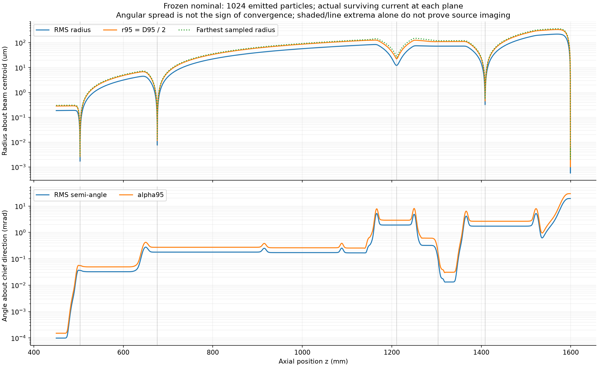
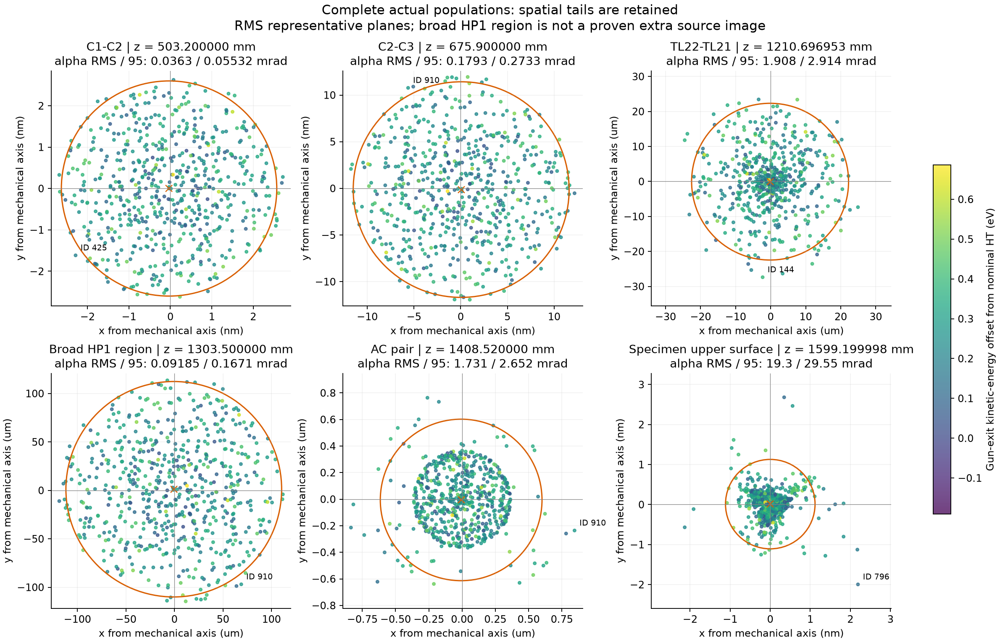
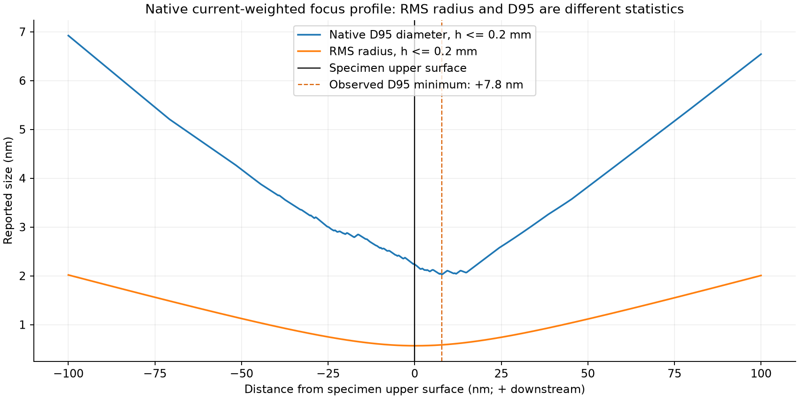

# Crossover angles, native sizes and original-particle tails

Date: 2026-10-29. This is a frozen **1024-emitted-particle classical diagnostic**, not a qualified preset. Physical controls, source law, apertures and original current weights were preserved. No coherent calculation or lens tuning was performed.

The nominal candidate remains short of its measured target: specimen **alpha95 = 29.546814 mrad** (1.51062% below 30 mrad), while the native D95 minimum sampled in the surface window is **+7.8 nm downstream**. The RMS representative is instead **+0.2 nm**. Using the RMS plane would conceal this difference. No historical 0.7 nm size cap is applied.

## Source, current and execution

- The numerical snapshot explicitly changes the previous 769-source candidate to 1024 original positive-current particles. All 1024 IDs are unique; the source law is unchanged.
- C1 aperture radius is 0.3 um at z = 445 mm. It intercepts 377/1024 particles: 36.81640625% of the 10 uA emitted current. No additional loss occurs in the captured incident column.
- All column planes and the specimen retain the same 647 particles, effective count 647, carrying **6.318359375 uA** (63.18359375% of emitted current). Actual-population and common-cohort results coincide downstream of the gun.
- Native gun plus unified column: maximum column step 0.2 mm, 5011 observed column planes, eight batches of at most 128 original particles, one numerical job and two threads. Runtime 1050.4 s; exit 0; all eight field audits passed.
- Column observations span z = 450 mm through specimen upper surface +100 nm. Maximum observation gap is 0.5 mm; C1/C2 waist windows use 0.1 mm, central corrector about 0.1 mm, AC local window 0.01 mm, specimen +/-100 nm window 0.2 nm. Observation insertion splits the actual integration mesh.
- The source-count floor is satisfied by the emitted population. The smaller surviving population is real interception, not permission to restore current or duplicate rays. This floor is not a sampling-convergence demonstration.

## Definitions

At each plane, normalize only its actual positive original-current weights for statistics; retain the source weights for transmission. The radial RMS is sqrt(sum(p*r^2)), where r is distance from the current centroid. **D95 is twice the weighted 95% radial quantile**, a diameter. It has no universal conversion to RMS radius. All tails remain in the centroid and RMS.

For angles, normalize each stored mechanical slope pair to a 3D unit direction, then compute its true angle to the current-weighted unit chief direction with cross/dot products. **alphaRMS** is the angular second-moment RMS and **alpha95** contains at least 95% of the actual plane current. D95 is a spatial quantity, never an angle. The sampled maximum is not a physical pupil-edge measurement.

These are unsigned mechanical angular spreads, including any tangential/rotation component in magnetic fields. Converging versus diverging behavior is checked separately with the position-slope covariance. A finite 2D RMS waist is not by itself a strict source-image conjugacy or driven scan pivot.

## Measured waist inventory

All sizes below are **nm**. Every row is at its executed RMS representative plane; axial digits identify stored planes, not a claim of equivalent physical accuracy. C1/C2 native minima are still limited by the 0.1 mm observation spacing.

| Region | RMS representative z, mm | alphaRMS, mrad | alpha95, mrad | RMS radius, nm | D95, nm |
| --- | ---: | ---: | ---: | ---: | ---: |
| C1-C2 | 503.200000000 | 0.036303 | 0.055321 | 1.700044 | 5.199476 |
| C2-C3 | 675.900000000 | 0.179315 | 0.273256 | 7.578366 | 23.105867 |
| Central corrector (TL22-TL21) | 1210.696953405 | 1.907840 | 2.913919 | 12214.414395 | 44795.826702 |
| Broad, shallow HP1-region waist | 1303.500000000 | 0.091854 | 0.167136 | 72666.805639 | 222349.211762 |
| AC pair | 1408.520000000 | 1.730582 | 2.651803 | 322.139665 | 1215.744903 |
| Final RMS waist | 1599.199997700 | 19.303191 | 29.546814 | 0.567497 | 2.224384 |
| Specimen upper surface (reference) | 1599.199997500 | 19.303191 | 29.546814 | 0.567522 | 2.234797 |

Native D95 minima are selected independently within each recorded waist search basin. No interpolation, smoothing or RMS-derived focus is substituted:

| Region | Sampled native D95 minimum z, mm | D95, nm | alphaRMS, mrad | alpha95, mrad |
| --- | ---: | ---: | ---: | ---: |
| C1-C2 | 503.200000000 | 5.199476 | 0.036303 | 0.055321 |
| C2-C3 | 675.900000000 | 23.105867 | 0.179315 | 0.273256 |
| Central corrector (TL22-TL21) | 1210.796833931 | 44657.150503 | 1.907840 | 2.913919 |
| Broad, shallow HP1-region waist | 1297.000000000 | 220257.107045 | 0.265139 | 0.501015 |
| AC pair | 1408.580000000 | 901.295558 | 1.730582 | 2.651803 |
| Final RMS waist | 1599.200005300 | 2.030430 | 19.303191 | 29.546814 |

A full-column cross-check finds six finite 2D RMS regions: the five upstream rows plus the final surface-adjacent region. No extra cross-region waist was missed by the ten component-interval checks. C2-C3 has one, C3-ADL has none, central corrector has one, and the AC pair has one. There is no separate upstream Mini-Objective crossover. The final 2D growth bracket spans approximately -7.2 to +8.2 nm relative to the specimen; its representative +0.2 nm is not a unique all-direction point focus.

The HP1-region observation is very broad and shallow: over 1301.5-1306.0 mm its RMS radius changes 72.675366 -> 72.666806 -> 72.673507 um. Its D95 minimum occurs at 1297.0 mm. Record this finite covariance waist, but do not count it as an independently established sharp extra source image. Full CEOS source-image conjugacies remain unqualified.

At the RMS planes, AC/central angle ratios are **0.907090 for alphaRMS** and **0.910047 for alpha95**. The independently selected D95 planes give essentially the same ratios. Equal semi-angles were not imposed and are not inferred from the manufacturer diagram.

## Specimen focus and finite-sample quantiles

At the physical surface: RMS radius 0.567522 nm, D95 2.234797 nm. The observed D95 minimum is 2.030430 nm at +7.8 nm; neighboring samples bracket it at +7.6/+8.0 nm. This is outside the declared nominal +/-1 nm placement budget, but is not yet a stable, uniquely determined physical focus.

Within the +/-100 nm scan there are 22 strict adjacent-sample local D95 minima. Four lie within a descriptive 1% band of the sampled best value:

| Offset from upper surface, nm | Native D95, nm | Excess over sampled best, % |
| ---: | ---: | ---: |
| +7.2 | 2.037990600 | 0.372354 |
| +7.8 | 2.030430205 | 0.000000 |
| +11.2 | 2.049613511 | 0.944790 |
| +12.0 | 2.042593507 | 0.599050 |

The 1% band only describes near-degenerate candidates; it is not an acceptance tolerance. With 647 equal surviving weights, the 615th radial order statistic defines D95 (95.0541% current). Around +7.6/+7.8/+8.0 nm, its boundary ID switches 728 -> 779 -> 364. This explains why native quantiles can have kinks without any particle jumping. Greater source sampling is needed before declaring the best focus stable.

## Original-particle tails and attribution

No isolated runaway is evident in this captured population. Across all 5011 column planes, the greatest centered-radius max/second-largest ratio is 1.160623; the greatest angular ratio is 1.040639. No active phase, kinetic energy or flight-time value is nonfinite, and no stopped particle reappears. These observations do not replace step-convergence testing.

| Plane | Farthest original ID | Distance from centroid | Max/second | Contribution to radial second moment |
| --- | ---: | ---: | ---: | ---: |
| Central RMS representative | 144 | 27.392450 um | 1.003997 | 0.7773% |
| AC RMS representative | 910 | 882.881531 nm | 1.002786 | 1.1609% |
| Specimen upper surface | 796 | 2.968935 nm | 1.102860 | 4.2299% |

At the specimen, the next centered radii are 2.692032, 2.516662, 2.453459 and 2.212696 nm (IDs 126, 910, 5 and 920). This is a populated tail. The beam centroid is only 0.010731 nm from the mechanical axis; the outer radius is not explained by a bulk beam offset. ID 796 carries 0.15456% of specimen current and 0.097656% of emitted current. Its 4.2299% second-moment contribution demonstrates RMS tail sensitivity without one particle dominating the result.

ID 796 has verified reconstructed launch kinetic energy 0.125885730 eV (15.46th percentile of the transmitted population), launch angle 2.092252 mrad (about the 90th percentile of emitted angles), and emission radius 2.325257 nm. It crosses the 300 nm-radius C1 aperture at radius 299.351231 nm, just inside the physical edge. Its sample chief-relative angle is 31.408035 mrad. This is an admitted edge trajectory, not an unexplained high-energy electron or a particle that bypassed an aperture.

Its centered radius/R95 is about 1.03 at C1-C2, 1.05 at C2-C3, 1.01 at the central waist, 1.45 at the AC RMS plane, and 2.66 at the specimen. The ratio first exceeds the descriptive 1.5 level in a short 1408.55-1408.58 mm AC window, then from about 24.6 nm upstream of the specimen through the captured final-focus region. All five outer specimen trajectories passed C1 at radii 286.8-299.4 nm, near the 300 nm aperture edge. This supports a continuous edge-ray aberration/focus-spread interpretation. Native local position-slope checks on IDs 144, 910 and 796 show no trajectory jump in the central, AC and specimen fine windows; this is a continuity check, not an integration-error bound. The separate contributions of corrector fields, downstream aberrations and source-energy coupling are not causally isolated by this one frozen run.

Energy naming matters: the captured `source_energy_offset_ev` is the executed gun-exit kinetic-energy offset from nominal HT. It is not inherently a stored launch energy. Launch energy was separately reconstructed with the production deterministic 1024-source sampler, with IDs, positions, directions, normals and weights all matching the saved emission arrays bit for bit; no propagation or field evaluation was repeated. Both quantities are preserved separately.

The five farthest particles before C1 (981, 956, 826, 306 and 331) are all physically intercepted there. Old source-count IDs must not be assigned this run's causal history without checking complete source arrays.

## Evidence and limits

[Compact measured evidence](crossover_audit_20261029/summary.json), [all representative-plane statistics](crossover_audit_20261029/crossover-statistics.csv), and [focus candidates](crossover_audit_20261029/focus-candidates.csv) accompany this report. Source artifacts remain local in `outputs/crossover-audit-20261029/n1024-h02/`; their SHA256 values are preserved in the compact evidence. The input digest is `273245a9cee6be6f07f150ab40e33898389e1d61b9a2246ab370fe3ca1ea4b1b`.

The 0.1 mm same-source control was prepared and passed identity checks, but was not propagated: the full-population audit found no isolated jump that required an immediate additional 20-27 minute transport run on this workstation. Column-step, gun-step and source-count convergence remain unqualified. The historical 769-source surface alpha95 29.679247 mrad / D95 2.264675 nm / D95 minimum +7.0 nm are contextual only, not a new sub-1000-particle calculation. Current 1024-source results must not be presented as count-converged.

Gun crossover topology before 450 mm is not certified: only exact C1 neighborhood/exit observations were added, while earlier stored gun curves are display interpolation. This report certifies neither coherent specimen scattering, driven scan behavior, a default preset nor CEOS source conjugacy. No lens strengths or defaults were changed by this audit.
