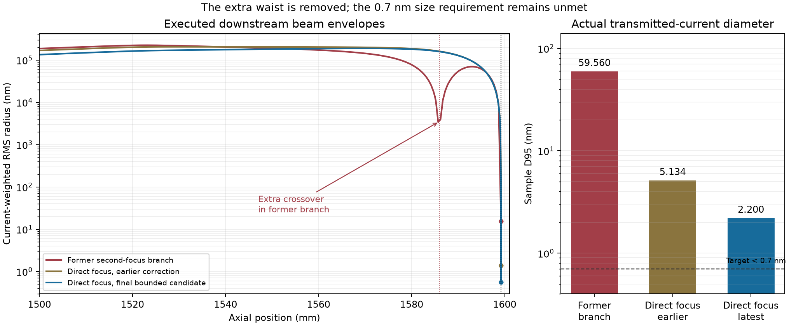

# Finite-field direct-focus and internal-corrector continuation

Date: 2026-10-28. This is a subsequent measurement record, supplementing
[the initial corrector diagnosis](CORRECTOR_REMATCH_DIAGNOSIS_2026-10-28.md).
Earlier physical observations and their original scope remain unchanged.

## Current acceptance boundary

The user confirmed the Normal entrance: a C2-C3 crossover, no additional
C3-ADL crossover, and an active weak C3 whose field combines with downstream
fields to form the next image. Internally, one resolved two-dimensional source
image is required between TL22/TL21 and one inside the AC coil pair. Public
CEOS diagrams provide relative optical relationships, not an OEM millimetre
calibration of this provisional assembly. The geometric 1208.15 mm TL midpoint
is a diagnostic target, not an already established optical symmetry plane.
See the [CEOS reference audit](CEOS_PROBE_CORRECTOR_REFERENCE_2026-10-28.md).

The latest additional hard condition is direct focusing by Mini Condenser
plus Upper Objective onto the specimen upper surface, without a distinct
additional pre-specimen crossover. The previous approximately 69-percent
Objective branch has an executed extra waist near 1585.7 mm and is no longer
an acceptable new-preset branch, regardless of its final probe diameter.

The other targets remain actual-current alpha95 = 30 mrad and spatial D95
below 0.7 nm at Z = 1599.1999975 mm. C2/C3 are the primary angle controls;
Mini Condenser/Objective compensate focus. Both 95-percent quantities use the
current physically arriving at the specimen. RMS is reported without an
additional acceptance bound, and there is no transmitted-current floor.

No measured candidate in this record satisfies the joint conditions. This
record neither installs a new default nor qualifies a scanning image.

The latest complete physical check, `first-focus-final-refined-v5`, has
D95 2.199562 nm, alpha95 29.999866 mrad and 10 microampere specimen current.
The corrected finite-region observer confirms the required condenser,
central/AC and direct-focus topology at the captured sampling. The strict
diameter bound is the remaining fixed-sampling qualification failure. This
does not waive the independent numerical/source-count and driven-scan checks.

## Complete source and numerical scope

Every physical case uses the same validated complete 193-particle gun output,
original IDs, absolute weights, energies, clocks and emission ancestry. Each
original weight is retained; particles are lost only through physical stops.
The source current is 10 microampere. The records keep all 193 columns even
when fewer particles reach the specimen. All new column runs use a 0.05 mm
maximum integration step, static scan controls and classical particles.
There are no new gun executions or coherent calculations in these cases.

The production implementation remained fixed:

- Solver: `f34f2ff6f73532f29faa3652fd88dd902625bd248d2196e5d94c3f0b08c5cd21`.
- Source: `4e3bac1af215cfe7b8589e64363541ba2039654fb01be49e8a5abee3017c0815`.
- Gun archive SHA256: `0d62afe83714e7e3745354ffccdcfa15b923dad0ed6a282a92c4d43f8fe04bcb`.

Source-count convergence and driven scan response are not established for
these new settings. Refined internal waist observations and a separate
half-step experiment are described with their specific candidate below;
they must not be generalized to other search candidates.

## Four actual auxiliary-hexapole differences

These independent trials started from the previously measured 59.559740 nm
candidate on the old extra-waist branch. They held C2/C3, primary HP1/HP2,
Mini Condenser, Objective, all other controls and geometry fixed. Each retains
the same 174 specimen arrivals, 9.015544 microampere, with 19 C2 Aperture losses.
They are useful measured correction directions; they do not qualify the newly
required direct-focus branch.

At an initially zero auxiliary hexapole, an orientation-only change has no
field effect. A positive amplitude at orientation 0 supplies its normal
coefficient; orientation pi/6 supplies its skew coefficient because the
component uses cos(3 theta) and sin(3 theta).

| Executed case | Added coefficient, m^-3 | alpha95, mrad | D95, nm | RMS radius, nm |
| --- | ---: | ---: | ---: | ---: |
| Baseline | 0 | 29.327973 | 59.559740 | 15.374536 |
| HPC normal | 100,000 | 29.333388 | 61.249438 | 15.781007 |
| HPC skew | 100,000 | 29.329058 | 61.315516 | 15.546389 |
| HPol normal | 5,000 | 29.330918 | 57.467152 | 15.685404 |
| HPol skew | 5,000 | 29.329936 | 62.799515 | 15.514393 |

An offline fit of these four actual differences predicted D95 55.294958 nm
within three times the measured increments. It was not physically executed
after the direct-focus requirement was confirmed. Its radial focus prediction
was near zero, but directional estimates remained approximately +80.5 and
-81.9 nm. It was not a common two-dimensional focus or a passing probe.

For the normal perturbations, a weighted empirical angular-polynomial
diagnostic removed terms through total degree three. The remaining part of
the HPC-induced sample displacement was 0.918671 nm RMS out of 1.034538 nm
total, whereas HPol left 0.023469 nm out of 2.241585 nm. This identifies HPC
as a potentially useful additional response direction at this point. These
are polynomial projections, not calibrated physical D4/C5 coefficients or
proof of independent cancellation in another working point.

Raw cases: `hpc-normal-v1`, `hpc-skew-v1`, `hpol-normal-v1`, `hpol-skew-v1`.
Preparation and prediction evidence: `auxiliary-basis-v1/basis-plan.json`,
`auxiliary-proposal-v1/proposal.json`, and
`normal-basis-shape-diagnostic-v1.json` under the output directory below.

## Actual downstream branch and refocus trials

A bounded linear Gaussian Larmor model proposed a first-focus branch with
Mini Condenser magnitude 33.140718348974744 percent and Objective
28.521789409746518 percent. It retained the preceding approximate angular
magnification, rather than fitting the 30 mrad target with these two controls.
C2/C3 were held at 23.225625142668733 and 9.207984804305022 percent.
The subsequent full-source executions, not that linear model, provide the
following measured results.

| Actual case | Objective, percent | alpha95, mrad | D95, nm | RMS radius, nm | Local radial focus estimate, nm |
| --- | ---: | ---: | ---: | ---: | ---: |
| First-focus branch, strong HP pair | 28.521789410 | 29.328998 | 151.869695 | 33.696657 | +1560.224 |
| Same branch, old Normal HP pair | 28.521789410 | 29.520878 | 721.818932 | 159.427072 | -7928.895 |
| Strong pair, actual Objective-only refocus | 28.524468707 | 29.330374 | 70.427564 | 18.651953 | -0.398368 |

All three retain the same 174 specimen IDs and physical current. The strong
pair is HP2 = 4525230.211531843 m^-3, HP1 = 2726069.910154215 m^-3,
with HP1 orientation -0.041924407392726584 rad. The old pair uses
423294.84130355046 and 253195.31789553943 m^-3, with HP1 orientation
-0.04199279823147041 rad. Thus the strong/old pair is not one infinitesimal
common-amplitude derivative: its ratio and orientation also differ.

The Objective-only refocus changes that one control by +0.002679296842537
percentage point. The actual D95 70.427564 nm is close to the earlier
saved-ray scalar-drift prediction of 70.413748 nm. The prediction itself is
not a corrected physical beam.

The extra 1585.7 mm waist is absent in the measured first-focus records at
the declared sampling. This does not establish final focus exactly on the
specimen. In particular, the refocused case has sample principal-axis
covariance-drift estimates of -115.741 and +113.159 nm. Its radial estimate
near zero therefore conceals a directional difference. An unresolved radial
candidate only 0.398 nm before the surface is a local endpoint diagnostic,
not a separately established extra crossover and not a two-sided 2D waist.

The old-HP first-focus case instead has a near-surface waist bracket and
approximately 7.93 micrometres of upstream focus error. Neither changing the
branch nor restoring the old HP values alone solves the probe.

## Actual central-matching proposal and its limitations

The executed `central-matched-v3` name identifies its proposal, not a claim
that the physical central image was successfully matched. Its linear model
targeted the central 1208.15 mm and AC 1400 mm references, HP relay conditions
and angular transport. The actual result is:

| Quantity | First-focus refocused reference | Central-matching trial |
| --- | ---: | ---: |
| Actual specimen arrivals | 174 | 191 |
| Actual specimen current, microampere | 9.015544 | 9.896373 |
| Transmission from original source, percent | 90.155440 | 98.963731 |
| alpha95, mrad | 29.330374 | 38.975519 |
| D95, nm | 70.427564 | 327.685931 |
| RMS radius, nm | 18.651953 | 62.797896 |
| Local radial focus estimate, nm | -0.398368 | -2405.899619 |

The central trial physically loses only original IDs 56 and 176 at C2
Aperture. The extra transmitted particles remain in all statistics. The
proposal's angular approximation incorrectly combined an old 174-arrival
alpha95 calibration with an all-193 linear RMS scaling after changing C2.
That surrogate did not predict the changed physical population and angular
quantile. This is a limitation of the proposal, not evidence of a production
current-normalization or source-pruning error. A revised proposal must model
aperture losses and the actual angular quantile before its production retrace.

The main changed controls, relative to the refocused reference, are:

| Control | Refocused reference | Central trial |
| --- | ---: | ---: |
| C2, percent | 23.2256251427 | 20.3914110236 |
| TL22, percent | 59.9315250358 | 55.5457747387 |
| TL21, percent | 59.9552790684 | 60.7303577035 |
| TL12, percent | 36.0045587087 | 48.4595993318 |
| Objective, percent | 28.5244687066 | 28.5217894097 |
| HP1, m^-3 | 2726069.910154 | 4078427.864751 |
| HP1 orientation, rad | -0.0419244074 | +0.0172653700 |

C3, ADL, Mini Condenser, HP2 and the auxiliary fields remain unchanged in
this comparison. Geometry and original source weights are unchanged.

## Internal and final waist audit

Both new cases pass the selected condenser Normal check at the declared
sampling. Their central and AC regions remain unresolved: each contains one
radial interpolated candidate but zero brackets accepted by the strict
two-dimensional waist test. Zero accepted brackets must not be interpreted
as proof that the optical image is absent.

| Region diagnostic | Refocused first-focus case | Central trial |
| --- | ---: | ---: |
| Central radial candidate Z, mm | 1201.724210 | 1207.632785 |
| AC radial candidate Z, mm | 1400.545438 | 1400.454293 |
| Resolved central 2D waist count | 0, unresolved | 0, unresolved |
| Resolved AC 2D waist count | 0, unresolved | 0, unresolved |

The central candidate moves toward the geometric midpoint, but neither the
candidate position nor its interpolated radius is an independently executed
exact waist. Central stored gaps are at most approximately 0.5 mm and AC gaps
0.1 mm; finer observations and directional convergence remain necessary.

The central trial has no detected old 1585.7 mm waist, but its final focus
is upstream of the specimen. The broad executed final-focus bracket spans
1598.700127993 to 1599.199897500 mm, with its smallest stored checkpoint at
1599.199797500 mm. The radial interpolation is near 1599.197591600 mm,
approximately 2.406 micrometres before the sample. The stored minimum must
not be reported as the exact waist location. Sample principal-axis drift
estimates are -2224.164 and -2570.948 nm. The direct-focus requirement is
therefore not qualified by this case either.

All additional brackets and unresolved candidates are retained in
`direct-focus-waist-audit-v3.json`; neither a total-count comparison nor a
near-zero radial average substitutes for both principal directions and
resolved internal source images.

## Higher-order shape evidence

Using each case's actual transverse sample slopes, a weighted polynomial fit through
total degree three leaves 14.553035 nm RMS in the refocused first-focus
beam and 4.479190 nm in the central trial. The populations are 174 and 191,
respectively. A separate diagnostic on the identical original 174 IDs leaves
1.592601 nm for the central trial. This conditional comparison does not alter
its physical 191-particle current or replace its actual sample statistics.

The change supports testing the internal matching direction further, but
several round-lens and HP parameters, the angle distribution and transmission
all changed. It does not isolate the central plane as the unique cause, nor
identify a calibrated physical aberration coefficient. Even a hypothetical
best scalar refocus of the full central-trial beam leaves D95 143.726734 nm
and RMS radius 35.981216 nm. Those are saved-array diagnostics, not additional
executed optical results.

## Aperture-aware angle matching and first nonlinear correction

The revised `central-angle-matched-v5` proposal uses the actual original
193-particle phase space and positive weights to predict the angular quantile,
including both faces of the C2/C3 aperture plates and the housing radius.
It reproduces the known 174- and 191-arrival ID sets in the two preceding
reference cases. This is a proposal model; the following values come from
subsequent complete production executions with material interception.

| Actual case | Arrivals | Transmission | alpha95, mrad | D95, nm | RMS radius, nm | Local radial focus, nm |
| --- | ---: | ---: | ---: | ---: | ---: | ---: |
| Aperture-aware angle match, v5 | 193 | 100% | 29.919607 | 140.003926 | 27.126048 | -1374.463 |
| First-focus HP optimization, v1 | 193 | 100% | 29.988918 | 7.103512 | 1.643926 | +0.068577 |

Both carry the original 10 microampere to the specimen, with no artificial
population selection or weight change. These source-count-specific results
do not establish source-sampling convergence or the full continuous aperture
transmission. Neither case passes the requested D95 below 0.7 nm.

The v5 controls are C2 = 17.87722154949 percent, C3 =
9.207984804305022 percent, ADL = 10 percent, TL22 = 55.59880587885
percent, TL21 = 60.72246019635 percent, and TL12 = 48.47723302285
percent. The exact input JSON is authoritative for additional digits and
unchanged settings. Mini Condenser remains at magnitude
33.140718348974744 percent and the first-focus Objective starts at
28.521789409746518 percent. Thus the aperture-aware angle change uses C2
while retaining the weak active C3 and first downstream focus branch.

The subsequent four-variable search holds C2/C3, the transfer lenses and
Mini Condenser fixed. It adjusts the common primary HP amplitude, the HP1
relative amplitude and orientation, and Objective focus. Its best balanced
candidate changes common HP amplitude by +19.5140431036 percent, the HP1
relative multiplier by -0.0253198784 percent, HP1 orientation by
+0.000172210269453 rad, and Objective by +0.000188012540548 percentage
point relative to v5. These are correction/focus controls; the small resulting
angle change is measured physical coupling, not a substitute angle-control
assignment. The candidate input SHA256 is
`e2e77c178dea7646f4ac31543bdddf9d324cedc780681ddc10cc18ec2c24342c`.

The search performs 32 bounded numerical forward evaluations in about
304 seconds on one CPU thread. Its static diagnostic retains the original
finite electric and magnetic fields, original 193 phases, energies, clocks
and weights, with strict field-domain guards. It omits material contacts
and therefore cannot qualify a physical beam. For both the v5 baseline and
the selected candidate, comparison with the independent complete production
propagation gives exactly the same captured positions and slopes for all
193 arrivals. The independent saved-array source, current and statistic
audit also passes for the production candidate.

The production case is `first-focus-hp-optimized-v1`. The near-zero radial
focus is encouraging but is not a common two-dimensional focus qualification.
Its local all-direction covariance focus extrema are -7.667441 and
+7.834873 nm; these must be considered alongside the radial average.
Internal central/AC waists, principal-direction focus, field expansion order,
step size, source count and driven scan response still need verification.
The search's 500 nm endpoint exclusion for preliminary branch screening is
explicitly a search tolerance, not an accepted specimen-focus error. It must
not hide a distinct upstream focus or be carried into final acceptance.

A same-input, same-node, complete-193 diagnostic comparing radial field
expansion orders three and five changes D95 from 7.103512 to 7.122428 nm.
The sample per-particle position difference has weighted RMS 0.019976 nm;
the radial focus changes by approximately -0.807 nm. Finite electric fields
are retained in both runs, and the order-three result reproduces the
production trajectory arrays exactly. This is an independent alternate-field
diagnostic, not a production model replacement or a new physical interception
qualification. The effect is not the main source of the present beam width,
but remains relevant to a future sub-nanometre error budget. See the
[field audit](CORRECTOR_FIELD_IMPLEMENTATION_AUDIT_2026-10-28.md).

The executed stage-one beam also has an empirical angle-polynomial remainder
of 1.491085 nm RMS after terms through degree three, 1.234863 nm after degree
four, and 0.099708 nm after degree five. These are saved-array projections,
not physical calibrated aberration coefficients, corrected probes, or proof
that an available actuator can cancel every projected term. They motivate
testing the TL12/Mini Condenser/Objective combination in addition to the HP
pair and auxiliary fields.

The bounded ten-variable second diagnostic stage adds HPC/HPol normal/skew
components and the native normal/skew condenser stigmator, with C2/C3 and
geometry fixed. Its 60 numerical evaluations take approximately 566 seconds.
The selected diagnostic candidate has D95 4.957659 nm, RMS 1.610893 nm and
alpha95 29.984145 mrad, but a radial focus offset of -23.058383 nm and
directional estimates approximately -24.462/-21.570 nm. It was not run as
a complete production candidate and is not a passing improvement in joint
focus and size. The next stage therefore starts from the already production-
verified stage-one candidate, uses a smooth weighted-position/focus objective,
and adds bounded TL12/Mini Condenser coupling. D95 remains an independently
recorded physical acceptance observable rather than a differentiable rank
surrogate.

The separate [crossover refinement report](CORRECTOR_CROSSOVER_REFINEMENT_2026-10-28.md)
compares the internal directional split with the finite waist depth and the
old Normal model. Stage-one central and AC split/depth ratios, approximately
0.133 and 0.094, are similar to the old reference's 0.114 and 0.093. A nonzero
directional split is not automatically two distinct crossovers or a reason to
require exact mathematical co-location for every finite-source direction.
Dense executed covariance observations are still required to distinguish one
finite two-dimensional waist region from separated line foci or extra images.

## Completed coupled-field production check with denser observations

The third diagnostic stage adds Mini Condenser and TL12 to the ten correction
controls, while keeping C2/C3 fixed. It completes 90 actual numerical forward
evaluations in 837.66 seconds. Its selected input has SHA256
`09fa92864515586bb7489a7a1bff7bf9987cdeb7f8851a49eaf59c499dc70eb4`.
HP1's relative-amplitude change reaches approximately -0.5 percent, the local
search bound; a plateau here is not proof that all allowed fields are exhausted.

That selected input is subsequently executed through the complete production
path as `first-focus-coupled-refined-v3`, with all physical interception,
original source data and weights retained. The observation request contains
6217 planes; the production checkpoint archive includes 6335 planes after
additional native checkpoints. This is still a 0.05 mm maximum-step run,
not a half-step convergence test. Execution and publication take 252.28 seconds.

| Actual measured quantity | Result |
| --- | ---: |
| Specimen arrivals | 193 of 193 |
| Specimen current | 10 microampere |
| alpha95 | 29.988771330 mrad |
| D95 | 5.133827962 nm |
| RMS radius | 1.392492365 nm |
| Local radial focus relative to surface | -3.572011 nm |

The independent saved-array source/current/statistics audit passes. The denser
capture differs from the earlier diagnostic sample D95 by only approximately
0.000000261 nm. It resolves a radial focus candidate between 5 and 2 nm
before the surface, outside the declared 1 nm final-focus tolerance. The old
extra waist near 1585.9 mm remains absent. This candidate still fails both
the requested spot-size bound and the final-focus criterion and is not
installed as a default.

The fourth bounded diagnostic stage therefore releases C2 as the primary
30 mrad matching control, adds TL22/TL21 core transfer changes, and expands
the local HP1/HPol ranges. Its source reference remains the real complete
stage-one source; its optimization start is explicitly the stage-three
zero-current diagnostic, not a second claimed production result. All original
193 columns remain in its objective. Aperture face clearances are diagnostic
only, and changing C2 requires new actual transmitted-current statistics.

The first local response matrix has a scaled condition number around
2.25 million. Large individual focus changes can nearly cancel along a much
weaker aberration-correction direction. A small-step optimizer may therefore
advance slowly without establishing a physical lower bound. Bounded linear
predictions along that direction remain proposals until actual forward
propagation and physical lens refocusing have been executed.

## Subsequent bounded diagnostic continuation

These cases use the same original 193 phases, absolute source weights and
frozen production implementation. They remain zero-current numerical
proposals without material contacts, not new actual-current qualifications.

| Diagnostic stage | Forward evaluations | D95, nm | RMS, nm | alpha95, mrad | Radial focus, nm |
| --- | ---: | ---: | ---: | ---: | ---: |
| Fifteen controls, including C2/core transfer | 89 | 4.125295 | 1.183934 | 29.999287 | -1.777245 |
| Bounded response direction, fraction 0.15, physically refocused | Part of 16 | 4.346457 | 1.289374 | 29.974950 | -0.013760 |
| Same direction, fraction 0.35, physically refocused | Part of 16 | 8.874791 | 2.264756 | 29.909018 | approximately 0 |
| Same direction, fraction 0.65, physically refocused | Part of 15 | 24.99319 | 6.039487 | 29.711127 | approximately 0 |
| Same direction, fraction 1.0, physically refocused | Part of 15 | 54.337471 | 11.931221 | 29.335854 | approximately 0 |
| Fraction 1.0, subsequent five-control HP/focus/angle rematching | 36 | 2.815562 | 0.857649 | 29.999690 | +0.009494 |

The two fraction experiments perform actual forward propagation after each
Objective correction. They do not replace those runs with a saved-ray drift.
The bounded direction is derived from a previously measured response matrix;
its full linear residual prediction of approximately 0.215 nm is not an
achieved probe or a physical lower bound.

Larger fractions create a substantial new low-order mismatch. Empirical
angle-polynomial remainders after degree three nevertheless decrease from
1.250039 nm at the starting point to 0.933739, 0.743798 and 0.581607 nm
at fractions 0.35, 0.65 and 1.0. This motivates re-matching rather than
rejecting the direction solely because the uncorrected total size grows.
It does not prove that the remaining terms are independently correctable.

The five-control rematching holds all structural changes fixed and varies
primary HP common amplitude, HP1 relative amplitude/orientation, Objective
focus and C2 angle matching. It converges after 36 real forward evaluations
in about 373 seconds. The frozen input SHA256 is
`eefc787618bd33ea52612d48718d5eb3a90f7504277ad797e0b73816b77d5258`.
Its initial complete phase and flight-time arrays reproduce the previous
fraction-one diagnostic exactly. No source column is removed.

For that result, empirical remainders after degrees one through five are
0.85431, 0.83262, 0.76787, 0.48671 and 0.07114 nm RMS. The incremental
fourth-degree projection is approximately 0.59391 nm RMS. The next bounded
stage therefore adds HPC/HPol normal/skew components and the native two
stigmator channels while keeping the structural fields fixed. Its result
still requires physical propagation, topology, numerical/source convergence
and driven-scan checks before any preset installation.

The measured weak direction does **not** enlarge the beam inside the HPs:
the original-weight RMS radii at the same saved planes bracketing their
centres decrease along the structural continuation. Their exact centres were
not captured and interpolated values are not presented as observations.
The primary HP strengths also decrease. Thus this evidence must not be
described as a demonstrated larger-beam-height mechanism for A5 suppression;
multiple coupled field and phase changes contribute. See the independent
field audit and `hp-heights-degree5-with-hp-rematch-v1.json` for the actual
planes, coefficients, source identities and fitting limitations.

The subsequent eleven-control auxiliary rematch completes 86 real forward
evaluations in 901.36 seconds. Its selected diagnostic has D95 2.435050 nm,
RMS radius 0.635423 nm, alpha95 29.999821 mrad and radial focus offset
-0.000582 nm. Its input SHA256 is
`61fefa2b5eed3fc395b18bd162bf36f15c67f4f4abea733f4f33739bd1eed34f`.
Although the focus and angle residuals are small, the diameter still fails
the strict 0.7 nm limit. Its complete material-contact execution is reported
below; no default installation is claimed. A smaller diameter found during
iteration, 2.13472 nm, has a -13.25 nm focus error and is not a passing result.

A further, explicitly bounded structural continuation tests fractions 1.5
and 2.0 of the same measured response direction. Objective corrections are
again propagated physically. Their empirical degree-three remainders decrease
to 0.418574 and 0.304251 nm RMS, respectively, but the corresponding actual
diagnostic diameters are 97.62635 and 137.03937 nm before low-order rematching.
The fraction-two alpha95 is 27.629217 mrad. These residual projections are
therefore evidence for a search direction only, not evidence of a small probe.
The five-control HP/focus/C2 rematch of fraction two is recorded separately in
`fast-hp-rematch-fraction2-v3`; no further structural extrapolation is assumed
to be qualified.

## Complete physical check of the auxiliary-corrected direct-focus candidate

`first-focus-auxiliary-refined-v4` executes the fraction-one auxiliary candidate
through the full production incident column with physical interception. It
retains the frozen implementation, original 193 source identities, phases,
energies, clocks and absolute weights. The maximum integration step is 0.05 mm;
the dense observation request is the same as the earlier 6335-plane check.
Execution and publication complete in approximately 253 seconds.

| Actual measured quantity | Result |
| --- | ---: |
| Specimen arrivals | 193 of 193 |
| Specimen current | 10 microampere |
| Transmission relative to emitted and gun-exit current | 100 percent |
| alpha95 | 29.999821400 mrad |
| D95 | 2.435050060 nm |
| RMS radius | 0.635423179 nm |
| Local radial focus relative to surface | -0.000586 nm |

The independent source/current/statistics audit passes, including exact
physical stop-to-survival consistency at every stored plane. The diameter
differs from the fast diagnostic by about 0.000000230 nm. These are finite
sampling results, not a claim of sub-picometre physical focus accuracy. The
diameter remains above the requested 0.7 nm bound; additional source-count,
integration-step and driven-scan qualification remains outstanding. The
record is not a default preset or an accepted scanning-image illumination.

A saved-array replay through the reviewed finite-region consumers retains
the original production identity and uses the original 0.5 mm maximum
observation spacing declaration. Condenser topology and central/AC corrector
evidence both pass, as does the required whole-chain topology. The sample
focus and angle pass their separate gates. The only fixed-sampling
qualification failure is the strict diameter limit. In particular, the
additional old downstream waist is absent. This is new analysis of frozen
physical observations, not execution relabeled under the newer observer code.

The same frozen controls are subsequently executed at a 0.025 mm maximum
integration step as `first-focus-auxiliary-half-step-v1`. The complete physical
run and publication take approximately 348 seconds; independent source and
stop-mask checks pass again.

| Observable | 0.05 mm step | 0.025 mm step |
| --- | ---: | ---: |
| D95, nm | 2.435050060 | 2.435016064 |
| RMS radius, nm | 0.635423179 | 0.635422896 |
| alpha95, mrad | 29.999821400 | 29.999821410 |
| Local radial focus, nm | -0.000586 | -0.001021 |
| Arrivals / specimen current | 193 / 10 microampere | 193 / 10 microampere |

The diameter changes by -0.000033996 nm, about -0.00140 percent. Both captures
pass condenser, central/AC, direct-focus and required-chain finite-region
reanalysis; both still fail only the diameter gate at fixed source sampling.
This step comparison does not establish source-count convergence, remove the
size failure, or quantify all finite-field representation errors.

The compact [diagnostic control and measurement record](finite_field_direct_focus_20261028.json)
preserves the executed controls, original input/observation hashes, source
identity and both physical statistics for review. It explicitly declares
`NOT_QUALIFIED_D95_LIMIT_FAILED` and is not a loadable State or a default.

The bounded CUDA execution probe also succeeds on the workstation's NVIDIA
GeForce GTX 1060 3GB with CuPy 14.2.0: device allocation and a 2x2 complex128
FFT are actually executed. Approximately 2.4 GiB was free at probe time;
this is not a scan memory guarantee. No coherent propagation or scanning
image is run. The present optical size failure remains the immediate
qualification barrier.

## Final bounded candidate and software integration

The last structural-fraction-two auxiliary rematch executes 89 forwards in
955.30 seconds; its last forward starts before the declared 950-second
admission budget. Candidate selection independently minimizes actual D95
among recorded points satisfying the angle, focus and preliminary topology
checks. It does not simply select the smallest smooth RMS objective. The
selected evaluation 85 retains all 193 original particles and has input SHA256
`d296a6405a752a81f82b60217e21090c84a37d4767ca322f39297bb8d399b040`.

The complete production case `first-focus-final-refined-v5` subsequently
executes that exact candidate, with material contacts and dense observations,
in approximately 246 seconds at the 0.05 mm maximum integration step.
Independent original-source, weight, energy, flight-time and stop-mask
validation passes. No physical losses occur: all 193 original particles
reach the specimen and carry the declared 10 microampere.

| Final actual observable | Result |
| --- | ---: |
| D95 | 2.199562064 nm |
| RMS radius | 0.561657923 nm |
| alpha95 | 29.999865624 mrad |
| Local radial focus offset | +0.000517 nm |
| Covariance focus offset | +0.000517 nm |

The reviewed saved-array observer confirms all required condenser, central,
AC and direct-focus regions; the independent focus, angle and support gates
also pass at the captured sampling. Only the strict D95 bound fails. The
earlier half-step check belongs to the 2.435 nm candidate, not this final
working point. No additional half-step, larger-source or driven-scan claim is
made for the final candidate. HP1 orientation and the HPol normal coefficient
approach their local search bounds; this bounded result is not proof of a
global physical size limit or of exhausting every permitted field control.

After all propagation stops, the three reviewed observation/qualification
patches are applied to the actual project in order. Exact base and final
hash guards pass for all 12 target files. The new finite-region consumers,
direct-focus gate and strict diameter gate are therefore integrated code,
not merely unapplied proposals. The earlier GUI background-calibration/P2
repairs are preserved. Five newly added test files are registered in the
existing CI scopes, and the exact scope-list test includes the previously
omitted existing pupil/source/crossover files without weakening its equality
assertion.

The final integrated source identity, including the CI registration change,
is `1c8a91c1cf5007de6035becd106149300cbd97114ced39fcb6d4e306645644c3`.
Historical physics uses `f34f2ff6...`; isolated observer reanalysis uses
`7dbc9aab...`. These identities remain separate. No old source archive is
relabeled or admitted as a newly executed result under the changed code.
No new default parameters or scanning image are installed by this change.

Final targeted validation in the actual project passes 526 distinct cases:
189 optics/waist/size checks, 199 CI-scope checks, 13 production/joint entry
checks and 125 scan/background/held-calibration checks. There are no remaining
failures or skips. The initial scope-list mismatch is corrected and its full
199-case suite rerun; the already passing 189 optics cases are not counted
twice. The scan suite includes bounded real finite-coil response checks as
well as controlled asynchronous GUI cases. This is not a new driven-scan
qualification of the 30 mrad candidate or a complete repository/remote-CI
result. Local JUnit receipts and their combined node-level result summary
remain under the output directory.

## Audit artifacts and remaining work

Raw input files, complete observations and production section archives are in
`outputs/finite-field-corrector-rematch-20261028/`, specifically the case
directories named above. Independent NumPy statistics/source audits passed
for `first-focus-refocused-v2` and `central-matched-v3`, checking all original
IDs and weights, launch coordinates and clocks, energy offsets, and exact
stop-to-survival consistency at every stored plane. Their
`independent-statistics-v1.json` files contain file hashes and comparisons.

The continuation also records:

- `direct-focus-waist-audit-v3.json`: complete downstream brackets and
  principal-axis estimates, including the rejected old branch for comparison.
- `central-first-focus-shape-comparison-v1.json`: actual-population and
  conditional same-ID empirical shape diagnostics, with observation hashes.
- `first-focus-refocus-proposal-v2/proposal.json`: source-checked preparation
  of the subsequent executed Objective-only adjustment.
- `measure_probe_fields_v2.py`: an optional `--no-column-prefix` execution
  path. It retains complete section/gun/source validation, but deliberately
  passes no previous column segment and verifies execution from the gun exit.
  This avoids an expensive unsuccessful prefix search; it changes no field
  model or production source. Its default retains the previous prefix policy.

Next candidate selection must preserve the direct-focus branch, correct the
actual aperture-aware angle prediction through C2/C3, and simultaneously
measure the central/AC image conditions and nonlinear correction. Any
candidate then needs actual full-source execution, refined 2D waist and
sample-focus checks, numerical/source-count convergence and driven scanning
validation before installation.
