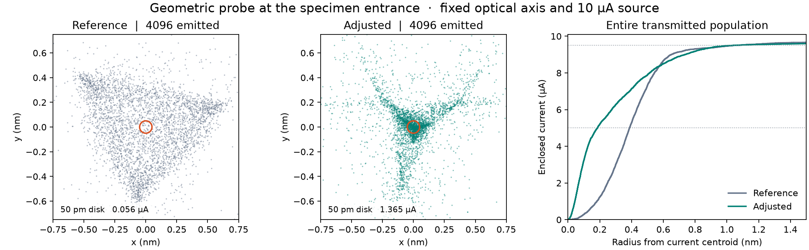
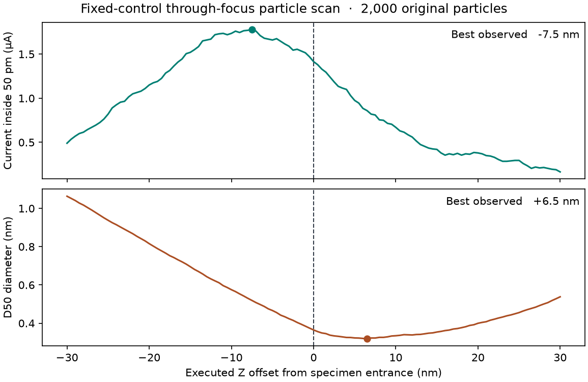

# Probe corrector calibration with unified-field particles

## Operating point and outcome

The instrument and specification both start at revision
`23768e90433330f52f0802bf4f8930ba7c9fa5bf`. The frozen original-source
Normal Nanoprobe working point uses 300 kV, a 100 µm C2 opening and 10 µA
emitted current. The entrance and imaging target coincide at 1599.1999975 mm.
The center is 1599.2 mm and the bottom is 1599.2000025 mm. Positive Z is
downstream. All target measurements precede material interaction.

The adjusted working point concentrates much more current in the central
100 pm diameter without losing transmitted current. At 4096 original
particles its D50 is 0.371 nm. Its D95 is 2.084 nm, close to the reference
2.095 nm. A separate current peak, median-diameter minimum and D95 minimum
persist in the through-focus scan. The joint brightest/smallest focus gate
fails. Atomic-resolution imaging remains unqualified.

| Fixed specimen entrance, 4096 original particles | B0 | Adjusted |
| --- | ---: | ---: |
| Current in a 50 pm radius about the commanded axis (µA) | 0.05615 | 1.36475 |
| Current fraction inside the disk | 0.562% | 13.647% |
| D50 about the weighted centroid (nm) | 0.77340 | 0.37109 |
| D95 (nm) | 2.09522 | 2.08433 |
| RMS radius (nm) | 1.74722 | 2.01061 |
| Through current (µA) | 10.000 | 10.000 |



The left and middle panels crop the view to the same square. The curve at
right uses all original surviving weights, including the tails. Points are
particles. The more concentrated core coexists with threefold structure
and a larger RMS radius.

## Controls and signed spherical response

The selected candidate is `Copt-balanced`. Both main HP strengths were
scaled by 0.9948629798007628. HP1 received a further factor of
0.999729047666775 and an orientation change of −0.0000240226981945 rad.
The physical objective changed by −0.0000917430018287 percentage points.
The condenser, auxiliary multipoles and source remain at B0 for this candidate.
Separate trials of the auxiliaries and of zero source energy width have their
own receipts. The original physical inputs and historical profiles are preserved.

The H0 experiment zeros only the drives of HP1 and HP2. H1 restores both
without refocusing. The archived field inventory identifies exactly these two
changed components. The common original cohort contains 2000/2000 source
IDs and carries 100% of the 10 µA emitted current at the target in both
branches. At fixed physical controls H0 gives D95 393.96 nm at alpha95
29.80 mrad. H1 gives 2.0900 nm at 30.0001 mrad.

A separate zero-current pencil at 300 keV launches from the executed gun exit
at 450 mm. The primary launch radius is 0.55 µm. Its fixed axial virtual point
has mechanical slope `t = 0.531522971740788 m^-1 * r`. This picks a reference
close to the incident beam's fitted radial slope. It retains the source law
and all emitted charges in the separate finite-source calculation. The
complete electric and magnetic fields and physical stops act on the pencil.
Eight rings with 24 azimuths train a full two-component polynomial through
degree five. Eight interleaved rings with rotated azimuths test predictions.
The fit retains the chief ray and linear term. The reported geometric Cs is
the azimuthal mean radial cubic coefficient in the local outgoing mechanical
slope chart. Positive sign corresponds to peripheral rays crossing the axis
early in a positive-Cs round lens. An exact free drift only adds a linear
term in this chart. The fitted coefficients are diagnostic outputs.

| Sample-plane geometric Cs at 0.55 µm launch radius | Cs (mm) |
| --- | ---: |
| H0, main HP fields off | +6.482741 |
| H1/B0, main HP fields on | −0.229618 |
| Effective H1 minus H0 | **−6.712359** |
| Adjusted physical working point | −0.159181 |

Halving the maximum step from 0.05 to 0.025 mm changes each of these
fixed-radius specimen coefficients by less than 0.000001 mm. At the
adjusted state, reducing the launch radius to 0.1375 µm gives −0.163414 mm.
The radius dependence is larger than the step dependence. The negative
increment describes the paired corrector acting through the coupled column.
The net specimen residual also includes C5 and asymmetric terms. This is
geometric point-source metrology and does not extend a static-magnetic
canonical wavefront fitter to arbitrary electric fields.

## Focus and numerical checks

The task-specific primary concentration statistic is absolute current inside a
50 pm radius about the fixed commanded axis. D50 and D95 use the weighted
centroid at each plane and the native inverse weighted CDF. Report RMS as a
radius. Measure alpha95 about the weighted chief direction. The 50 pm disk
corresponds to a 100 pm diameter for this atomic-imaging study. It defines a
finite-area mean current density, with no adjustable smoothing width. The
comparison keeps alpha95 within 30 ± 0.3 mrad and preserves transmission.

The independently declared focus allowances require at least 95% of the
largest sampled disk current and a D50 within 5% of the smallest sampled D50
at the target. The adjusted 2000-particle scan uses 0.5 nm observations across
±100 nm. Its largest disk current, 1.780 µA, occurs 7.5 nm upstream. Its
smallest D50, 0.31892 nm, occurs 6.5 nm downstream. At the specimen the
ratios are 79.49% for central current and 114.34% for D50. The D95 minimum
occurs at the specimen and the RMS minimum occurs 25.5 nm upstream. A D95
placement pass alone would have approved a different performance criterion.



| Adjusted working point | Original / surviving | D50 (nm) | D90 (nm) | D95 (nm) | Central current (µA) | alpha95 (mrad) |
| --- | --- | ---: | ---: | ---: | ---: | ---: |
| 0.05 mm maximum step | 2000 / 2000 | 0.36464 | 1.44910 | 1.99195 | 1.41500 | 29.99572 |
| 0.025 mm step, same source | 2000 / 2000 | 0.36463 | 1.44909 | 1.99199 | 1.41500 | 29.99572 |
| 0.05 mm step, refined source | 4096 / 4096 | 0.37109 | 1.47094 | 2.08433 | 1.36475 | 30.17004 |

Equal original weights make the effective sample size the surviving count.
The refined count changes D95 by 4.64%, close to the study's 5% allowance.
The between-setting difference in D95 at 4096 is smaller than that numerical
sensitivity. The large central-current and D50 improvements remain at both
counts. The M0 zero-emission-width control, with all B0 magnet drives fixed,
moves alpha95 to 28.79 mrad and D95 to 1.61 nm. This separate source-law trial
does not meet the declared angle range. These observations do not isolate Cs
as the sole cause of the tail or the axial separation.

## Lens crossover measurements

The full-column survey propagates actual particles to 2874.15 mm in vacuum.
Uniform observations are at most 0.5 mm apart, supplemented with exact
component boundaries and target planes. The table records the bracket and
representative of each bounded 2D waist, its local angle chart and the
current fraction. A lens names its interval beginning at the posed reference
center. The final incident waist lies in the immersed objective field, just
upstream of that center, in the interval beginning at Mini Condenser.
The lookup describes a cumulative aberration at a measured waist. Coefficients
in differently magnified local angular coordinates cannot be subtracted to
obtain individual lens constants.

[Measured crossover table](probe_corrector_20261101/lens-crossovers.csv) ·
[Controls, field identities, trial metrics and gate results](probe_corrector_20261101/evidence.json)

The TL21 interval contains a finite beam waist with an unsuccessful
geometric coefficient fit. The P2 interval includes receiver interception
and lacks a qualified continuous crossover. Empty intervals and failed
holdouts retain their distinct statuses. The survey starts at the gun exit;
the accelerating gun interior requires its own source-angle measurement.

## Model boundary and reproduction

A finite-difference Maxwell check at actual transmitted positions used
100 nm and 50 nm derivative steps. In a sampled HP2 fringe plane at
1140.0 mm, the isolated component has RMS curl(B) times axial sigma
divided by RMS field magnitude of about 1.77. In an HP1 fringe at 1295.0 mm
the value is about 1.38. The sampled total field also has a nonzero curl.
These dimensionless local estimates establish a limitation of the existing
Gaussian transverse multipole model. Quantitative vacuum fringe-field
accuracy and field-order convergence remain open. No empirical negative-Cs
kick or replacement field was added.

Run from the repository root with the project interpreter. The inputs are
the complete matched-30-mrad original-source snapshot. Output must be a new
directory. A survey preserves all original weights, stop positions and
component IDs and emits separate controlled-pencil records.

```powershell
$inputFile = 'outputs/probe-repair-20261029/original-source-exact30-surface-h005/snapshot.json'
& .venv/Scripts/python.exe scripts/measure_crossover_cs.py $inputFile outputs/new-h0 --pupil-radius-um .55 --curvature-m1 .531522971740788 --hp-pair-scale 0
& .venv/Scripts/python.exe scripts/measure_crossover_cs.py $inputFile outputs/new-adjusted --pupil-radius-um .55 --curvature-m1 .531522971740788 --hp-pair-scale .9948629798007628 --hp1-relative-scale .999729047666775 --hp1-angle-delta-rad=-.000024022698194468923 --objective-delta-percent=-.00009174300182870158 --stop-mm 2874.15 --focus-spacing-nm .5
```

The exported particle kernel contains absolute amperes per 0.02 nm pixel on
a 256-square grid, exact XY positions and per-particle current for every
survivor, plus the out-of-view current. The built-in projected specimen
scattering model uses a Gaussian with the measured XY covariance. Its use
of the broader RMS can obscure the much sharper measured center; the raw
kernel preserves that distinction. The static and scan-ready profiles were
reloaded and their controls and original specimen were checked. A scan-ready
profile requires fresh scan calibration. No detector image or atomic
resolution has been qualified in this particle-only study.

For the physical distinction between source-image and aperture-plane
conjugacies in double-hexapole optics, see
[Müller et al., 2006](https://www.ceos-gmbh.de/en/produkte/stemkorrektoren/dcor-ascor/Mueller2006a.pdf).

Independent comparison of the frozen near-axis maps found a relative
Frobenius difference of 1.28e-7 between H0 and H1 in the linear
gun-exit-position to specimen-slope block at the common finite reference
pupil. The geometric coefficient sign survived launch-radius and step
refinement. At a 0.00859375 µm launch radius and 0.025 mm maximum step,
the adjusted specimen coefficient was −0.163431 mm. The TL21-interval
coefficient still failed the 0.01 nm holdout budget after shrinking the
pencil. Conditioning and holdout residuals remain available in each fit.

At 4096 particles the adjusted 5.12 nm-wide export retains 97.5342%
of the incident current in its central raster. It records the remaining
2.4658% separately and retains all individual positions and currents.
The corresponding D90 widened from 1.3002 to 1.4709 nm.

## Independent physical placement trials

At the same adjusted HP settings the objective excitation alone was changed
and the complete original beam retraced. The table uses 2000 original
particles with 10 µA retained. Positive offsets are downstream. These
are separate physical excitation settings, not shifted plots.

| Operating point | Objective (%) | 50 pm current (µA) | D50 (nm) | D95 (nm) | Offset of maximum core current (nm) | Offset of minimum D50 (nm) |
| --- | ---: | ---: | ---: | ---: | ---: | ---: |
| Balanced | 29.2932006506 | 1.415 | 0.36464 | 1.99196 | −7.5 | +6.5 |
| Core-current focus | 29.2931875638 | 1.780 | 0.51893 | 2.21883 | 0.0 | +14.0 |
| Median-diameter focus | 29.2932119926 | 0.860 | 0.31889 | 2.19617 | −14.0 | 0.0 |

For all three settings the physical strengths are HP2 5,335,730.21689 m⁻³
and HP1 4,529,246.04818 m⁻³ with HP1 orientation 0.0168735630 rad.
Other bounded experiments varied the two auxiliary strengths. The
six-control replay obtained 1.270 µA, D50 0.43627 nm and D95 2.00195 nm.
It did not meet the simultaneous-focus allowances. The balanced point was
retained for its concentrated core, smaller D95 than B0 and independent
count and step checks. Each exported operating profile identifies its own
focus choice. No global optimum across all allowed optical designs was
established.

The brightness-priority setting was independently repeated with 4096
original particles. At the specimen it delivered 1.75781 µA inside 50 pm,
D50 0.52586 nm and D95 2.22802 nm at alpha95 30.17003 mrad. Its highest
sampled central current remained at the entrance. Its D50 minimum lay
12.5 nm downstream.

Open **Crossover Cs** in the probe aberration panel and select the saved
`Copt-complete/report.json` to inspect the archived physical survey. The GUI
shows the full and reduced-pupil coefficients separately and binds the table
to the report input identity. The command-line observer also exports a
`target-current.npz` for new runs. Compare two complete surveys with
`scripts/probe_correction_assessment.py REFERENCE/report.json CANDIDATE/report.json`.
It verifies the frozen source arrays and gives separate fixed-target,
through-focus and numerical-refinement results.

Validation on 2026-11-01 covered 202 targeted regression cases, all passing,
plus loading the actual 15-row crossover survey in the offscreen Qt panel.
The original run identities are retained. Subsequent display and input
validation edits did not change the ray, field or coefficient formulas.
