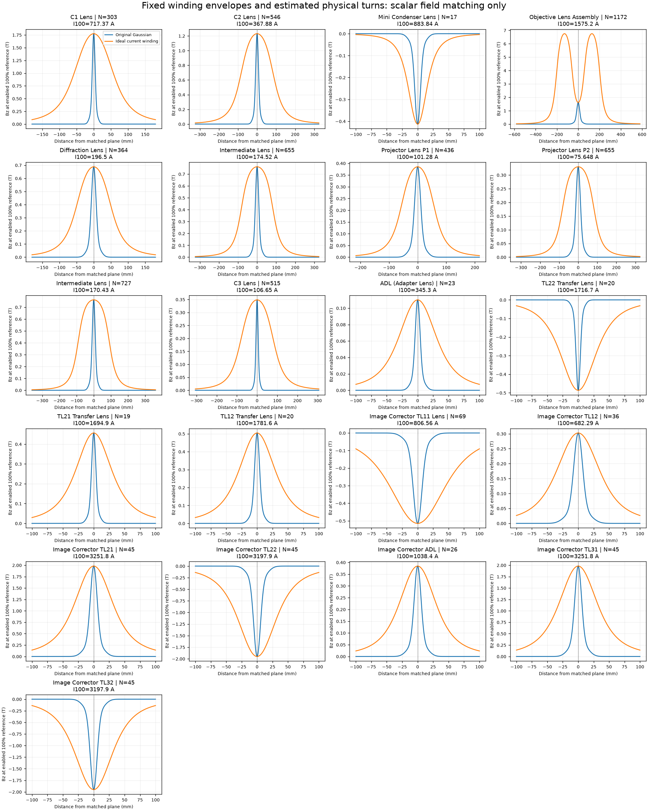

# Fixed physical-size winding estimates and ideal current calibration

Date: 2026-11-15.

The user authorized extending the Objective approach to all remaining round
electromagnetic lenses, estimating turns in proportion to their physical winding
dimensions. The migration saves 78 owner/winding definitions in nine files,
covering 20 logical lens types across seven column and two recording choices.
These are alternative configurations, not 78 simultaneous optical elements.

## Physical and electrical definition

The reference Objective retains upper 586 plus lower 586 turns, with original
ID 60 mm, OD 132 mm and 145 mm occupied length per region. Its total R-Z winding
area is 10440 mm squared. Upper 586 is the adopted photo estimate; lower 586
is the user's symmetry assumption. Other windings assume the same N per R-Z
area and use nearest-integer rounding with halves upward:

`A = (OD-ID)/2 * sum(occupied axial lengths)`

`N = round_half_up(1172 * A / 10440)`

Mean radius, toroidal volume, child display length and pole-piece geometry do
not enter the ratio. Explicit positive counts per occupied interval sum to N;
equal-priority integer allocations follow increasing Z. The saved estimates
remain fixed on subsequent geometry/current changes. No wire diameter, metal
fill, insulation gap, resistance, thermal limit or current rating is invented.
Unknown wire size retains the existing envelope CAD.

The ideal source still uniformly homogenizes each original R-Z interval and
uses its fixed N times the common prescribed current. Existing excitation
percentages, polarity and enabled controls give signed actual current:

`I = I100 * percent/100 * polarity` (zero when disabled).

All 78 owners retain their historical 3000-A-turn records for old-input
compatibility; these records are inactive for the new explicit-current source.
No new optical owner or duplicate magnetic contribution is created.

## Matching conditions and actual default currents

Objective preserves the selected Bz condition at the original specimen upper
surface and its saved reference current. Other round lenses match their own
original Gaussian Bz at its original absolute-peak plane. A common specimen
plane is unsuitable for lenses whose Gaussian field there is negligible.

Calibration explicitly enables a detached 100% reference state, verifies linear
excitation scaling, and solves only I100 with fixed N and geometry. The live
state is never enabled or raised to 100%. Originally off/zero channels remain
off/zero. Mapped/FEM sources and misregistered axes are rejected rather than
silently replaced by Gaussian fields.

For the unchanged standard C3 + Probe Corrector / No Energy Filter
Nanoprobe/Diffraction setting:

| Lens | Fixed turns | Signed working current A | I100 A |
| --- | ---: | ---: | ---: |
| C1 lens | 303 | 370.641394 | 717.370440 |
| C2 lens | 546 | 51.131794 | 367.880037 |
| C3 lens | 515 | 16.731510 | 106.650033 |
| Probe Adapter lens | 23 | 34.529999 | 345.299990 |
| Probe TL22 lens | 20 | -1028.830498 | 1716.676652 |
| Probe TL21 lens | 19 | 1016.152928 | 1694.851468 |
| Probe TL12 lens | 20 | 641.440844 | 1781.554522 |
| Mini Condenser lens | 17 | -387.888055 | 883.844359 |
| Objective lens | 1172 (586+586) | 1086.565908 | 1575.233029 |
| Diffraction lens | 364 | 28.644622 | 196.497288 |
| Intermediate lens | 655 | 0.061228 | 174.523651 |
| Projector lens P1 | 436 | 32.524120 | 101.279419 |
| Projector lens P2 | 655 | 7.433834 | 75.647996 |

Negative actual currents represent the unchanged polarity; I100 inputs remain
nonnegative. The image-corrector transfer lenses are also configured:
TL11 69 turns; TL12 36; TL21/TL31 45; TL22/TL32 45; image Adapter 26.
The Energy Filter's shared Intermediate lens has a distinct 180 mm occupied
length and 727 turns, compared with 162 mm and 655 turns without the filter.
The [migration plan](validation/migration-plan.json) retains every exact value,
geometry, estimate and current recipe; [default currents](validation/default-working-currents.csv)
are also available as CSV.



The plot uses enabled **100% reference excitation**, not the working currents
in the table. Field profiles remain much broader than the old Gaussian fields;
Objective retains its two-lobe profile. Equal Bz at one plane does not preserve
the Bz-squared integral, total all-column field, aberrations or focus. No beam
transport or focus adjustment is performed or qualified here.

## Model and input integration

All nine source definitions are included: seven column variants, the direct
No Energy Filter recording module and `configs/subassemblies/projector_stack.toml`
used by Energy Filter. Both B-COR variants include TL31/TL32. Existing angular
multipole correctors, stigmators and scan/deflection coils retain their native
models; an axisymmetric annular winding does not replace those structures.

Physical Layout's excitation-winding **Configure winding...** action and Model
Inspector now expose the saved inputs/readbacks for every round lens. The
standard startup model choice remains Gaussian; the saved electrical inputs
drive **Ideal prescribed-current coils in vacuum** when explicitly selected.
No lens excitation, source energy law, boundary, optical geometry, aperture,
corrector compensation, Gaussian coefficient or numerical tolerance is retuned.

The generic editor also preserves full binary64 input precision on open/apply,
updates manual-input source records, invalidates an old field-match declaration
after a manual turn edit without automatically changing current, and retains
Undo/save/reload behavior. Optional wire/count deletions persist correctly.
Unchanged inputs preserve their values, provenance and history.

## Verification and limits

All 14 FEG column/recording combinations preserve their complete pre-migration
optical/source/numerical state. Parsed raw files compare identically after
removing only the authorized electrical inputs and their source declarations.
**196 isolated field checks pass**, with maximum relative matching error
1.615e-15 under the unchanged 2e-14 check and zero absolute tolerance. Original
q12 quadrature remains in use. Every assembly's ideal cache identity changes
against its captured old electrical definition, so stale ideal results cannot
share those cache identities.

An independent implementation uses exact decimal/Fraction geometry arithmetic
to check all 78 integer estimates and captures every interval's actual NI,
geometry and q12 setting. For 20 lens keys plus the second Intermediate geometry,
it analytically integrates the loop law axially and independently integrates
radius. Across a 121-point grid plus the matching plane per curve, unchanged q12 differs from that continuous
ideal source by at most **0.0259102%** of the curve peak, at the 180 mm Energy
Filter Intermediate lens. This is an existing quadrature-discretization
diagnostic, separate from same-operator scalar matching accuracy. It is not a
new tolerance, a reason to change defaults or a physical microscope validation.
The [independent receipt](validation/independent/receipt.json) retains the details.

Regression evidence covers estimation/calibration edge cases, field signs,
zero/disabled channels, fixed regional counts, N/I scaling, legacy inputs,
cache dependencies, native CAD restrictions, high finite currents, GUI input
precision, atomic edits and save/reload. At this checkpoint, **355 unique tests
have latest status passed** and six optional STEP tests are skipped because
CadQuery is absent from the main runtime. See [test summary](validation/test-summary.json)
for final statuses. Earlier failed
test fixtures are preserved separately; later passing reports identify the
explicit modern versus old-input conditions without relaxing constraints.

No source emission, finite-source physical trial, focus calculation, material
solve, new STEP export or coherent/CUDA calculation is claimed. The CUDA and
minimum physical-particle policies remain unchanged because this task samples
fields and tests components only.

## Reproduction

The [evidence manifest](validation/manifest.json) records input, code and output
hashes. The `before` directory preserves the exact original nine definitions
and all 14 input states. The migration driver defaults to read-only field
validation using `outputs/all-lens-current-20261115`; it reads preserved inputs
from the curated validation directory on a fresh checkout. Its `--apply` option is an explicit
one-time migration, guarded by the original input hashes, and refuses to
overwrite later edits.

```powershell
.venv/Scripts/python.exe -u docs/development/all_lens_current_20261115/update_and_validate.py
.venv/Scripts/python.exe -u docs/development/all_lens_current_20261115/validation/independent/check.py
$env:QT_QPA_PLATFORM='offscreen'
.venv/Scripts/python.exe -m pytest -q tests/test_catalog_ideal_coils.py tests/test_coil_turn_estimation.py tests/test_coil_current_calibration.py tests/test_fixed_winding_currents.py tests/test_copper_coil_capture.py tests/test_round_lens_cache_identity.py
```
