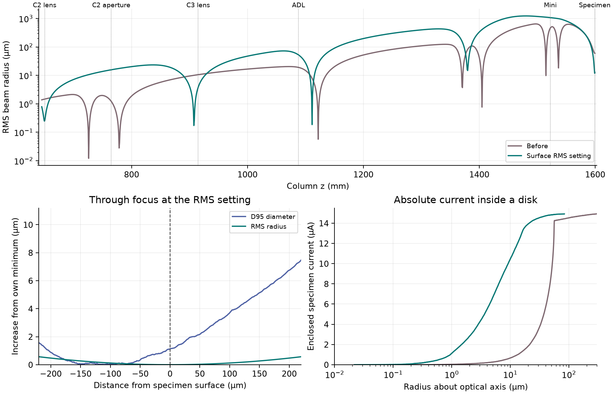
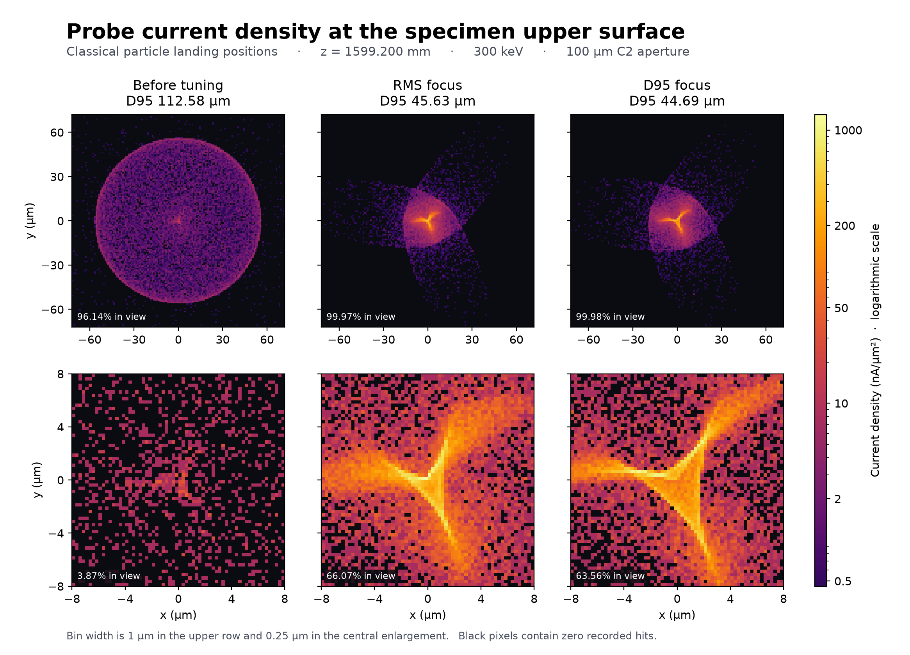

# CESCOR probe current and direct specimen focus

In the latest zero-scan Nanoprobe Normal trial, 16,384 original particles form one shared crossover inside the probe corrector at 1209.153 mm and another at 1422.987 mm, beyond the lower scan winding. C1 lens remains at −30 A, C2 lens at +16 A and the physical C2 aperture diameter at 100 µm. Before the objective-only adjustment the post-scan waist was within 7 µm of both the driven AC pivot and the Mini Condenser–objective front. The adjustment separated the waist and the lens-pair front by 131 µm. The specimen D95 is 575.47 nm and a through-focus check does not establish a surface minimum. [Internal counts, three-plane comparison and specimen probe](post-scan-crossover.md) · [Earlier 5.487 nm specimen setting](material-relay.md)

The earlier refined-objective calculation propagated 32,768 particles to the upper surface. Relative to its original objective mesh, the last upstream waist moved from 1474.70 to 1481.88 mm and the specimen D95 changed from 3.089 to 5.197 µm at fixed downstream currents. [Refined-objective control](refined-objective-normal.md) · [Archived working point](evidence/refined-objective-normal/working-point.json)

The preceding condenser-pair study established one 5.07-fold demagnified source image, one crossover in the C2–C3 gap and zero crossovers from C3 to ADL. Its specimen result used the original objective mesh. [Condenser material fields and original full-column tracking](condenser-pair-fem.md)

With vacuum condenser windings, relaunching the effective source with C1 lens at −41 A and C2 lens at +19.5 A gives one 5.76-fold demagnified source image at 522.117 mm and one free-gap waist at 794.747 mm. The original 8.03 T winding field and the mismatched historical gun exit are accounted for separately. [Condenser fields, current-off controls and before/after trajectories](condenser-source-audit.md)

The joint-field relay trial aligns the TL12 radial waist and driven scan pivot at 1490.375 mm. Objective-only specimen refocusing separates the planes, and independent winding controls expose repeated C1-region waists. [Three-plane measurements, whole-column trajectories and specimen probes](joint-three-plane-focus.md)

The earlier Nanoprobe Normal scan-region study uses the joint ADL–TL12 field with the installed poles and returns. At its inherited objective setting the beam expands through both scan windings and the previous 1408 mm crossover disappears. [Full-column and scan-region trajectories](normal-joint-field.md)

The earlier working point with vacuum ADL and TL12 windings attained a specimen D95 of 7.952 µm at a median pupil-edge angle of 29.80 mrad. The improvement in D95 persisted on the independent material mesh. The change in central current depended on the mesh. [Archived specimen probe, currents and focus verification](normal-objective-probe.md)

The condenser-current comparison places one source crossover in the free gap between the C2 lens and C3 lens and removes the crossover ahead of the ADL. It measures how far the fixed 100 µm C2 aperture is illuminated and the resulting convergence at the specimen. [Nanoprobe Normal trajectories and operating currents](condenser-normal.md)

The probe-size study compares the specimen landings, source-image waists inside the corrector and the measured response to switching or increasing the hexapole fields. [Internal imaging, probe size and the DCOR comparison](internal-optics.md)

The preceding comparison uses the physical 100 µm C2 aperture edge to set 30 mrad, locates the illumination-side objective coma-free plane and tests three-plane imaging with a 1 µrad tilt. [Hexapole conjugacy and specimen-plane current](relay-conjugacy.md)

With a 15 µA gun exit, current-only tuning reduced specimen D95 from 112.58 to 44.69 µm at about 30 mrad. The 100 µm C2 aperture intercepted one of 32,768 original, equally weighted particles. Both retuned settings delivered about 14.91 µA to the specimen, well above a probe current of order 100 pA. The Si[110] scan remains pending this current condition.

Subsequent A₂ correction and a two-lens refocus bring the reference specimen-surface D95 to 10.135 µm at 30.000 mrad. The measured D95 minimum moves 6.3 µm upstream in each of five paired numerical comparisons. [Objective and Mini Condenser refocus](#objective-and-mini-condenser-refocus)

Balancing the fitted C₃ and C₅ with physical relay and lens currents brings the specimen D95 below 1 µm on the 3.8 mm material mesh. The fixed-current cubic-field check gives 0.782 µm at 29.988 mrad and resolves three comparable bright patches. [Spherical-aberration adjustment](#spherical-aberration-adjustment) · [Origin of the off-axis patch](#why-the-bright-patch-appears-off-axis)

Continuing from that cubic-interpolation working point, a two-channel HPol trim gives 0.559 µm D95 and 1.046 µA inside a fixed 50 nm radius at the same specimen surface. [A₂ continuation and matched current controls](#continuing-the-a₂-trim-with-cubic-field-interpolation)

The follow-up puts the D95 waist on the upper surface at 30.000 mrad and tests whether the two hexapole midplanes are conjugate. It also compares the incident angular current with measured vacuum diffraction data. [Specimen focus, hexapole relay and angular illumination](focus-and-angular-illumination.md)

| At the specimen upper surface | Before | RMS waist at surface | D95 minimum near surface |
| --- | ---: | ---: | ---: |
| 95% convergence semi-angle (mrad) | 30.0000 | 30.0000 | 29.9798 |
| D95 diameter (µm) | 112.580 | 45.634 | 44.686 |
| RMS radius (µm) | 60.161 | 11.762 | 11.925 |
| Specimen current (µA) | 15.00000 | 14.91257 | 14.91165 |
| Original / surviving / effective particles | 32768 / 32768 / 32768 | 32768 / 32577 / 32577 | 32768 / 32575 / 32575 |
| Hits inside the fixed-axis 50 pm radius | 0 | 0 | 0 |
| Objective winding current (A, 1160 turns) | −31.034 | −20.690 | −20.690 |

Each packet carries 457.76 pA in the full population. The sampled central-disk current was zero in all three cases. An absolute current of 100 pA would correspond to only 0.218 original packets. These runs resolve the large excess in total specimen current. A quantitative central-disk current at the requested scale requires more statistical weight resolution.



## Probe shape at the specimen upper surface



All six views use the installed optical axis as the origin and the same logarithmic current-density scale. Each pixel sums the original current of surviving particles and divides by its area. The upper windows cover ±72 µm in both coordinates. The lower windows cover ±8 µm. Each panel gives the fraction of total specimen current inside its square. The radial profile includes the tails outside the windows. [Radial profiles and angular symmetry](specimen-probe-profiles.png)

The original probe has a pronounced rim at about 55 µm radius. Both retuned settings have three bright arms in the centre. In the 2–6 µm annulus the normalized third angular harmonic of the landing current is 0.589 for RMS focus and 0.730 for D95 focus. Halving the transport step gives 0.588 and 0.730, and the 16,384-particle prefix gives 0.590 and 0.728. The statistic is the magnitude of the current-weighted mean of `exp(i m θ)`, with θ measured counterclockwise from +x. It describes azimuthal contrast. Several wave aberrations share threefold symmetry, including second-order threefold astigmatism A2 and the fourth-order three-lobe term D4. Identifying their individual coefficients requires an angle-dependent aberration measurement or fit. [Müller et al., 2006, Table 1](https://www.ceos-gmbh.de/de/produkte/stemkorrektoren/dcor-ascor/Mueller2006a.pdf#page=6)

Regenerate both figures from the three archived specimen checkpoints with `python docs/development/cescor_direct_probe_20261121/plot_specimen_probe.py`.

### Which electrons form the three arms?

At D95 focus, 6,465 electrons with incident semi-angle below 10 mrad and 4,142 between 10 and 20 mrad land in the 2–6 µm annulus about the installed axis. Those groups supply 2.959 and 1.896 µA to the annulus. The smallest landing radii in the 20–30 and 30–40.253 mrad groups are 7.14 and 13.27 µm. Each semi-angle is measured from the current-weighted chief using the particle's actual direction at the specimen entrance. The four panels include every surviving particle and preserve its absolute current. [Landing maps by incident angle](aperture-angle-spots.png)

| Effective coefficient fitted at the specimen | Magnitude | Coefficient azimuth | RMS displacement on a 30 mrad ring |
| --- | ---: | ---: | ---: |
| A₂, second-order threefold astigmatism (C₂₃) | 26.22 mm | 112.83° | 23.60 µm |
| D₄, fourth-order three-lobe aberration (C₄₃) | 2.270 m | 104.62° | 1.52 µm |

The model fits both intercept coordinates with original particle weights, a free intercept and all axial wave-aberration gradients through fifth geometric order. It uses the project's displacement convention `−∇W`, with `W = C_nm α^(n+1) cos[m(φ−θ)]/(n+1)`. Angles are in radians in this formula. The pupil azimuth is measured from laboratory +x projected perpendicular to the chief toward +y. Coefficient directions repeat every 120°. The observed landing-current harmonic has orientation 52.57° modulo 120°. The quoted ring displacement averages uniformly over azimuth and allows comparison of the two angular orders in the same units. These are effective mechanical-angle coefficients of this finite-source operating point. [Ma et al., Eq. 1](https://www.sciencedirect.com/science/article/pii/S0304399125000373) · [Müller et al., Table 1](https://www.ceos-gmbh.de/de/produkte/stemkorrektoren/dcor-ascor/Mueller2006a.pdf#page=6)

With identical five-fold splits by original particle ID, adding A₂ to the background gives 0.540 µm held-out vector RMS error, adding D₄ gives 5.001 µm, and fitting both gives 0.438 µm. Subtracting only the held-out joint fit's A₂ displacement from each observed position reduces the annular third harmonic from 0.730 to 0.118. Subtracting D₄ gives 0.731. The annulus is reselected after each subtraction and its current is recorded. These diagnostic maps retain the measured finite-source residual. [Held-out maps and angular current profiles](threefold-attribution.png)

Halving the particle step changes A₂ by less than 0.00005 mm. The 16,384-particle prefix gives 26.22 mm. Restricting the joint fit to 30 mrad gives 26.02 mm and 2.61 m for A₂ and D₄. Including the next threefold term C₆₃ over the full cone gives 25.80 mm and 3.69 m, respectively. The A₂ attribution is stable, while D₄ depends appreciably on the truncation. Regenerate the primary fit and figures with `python docs/development/cescor_direct_probe_20261121/fit_threefold.py`. Add `--controls-dir outputs/cescor-direct-20261121` to verify the native step and population controls. [Coefficient quadratures, held-out errors and sensitivity checks](evidence/threefold-fit.json)

## Physical A2 current adjustment

At the original D95-focus round-lens currents, the installed HP1 and HP2 main windings and both nominal HPol fine channels were driven in the 40-body nonlinear corrector field solve. The final currents are HP1 +0.01752 A, HP2 −1 A, HPol-X −0.07115 A and HPol-Y −1.14652 A. TL21 and TL22 retain +5 A and −5 A. The two HPol groups have six alternating closed windings each, using the model's nominal 384 turns per winding. Their physical placement and drive calibration still lack instrument measurements. Each setting below uses its own nonlinear field and retraces all 32,768 original gun-exit particles.

| Specimen upper surface | Original HP1/HP2 at +1/−1 A | HP1/HP2 at +0.5/−0.5 A | Final HP1/HP2 and HPol |
| --- | ---: | ---: | ---: |
| Effective A₂ (mm) | 26.2175 | 13.0704 | 0.0121 |
| Threefold landing-current harmonic, radius 2–6 µm | 0.7302 | 0.4410 | 0.0110 |
| D95 diameter (µm) | 44.686 | 22.708 | 10.306 |
| Convergence semi-angle α95 (mrad) | 29.980 | 30.026 | 30.000 |

With the final corrector current, the native D95 minimum lies 6 µm beyond the specimen surface and the RMS-radius minimum lies 72 µm beyond it. The 50 pm centre disk receives zero sampled packets at the surface. On the 3.8 mm corrector material mesh, halving the transverse field-table pitch from 0.30 to 0.15 mm gives A₂ of 26.185 mm before adjustment and 0.184 mm after. The independently solved 5 mm material mesh gives 27.419 and 0.478 mm and reduces the threefold harmonic from 0.717 to 0.051. The suppression is reproducible across these controls. The small residual magnitude and direction depend on spatial resolution. With HP1 near zero, a separate spherical-aberration measurement would be needed to establish simultaneous correction.

[Original and adjusted specimen landing maps](a2-current-adjustment.png) · [Adjusted landings by incident semi-angle](a2-adjusted-angle-spots.png) · [Corrector working point and control results](evidence/a2-adjusted-working-point.json) · [Original-weight adjusted trajectories](evidence/a2-adjusted.npz)

To regenerate the adjusted corrector field and initial through-focus observation from the reference inputs below:

```powershell
$study = 'docs/development/cescor_direct_probe_20261121'
$field = 'outputs/cescor-a2-20261121/a2-set-field.npz'
python "$study/adjust_a2.py" field a2-set -0.07115 -1.14652 --hp1 0.01752 --hp2 -1
python "$study/adjust_a2.py" trace a2-set-native $field --through-focus
```

## Objective and Mini Condenser refocus

The starting point is the A₂-adjusted corrector above. The objective changes from −24,000 to −24,000.8 ampere-turns, or −20.689655 to −20.690345 A across 1,160 turns. The three Mini Condenser winding groups share one gain of 1.0000080968723972. Their signed currents change from +908.34022, −1057.68850 and +1592.53694 A to +908.34757, −1057.69706 and +1592.54983 A. These are prescribed-current model values. The gain preserves the winding ratios and polarities. The other 18 round-lens windings, corrector currents and field, gun emission and 100 µm C2 aperture are fixed. A fresh nonlinear ARMCO objective solution is used at each distinct objective excitation; Mini Condenser excitation uses its existing vacuum coil basis.

| At the upper surface, z = 1599.1999975 mm | A₂-adjusted baseline | After two-lens refocus |
| --- | ---: | ---: |
| D95 diameter (µm) | 10.3060 | 10.1352 |
| Axial location of minimum D95 (µm from surface) | +6.3 | 0.0 |
| RMS radius at the surface (µm) | 4.8870 | 4.8586 |
| Axial location of minimum RMS radius (µm) | +72 | +66 |
| Convergence semi-angle α95 (mrad) | 30.00013 | 29.99992 |
| Threefold contrast, radius 2–6 µm | 0.01096 | 0.01110 |
| Absolute current inside 1 µm radius about the installed axis (nA) | 788.73 | 804.75 |
| Specimen current (µA) | 14.91898 | 14.91898 |

The two settings transmit the same 32,591 of 32,768 original particles, with identical IDs, weights, energies and interception owners. Both have zero observed hits in the 50 pm centre disk. Each original packet represents 457.76 pA. The smallest D95 anywhere in the measured axial interval changes from 10.1425 to 10.1352 µm. Most of the diameter change seen at the specimen therefore comes from moving the waist. In the refocused trace the x and y covariance waists lie 66–67 and 65–66 µm beyond the specimen. The region from the C2 lens to the C3 lens contains one crossover in each axis. The C3 lens to adapter interval and the Mini Condenser to pre-specimen interval contain none in either the full population or the common surviving cohort. The fixed-current threefold fits give A₂ of 0.01213 mm and D₄ of 0.1936 m on the reference grid.

| Paired calculation with identical lens changes | D95 waist before → after (µm) | Surface D95 before → after (µm) |
| --- | ---: | ---: |
| 32,768 source particles, 3.8 mm corrector material mesh | +6.3 → 0.0 | 10.3060 → 10.1352 |
| Axial integration step 0.0375 mm instead of 0.075 mm | +6.3 → −0.0005 | 10.3060 → 10.1353 |
| 16,384 original source particles | +8.5 → +2.2 | 10.2997 → 10.1212 |
| Transverse field-table pitch 0.15 mm instead of 0.30 mm | +4.7 → −1.6 | 10.2062 → 10.1611 |
| Independent, coarser 5 mm corrector material mesh | −4.5 → −10.8 | 10.5524 → 10.9207 |

Positive axial distance follows the beam. The upstream displacement is reproducible. The absolute waist registration changes with source sampling and magnetic discretization. In particular, the independent coarse mesh places the incoming waist upstream already, so the same adjustment increases the diameter at the surface. Sub-nanometre localization on the reference grid does not establish equivalent physical accuracy. The present specimen current and spot size remain above the atomic-scanning targets.

[Specimen landing maps and native through-focus curves](objective-mini-focus.png) · [Refocused landings by incident semi-angle](refocused-angle-spots.png) · [Complete refocused working point, currents and paired controls](evidence/refocused-working-point.json) · [Refocused specimen trajectories and axial profiles](evidence/refocused.npz)

After preparing the A₂-adjusted field, replay the independent-current response search and the final native verification with the following commands from the repository root:

```powershell
$study = 'docs/development/cescor_direct_probe_20261121'
python "$study/refocus_a2.py" search matched
python "$study/refocus_a2.py" verify refocused --ni -24000.8 --gain 1.0000080968723972
```

## Spherical-aberration adjustment

Starting with the refocused A₂ setting, the search varied the TL12 relay gain, Mini Condenser gain and upper-objective ampere-turns. C2 and C3 lens drives, the 100 µm C2 aperture, gun-exit distribution and all magnetic structures remained fixed. Main hexapoles and fine windings were tested in separate nonlinear solves. A proposal sweep interpolated independently solved objective maps. The following three working points use the field solved at the exact objective current and retain each original particle weight. The baseline and tuning rows use the same transverse linear interpolation.

| At the specimen upper surface | Fitted C₃ (mm) | Fitted C₅ (m) | D95 (µm) | α95 (mrad) | Current within 100 nm radius (nA) | Specimen current (µA) |
| --- | ---: | ---: | ---: | ---: | ---: | ---: |
| A₂ corrected and refocused | −622.15 | −94.04 | 10.135 | 30.000 | 26.1 | 14.9190 |
| C₃ near zero | +2.81 | −213.62 | 3.344 | 30.000 | 102.1 | 14.9931 |
| C₃ and C₅ balanced, fine currents retrimmed | +319.95 | −280.26 | 0.745 | 30.000 | 2072.8 | 14.9982 |

The fitted mechanical-angle coefficients include defocus and all angular terms through fifth geometric order. At 30 mrad the three round terms contribute +2.19 µm from defocus, −8.64 µm from C₃ and +6.81 µm from C₅ in the balanced case. C₅ changes with the physical relay and lens drives. There is no independent C₅ winding in these trials. The signed coefficients depend on the fitted cone. Using only rays at or below 30 mrad gives C₃ of −561, −72 and +155 mm for the three cases. The specimen diameter, current and landing maps use the complete transported beam. The transfer-lens dependence of higher-order aberrations in hexapole correctors is discussed in [Müller et al., 2006, Fig. 5](https://www.ceos-gmbh.de/de/produkte/stemkorrektoren/dcor-ascor/Mueller2006a.pdf#page=7).

The final upper objective carries −21,253.2 ampere-turns, or −18.3217 A across 1,160 turns. TL12 and Mini have gains of 0.7989662723415103 and 1.1046425788406402 relative to the two-lens refocus. Their three signed winding currents are +113.32, +1152.46, +491.07 A and +1003.40, −1168.38, +1759.20 A respectively. HP1 and HP2 remain at +0.01752 and −1 A, with TL21 and TL22 at +5 and −5 A. The HPol fine channels change to −0.25891 and −1.01620 A. These are nominal simulator drives. Before fine trimming, three independently solved objective settings with the angle and D95 focus matched gave 0.809, 0.785 and 0.856 µm at −21,530, −21,253.2 and −21,040 ampere-turns.

Of the 32,768 original particles, 32,764 reach the specimen in the balanced linear trace. The same 32,591 IDs that reached the surface in both the baseline and balanced runs change from 10.135 to 0.729 µm D95. The C2–C3 interval retains one covariance crossover per axis and the Mini-to-pre-specimen interval retains zero. The surface D95 minimum and the RMS-radius minimum 28 µm upstream are distinct. Halving the integration step gives 0.746 µm at the surface. The 16,384-particle prefix gives 0.742 µm. Halving transverse table pitch at fixed material mesh gives 0.786 µm. A coarser 5 mm material mesh gives 1.220 µm. Fine-grid centring and current checks below quantify the uncertainty in the visible shape. The 50 pm fixed-axis disk recorded zero packets and the specimen receives about 15 µA. The hundred-pA condition for the Si[110] scan remains open.

[Matched specimen landing maps](spherical-probe.png) · [Landings by angle and radial response](spherical-angle-response.png) · [Fitted coefficients, current ledger and control runs](evidence/spherical-working-points.json) · [Small-C₃ trajectories](evidence/cs-zero-native.npz) · [Balanced reference trajectories](evidence/cs-balanced-native.npz)

## Why the bright patch appears off axis

In the original balanced image the whole-current centroid is at (−0.67, +0.15) nm. Its brightest patch is near (+57.5, −57.5) nm. The patch location uses a 5 nm histogram smoothed with a 25 nm standard-deviation Gaussian. Displayed landing maps and reported disk currents use the original particle weights. The 50 nm radius disk there contains 1.028 µA, compared with 0.414 µA on axis and 0.168 µA at the diametrically opposite position. Half-step integration and the 16,384-particle prefix select the same bright-patch coordinates.

Fixed-current controls locate the origin of this imbalance. Rotating just the registered corrector field by 180° moves the bright patch to (−57.5, +57.5) nm. This exchanges opposite grid indices and rotates the transverse field vectors exactly. Setting HP1, HP2 and both HPol currents to zero while keeping TL21, TL22 and the ordinary lens currents fixed places the brightest patch within 4 nm of the axis. The baseline and these two controls all use the same integration and transverse interpolation.

The square-grid linear interpolation of the hexapole field breaks the expected 120° symmetry of the intensity pattern. With the same FEM solution and 0.30 mm table pitch, changing only transverse interpolation to a four-node cubic Lagrange stencil reduces the normalized 120° image difference from 0.370 to 0.013. Linear interpolation at 0.15 mm gives 0.124. Cubic interpolation at both 0.30 and 0.15 mm gives 0.013 and surface D95 values of 782.464 and 782.456 nm. The cubic stencil reproduces a manufactured bicubic vector field linear in z to an absolute error below 9 × 10⁻¹⁶ over 1,503 locations. Axial interpolation, finite-source weights, stops and winding currents are identical.

On the fine cubic grid the 50 nm radius disks centred on three 120°-related patches carry 0.705, 0.691 and 0.683 µA. The full-current centroid is about 1 nm from the optical axis. At these currents the D95 minimum lies 2.6 µm downstream (0.682 µm), and the RMS-radius minimum lies 29 µm upstream. The specimen upper surface itself has D95 of 0.782 µm and α95 of 29.988 mrad. The coarser 5 mm material mesh with cubic interpolation gives 1.210 µm, so the diameter still depends on the material discretization. The comparison identifies a numerical source of the single bright side and a residual threefold pattern in the simulated hexapole system.

[Centring controls](probe-centring.png) · [Higher-order interpolation and central spot](spherical-probe-fine.png) · [Centroids, peak locations, disk currents and symmetry checks](evidence/probe-centring.json) · [Full original-weight fine-grid specimen phase space](evidence/cs-balanced-cubic.npz)

To replay the fine-grid specimen result with the physical winding and geometry files from this study, run the following from the repository root. The two quoted gains preserve their full precision in PowerShell.

```powershell
$study = 'docs/development/cescor_direct_probe_20261121'
$fields = 'outputs/cescor-a2-20261121'
python "$study/adjust_a2.py" field cs-trim -0.25891 -1.01620 --hp1 0.01752 --hp2 -1
python "$study/adjust_a2.py" refine-grid "$fields/cs-trim-solution.npz" "$fields/cs-trim-fine-field.npz"
python "$study/adjust_cs.py" verify centre-cubic-fine --table "$fields/cs-trim-fine-field.npz" --interpolation cubic --ni -21253.2 --tl '0.7989662723415103' --mini '1.1046425788406402' --count 32768 --step 0.075
```

## Continuing the A₂ trim with cubic field interpolation

The starting point for this adjustment is the full cubic-field replay of the balanced C₃–C₅ currents. All comparisons retain the 300 keV source, 100 µm C2 aperture, round-lens currents, geometry and materials. Only the signed currents in the X and Y HPol windings change. Each field was solved with the nonlinear materials at its actual drive and each trace uses the native absolute source weights. The selected currents were checked on two transverse sampling grids at fixed integrator settings.

| At the specimen upper surface, 0.15 mm transverse pitch | Starting point | Continued A₂ trim |
| --- | ---: | ---: |
| HPol-X / HPol-Y (A) | −0.258910 / −1.016200 | +0.053452 / −0.833845 |
| Full-cone A₂ magnitude (mm) | 0.19934 | 0.01849 |
| A₂ magnitude from rays within 30 mrad (mm) | 0.21936 | 0.01737 |
| D95 diameter (nm) | 782.46 | 559.17 |
| 95% convergence semi-angle (mrad) | 29.988 | 29.984 |
| Current within radius 50 nm / 100 nm (µA) | 0.390 / 1.864 | 1.046 / 2.414 |
| Threefold harmonic at radii 100–400 nm | 0.326 | 0.043 |
| Surface RMS radius (µm) | 1.508 | 1.501 |
| D95 / RMS waist relative to surface (µm, positive downstream) | +2.600 / −29 | −0.775 / −28 |

The joint response used the starting point and independent HPol settings (−0.07115, −1.14652) and (−0.07115, −0.94652) A. On the 3.8 mm material mesh the full-cone A₂ cosine and sine quadratures change with the X and Y drive according to the matrix [[−0.57685, +0.35226], [−0.17073, −0.69427]] mm/A. Targeting only the full-cone fit at (+0.039244, −0.855334) A gave 0.00236 mm full-cone A₂, 0.03315 mm inside 30 mrad, 563.0 nm surface D95 and 0.077 threefold contrast. The selected two-cone adjustment reduces the larger of those two coefficient residuals and gives a smaller D95 and weaker threefold contrast. The contrast is the magnitude of the third angular harmonic of actual landing current in a fixed 100–400 nm annulus about the optical axis. The independent normalized 120° rotation difference is 0.013 before and after.

Both reference traces deliver 32,765 of 32,768 original positive-current particles (effective count 32,765) and 14.99863 µA. The fixed-axis 50 pm disk receives zero sampled packets in either case. The C2–C3 interval has one covariance crossover per axis and the Mini-to-pre-specimen interval has none. At the selected currents the sampled D95 minimum is 542.7 nm, 0.775 µm upstream; the surface value in the table is the direct observation at the unchanged specimen plane. The nominal-material result gives the shape and current concentration of the simulated microampere beam. The hundred-pA imaging condition remains open.

The 0.30 and 0.15 mm transverse tables give 559.159 and 559.174 nm after adjustment. At 0.15 mm pitch, halving the integration step gives 559.119 nm. With 16,384 source particles the paired diameters are 779.80 and 560.22 nm, and the full-cone A₂ values are 0.2093 and 0.0352 mm. This spread limits the precision of the small residual coefficient and its azimuth.

The material-mesh comparisons below use a common 0.30 mm cubic table pitch, 0.5 mm axial field pitch, 195 mm exterior padding, 32,768 emitted particles and identical before/after currents on all three meshes. Each pair uses independently solved material fields at both drives. On the original mesh C₃ changes from +322.31 to +322.40 mm and C₅ from −282.04 to −282.10 m. The improvement in A₂ and D95 occurs on every mesh; their absolute residuals are mesh dependent.

| Nominal material mesh (mm) | Full-cone A₂ before → after (mm) | Surface D95 before → after (nm) | Current within 50 nm before → after (µA) |
| ---: | ---: | ---: | ---: |
| 5.0 | 0.5525 → 0.2157 | 1209.8 → 702.0 | 0.181 → 0.355 |
| 3.8, calibration mesh | 0.1993 → 0.0185 | 782.5 → 559.2 | 0.390 → 1.046 |
| 3.2, finer check | 0.2187 → 0.0723 | 882.7 → 638.2 | 0.409 → 1.063 |

[Before and after landings on a shared absolute scale](a2-cubic-probe.png) · [Currents, signed fits and matched numerical controls](evidence/a2-cubic-working-point.json) · [Adjusted original-weight particle landings](evidence/a2-cubic-adjusted.npz) · [Interpolation checks for future corrector tuning](../../OPTICAL_CONTROL_ROLES.md#transverse-field-sampling-during-corrector-adjustment)

From the repository root, the following commands reproduce the selected working point after preparing the reference inputs above.

```powershell
$study = 'docs/development/cescor_direct_probe_20261121'
$fields = 'outputs/cescor-a2-20261121'
python "$study/adjust_a2.py" field a2-cubic-both 0.053452 -0.833845 --hp1 0.01752 --hp2 -1
python "$study/adjust_a2.py" refine-grid "$fields/a2-cubic-both-solution.npz" "$fields/a2-cubic-both-fine-field.npz"
python "$study/adjust_cs.py" verify a2-cubic-both-fine --table "$fields/a2-cubic-both-fine-field.npz" --interpolation cubic --ni -21253.2 --tl '0.7989662723415103' --mini '1.1046425788406402' --count 32768 --step 0.075
```

## Where the current goes

The Gun aperture was held at its installed model opening (4 mm diameter). The C1 aperture was set to the supplied nominal 1000 µm diameter at z = 445 mm. The maximum originally executed gun radius was 1.213 µm, and every gun trajectory cleared both apertures. The independently transported, 300 keV gun-exit distribution at z = 450 mm has a 95% radius of 0.685 µm and a 95% semi-angle of 0.619 µrad about the axis. These are model inputs to column tuning. The instrument's gun-exit spot and divergence are unknown.

| Current or footprint | Before | RMS setting | D95 setting |
| --- | ---: | ---: | ---: |
| C2 aperture incident current (µA) | 15.000000 | 15.000000 | 15.000000 |
| Incident D95 at the aperture foil (µm) | 4.40 | 56.64 | 56.64 |
| C2 aperture outgoing current (µA) | 15.000000 | 14.999542 | 14.999542 |
| Current subsequently intercepted by the objective lens bore (nA) | 0 | 86.98 | 87.89 |

The measured foil faces lie at z = 764.9 and 765.1 mm. In both retuned runs the foil intercepts 0.458 nA. Approximately 99.4% of the gun current reaches the specimen. A 100 pA specimen current from this gun would require transmission of approximately 0.000667%. A measurement of incident beam diameter at the C2 aperture, or beam current immediately downstream of it, would distinguish underfilling at that plane from additional current selection elsewhere in the real column.

A separate search varied signed condenser and relay windings over a bounded range. The 524,288 whole-column first-order trials proposed candidates for physical transport. One full-source trial increased downstream interception, delivering 4.600 µA at 28.78 mrad. D95 grew to 4.843 mm, with 9.048 µA intercepted by the upper objective pole and 1.348 µA by the sample stage. Refocusing and aperture-illumination searches did not find a setting meeting both the requested current and probe conditions. This comparison holds magnetic geometry and materials fixed, so it cannot isolate a pole-shape resolution limit.

## Crossovers and focus

Coordinates increase in the beam direction. The upper surface is at z = 1599.1999975 mm. For each axis a crossover is bracketed by a change of sign of the centered position–slope covariance from negative to positive. The brackets were checked for all particles present at each plane and independently for the original particles that reach the specimen.

- Using the C2 lens and C3 lens centres at 650 and 915 mm, the original column had two crossovers in that interval. Both retuned columns have one at 907.50–908.25 mm. There is also a waist just upstream of the C2 lens centre at 649.675–649.700 mm. The C3 lens to ADL interval contains zero crossovers in all three cases.
- The original Mini Condenser to specimen path had an additional crossover at 1536.00–1536.75 mm, about 63 mm upstream. Both retuned paths remove it. In the RMS setting, the x waist is 1–2 µm downstream of the surface, the y waist is 1–2 µm upstream, and the combined RMS radius is smallest at the surface. The smallest D95 lies about 110 µm upstream.
- In the D95 setting, the 32,768-particle D95 minimum is near the surface. The RMS radius is smallest about 96 µm downstream. Halving the integration step moves the observed D95 minimum from within 2 nm of the surface to about 30 nm downstream. At fixed currents the 16,384-particle prefix places it about 13 µm upstream. This source-count sensitivity limits the precision of the percentile focal plane.

## Fixed fields and numerical checks

The calculation reuses the installed 40-body CESCOR field with HP1/HP2 at +1/−1 A and TL21/TL22 at +5/−5 A. The objective uses separate nonlinear ARMCO field solutions at 36,000 and 24,000 ampere-turns with the selected polarity. The installed objective geometry and its B–H curve have the same digests in both solves. Remaining round lenses use their existing ideal prescribed-current winding fields. Their independent signed group currents reach 1.59 kA after tuning and lack a measured drive calibration. The three settings are research inputs. [Material geometry and field calculation](../probe_corrector_cescor_20261121/README.md)

The gun-exit checkpoint fixes original positions, directions, energies and IDs. The emitter rate is set before any clipping, with the same emission quadrature and gun electrostatic geometry. Gun-exit phase space is prescribed for this comparison. Upstream magnetic feedback from changed column currents and current-dependent space charge were not recomputed. Native Lorentz transport retains all three corrector field components, the mechanical apertures and original source weights. Out-of-table Runge–Kutta stages are allowed only to identify an intercepted physical step. An accepted step outside the registered field aborts the calculation.

Halving the maximum step from 0.075 to 0.0375 mm preserved every surviving particle ID and every intercepted component for both settings. D95 changed by 0.0025 µm for the RMS setting and 0.0015 µm for the D95 setting. The 16,384-particle source prefix gives D95 of 45.634 and 44.703 µm respectively. The exact surface metrics, center-disk counts, focal-plane brackets, material field identifiers and absolute loss ledger are archived together. [Numerical comparison](evidence/comparison.json)

## Replay

Run the following from the repository root in the project environment with CUDA. The field preparation commands are needed only when the existing CESCOR solution and field table are absent. The particle driver rebuilds missing column, objective and winding inputs from the reference recipes. The JSON settings preserve the current of every winding group in circuit order.

```powershell
$study = 'docs/development/cescor_direct_probe_20261121'
$field = 'outputs/cescor-20261121'
python -m temsim.corrector_field_cli solve "$field/solution.npz" --hp1 1 --hp2 -1 --tl21 5 --tl22 -5 --mesh-mm 3.8 --padding-mm 195 --mesh-cache "$field/meshes" --backend cuda
python -m temsim.corrector_field_cli sample "$field/solution.npz" "$field/fine-field.npz" --step-mm 0.5
foreach ($setting in 'before', 'rms', 'd95') {
    python "$study/finite_probe.py" "replay-$setting" --seed "$study/evidence/$setting-currents.json" --step 0.075 --observe
}
```

The three NPZ files contain the specimen phase space, original IDs and weights, component-level losses, through-focus profiles and two-axis moments. D95 is a diameter about the current centroid. The bright-core current uses a fixed-axis 50 pm radius. [Original winding currents](evidence/before-currents.json) · [Surface RMS winding currents](evidence/rms-currents.json) · [Surface D95 winding currents](evidence/d95-currents.json)
