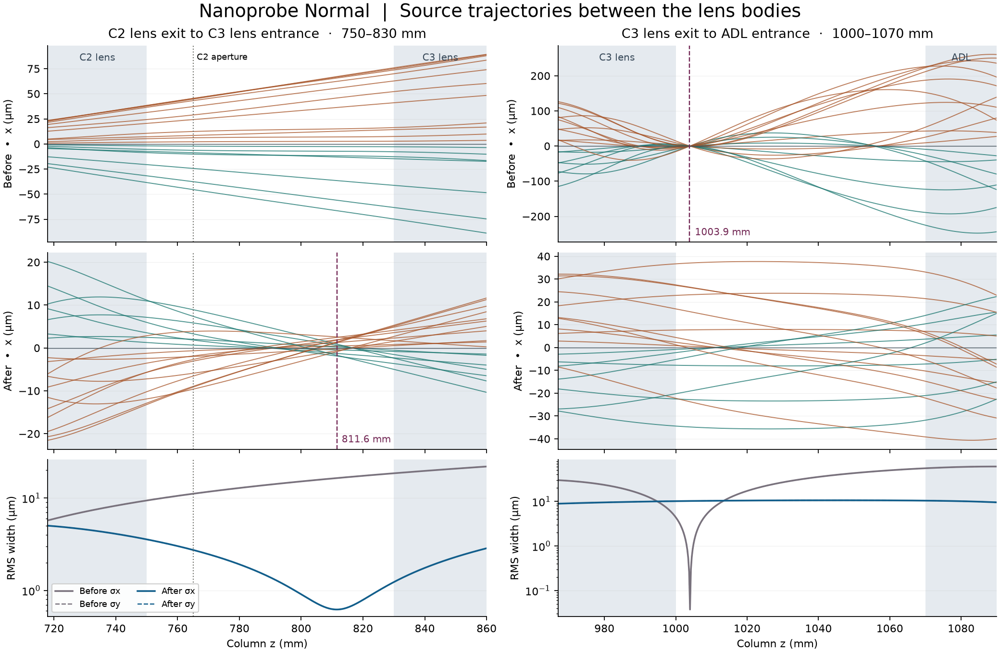
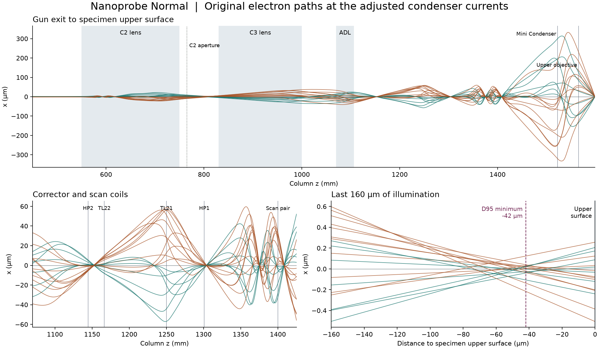

# Nanoprobe Normal condenser trajectories

Increasing the four C2 lens winding currents together by a factor of 1.542 forms a source crossover between the two lens bodies. The extra crossover before the adapter lens (ADL) persists until the C3 lens excitation is reduced. With the C3 lens currents at 0.260 of their previous values the measured crossover lies at 811.50–811.75 mm. Both transverse directions cross there. The free gap from the C3 lens to the ADL contains no crossover at 0.25 mm sampling. This is a local working point for the condenser geometry. The sample-plane illumination still falls short of the requested 30 mrad.



## Separate current changes

All gains refer to the previous 2.296 µm D95 working point. Each gain scales every signed winding current of its own lens, preserving winding ratios, polarities and turns. Column z increases toward the specimen. The free gaps are bounded by the installed mechanical faces. The C2 lens occupies 550–750 mm, the C3 lens 830–1000 mm and the ADL 1070–1106.4 mm. The previous beam waist at 669.00–669.25 mm lay inside the C2 lens. Using the distance between optical centres had assigned it to the wrong interval.

| C2 lens gain | C3 lens gain | C2 lens to C3 lens crossover (mm) | C3 lens to ADL crossover (mm) | Sample α95 (mrad) | Largest sampled angle (mrad) | Sample D95 (µm) |
| ---: | ---: | --- | --- | ---: | ---: | ---: |
| 1.000 | 1.000 | None | 1003.75–1004.00 | 16.831 | 28.501 | 2.296 |
| 1.542 | 1.000 | 807.0–807.5 | 1005.5–1006.0 | 4.917 | 8.708 | 0.685 |
| 1.542 | 0.260 | 811.50–811.75 | None | 4.160 | 7.373 | 0.367 |

At 1.542/0.260 the C2 lens peak axial self-field increases from 1.0816 to 1.6679 T. The C3 lens peak axial self-field drops from 0.15781 to 0.04103 T. Its integrated squared axial self-field falls from 0.0015000 to 0.0001014 T² m. Particle transport uses the combined fields, including their fringes. A separate 4,096-particle control with the original C2 lens current and the weakened C3 lens found no crossover in either gap.

Two perturbations from the adjusted setting retain the required gap counts. At fixed C3 lens gain 0.260, increasing the C2 lens gain from 1.542 to 1.548 changes sample α95 from 4.160 to 4.572 mrad. At fixed C2 lens gain 1.542, reducing the C3 lens gain from 0.260 to 0.240 changes α95 to 4.063 mrad. The Mini Condenser and the upper objective were held at their previous currents throughout this comparison.

A screening sweep of positive C2 lens gains up to 2.50 and C3 lens gains from 0.050 to 0.545 found 4,733 paraxial candidates with the required gap counts and no C3-centre to ADL-centre waist. The largest estimated illumination radius on this sampled branch was 0.303 of the C2 aperture radius. Two further native 32,768-particle runs check the limits suggested by the screening. Gains of 1.472/0.185 gave a 15.11 µm maximum entrance radius and a sample α95 of 1.40 mrad. Gains of 1.846/0.335 produced a genuine crossover at 751.5–752.0 mm with none before the ADL. They raised the largest sampled angle to 29.04 mrad and α95 to 16.29 mrad, while the entrance footprint reached only 10.07 µm. At that setting another two-axis waist appeared upstream of the sample between 1597.0 and 1598.88 mm, and sample D95 rose to 20.83 µm.

## Aperture filling and specimen focus

The physical C2 aperture has a 50 µm radius and extends from 764.9 to 765.1 mm. The original beam illuminated its rim. A 128-azimuth boundary trace then gave 29.700–30.000 mrad at the specimen. With the new currents the largest incident particle radius at the upstream foil face is 12.405 µm. No transmitted particle samples the outer tenth of the aperture radius. The finite source therefore supplies no measured incident direction at the rim for a new 30 mrad boundary claim. The sample angles above use the actual transmitted particles and their original weights.

The upper specimen surface is at 1599.1999975 mm. An independent through-focus trace gives a D95 minimum 42 µm upstream (adjacent samples 43 and 41 µm upstream) and an RMS radius minimum 36 µm upstream. The source-plane current is 15 µA. The previous run transmitted 32,767 of 32,768 packets and the adjusted run transmitted all 32,768. The smaller surface D95 accompanies a narrower illumination cone. It does not establish a focused 30 mrad STEM operating point.



## Trajectory evidence and replay

The traces reuse the archived 300 keV gun-exit phase space, the installed CESCOR-style corrector and objective material fields, and the prescribed-current condenser coil basis. Beam contacts, energies and absolute weights are propagated. The plotted paths use the same 18 original IDs in both settings. The two width curves use every positive-current packet reaching the specimen in the corresponding run. For the adjusted crossover, the eigenvalues of the transverse covariance derivative reverse from both negative to both positive. Both principal directions have greater spatial variance on each side of the minimum. Data reduction and graphics leave the sample plane fixed.

The previous and adjusted rows use a maximum integration step of 0.0375 mm and 0.25 mm axial observations in the condenser section. The intermediate setting and the two local angle perturbations use 0.075 mm steps and 0.50 mm observations. Repeating the adjusted setting at the coarser resolution gives a crossover bracket of 811.5–812.0 mm and sample D95 of 0.3675 µm. The through-focus result uses the 0.075 mm integrator with native observations at 1 µm spacing around the minimum.

From this directory, using the project environment and existing field cache, the commands below replay the original ensembles and regenerate both figures. The 21 round-lens winding currents are in the order identified by `round_lens_winding_owner`. The field digest, corrector currents, original source digest, per-run current losses, and separate directional waist brackets accompany the results. In the path archive the phase coordinates are x (m), y (m), dx/dz and dy/dz. The moment columns are surviving source weight, σx (m), σy (m), cov(x,dx/dz) and cov(y,dy/dz). [Measurements and currents](evidence/condenser-normal.json) · [Selected original paths and full-cohort moments](evidence/condenser-normal-tracks.npz)

```text
python condenser_normal.py screen
python condenser_normal.py trace --count 32768 --step .075 --spacing .5
python condenser_normal.py trace --count 32768 --step .0375 --spacing .25
python condenser_normal.py waist --count 32768 --step .0375 --spacing .25
python condenser_normal.py focus --count 32768 --step .075
python plot_condenser_normal.py
```

The path archive also contains the original IDs, weights, energy offsets, final phase coordinates and loss codes for all 32,768 particles in both primary settings. A loss of −1 denotes arrival at the specimen. For intercepted particles the final coordinates mark the last propagated state.
