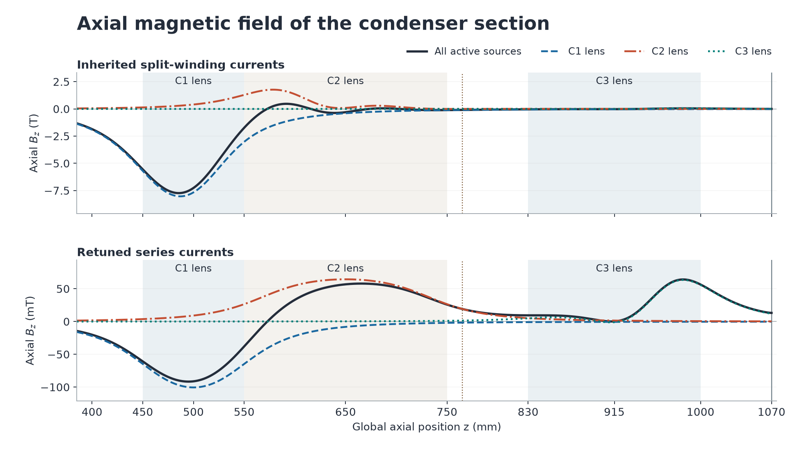
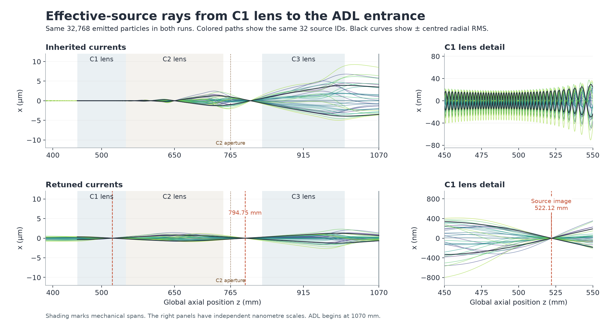
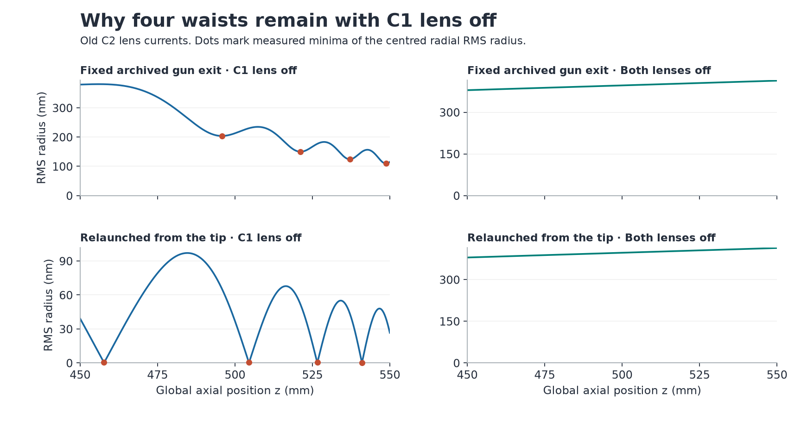

# C1 lens and C2 lens from the effective source

In the 300 kV three-condenser Nanoprobe Normal model, setting every C1 lens winding group to **−41.0 A** and every C2 lens group to **+19.5 A** produces one demagnified effective-source image at **522.117 mm**. The next radial waist is **794.747 mm**, in the free gap between the C2 lens and C3 lens. The beam contracts in both principal directions throughout the C3 lens to ADL gap and reaches ADL without crossing. This operating point covers emission through the ADL entrance at 1070 mm. Specimen convergence and probe size require separate downstream tracking. [Operating currents and measured planes](evidence/condenser-source-working-point.json)

## Current and field accounting

Each row lists winding groups in increasing axial position. A negative current reverses the registered winding polarity. Both windings have inner and outer diameters of 96 and 156 mm. Counts come from the installed nominal winding model. Real-instrument currents and turn measurements are unavailable.

| Quantity | C1 lens | C2 lens |
| --- | ---: | ---: |
| Winding interval (mm) | 455–545 | 569–731 |
| Physical turns per group | 75, 75, 75, 75 | 135, 135, 135, 135 |
| Inherited group currents (A) | −3762.19, −4834.79, −4006.98, +1120.96 | +2046.77, −1502.07, +764.60, −217.32 |
| New current in each group (A) | −41.0 | +19.5 |
| Net ampere-turns before / after | −861225 / −12300 | +147416 / +10530 |
| Winding's signed axial peak before | −8.0290 T at 486.9 mm | +1.7728 T at 578.5 mm |
| Winding's signed axial peak after | −0.10043 T at 500.0 mm | +0.06450 T at 650.0 mm |

At 486.9 mm the four old C1 lens contributions are −2.413, −3.619, −2.428 and +0.431 T. Their sum accounts for the 8 T result. The total field from all active owners in the C1 lens housing peaks at −7.732 T at 485.4 mm before tuning and −0.09157 T at 495.1 mm after tuning. The C3 lens retains its four currents and its signed 63.51 mT self-field peak. Its four physical winding groups have 128, 128, 127 and 127 turns. The Mini Condenser, joint-corrector solution, objective at −28.2203 A, projection windings and scan drives retain their parent settings. [Field ledger and winding coordinates](evidence/condenser-source-field-audit.json)



## Source image and trajectories

Both main calculations launch the same 32,768 original positive-current records from the effective source, with a nominal 5 nm FWHM and identical positions, directions, energies, IDs and weights. Their total emitted current is 15 µA. Each gun calculation includes the downstream fringe field appropriate to its own currents. Native three-dimensional Lorentz tracking continues from the 450 mm exit through the physical 100 µm diameter C2 aperture, with faces at 764.9 and 765.1 mm. The 1 mm diameter C1 aperture remains in place. All 32,768 particles passed the C2 aperture and reached ADL in both relaunched runs. The current weights are preserved. [Sampled fields, trajectories, particle identities, weights and end states](evidence/condenser-source-comparison.npz)

| Axial interval | Inherited currents, new gun trace | Tuned currents, new gun trace |
| --- | ---: | ---: |
| C1 lens housing, 450–550 mm | 44 radial waists | 1 at 522.114 mm |
| C2 lens housing, 550–750 mm | 4 | 0 |
| C2 lens to C3 lens, 750–830 mm | 1 at 806.015 mm | 1 at 794.747 mm |
| C3 lens housing, 830–1000 mm | 0 | 0 |
| C3 lens to ADL, 1000–1070 mm | 0 | 0 |

A radial waist requires a contraction-to-expansion change of the centred radial second moment. The two eigenvalues of the transverse symmetric position–slope covariance give the same five interval counts. Source imaging was measured separately. At 0.30 eV launch energy, symmetric angular perturbations of ±1 and ±0.5 µrad and position perturbations of ±1 and ±0.5 nm give one C1 lens image at 522.11665 mm. The singular values of its position transfer are 0.173521 on both axes, a 5.76-fold linear demagnification. A 1 µrad change in source direction gives at most 0.0000013 nm of first-order displacement there. The 0.025 and 0.05 mm maximum column steps give identical waist counts and agree on both reported planes within 0.001 mm.

An independent paraxial integration from the tip finds only two source-image zeros through ADL at 522.118 and 794.750 mm. With the tuned C2 lens off, it finds only the C1 lens image at 516.656 mm. With the tuned C1 lens off, it finds one image at 682.617 mm. Turning off both removes all source-image zeros through ADL. For the current search, all four groups within each lens carried the same current. Among 328 settings meeting the paraxial topology requirements, the selection favoured an image near 525 mm and a gap waist near 792 mm. The finite-source results above measure the selected setting. [Perturbations and independent first-order controls](evidence/condenser-source-field-audit.json)



## Origin of the four residual waists

With the old C2 lens currents retained, switching off every C1 lens winding makes its own computed field exactly zero. The C2 lens fringe reaches 1.292 T at the downstream edge of the C1 lens housing. Switching off both lenses leaves at most 0.188 mT from the other registered sources in that housing. The paraxial magnetic focusing power depends on the square of the total axial field at fixed electron momentum. A strongly overexcited, extended field can produce repeated contractions.

| Gun condition with inherited currents | Waists in the C1 lens housing with C1 lens off (mm) | Both off |
| --- | --- | ---: |
| Archived 450 mm exit, 32,768 original particles | 495.77, 521.18, 537.07, 548.78 | 0 |
| Relaunched in each switch setting, 4,096 original particles | 457.74, 504.52, 526.59, 541.00 | 0 |

The four waists persist after relaunch and require the old C2 lens excitation. Their locations are sensitive to the incoming phase space. The figure compares the two handoffs with the same 4,096 original IDs and 0.025 mm maximum column step. With both lenses powered, the archived exit gives 35 waists in the C1 lens housing and 30,432 survivors at ADL. Relaunching the 32,768 identical emission records in the inherited current field gives 44 and 32,768 respectively. [Current-off measurements](evidence/condenser-source-working-point.json)



## Historical fields and boundary

- **Gun exit.** Restoring the archived instrument and its original field evaluator reproduces the original coefficient-table SHA-256 byte for byte. At 450 mm its on-axis field was −0.212 mT. The inherited column at the same coordinate requires −5.55655 T and the tuned column requires −0.06075 T. Using the saved exit therefore carries phase space from an incompatible field into the column. Both comparative traces here start at emission. The new handoff checks the source, weights, field solutions, windings, drives, apertures and gun solver. Replay tests accept the matched exit and reject both a 0.01 A change in the C1 lens current and the historical exit substituted at its path. [Gun reconstruction and handoff tests](evidence/condenser-source-working-point.json) · [Field and replay audit](evidence/condenser-source-field-audit.json)
- **Round-coil fields.** The new transport rebuilds the winding derivatives from the current group geometry and integer turns. As an independent on-axis check, the closed-form volume integral for a rectangular annular winding agrees with all 39 historical unit-current field groups to at most 5.59 × 10⁻¹⁷ T/A. The inherited total round-winding field is reproduced to 1.04 × 10⁻¹³ T between the gun exit and ADL. The background left by the old group subtraction agrees with the four named projection windings to 2.38 × 10⁻¹⁵ T. This accounts for the apparent residual and excludes an extra historical C1 lens or C2 lens field in the audited section. [Winding-by-winding comparison](evidence/condenser-source-field-audit.json) · [MIT, magnetostatic fields from steady currents](https://web.mit.edu/6.013_book/www/chapter8/8.2.html)
- **Material fields.** The joint corrector, including ADL and TL12, uses the matching nonlinear solution. The circuit geometry, B–H assignments, drive and mesh identity agree with the registered tracking table. The objective geometry, ARMCO iron curve, ampere-turns and stored field agree with the parent solution. Their corresponding vacuum windings are disabled. The gun electric grid also matches. Comparing the gun magnetic evaluator against independent off-axis samples gives at most 5.0 × 10⁻¹¹ T error upstream. At the 450 mm interface the jointly solved corrector's exterior evaluation and its interior tracking table differ by 0.475 µT in axial field. [Field identities, grids and interface values](evidence/condenser-source-field-audit.json)
- **Upstream model limit.** The C1 lens and C2 lens have pole geometry in the assembly. In this operating point the two lenses still use prescribed vacuum winding fields. Their pole material response and the associated flux return have not been solved for these currents. The quoted currents, demagnification and C2 fringe are predictions of this upstream field model. [Inherited field assignment](joint-three-plane-focus.md) · [Installed magnetic elements](field-range-inventory.md)

## Replay

In the prepared study environment, the following commands reproduce the current search, authenticated effective-source exits, controls and figures. The archived-gun comparison uses the original published checkout under `outputs/default-ideal-coil-probe-20261117/published-checkout`. Restore the joint FEM first if its tracking table is absent. [Restore the parent field](joint-three-plane-focus.md#replay)

```powershell
$study = 'docs/development/cescor_direct_probe_20261121'
$python = '.\.venv\Scripts\python.exe'
& $python "$study/condenser_archived_gun.py"
& $python "$study/condenser_source_search.py"
foreach ($caseName in 'before','after') {
    & $python "$study/condenser_source_gun.py" $caseName --count 32768
}
foreach ($caseName in 'c1_off','both_off') {
    & $python "$study/condenser_source_gun.py" $caseName --count 4096
}
& $python "$study/condenser_source_trace.py" before after --count 32768 --step 0.025
& $python "$study/condenser_source_trace.py" after --count 32768 --step 0.05
& $python "$study/condenser_source_trace.py" c1_off both_off archived_c1_off archived_both_off --count 4096 --step 0.025
& $python "$study/condenser_source_trace.py" archived_before archived_c1_off archived_both_off --count 32768 --step 0.0375
& $python "$study/condenser_provenance.py"
& $python "$study/render_condenser_source.py"
```
