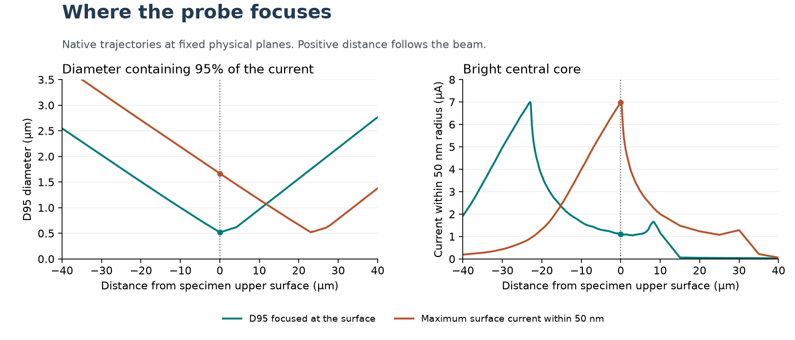
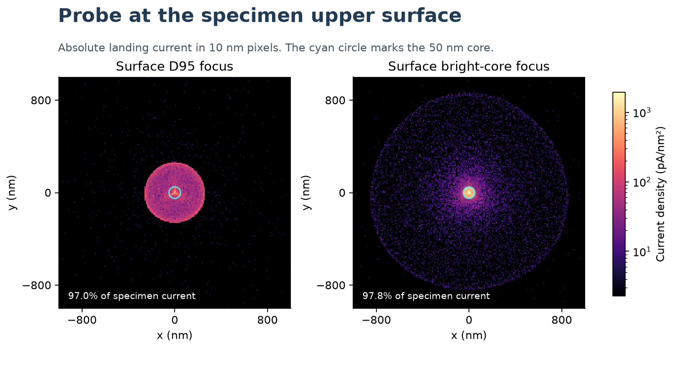
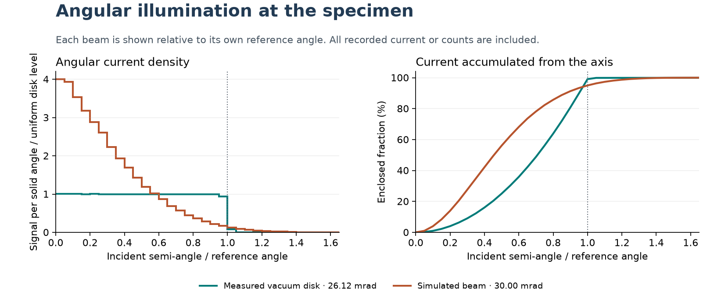

# Specimen focus, hexapole relay and angular illumination

The 300 keV column can put the full-current D95 waist on the specimen upper surface at 30.000 mrad. Its diameter there is 521 nm, and the most concentrated 50 nm core forms 23 µm upstream. A full-field transfer test finds a separate optical mismatch. The two nominal hexapole midplanes transmit a change of incoming slope almost as strongly as a free drift. The published CESCOR design requires these planes to be conjugate. The illumination also differs substantially from a measured STEM vacuum disk. [CESCOR design, Fig. 2](https://www.ceos-gmbh.de/de/produkte/stemkorrektoren/dcor-ascor/Mueller2006a.pdf) · [Numerical results and winding settings](evidence/focus-and-pupil.json)

## Where the beam focuses

All settings use the same 32,768 original positive-current particles, energies and 15 µA gun current. The 100 µm C2 aperture, nominal 1 mm C1 aperture, installed gun aperture, pole geometry, materials, 300 keV beam energy and specimen upper surface at z = 1599.1999975 mm are fixed. Original IDs, weights and interception owners agree across all six records. D95 is measured about the current centroid, while the core disk stays on the installed optical axis. Negative axial offsets point towards the gun.

| Setting | Surface α95 (mrad) | Surface D95 (nm) | D95 waist offset (µm) | Surface current in 50 nm radius (µA) | Maximum 50 nm current offset (µm) |
| --- | ---: | ---: | ---: | ---: | ---: |
| Previous A₂ adjustment | 29.9838 | 559.17 | −0.775 | 1.046 | −24.9 |
| Surface D95 focus | 30.0000 | 521.16 | 0.000 | 1.107 | −23.0 |
| Same currents, half the integration step | 30.0000 | 521.13 | 0.000 | 1.107 | — |
| Mini Condenser optimized for the 50 nm disk | 29.9895 | 1670.85 | +23.0 | 6.989 | +0.1 |

At the surface-D95 setting the central disk contains 7.004 µA at −23.0 µm. D95 there is 1665.49 nm. The 100 nm radius disk reaches its maximum at −16.3 µm. The RMS radius is 1.510 µm on the surface and reaches 1.434 µm at −28.0 µm. Moving the bright-core focus to the surface exchanges a narrower center for a wider envelope. The position of the 50 nm current peak is sampled at 0.1 µm intervals near its maximum. At the D95 minimum the neighboring planes are ±0.5 nm. This spacing describes the sampling grid. The model and source accuracy are coarser.



The maps below use the same specimen plane, pixel area and absolute current-density scale for both settings. Each occupied pixel sums original packet currents. Dark empty pixels have zero sampled hits. The percentage gives the share of the entire surviving beam inside the displayed square.



One original packet is intercepted by the C2 aperture and two by the objective bore. The foil receives a 56.64 µm D95 footprint. Of the emitted current, 14.99863 µA reaches the specimen. The previous crossover near 63 mm upstream is absent, and both axes have one crossover between C2 and C3 at 907.50–908.25 mm. A packet carries 457.76 pA. No packet landed within the 50 **pm** radius at the upper surface, so the calculation cannot resolve a 100 pA atomic core. The central currents in the table use a 50 **nm** radius. The reported gun-exit spot and divergence are prescribed model values. Their counterparts on the user's instrument are unknown.

## Do the two hexapoles image one another?

For a conjugate pair, rays leaving a point in HP2 at slightly different slopes land at the same point in HP1 to first order. The published CESCOR also conjugates the hexapole midplanes to the coma-free aperture plane of the objective. In the installed coordinates the beam reaches HP2 at 1144.50 mm and HP1 at 1300.85 mm. The two nominal midplanes are 156.35 mm apart. [Müller et al., optical design](https://www.ceos-gmbh.de/de/produkte/stemkorrektoren/dcor-ascor/Mueller2006a.pdf)

We replayed each of the 32,765 common survivors to HP2, held its position and energy fixed, and perturbed its x or y slope by ±1 and ±2 µrad. Each particle retained its original electrostatic energy reference and loss history. A zero perturbation reproduced the uninterrupted HP1 landing to within 0.01 pm. The two singular values describe the strongest and weakest transverse responses, independent of the rotation between the two planes. A value of 152 mm/rad corresponds to a 0.152 µm shift for an actual 1 µrad perturbation.

| Signed TL21 / TL22 current (A) | Median strong / weak response (mm/rad) | Surface D95 (nm) | D95 waist offset (µm) | Surface α95 (mrad) |
| --- | ---: | ---: | ---: | ---: |
| +4 / −4 | 152.25 / 151.84 | 523.79 | −0.006 | 30.0000 |
| +5 / −5 | 152.20 / 151.79 | 521.16 | 0.000 | 30.0000 |
| +6 / −6 | 152.13 / 151.72 | 513.46 | 0.000 | 30.0000 |

Each row has a separate nonlinear material-field solution. TL12 and Mini Condenser were refocused for each field. HP1 and HP2 stayed at +0.01752 and −1.0 A, the two HPol drives at +0.053452 and −0.833845 A, and the objective at −21,253.2 ampere-turns. At ±5 A the closest tenth of the rays to the HP2 axis gives 152.04 and 151.94 mm/rad. Halving the slope perturbation changes any matrix entry by less than 0.000002 mm/rad across these three fields. Thus an illumination ray's angle strongly affects its location at the next hexapole, even near the axis. These measurements isolate a failure of the relay at the tested excitations. Establishing which winding calibration, field strength or registration is responsible requires an independent check of the transfer optics. The test does not set a pole-shape resolution limit.

The field tables use cubic transverse interpolation at 0.15 mm pitch and 0.5 mm axial pitch, with a nominal 3.8 mm material mesh. Halving the particle integration step from 0.075 to 0.0375 mm changed the ±5 A surface diameter by 0.025 nm. Material discretization has a larger effect. At the previous A₂ setting a 3.2 mm material mesh gave 638.2 nm against 559.2 nm at 3.8 mm. The small diameter differences between relay settings have not been qualified against material-mesh uncertainty. [Earlier field and mesh comparisons](README.md#continuing-the-a₂-trim-with-cubic-field-interpolation)

## What the aberration fits explain

The surface-D95 setting has a full-current D50 of 412.7 nm. Rays at 10–12 mrad land at a median radius of 256.0 nm with a 10th–90th percentile interval of 253.5–259.0 nm. The medians for 18–20 and 29–30 mrad are 46.7 and 72.0 nm. At 32–34 mrad the median is 1.36 µm. This directly ties the broad ring to the transport of different angles. The threefold modulation describes a further variation around the ring.

Using actual mechanical directions at the surface, we fit the gradient of a scalar aberration polynomial to the two-dimensional landing errors. Five folds grouped by original particle ID give out-of-sample residuals. For each cohort the training minimizes current-weighted squared position error with all azimuthal components through the stated geometric order. The table reports the diameter of the held-out residuals. A relay winding cannot in general supply an arbitrary fitted gradient.

| Model for landing error | D95 of residuals, rays ≤30 mrad (nm) | D95 of residuals, all survivors (nm) |
| --- | ---: | ---: |
| Observed diameter before fitting | 513.28 | 521.16 |
| Through third order | 314.95 | 3302.68 |
| Through fifth order | 90.96 | 544.56 |
| Through seventh order | 6.99 | 102.62 |
| Through ninth order | 6.99 | 16.27 |

The fits describe the angular dependence, including the impact of tails on a least-squares objective. They do not deliver those currents or probe diameters. Within 30 mrad the fifth-order decomposition gives signed radial shifts of +1.216, −4.109 and +2.912 µm at the pupil reference radius from defocus, C₃ and C₅. These terms largely cancel there and add differently at smaller angles. A₂ contributes a 15.7 nm RMS displacement at that radius and D₄ about 6.6 nm. These effective coefficients vary with fit range and are unsuitable as direct winding settings. In a separate two-component fit inside 30 mrad, including energy-dependent terms reduced the held-out D95 from 3.26 to 0.417 nm. The source energy RMS width is 0.127 eV. This identifies energy correlations that warrant a chromatic-response measurement.

## Angular illumination measured in vacuum

We used the original large-angle 4D-STEM acquisition by Antonin Louiset and colleagues at 80 kV. The authors identify a vacuum patch at scan indices `[150:158, 4:12]`. We summed its 64 raw 256 × 256 diffraction frames before thresholding or pupil masking. Detector calibration gives 0.635 mrad per pixel, center (126.778, 126.832) pixels and disk edge 26.119 mrad. All 43,491,941 detector counts contribute to the reported fractions. The simulated beam is normalized to its total surviving current. Its 30 mrad reference is a 95th percentile, with a median of 13.66 mrad and a maximum of 48.56 mrad. [Louiset et al., 2026](https://doi.org/10.1088/2515-7639/ae6e71) · [Authors' data](https://doi.org/10.5281/zenodo.19238708)

| Fraction of each reference semi-angle | Raw measured detector signal | Simulated current |
| --- | ---: | ---: |
| 0 to ⅓ | 11.11% | 32.44% |
| ⅓ to ⅔ | 33.28% | 42.82% |
| ⅔ to 1 | 54.69% | 19.73% |
| Beyond 1 | 0.92% | 5.00% |

The three in-disk annuli average 128.0, 127.6 and 125.8 counts per pixel per exposure. Nearly uniform illumination per solid angle therefore produces more counts in each successive annulus of equal radial width. In the small-angle limit a uniform disk gives an enclosed fraction of approximately (α/α_edge)². A 30 mrad hard edge would then give α95 ≈ 29.24 mrad. The experimental disk gives α95 = 25.50 mrad at a 26.12 mrad edge. Alternate scan positions in the vacuum patch give fractions within 0.012 percentage point of each other. Subtracting the mean pedestal measured between 50 and 70 mrad changes the outside fraction from 0.92% to 0.83%. These particular settings on another instrument establish a measured example. A vacuum diffraction disk characterizes angular intensity, while identifying the wave aberrations requires phase-sensitive information.



## Atomic-resolution criterion

A uniform, fully coherent 300 keV circular pupil with a true 30 mrad edge has a calculated Airy FWHM diameter of 33.77 pm and a D95 diameter of 257.02 pm. These diameters use different fractions of the same ideal intensity profile. In experiment, a CESCOR-equipped 300 kV Titan resolved 78 pm Si〈112〉 dumbbells, and a separate 300 kV instrument resolved 63 pm GaN spacings at 29.4 mrad and about 10 pA. Different correctors, source sizes and acquisition conditions matter. [CESCOR experiment, Fig. 1](https://www.ceos-gmbh.de/de/produkte/stemkorrektoren/dcor-ascor/Mueller2006a.pdf) · [Yücelen, Lazić and Bosch, 2018](https://pmc.ncbi.nlm.nih.gov/articles/PMC5805791/)

For this instrument model the next optical checks are the HP2–HP1 conjugacy, the conjugacy to the objective aperture plane, and the transfer-lens current-to-field calibration. A vacuum disk and absolute specimen current measured at the same 100 µm C2 setting would independently constrain the incident phase-space distribution. After those checks, calibrate the two hexapole excitations and the relay magnification against C₃/C₅ over the illuminated disk, then measure remaining A₂/D₄ and energy dependence. Verify probe core current and the full-current envelope at the same upper surface. The intended final test is a CUDA mixed particle–wave Si[110] scan that resolves the 0.136 nm pair at the declared specimen current. The current and size measured here have not reached that validation stage. [Si〈110〉 HAADF image and line profile](https://www.hitachi-hightech.com/file/us/pdf/library/literature/Hitachi-HD-2700FE-STEM-HTD-E171_0.pdf)

## Reproduction

From the project environment, the following reproduces the plots directly from the archived results.

```powershell
$study = 'docs/development/cescor_direct_probe_20261121'
python "$study/focus_and_pupil.py" figures
```

For a full replay, the parent study documents the physical gun checkpoint, column generation and nonlinear field preparation. The field tags are `a2-cubic-both` for ±5 A, `focus-audit-tl4` for ±4 A and `focus-audit-tl6` for ±6 A. Use `adjust_a2.py field` with the HP/HPol currents above and the corresponding `--tl21` and `--tl22` settings, then use `adjust_a2.py refine-grid`. The JSON includes per-case field and source digests, exact winding currents, TL12 and Mini gains, objective receipts and integration steps. The following replays the native cases with those saved settings, including the half-step comparison. [Field preparation](README.md) · [Settings](evidence/focus-and-pupil.json)

```powershell
$s = Get-Content "$study/evidence/focus-and-pupil.json" -Raw | ConvertFrom-Json
$fields = 'outputs/cescor-a2-20261121'
foreach ($job in $s.model_runs.PSObject.Properties) {
    $v = $job.Value
    $tlGain = $v.tl12_gain.ToString('R', [cultureinfo]::InvariantCulture)
    $miniGain = $v.mini_gain.ToString('R', [cultureinfo]::InvariantCulture)
    python "$study/adjust_cs.py" verify $job.Name --table "$fields/$($v.field_file)" --interpolation cubic --ni $v.objective_At --tl $tlGain --mini $miniGain --count $v.emitted --step $v.max_step_mm
}
foreach ($run in 'a2-cubic-both-fine','focus-audit-native','focus-audit-bright-core') {
    python "$study/focus_and_pupil.py" core-focus $run
}
foreach ($run in 'focus-audit-native','focus-audit-tl4-native','focus-audit-tl6-native') {
    python "$study/focus_and_pupil.py" relay $run
}
python "$study/focus_and_pupil.py" analyze
python "$study/focus_and_pupil.py" figures
```

To repeat the bright-core current search use `focus_and_pupil.py search-core`. To repeat the experimental extraction use `focus_and_pupil.py experiment <path-to-swcnt_dataset_150x170.h5>` in an environment with h5py. The HDF5 member in the authors' ZIP is `swcnt_4DSTEM/large_angle/ptycho_exp/swcnt_dataset_150x170.h5`, CRC32 `8da613c9`. The included derivative contains sums of even and odd vacuum frames plus their angular calibration. Credit is due to Antonin Louiset and coauthors. Changes comprise selection, summation and radial binning of the original frames. [Derived vacuum counts](evidence/louiset-vacuum-roi.npz) · [Original data](https://doi.org/10.5281/zenodo.19238708) · [Creative Commons Attribution 4.0](https://creativecommons.org/licenses/by/4.0/)
