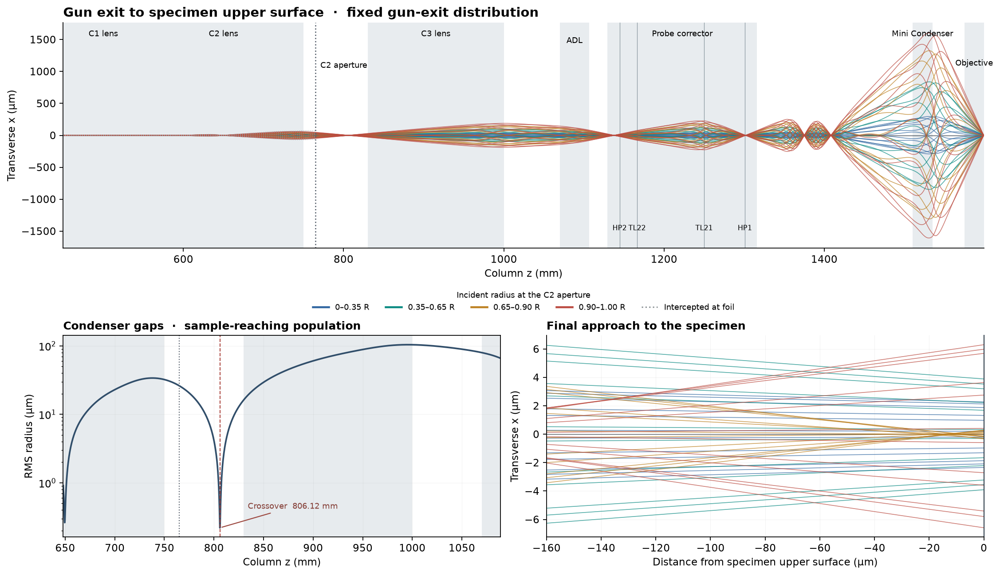
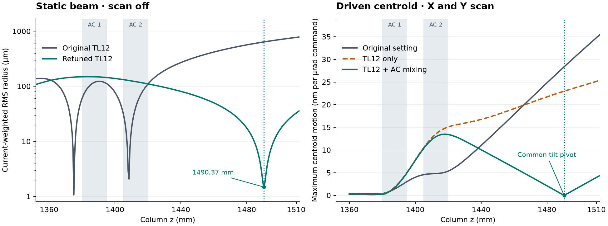
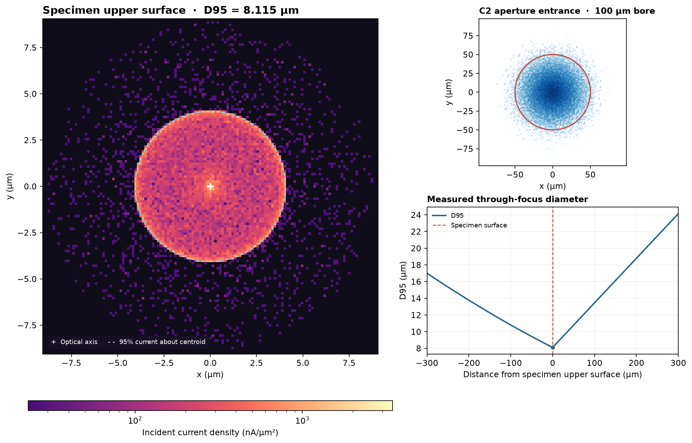

# Illuminated 100 µm C2 aperture and the effective tip source

This local 300 keV calculation starts with the 1.542 / 0.260 condenser setting and the archived 32,768-particle gun exit at column z = 450 mm. On that entrance distribution the retuned column has a 30.000 mrad pupil edge and an 8.115 µm specimen-surface D95. The calculation does not establish a 50-fold tip image. The changed condenser fringe field extends into the region that supplied the archived gun exit.

## Condenser and focus measurements

| Stage | Incident D95 at C2 aperture (µm) | Specimen pupil edge (mrad) | Specimen α95 (mrad) | Specimen D95 (µm) |
| --- | ---: | ---: | ---: | ---: |
| 1.542 / 0.260 | 14.00 | Unilluminated | 4.160 | 0.367 |
| C1 lens adjusted, starting C2 and C3 currents | 143.30 | — | — | — |
| C1 lens held, C2 and C3 lenses adjusted | 107.48 | 30.000 | 26.702 | 28.162 |
| Mini Condenser and objective refocused | 107.48 | 30.000 | 26.705 | 8.115 |

The C1-only run populated the 47.5–50 µm entrance annulus in all 16 azimuthal sectors, with 25,900 original packets passing the foil. The later stages held those C1 currents fixed. The final 128 physical-edge diagnostic trajectories reached the specimen, giving 29.960–30.000 mrad by azimuth. The original finite source supplied 251 passing packets in the outermost 2% of the radius, reaching 29.998 mrad. The transmitted current was 13.9142 µA out of 15 µA at the gun exit. The finite 0.2 mm thickness and both faces of the C2 aperture remained active.

| Excitation | Final model setting |
| --- | --- |
| C1 lens windings in axial order | −3762.191, −4834.791, −4006.984, +1120.964 A |
| C2 lens windings in axial order | +2046.768, −1502.072, +764.601, −217.323 A |
| C3 lens common gain | 0.402441 of the same reference used for the starting 0.260 setting |
| C3 lens peak axial self-field | 0.06351 T |
| Mini Condenser common gain | 0.99072749 of its starting value |
| Objective excitation | −14,551.5 At, with both lobes on the installed material-field solution |

The independent C1 and C2 model windings include a reversal of the fourth winding in each lens. These current settings have no hardware calibration. At 0.25 mm observation spacing, all 36 transverse directions had a single crossover between 806.00 and 806.25 mm. The gap between the C3 lens and the adapter lens contained none. The corrector and adapter drives were held at their archived values.

### TL12 output waist and AC scan matching

The illustrated setting fails the direct TL12-to-AC relay. The 32,768 original gun-exit particles were replayed with the raster, wobble and all DP12 steering offsets at zero. With TL12 at the illustrated excitation, the x and y widths reach minima at 1375.00–1375.25 mm inside TL12 and at 1408.25–1408.50 mm between the upper and lower AC interaction centers (1387.5 and 1412.5 mm). With only the TL12 winding currents set to zero, both minima disappear from the 1340–1422 mm interval. The same result holds for the 30,396 original particles that traversed this interval in both runs. The other physical fields and the 100 µm aperture were held fixed. The physical scan pair supplies transverse deflection during scanning.

The Mini Condenser plus incident-side objective field gives a specimen-referenced canonical front focal plane at 1490.37 mm, about 82 mm downstream of the AC-region waist. The calculation retains both poles of the installed objective's material-field solution up to the specimen upper surface. At 1408.5 mm a 1 µrad input tilt produces approximately 1.401 µrad of specimen angular change in this two-lens field. At 1490.37 mm the same tilt gives 48.96 nm specimen shift in either transverse direction, a canonical angular change below 0.000003 µrad and a mechanical angular change of 0.0267 µrad in the immersion field. Symmetric 1 and 0.5 µrad perturbations were traced independently along x and y. In the complete installed field an additional first-order focal solution lies inside the AC pair at 1389.03 mm. These optical transfer measurements used zero commanded scan. [Static TL12 control and focal-plane checks](evidence/scan-waist-audit.json)

#### Matching the virtual scan pivot downstream of both windings

The lower winding ends at 1420.00 mm. The independent two-lens front focus lies 70.37 mm beyond that exit. Scaling all three signed TL12 currents to 0.300463 of the reference gives a single radial waist from 1352 to 1512.5 mm. The two principal position–slope covariances reverse sign within 1490.345–1490.395 mm. The RMS radius at the target is 1.480 µm. The weaker branch was first solved on 4096 original particles at 0.15 mm maximum step and then on all 32768 at 0.075 mm. The field, original weights, physical contacts, Mini Condenser, objective and 100 µm C2 aperture are common to both settings. The comparison starts at the archived gun-exit distribution at 450 mm. [Finite-source measurements](evidence/downstream-waist.json)

Separate X and Y perturbations of each station used all four closed saddle-winding current channels, their saved ampere calibration, the overlapping fringes and the full installed static fields. A two-by-two lower-from-upper station command matrix gave the common virtual pivot. Its rows are (−1.09439, +0.42018) and (−0.55302, −1.10248) in laboratory X/Y command axes. Opposite drive signs retained identical particle IDs in each comparison. The original pairing moved the centroid by up to 28.36 nm per µrad command at the target, or 22.98 nm with TL12 alone retuned. Transferring the coarse calibration to the finer calculation left 0.00112 nm/µrad. Refitting in the fine calculation gave two independent tilt gains of 0.175 and 0.203 µrad/µrad, reproduced with half-amplitude perturbations. The specimen shift gains were 8.19 and 9.50 nm/µrad with mechanical slope gains of 0.0072 and 0.0084 µrad/µrad. The largest sampled vector field error against the direct winding evaluation was 0.061% over 192 checks per channel in the refined table. These are model calibrations. [Driven position and angle measurements](evidence/downstream-pivot.json)

| At the specimen upper surface | Original setting | Downstream waist and pivot matched |
| --- | ---: | ---: |
| Maximum angle from the physical C2 edge (mrad) | 30.000 | 0.224 |
| Current-weighted α95 (mrad) | 26.704 | 0.154 |
| D95 diameter (µm) | 8.115 | 269.244 |
| RMS radius (µm) | 3.335 | 79.106 |
| Current inside a fixed 50 nm axial radius (nA) | 43.03 | 0 at this sampling |
| Transmitted current (µA) | 13.914 | 13.920 |
| Surviving / effective source packets | 30396 / 30396 | 30409 / 30409 |

The two-lens front focus converts angular spread at that plane into spatial spread at the specimen. The focused TL12 waist there produces an almost parallel, broad specimen beam with this particular downstream excitation. The local relay match therefore fails the 30 mrad specimen-probe condition. The simulated winding geometry and frozen gun-exit distribution limit the interpretation of the numerical currents and axial positions.

The objective-current study measures how specimen scan scale, scan rotation and the driven pivot respond when the coil mixing stays fixed during focusing. It also documents how commercial S/TEM platforms use a reference focus, diffraction-plane wobble and a real-space length calibration. [Objective focus and STEM raster calibration](scan-focus-calibration.md)

### Specimen focus in the original 30 mrad setting

The nominal upper specimen surface is at 1599.1999975 mm. The two finest native integrations used 18.75 and 9.375 µm maximum axial steps, with identical original IDs reaching the specimen. The measured D95-minimum brackets relative to the surface were [−0.25, +0.25] nm and [−0.50, 0.00] nm at 0.25 nm local observation spacing. The specimen D95 changed by 0.0072 nm between the two integrations. The RMS-radius minimum was about 77 µm downstream, as measured on the separate vacuum extension. The figure uses unsmoothed, current-weighted landed packets on the physical surface. The dashed circle contains 95% of the transmitted current about its centroid.

## Effective tip and source conjugacy

The archived launch plane is z = 0 mm. Its effective source has a nominal transverse FWHM of 5.0 nm. A 50-fold linear demagnification would give a geometrical source image of 0.10 nm FWHM. A true source image requires near-zero landing-position response to launch angle at fixed emission position. Only at such a plane does the landing-position response to emission position define the image magnification.

For this boundary-conditioned study we fitted the gun transfer to paired launch and exit records and propagated symmetric transverse-position and angular perturbations in the native field. Fits to the inner 30%, inner 60% and full launch-angle distribution all gave about 0.233 nm of landing displacement per µrad at the lowest angular response within the C1 body. This occurred near 485.65 mm. At the inter-condenser waist near 806.1 mm the response was about 0.178 nm per µrad. Both observations retain first-order angular sensitivity, so neither certifies 50-fold source imaging. An independent fit to the actual landed packets at the nearby native nodes gave the same result.

The original archived gun used another set of winding currents. An independent reconstruction of the archived nominal settings with the current implementation gave approximately −0.21 mT on axis at the 450 mm boundary. Its full magnetic-table checksum differs from the archived one. The downstream model gives −2.081 T at the starting setting and −5.557 T at the final setting at that plane. A tip-to-specimen performance claim requires propagating the same effective tip through a consistent gun and condenser field and repeating the source-image and pupil tests.

The local working point contains the double-precision drives, absolute-current ledger, source and field identities, directional crossover checks, two numerical resolutions and the original-particle arrival data. [Working point and measurements](evidence/illuminated-normal.json) · [Original particles, selected paths and focus scan](evidence/illuminated-normal-particles.npz)
