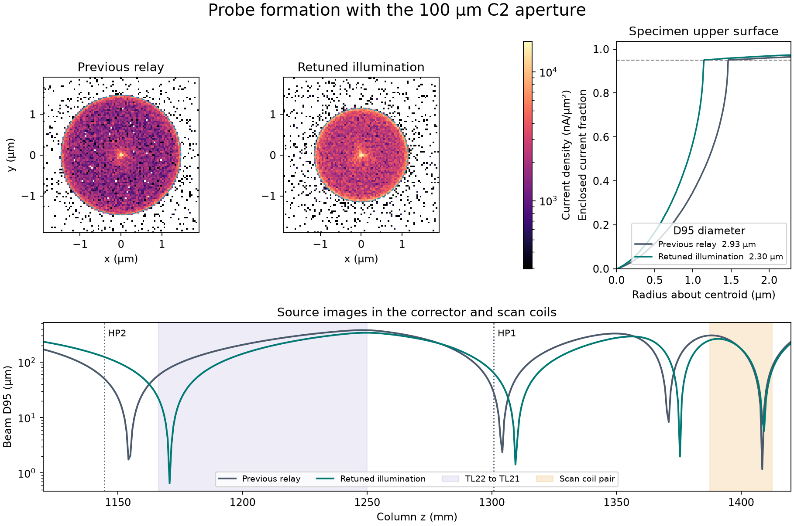

# Source images in the two-hexapole corrector and specimen probe size

This local current-only study uses the installed CESCOR-style probe corrector, the same material field for the primary comparison and the previous illumination-side objective coma-free aperture plane at 1408.05425 mm. The source is the archived 300 keV finite gun-exit ensemble. The physical 100 µm C2 foil, nominal pole geometry, material curves, winding turns, objective excitation and specimen upper surface at 1599.1999975 mm are fixed. Specimen current carries no optimization penalty. Physical contacts, original weights, energies and source identifiers remain active.

## Trajectories at the reported 2.296 µm setting

The subsequent C2 lens and C3 lens adjustment is plotted against this reference with identical source IDs. [Corrected inter-lens crossovers and illuminated semi-angle](condenser-normal.md)

Replaying the saved fields and currents reproduces the final positions, slopes, flight times and interception states of all 32,768 original particles exactly. The plots follow 42 transmitted particles selected by their radius and azimuth at the physical C2 foil, together with the single particle intercepted there. The signs of x and y are preserved throughout the column. The third full-column panel gives distance from the installed optical axis. Line counts in the figures reflect the sampling for display. The D95 calculation uses all 32,767 transmitted particles with their original weights.

The waist at 669.00–669.75 mm is **inside the C2 lens**, which ends at 750 mm. The original centre-to-centre classification was incorrect. The free gap from the C2 exit to the C3 entrance (750–830 mm) has no crossover. Both transverse axes cross at 1003.50–1004.25 mm in the C3-to-ADL gap (1000–1070 mm). Both intervals violate the Normal illumination setting. For the six plotted particles entering at 0.90–1.00 of the C2 aperture radius, the distances from the optical axis increase from 3.74–5.86 µm at 300 µm upstream to 11.83–14.41 µm at the specimen upper surface. The reported geometric edge angle of 30.000 mrad is the maximum over the 128-azimuth foil-edge check. [Full column trajectories](last-point-trajectories.png) · [Three enlarged sections](last-point-trajectories-detail.png) · [Original-ID path coordinates and replay checks](evidence/last-point-trajectories.npz)

## Two families of conjugate planes

- The selected field ray identifies conjugate **aperture planes** at HP2, HP1 and the illumination-side objective pupil. A transverse angular perturbation at the object plane should give little change in position at the image plane. This constrains the position-from-slope block B. The image magnification, orientation, outgoing slopes and nonlinear response are additional measurements.
- The axial illumination ray identifies **source images** between the core transfer lenses TL22/TL21, near DP12 and at the specimen. This assembly uses the two scan coils in the DP12 region. In the published symmetric core, placing the intermediate source image at the optical symmetry plane helps cancel the fourth-order three-lobe aberration D4. The mechanical TL midpoint is 1208.15 mm. The HP midpoint is 1222.675 mm. The optical symmetry location in this nominal, asymmetric assembly requires a field or aberration measurement. The scan-coil waist and the driven scan pivot are separate observables. [Müller et al., Fig. 2 and pp. 443–444](https://www.ceos-gmbh.de/en/produkte/stemkorrektoren/dcor-ascor/Mueller2006a.pdf#page=3) · [Hartel et al., residual-aberration alignment](https://www.ceos-gmbh.de/de/produkte/residualsCEXCOR)
- The ideal symmetric hexapole doublet also pairs the transverse scales, relative field azimuths and effective excitations of its halves. In the original three-plane working point the HP2-to-HP1 rotating-frame position magnification is −0.548, the slope magnification is −1.825 and the position-to-slope transfer is −6.11 m⁻¹. The laboratory image of a transverse displacement rotates by −115.26°. A unit-magnitude telescope with matched sextupole phase is a design reference. Its physical test uses the installed pole orientations and finite fields. The HP1-to-objective-pupil magnification is a separate control for the correction strength. [Rose, optics of the hexapole corrector](https://pmc.ncbi.nlm.nih.gov/articles/PMC5099802/) · [Müller et al.](https://www.ceos-gmbh.de/en/produkte/stemkorrektoren/dcor-ascor/Mueller2006a.pdf)

## What the DCOR design contributes

DCOR/ASCOR uses two principal hexapole stages. The advanced design suppresses intrinsic fifth-order sixfold astigmatism A5 through the effective hexapole field profile and excitation. Published design calculations explore shorter hexapole fields at the excitation required to maintain C3 compensation. These results concern effective magnetic lengths and the complete corrector-objective combination. The installed 30 mm physical pole lengths and 8 mm bores in this study are the published CESCOR dimensions. [CEOS DCOR/ASCOR](https://www.ceos-gmbh.de/en/produkte/stemkorrektoren/dcor-ascor) · [Hartel et al., residual A5 in DCOR/ASCOR](https://www.sciencedirect.com/science/article/pii/S0304399119302347)

The C3 and C5 adjustments are coupled. TL1 magnification and main hexapole excitation control C3. A change to TL1 and the objective focus can balance C5 while restoring C3. For the C5-free STEM alignment described by Müller et al., the image of HP1 moves from the objective coma-free plane toward the specimen. That alignment trades radial off-axis coma for axial performance. The comparison here keeps the previously requested coma-free conjugate. A future comparison of the two optical modes needs the driven scan response as well as the on-axis probe. [Müller et al., pp. 448–449](https://www.ceos-gmbh.de/en/produkte/stemkorrektoren/dcor-ascor/Mueller2006a.pdf#page=7)

## Measurement and interpretation

The native GPU transport uses the installed three-dimensional nonlinear material field and cubic transverse interpolation. The primary run uses 32,768 original particles. Geometric aperture-edge angles are evaluated at 128 azimuths with the actual foil faces. Current-weighted angular percentiles use only surviving physical particles. The source-image test brackets minima independently in both transverse axes using the same surviving cohort. The current density maps show direct particle landings with the same pixel area and color scale. The enclosed-current curve uses the full landing distribution.

The pupil analysis predicts the two-dimensional specimen intercept from the physical C2 entry radius and azimuth on disjoint sets of original source IDs. The first mode predicts a vector with radial and tangential components that depend on radius. The threefold and sixfold families add azimuthal variations. An independent five-fold fit uses the measured direction at the specimen, the shared ray-aberration basis through fifth order and the project's displacement convention. Omitting C3, C5 or the two A5 components in turn measures the extra prediction error. These effective coefficients include illumination, corrector, transfer and objective fields. An isolated objective coefficient or an experimental wavefront requires its own measurement.

The ideal 300 keV, uniformly filled, monochromatic circular pupil gives a scale for D95. At 30 mrad the Airy encircled-current expression gives 0.257 nm, using a wavelength of 1.969 pm. The simulated finite-source distribution differs from that illumination. Source calibration, mixed-wave propagation and a specimen-image measurement are still needed to establish atomic resolution.

The archived [numerical evidence](evidence/internal-optics.json) includes signed winding currents, optical blocks in the laboratory and rotating frames, matched sample statistics, source-image brackets, field hashes and independent angular fits. The [original-ID specimen landings](evidence/internal-optics-landings.npz) contain absolute particle weights, energy offsets, loss states and unaltered phase-space coordinates.
