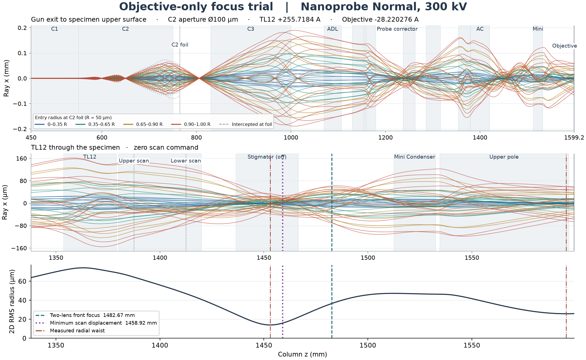
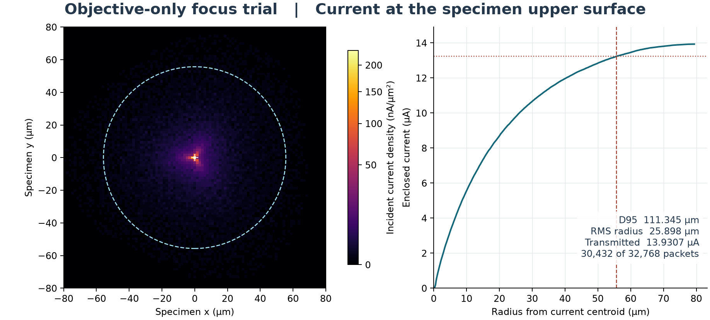

# Scan relay and objective-only focus with the joint magnetic circuit

The TL12 output waist, scan pivot and Mini Condenser–upper objective front focal plane align to about 1 µm on the radial measure at the inherited objective excitation. Changing only the objective to place the specimen D95 minimum breaks the alignment. A separate upstream control also identifies repeated two-dimensional contractions from the inherited C1 and C2 excitations. Both observations disqualify the trial as a Nanoprobe Normal preset. [Control rules](../../OPTICAL_CONTROL_ROLES.md) · [Numerical result and archive identities](evidence/joint-three-plane-result.json)

## Three planes and the specimen

The 300 kV launch contains 32,768 original particles carrying 15 µA. The physical C2 foil has a 100 µm diameter. The source checkpoint, energy offsets, aperture, Mini Condenser, C1–C3, and six inner corrector currents carry through both trials. The nonlinear eight-winding solve includes the poles, sleeves and returns. Each tested TL12 excitation used for a reported result has its own material solution. ADL carries +10 A and TL12 has 19 turns. The objective uses its installed 1,160-turn supply and a separately solved nonlinear ARMCO field. These currents describe the simulation. [Starting working point](normal-joint-field.md) · [TL12 material solution](evidence/joint-tl12-material-solution.npz) · [Objective solution record](evidence/joint-objective-material-field.json)

| Measured quantity | Relay alignment | Change only the objective |
| --- | ---: | ---: |
| TL12 current | +255.71838 A | +255.71838 A |
| Objective current | −12.541514 A | −28.220276 A |
| First radial waist after lower scan | 1490.3739 mm | 1453.0651 mm |
| Directional waist limits near that plane | 1490.2555–1490.4922 mm | 1453.0257–1453.1045 mm |
| Smallest driven scan displacement near the front focus | 1490.3749 mm | 1458.9214 mm |
| Residual position response there, two singular values | below 0.000001 nm/µrad | 8.28 and 6.94 nm/µrad |
| Mini Condenser–upper objective front focus | 1490.3749 mm | 1482.6701 mm |
| Radial waist on the final approach | 1583.6445 mm | 1595.3012 mm |
| Specimen upper surface | 1599.2000 mm | 1599.2000 mm |
| Specimen D95 | 142.229 µm | 111.345 µm |
| Specimen RMS radius | 36.291 µm | 25.898 µm |
| C2 rim convergence, min / median / max | 1.212 / 1.411 / 1.612 mrad | 0.537 / 1.648 / 2.251 mrad |
| Incident current | 13.92975 µA | 13.93066 µA |
| Current inside the fixed-axis 50 nm disk | 0 sampled | 0.916 nA (2 packets) |

The inherited +10 A TL12 and original scan mix gave a specimen D95 of 256.240 µm and a minimum scan displacement at 1590.621 mm. After setting TL12, symmetric ±1 µrad perturbations of both scan axes determine the lower winding mix. At the new pivot both centroid translations vanish to numerical precision and the two independent tilts remain, with angular singular values of 0.234 and 0.199 µrad per µrad command. The final objective-only trial retains exactly this mix. Both directions then retain translation at the closest approach. At the new front focus the residual position responses are 11.26 and 9.54 nm/µrad. The front focal plane uses the specimen-referenced canonical angular transfer in the isolated combined field. The full installed field gives 1482.563 mm in the final trial. [Initial scan](evidence/joint-baseline-scan.json) · [Aligned scan](evidence/joint-relay-scan.json) · [Final scan and independent angular checks](evidence/joint-final-scan.json)

## Where the beam contracts

The scan-off beam has one radial waist in the open C2–C3 gap at 805.731 mm after objective focusing. The C3–ADL gap and the TL12 entrance through the lower AC exit have zero radial or directional minima. In particular the previous 1408 mm crossover stays absent. The 1453.065 mm waist lies inside the 1436.5–1466.5 mm housing of the unpowered condenser stigmator. The change in objective excitation moves the waist there through the combined focusing field. The dipoles and stigmator supply no independent round focus. [Full-source tracking](evidence/joint-objective-focus.json) · [Stigmator and scan locations](field-range-inventory.md)

On the original trajectories, the last RMS waist is 3.899 mm upstream of the specimen. The specimen has a bright central feature with a broad halo. The current-weighted D95 reaches its native through-focus minimum at −0.50 nm relative to the upper surface on the primary discretization. Halving the integration step moves that minimum to approximately −47 nm while changing surface D95 by 0.00032 µm. At 16,384 source particles the minimum shifts upstream by 0.170 mm and surface D95 is 111.309 µm. The subnanometre location is specific to the numerical sample. Both full-source integration steps retain exactly the same surviving IDs and put the two downstream RMS waists within 0.0001 mm of each other. At a transverse pitch of 0.45 mm the same topology persists and the D95 minimum shifts to +0.84 µm. The 50 pm disk contains no sampled current at the surface. One packet represents 0.458 nA. [Resolution and source-count comparison](evidence/joint-objective-focus-sensitivity.json) · [Physical upper-surface landings](evidence/joint-objective-focus-particles.npz) · [Absolute incident-current histogram](evidence/joint-objective-focus-current-density.npz)

The upstream control traces the identical source through the C1 mechanical interval, 450–550 mm. With both condensers excited there are 35 radial contractions, with the same count in both principal directions. Switching off C1 leaves 4, switching off C2 leaves 39, and switching off both leaves zero. The separate prescribed-winding contributions peak at 8.03 T for C1 and 1.29 T for C2 in that interval. Every control preserves all 32,768 source particles locally. The overfocusing already exists upstream of TL12. [Matched coil controls](evidence/joint-c1-topology-control.json)

## Trajectories and current





The images count the original current of each arriving particle in its physical pixel. The fixed cross marks the optical axis and the dashed circle encloses 95% of the transmitted current about its centroid. The plotted colors use a square-root scale with absolute current-density labels. [Relay-aligned rays](joint-relay-alignment-rays.png) · [Relay-aligned probe](joint-relay-alignment-probe.png) · [Relay-aligned landings](evidence/joint-relay-alignment-particles.npz)

## Replay

The retained winding solution uses 1,485,999 tetrahedra and reached a nonlinear residual of 8.3 × 10⁻¹². The production table uses 0.5 mm axial and 0.15 mm transverse sampling. The tracking step is at most 0.0375 mm. The native through-focus measurement continues the incident rays over ±0.3 mm with the specimen interaction disabled. The figure and absolute histogram can be rebuilt from the archives without retracing.

```powershell
$study = 'docs/development/cescor_direct_probe_20261121'
$python = '.\.venv\Scripts\python.exe'
& $python "$study/render_joint_alignment.py" objective-focus "$study/evidence/joint-final-scan.json"
& $python "$study/render_joint_alignment.py" relay-alignment "$study/evidence/joint-relay-scan.json"
```

In the prepared CUDA study workspace, restore the archived fields and repeat the two measurements in order.

```powershell
& $python "$study/archive_joint_alignment.py" --restore
& $python "$study/verify_joint_alignment.py" scan --amps 255.71838 --fit
& $python "$study/verify_joint_alignment.py" capture --amps 255.71838 --tag relay-alignment
& $python "$study/verify_joint_alignment.py" scan --amps 255.71838 --ni -32735.5201
& $python "$study/verify_joint_alignment.py" capture --amps 255.71838 --ni -32735.5201 --tag objective-focus
& $python "$study/check_joint_focus.py" --amps 255.71838 --ni -32735.5201
& $python "$study/check_c1_topology.py" --amps 255.71838
```
