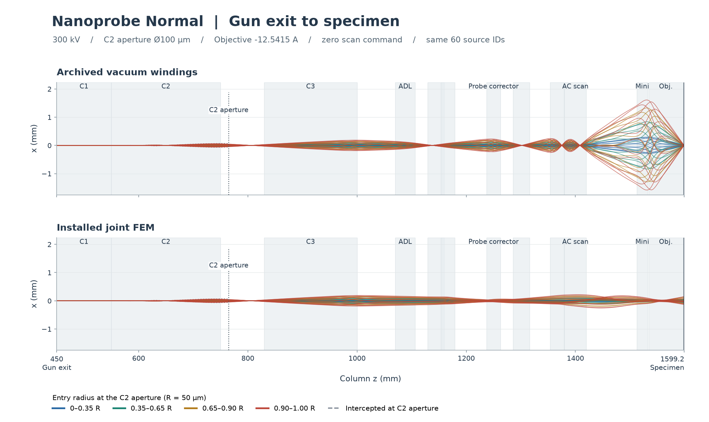
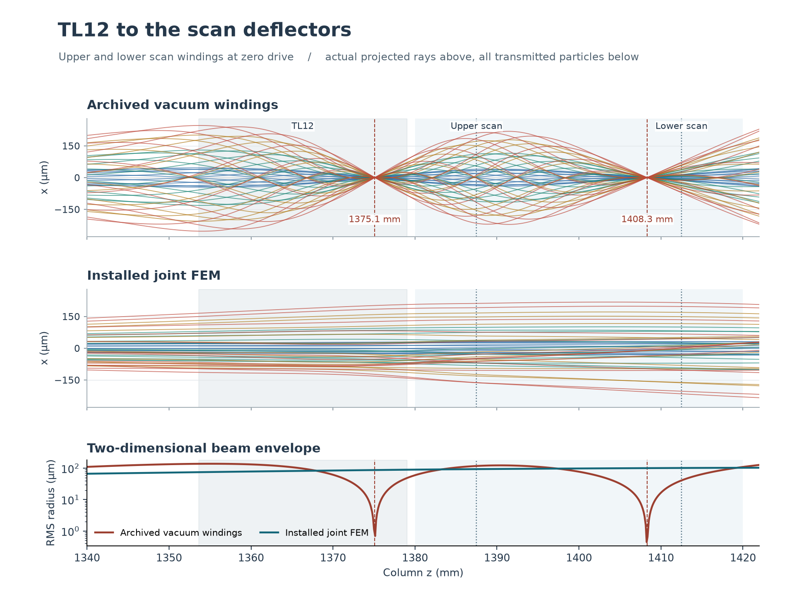

# Nanoprobe Normal trajectories with the joint corrector field

The extra static crossover near 1408 mm disappears when the installed ADL–TL12 magnetic circuit replaces the archived field representation. The earlier crossover near 1375 mm also disappears. The result applies to the 300 kV, three-condenser working point at the fixed lens currents specified below. The current-weighted beam is expanding throughout the AC scan housing.

## Fixed controls and field assignment

The replay inherits the final currents, 100 µm C2 aperture diameter, 450 mm gun-exit phase space and 1599.1999975 mm specimen entrance plane from the [objective-focused working point](evidence/normal-objective-probe.json). The objective stays at −14,548.156 ampere-turns (−12.541514 A). C1, C2, C3, Mini Condenser and the six existing corrector supplies keep their signed currents. AC scan, wobble and DP12 offsets are zero.

The new working point uses one vector field from the nonlinear FEM solution of the eight energized corrector channels and 60 magnetic solids, including the pole pieces, sleeves and returns. It uses the previously audited +10 A ADL winding (23 turns) and +10 A TL12 winding (19 turns). The loader removes the three archived vacuum groups of each replaced lens everywhere in the illumination column and rejects attempts to energize them alongside the joint table. HP2, TL22, TL21, HP1 and both HPol channels enter once through the same joint solution. All other column fields retain their prior models. The comparison changes both the winding representation and the magnetic circuit at the two lenses. The earlier audit supplies a separate, equal-ampere-turn material comparison. [Current working point](evidence/normal-current-working-point.json) · [Magnetic circuit and same-current field comparison](../probe_circuit_audit_20261122/README.md)

| Quantity at fixed controls | Archived field | Joint material field |
| --- | ---: | ---: |
| Radial crossover brackets within 1340–1422 mm | 1375.000–1375.142 and 1408.254–1408.367 mm | None |
| RMS radius at upper scan, 1387.5 mm | 117.38 µm | 93.20 µm |
| RMS radius at lower scan, 1412.5 mm | 40.67 µm | 101.37 µm |
| Whole-column axial field at upper / lower scan | +429.14 / +192.37 mT | −41.58 / −41.02 mT |
| Particles reaching the specimen out of 32,768 | 30,396 | 30,433 |
| Current reaching the specimen from a 15 µA source | 13.91418 µA | 13.93112 µA |

The new corrector circuit itself contributes +1.163 and +0.774 mT at the upper and lower scan centers. The signed whole-column values in the table also contain the other energized lenses. All modeled interceptions in this replay occur at the C2 aperture. The small change in transmitted current follows from tracking the same original particles through the different fringe fields.

## Crossover check

The two upper panels of the detail figure show actual laboratory x projections of the same source IDs. Each line ends at its first physical interception or at the specimen. The bottom panel uses the two transverse coordinates of every locally transmitted particle and its original current weight. A radial waist brackets a negative-to-positive change in the sum of the centered position–slope covariances, half the axial derivative of mean-square radius. The sign is independent of rotation in the transverse plane.

At 657 axial positions spanning 1340–1422 mm, the joint field produces no radial, x-only or y-only waist. Through the AC assembly at 1380–1420 mm, the smaller eigenvalue of the symmetric transverse position–slope covariance stays above +7.87 µm·mrad. The beam therefore expands in every transverse projection at the sampled planes. Restricting both cases to the same 30,396 particle IDs gives the same conclusion. The archived control also reproduces its stored gun-to-specimen landing coordinates and loss records exactly.

Repeating the joint calculation on all 32,768 particles with the maximum transport step reduced from 0.0375 to 0.01875 mm preserves the accepted IDs and the crossover result. The largest difference in local RMS radius between the two step sizes is below 0.000181 µm. This refinement uses the same magnetic solution. The field comparison is a simulation at the audited nominal ADL and TL12 excitations. The new beam is already diverging at the specimen surface with the objective fixed. No focus or scan-pivot recalibration was performed in this replay.

## Reproduction

Each trajectory launch receives its own magnetic field and interpolation tables. Interleaving the two models reproduces the archived control particle by particle. A separate replay reproduced the previous zero-command control and four signed 1 µrad deflector perturbations. The magnet, return-part, deflector-binding and crossover suites passed 68 tests. The binding checks use the installed 6.12 mm DPH laminate bore inside the 8 mm hexapoles and the 20 mm bores of the other tested dipole inserts.

From the project root, run `.venv\Scripts\python.exe docs/development/cescor_direct_probe_20261121/plot_normal_objective_rays.py` to render both figures from saved particles on a CPU. Use `--retrace` in the prepared CUDA study workspace to rerun the old and current models from the original source, repeat the half-step check and rebuild the figures. The field loader verifies the archived objective field, corrector currents and mesh, and compares the registered axial field against all 931 locations in the magnetic audit. The saved FEM solution can regenerate the three-dimensional field table. Use `--archived` to reproduce the historical objective-focus figures. [Original FEM solution](../probe_circuit_audit_20261122/normal-joint-solution.npz) · [Transport results](evidence/normal-joint-rays.json) · [Particle IDs, trajectories, landings and contact records](evidence/normal-joint-rays.npz)
