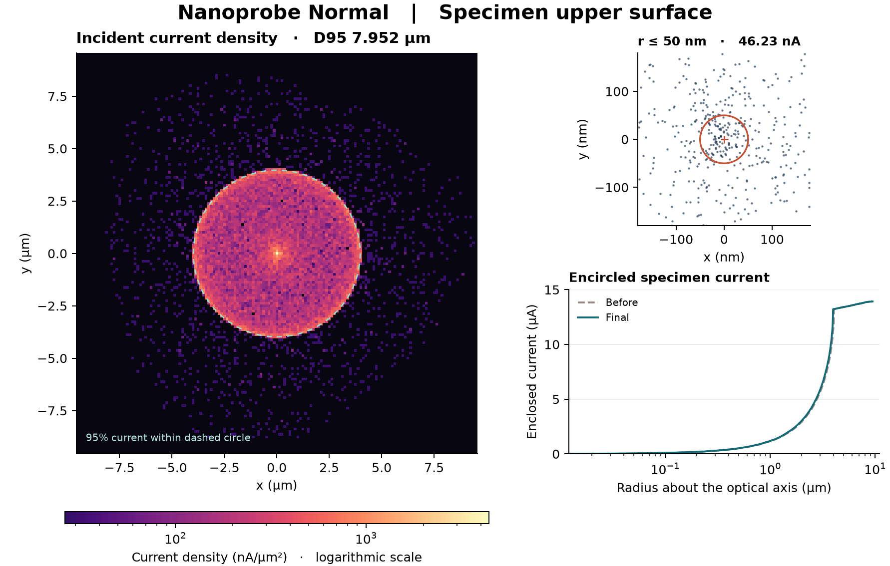

# Nanoprobe Normal with objective-only focus

The 300 kV, three-condenser column gives a **7.952 µm D95** at the specimen upper surface after adjusting four physical corrector currents and the objective supply. The starting D95 was **8.115 µm**. The 100 µm C2 aperture rim spans **29.32–30.26 mrad** by azimuth. A bright center and a rim at approximately 4 µm radius remain. This operating point is still far from atomic resolution. [Absolute incident current map](normal-objective-final-probe.png) · [Matched before and after](normal-objective-probe-comparison.png)

## Specimen and focus

All landings refer to the entrance surface at column z = 1599.1999975 mm. The two calculations start with the same 32,768 original packets at the 450 mm gun exit and carry their positions, slopes, energies and absolute weights through the installed fields. At both settings the same 30,396 packets reach the specimen. The C2 foil intercepts 1.0858 µA of the emitted 15 µA. The study imposes no clipping fraction at the aperture. The displayed density uses 125 nm square bins. The core inset shows individual landings. [Source particles, specimen phase space and current bins](evidence/normal-objective-landings.npz)

| Quantity | Before | Final |
| --- | ---: | ---: |
| D95 about the current centroid | 8.1153 µm | 7.9517 µm |
| RMS radius about the centroid | 3.3349 µm | 3.2737 µm |
| Current inside 50 nm radius about the fixed axis | 42.572 nA (93 packets) | 46.234 nA (101 packets) |
| Total specimen current | 13.9142 µA | 13.9142 µA |
| Physical pupil edge, minimum / median / maximum over 128 azimuths | 29.960 / 29.980 / 30.000 mrad | 29.324 / 29.796 / 30.261 mrad |
| 95th percentile of transmitted-particle angle | 26.705 mrad | 26.514 mrad |
| Axial offset of the D95 minimum, positive downstream | +1.25 nm | +1.00 nm |
| Axial offset of the RMS-radius minimum | +77 µm | +75 µm |

Direct through-focus transport brackets the final D95 minimum between +0.75 and +1.25 nm on the nominal material grid. The smallest sampled D95 is 7.95162 µm. At the surface, 0.332% of the transmitted current falls within 50 nm of the fixed axis. Across the sampled through-focus interval this disk reaches 212.86 nA at +291 and +296 µm. The diameter minimum, the RMS minimum and the brightest fixed central disk therefore occur at different positions. The 50 pm radius disk contains zero sampled packets at the surface. At 0.458 nA per packet the simulation cannot resolve a smaller nonzero current there. [Native axial profiles and specimen statistics](evidence/normal-objective-probe.json)

## Active controls

| Signed model current | Before | Final |
| --- | ---: | ---: |
| Objective, 1160 turns | −12.544397 A | −12.541514 A |
| Objective excitation | −14,551.500 At | −14,548.156 At |
| HP1 | +0.01752 A | +16.00000 A |
| HP2 | −1.00000 A | +70.00000 A |
| HPol X | +0.053452 A | −5.000000 A |
| HPol Y | −0.833845 A | −2.717050 A |

C1, C2, the weak C3 lens, the adapter and Mini Condenser, TL12, TL21 (+330 A), TL22 (−145 A), all winding turns, pole shapes, B–H curves, aperture geometry and the AC scan calibration have their archived values. Objective focus was evaluated in increments of 0.001 At. Physical core, sleeve and return-path fields were solved for each finalist with its actual signed currents. The packaged corrector solution contains the material recipe. The packaged objective field has its own geometry and material receipt. These currents are simulator working points without a measured instrument supply calibration. [Corrector solution](evidence/normal-final-corrector-solution.npz) · [Objective field](evidence/normal-final-objective-field.npz) · [Objective receipt](evidence/normal-final-objective-field.json)

## Aberrations and material-grid sensitivity

The fit uses mechanical incidence angles and both actual landing coordinates with their original weights. The following are ray-displacement terms evaluated at 30 mrad. A₂ is the magnitude of its vector. D₄ is its azimuthal RMS displacement. C₃ and C₅ are signed axisymmetric components. The terms describe this finite-source column operating point.

| At 30 mrad | 3.8 mm mesh, before → final | 3.2 mm mesh, same controls, before → final |
| --- | ---: | ---: |
| A₂ | 17.27 → 3.58 nm | 44.77 → 60.94 nm |
| D₄ | 4.48 → 15.41 nm | 3.73 → 15.61 nm |
| C₃ | −26.676 → −26.694 µm | −26.671 → −26.686 µm |
| C₅ | +3.668 → +3.703 µm | +3.659 → +3.692 µm |
| Specimen D95 | 8.115 → 7.952 µm | 8.177 → 8.015 µm |
| Fixed-axis 50 nm current | 42.57 → 46.23 nA | 39.37 → 30.67 nA |

The reduction in diameter repeats on both material meshes. The nominal-grid gain in core current and reduction in A₂ do not repeat. Refocusing the objective independently on the 3.2 mm mesh gives D95 of 8.158 → 8.002 µm and 50 nm current of 38.45 → 31.59 nA. Thus objective refocus alone does not account for the difference. The large residual C₃ and C₅ terms persist. The comparison keeps the pole shapes fixed and cannot isolate a contribution from pole geometry alone.

Changing the integration step from 0.0375 to 0.01875 mm changes the final D95 by 0.000013 µm. Doubling the transverse vacuum-field pitch from 0.15 to 0.30 mm changes it by 0.00013 µm. The fitted-field implementation uses cubic transverse interpolation. Original 8,192-, 16,384- and 32,768-packet prefixes give final D95 values of 8.270, 7.966 and 7.952 µm, respectively. The corresponding starting values are 8.388, 8.141 and 8.115 µm. [Numerical controls, fit components and prefix counts](evidence/normal-objective-probe.json)

## Scan pivot and source waists

The C2–C3 gap contains one source crossover at 806.00–806.25 mm. The C3–ADL gap and the region from the Mini Condenser exit to 0.25 mm ahead of the specimen contain zero crossovers in the two transverse projections. Downstream of HP1 the static radial waists are at 1375–1376 mm and 1408–1409 mm, both before and after correction. The static calculation uses zero scan drive.

With the original AC upper/lower winding combination, symmetric ±1 µrad commands in X and Y locate the closest common downstream pivot at 1496.707 mm before and 1496.722 mm after correction. This is the plane of minimum two-axis position response in the measured 1420–1512 mm interval. The isolated Mini Condenser and incident-side objective fields put their front focal plane at 1490.370 and 1490.375 mm, respectively. The final pivot is 6.35 mm beyond that plane. The last static TL12 waist is about 82 mm upstream of the front focus. This 30 mrad setting still misses the intended three-plane coincidence.

At the specimen the two principal scan scales change by −0.00877% and −0.00858%, with +0.02717° rotation. The maximum residual mechanical tilt is 0.000099 µrad per µrad of scan command at 0.0375 mm integration step. These checks quantify the local behavior around scan center. Full-field magnification and high-resolution imaging require additional evidence. [Initial scan calibration](scan-focus-calibration.md) · [Matched scan matrices and downstream plane measurements](evidence/normal-objective-probe.json)

## Other current settings

The initial search screened 87 settings on 8,192 packets, followed by two searches of 30 and 33 settings on 32,768 packets. A local field response supplied proposals. Each result in the table uses a fresh nonlinear material-field solution and a physical objective excitation. Among these settings near 30 mrad the selected one gives the smallest D95 on both material meshes. The shared-mesh setting provides a narrower spread of edge angles and a smaller D₄ on both grids.

| Nominal material grid | Edge minimum / median / maximum (mrad) | Surface D95 (µm) | Current inside 50 nm (nA) |
| --- | ---: | ---: | ---: |
| Initial | 29.96 / 29.98 / 30.00 | 8.115 | 42.57 |
| A₂ and D₄ balance on the nominal mesh | 29.79 / 29.89 / 29.99 | 8.069 | 39.83 |
| A₂ and D₄ compromise across both meshes | 29.77 / 29.87 / 29.97 | 8.043 | 41.20 |
| Selected diameter and central-current setting | 29.32 / 29.80 / 30.26 | 7.952 | 46.23 |
| Strong opposing hexapoles | 26.66 / 27.73 / 28.76 | 6.632 | 6.87 |

## Reproduction

From the repository root, run `python docs/development/cescor_direct_probe_20261121/render_normal_probe.py` to reconstruct both figures directly from the versioned landing archive on a CPU. The renderer independently rebins the particles and verifies that the integrated image current equals the transmitted current. The evidence JSON records the file digests, signed currents, scan matrices, physical pupil angles, through-focus minima, numerical controls and candidate settings.

For a field replay in the prepared study workspace, `adjust_a2.refine_grid` builds the selected 0.15 mm vacuum table from the versioned nonlinear corrector solution. `normal_objective_focus.py normal-core --ni -14548.156 --fixed-ni --capture` transports the original gun-exit distribution using that table and the objective receipt. `normal_probe_checks.py` repeats the pupil, finite-step, mesh and scan checks. [Search](normal_corrector_search.py) · [Objective focus](normal_objective_focus.py) · [Checks](normal_probe_checks.py) · [Archiving and verification](archive_normal_probe.py)

The targeted topology and material/calibration suites passed 65 checks. One existing analytic calibration test on a separate 3,000-particle model obtained α95 = 30.69818 mrad against 30.0 ± 0.3 mrad. The same result was independently reproduced on upstream revision `633105a56`. The finite-field determination above uses the transported physical aperture edge.
