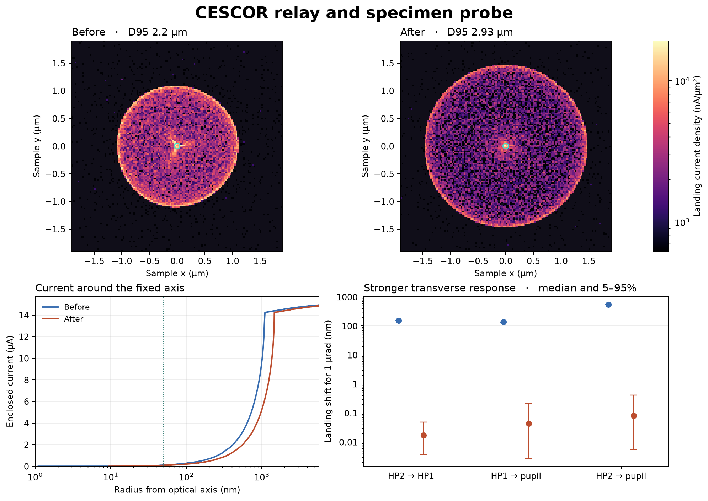

# CESCOR relay conjugacy at a 30 mrad C2 aperture edge

Imaging the two hexapole midplanes and the independently measured objective pupil reduced the median HP2-to-HP1 landing shift from 152.78 to 0.017 nm per 1 µrad. With the same foil illumination and surface D95 focus the specimen D95 **increased from 2.205 to 2.930 µm**, and the current in the fixed 50 nm disk fell from 102.54 to 87.43 nA. The independent material mesh gives the same direction for both changes. This establishes an imaging correction and leaves the large probe unresolved.

| At the specimen upper surface unless specified | Original transfer excitation, matched control | Conjugate relay |
| --- | ---: | ---: |
| Signed TL21 / TL22 (A) | +5 / −5 | +330 / −145 |
| Objective (A, 1160 turns) | −18.322 | −13.238 |
| C2 entrance current D95 (µm) | 56.635 | 56.635 |
| Edge minimum / maximum over azimuth (mrad) | 29.618 / 30.00009 | 29.949 / 30.00005 |
| Current-weighted α95 (mrad) | 16.9302 | 16.8749 |
| D95 diameter (µm) | 2.20488 | 2.93031 |
| RMS radius (µm) | 1.15450 | 1.52938 |
| Fixed-axis current inside radius 50 nm (nA) | 102.54 | 87.43 |
| Total transmitted current (µA) | 14.999542 | 14.999542 |
| Original / surviving / effective packets | 32768 / 32767 / 32767 | 32768 / 32767 / 32767 |
| D95 minimum offset (nm, positive downstream) | +0.5 | −0.5 |
| RMS minimum offset (µm, positive downstream) | +20 | +28 |
| Peak fixed-axis 50 nm current and offset | 5.506 µA at +170.5 µm | 4.744 µA at +238.0 µm |

In both cases C2 intercepts the same original packet (ID 12981). Only six surviving packets in each main trace approach the outer 10% of the foil radius. The 128 marginal rays measure the geometric edge. The much lower α95 describes how the physical source illuminates that edge. Each original packet carries 457.76 pA, and no packet lands inside a 50 **pm** radius. The total surface current is about 150,000 times 100 pA. This source and probe do not qualify a Si[110] atomic-resolution scan at the intended current. No new silicon image was calculated at these settings.

The surviving cohort has a single transverse waist in both axes between C2 and C3, at 903.00–903.75 mm before and 864.75–865.50 mm after. The axial scan finds no crossover between C3 and ADL or between the Mini Condenser and the near-specimen focus region. The through-focus D95 minimum brackets include the physical surface in both cases. The ±0.5 nm offsets describe this numerical grid. The RMS minima lie downstream, and the distinct 50 nm disk current peaks lie farther downstream still.

| Full-current strongest differential shift (nm per 1 µrad) | Control median | Conjugate median | Conjugate 5th–95th percentiles |
| --- | ---: | ---: | ---: |
| HP2 → HP1 | 152.784 | 0.0173 | 0.0038–0.0485 |
| HP1 → objective pupil | 136.410 | 0.0433 | 0.0027–0.219 |
| HP2 → objective pupil | 554.717 | 0.0813 | 0.0056–0.410 |

At the original objective excitation (−21,253.2 A·turn), the illumination-side radial zero used for the comparison lies at 1536.570 mm and retains skew coma. At −15,356.1 A·turn the isolated objective has a real two-component zero at **1408.054 mm** on the nominal calibration. The radial and skew ring-centroid responses use units of displacement divided by scan displacement and pupil angle squared. At the radial zero the signed skew component falls from about +761 to −0.00010. Reducing the calibration cone from 0.24 to 0.17 mrad and the integration step from 0.040 to 0.025 mm gives 1408.0526 mm and +0.605 at the same excitation. Refitting excitation on the smaller cone gives about −15,354.5 A·turn and 1408.246 mm. This bounds the meaningful digits of the simultaneous null.

The selected optical plane lies downstream of TL12 (1366.3 mm) and upstream of the Mini Condenser (1522.5 mm). Its definition belongs to the objective. Transport to the specimen includes the energized Mini Condenser and all other installed fields. The near-axis magnification magnitude is 0.548 from HP2 to HP1 and 0.400 from HP1 to the pupil. Unit-magnitude hexapole imaging, cancellation of all column coma at 30 mrad and hardware-current calibration remain separate conditions. The HP and HPol winding currents are held at the previous aberration adjustment. Specimen D95 alone cannot identify which higher-order or chromatic coefficient should be changed.

## Numerical checks

The nominal corrector material mesh uses 1,088,545 tetrahedra with a 3.8 mm material size parameter. With a separately generated 3.2 mm mesh and the same physical currents, surface D95 changes from 2.258 to 3.052 µm across the two configurations, and the fixed-axis 50 nm current changes from 93.38 to 86.06 nA. In the conjugate setting the finer mesh gives a maximum edge of 29.927 mrad and full-current median 1 µrad shifts of 0.027, 0.036 and 0.070 nm. Halving the integration step from 0.075 to 0.0375 mm changes the nominal conjugate D95 by 0.016 nm. The absolute D95 and disk current depend on the material mesh. The poorer D95 and lower disk current after matching persist on both meshes.

On the nominal material mesh the model also replays a 16,384-packet prefix, halves the maximum transport step, and substitutes a second interpolation through the sparse Ni–Fe high-field measurements. All keep the archived currents fixed. The alternate material interpolation gives D95 2.930 µm and 87.89 nA in the disk. The prefix gives 2.928 µm and 91.55 nA. Other round-lens windings use the installed prescribed-current vacuum model, including independently driven closed subwindings. Some modeled winding currents exceed 1 kA. The 15 µA gun-exit distribution is prescribed and is reused in the changed fringe field. Its real source size, divergence and winding limits have no measured calibration here.

## Plane and angle definitions

The illumination crosses HP2 at 1144.50 mm, TL22 at 1166.35 mm, TL21 at 1249.95 mm and HP1 at 1300.85 mm. The specimen upper surface is at 1599.1999975 mm. The requested pupil is the illumination-side coma-free plane of the working objective. The mechanical objective aperture is on the image side at 1600.7 mm. The published CESCOR optical design relates the hexapole midplanes to the objective coma-free plane. The axial positions in this reconstruction are model results. [Müller et al., Fig. 2](https://www.ceos-gmbh.de/de/produkte/stemkorrektoren/dcor-ascor/Mueller2006a.pdf)

The optical-plane calibration isolates the upper objective with its installed material field and traces from the gun exit at 450 mm to the specimen. In specimen coordinates it samples 24 pupil azimuths and opposite small displacements and tilts in both transverse directions. The odd-in-displacement, even-in-pupil mean landing shift divided by displacement and squared pupil angle gives the off-axis coma response. A real axial pivot changes one transverse component. We adjust objective excitation to allow both the radial and skew components to approach zero. Candidate poles of the transfer quotient are rejected. The archived results include the independent calibrations, finite perturbation amplitudes and step sizes. This is a third-order measurement around the axis. [Real and skew coma pivots, EP 4 345 447 A1, paragraphs 0134–0136](https://data.epo.org/publication-server/rest/v1.2/publication-dates/20240403/patents/EP4345447NWA1/document.pdf)

The fixed gun supplies 15 µA at 300 keV. The installed gun aperture and nominal 1 mm C1 aperture stay fixed. The C2 aperture has radius 50 µm on both faces, at 764.9 and 765.1 mm. For each set of currents we fit the radial and azimuthal incident slopes at the foil from the transported source with its original current weights. Marginal rays approach the limiting face from inside, reach 99.999% of the radius and undergo the same downstream interception checks. The reported **edge semi-angle** is the largest specimen angle over 128 marginal azimuths. These diagnostic rays carry zero current. The evidence also records the complete physical-particle cohorts reaching 90%, 95% and 98% of the foil radius.

The previous A₂/C₃/C₅ setting had a 521 nm surface D95 and α95 of 30 mrad. All 32 diagnostic C2-edge azimuths in its replay were intercepted downstream. We therefore retain that result as history and set the original TL windings to +5/−5 A for the matched control. Its illumination is adjusted until the edge reaches 30 mrad at the surface D95 waist. [Earlier angular-percentile comparison](focus-and-angular-illumination.md)

## Transfer-lens current calibration

Each TL winding retains 19 turns. HP1, HP2, both HPol drives, pole geometry, alloy assignments, nominal sleeve and return-plate dimensions stay fixed. The joint nonlinear three-dimensional FEM solves the windings, iron and nickel–iron together at each reported TL current pair. The table gives the signed peak of the **combined** on-axis field within 20 mm of each winding centre. The two coils contribute to one another's local field.

| TL21 / TL22 (A) | TL21 / TL22 (A·turn) | Local TL21 / TL22 peak (mT) |
| --- | --- | --- |
| +5 / −5 | +95 / −95 | +6.25 / −7.36 |
| +30 / −30 | +570 / −570 | +31.25 / −39.59 |
| +160 / −160 | +3040 / −3040 | +88.27 / −136.50 |
| +330 / −145 | +6270 / −2755 | +160.85 / −124.47 |
| +370 / −145 | +7030 / −2755 | +177.73 / −123.49 |

At +330/−145 A the nominal mesh reaches 2.353 T and 164.6 kA/m in ARMCO iron, and 1.544 T and 14.76 kA/m in solid PERMENORM 5000 H2. Both are within the extended tabulated endpoints. The iron extension reads the manufacturer's intrinsic polarization curve and adds μ₀H. VAC gives 1.60 T at 40 kA/m for the solid alloy. The nominal interpolation spans the gap above the last low-field knot. A second solution changes this interpolation at fixed currents. The sources document material properties. The installed winding currents and the alloy grades of the original microscope have no independent measurement here. [ARMCO pure iron, Fig. 8](https://www.aksteel.nl/files/downloads/clf_productdata__armco_pure_iron_pdb_euro_final_072022_92.pdf) · [VAC solid PERMENORM 5000 H2](https://vacuumschmelze.com/03_Documents/Brochures/Datasheet%20PERMENORM%205000%20H2%20Solid.pdf)

## Particle and transfer measurements

The two main cases start with the same 32,768 positive-current gun packets, IDs, initial phase space, energies and original weights. All winding changes act on the common beam. Each trajectory keeps its contact history and electrostatic potential reference on restart. For the 1 µrad test we start at HP2 or HP1, hold position and energy fixed, perturb each laboratory-frame slope by ±1 µrad, and measure both receiver coordinates. Zero perturbation reproduces the original landing within 10⁻¹⁴ m. Independent ±2 µrad replays check the differential response. The largest singular value gives the strongest position shift for each particle, including rotation. A transfer of 1 mm/rad corresponds to 1 nm of landing shift for 1 µrad.

Surface D95 is the diameter enclosing 95% of surviving current around its current centroid. Bright-core current uses a **fixed 50 nm radius about the installed optical axis**. The through-focus scans independently locate the D95 minimum, RMS minimum and peak current in that disk. They retain the actual magnetic field at each propagation step and include all transmitted current. Absolute current-density maps share a single scale.



## Reproducing the comparison

The [exact working currents, field identities and numerical measurements](evidence/relay-conjugacy.json) select the two working points. The [paired specimen landings](evidence/relay-conjugacy-landings.npz) contain the original IDs, fractional source currents, energy offsets, both specimen phase spaces and loss indices. The settings are research configurations. The comparison uses the existing CESCOR study field caches and a working CUDA device. Prepare the gun, finite-element geometry and +5/−5 A reference as described in the [CESCOR assembly study](../probe_corrector_cescor_20261121/README.md) and the [A₂ study](README.md#continuing-the-a₂-trim-with-cubic-field-interpolation). To regenerate the high-current field, store the two linked manufacturer PDFs as `iron.pdf` and `nife.pdf` in `outputs/cescor-relay-20261121`. The field builder verifies each document against the material library's SHA-256.

```powershell
$study = 'docs/development/cescor_direct_probe_20261121'
$record = "$study/evidence/relay-conjugacy.json"
$python = '.\.venv\Scripts\python.exe'
& $python "$study/relay_magnetics.py" m330 330 -145
& $python "$study/relay_transfer.py" replay-before --settings $record --configuration before --relay --axial
& $python "$study/relay_transfer.py" replay-after --settings $record --configuration after --relay --axial
& $python "$study/relay_transfer.py" replay-after-core --settings $record --configuration after --core-only
```

Automatic field selection verifies the archived file hash. For an independently regenerated mesh, nonlinear solve or interpolated field, provide its path with `--table` and compare the resulting measurements with the sensitivity runs. The regenerated solve can have a different iteration history and binary hash. The axial field pitch is 0.5 mm, the transverse pitch is 0.15 mm and transport uses cubic transverse interpolation.
