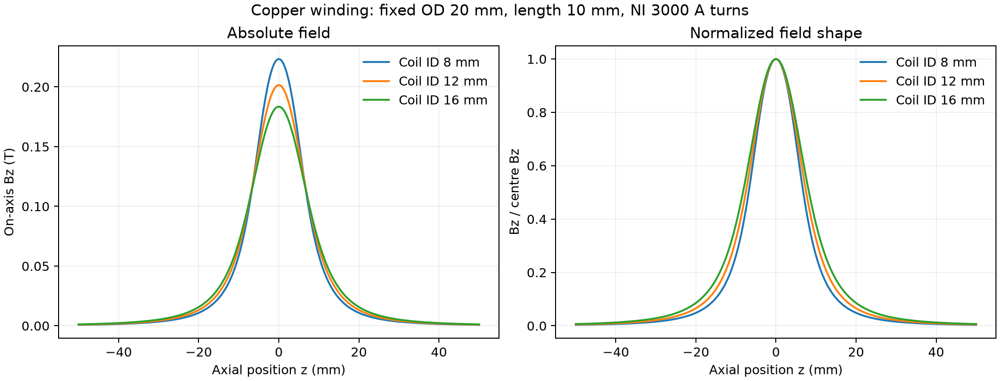
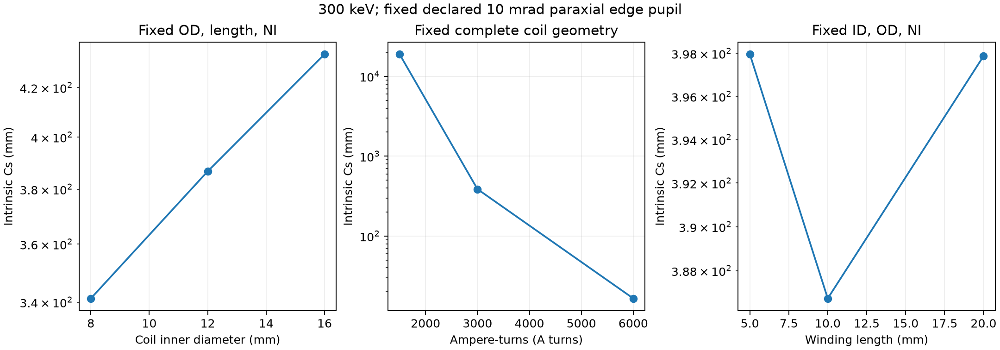

# Geometry-driven copper-coil intrinsic aberration study

The new round-lens field is the Biot-Savart integral of the declared circular copper winding. It is not a three-Gaussian fit. Pole-piece/yoke magnetism, saturation, thermal effects, space charge, specimen scattering and coherent propagation are absent. The [input design and public-source review](../air_core_copper_coil_20261113/README.md) separates engineering assumptions from published evidence.

## Controlled inputs and results

All cases use 300 keV monochromatic, zero-emittance, uniform-disk source current of 1 microampere. The declared **paraxial edge** angle is 10 mrad; this is not alpha95. Each case has its own recorded pupil radius to hold that edge angle fixed. The source plane is z=-200 mm and the first paraxial image is independently determined. Finite axial tails are always evaluated; the plotted interval and FWHM are not field cutoffs.

| Case | Coil ID / OD / length (mm) | NI (A turns) | Centre B (T) | Field FWHM (mm) | Cs (mm) | D95 (nm) | RMS radius (nm) | alpha95 (mrad) |
| --- | --- | ---: | ---: | ---: | ---: | ---: | ---: | ---: |
| [baseline](baseline/report.json) | 12 / 20 / 10 | 3000 | 0.20153113 | 15.090042 | 386.739185 | 716.519358 | 193.483834 | 9.753773 |
| [inner-8mm](inner-8mm/report.json) | 8 / 20 / 10 | 3000 | 0.22335694 | 13.648944 | 341.226302 | 632.173835 | 170.708740 | 9.753665 |
| [inner-16mm](inner-16mm/report.json) | 16 / 20 / 10 | 3000 | 0.18345533 | 16.496874 | 434.018134 | 804.146155 | 217.144586 | 9.753901 |
| [ni-1500](ni-1500/report.json) | 12 / 20 / 10 | 1500 | 0.10076557 | 15.090042 | 18947.789485 | 35584.355655 | 9588.367317 | 9.861861 |
| [ni-6000](ni-6000/report.json) | 12 / 20 / 10 | 6000 | 0.40306226 | 15.090042 | 16.526951 | 30.589664 | 8.261501 | 9.746069 |
| [length-5mm](length-5mm/report.json) | 12 / 20 / 5 | 3000 | 0.22868028 | 12.727439 | 397.959682 | 737.535493 | 199.149172 | 9.754839 |
| [length-20mm](length-20mm/report.json) | 12 / 20 / 20 | 3000 | 0.14728510 | 22.435806 | 397.875266 | 736.912145 | 199.000753 | 9.752142 |





At fixed outer diameter, length and NI, increasing coil ID lowers the central field and broadens its axial distribution. The reported Cs increases over these three cases. Increasing NI reduces Cs over the tested interval. Winding length is not a universal monotone control: these three sampled lengths place the lowest Cs near the middle case. These are local results of the declared air-core geometry, not universal lens-design laws.

## Sampling, current and numerical checks

Every finite-source trial transports 1024 original positive-current particles, then **appends and transports another 1024 without changing or rerunning the prefix**. Original IDs, positions, directions, energy, emission time and training masks are retained. Each N-particle publication uses source current/N per original; intercepted current is never restored. Raw first-partition weights remain intact. Emitted, surviving and effective counts are separate in each report.

The primary 12-by-12 radial/axial coil quadrature is compared with 24-by-24. An independent first/third-order perturbation ODE supplies intrinsic Cs; full off-axis Lorentz particle transport supplies the finite-pupil fit. Quadrature and reference-step refinement are separate from finite-source refinement. The baseline additionally repeats complete 1024+1024 transport at half the maximum integration step.

- Largest absolute 1024-to-2048 relative D95 change: 0.00015425173.
- Largest relative finite-pupil Cartesian Cs difference from the independent third-order reference: 0.00019889175.
- Largest sampled B difference for primary versus refined coil quadrature, divided by centre B: 1.2486208e-06.
- Baseline finite-source half-step relative D95 change: 7.92640398e-10.
- Baseline finite-source half-step relative fitted Cs change: 4.60644856e-11.

These comparisons establish bounded numerical sensitivities, not exact continuum error or real-instrument accuracy. The field comparison cylinder uses the maximum radius at retained observation planes; it is a sampled check, not a certified continuous beam envelope. No installed operating preset is qualified by this study.

## Size and focus conventions

**RMS is a radius**, measured about the current-weighted centroid. **D95 is a diameter** containing 95% of the current actually surviving at the observation plane. Alpha95 is the 95% current angular radius about the mean direction, converted through arctan. The table uses the fixed first paraxial image plane. Each report also retains 65 through-focus planes and their lowest sampled D95; that discrete minimum is not a continuous optimum. Intrinsic Cs is defined by the unblocked lens and is not reduced by discarding intercepted rays.

## Retained evidence and observer correction

Each case directory retains the source, both transported characteristic partitions, wall classifications, field snapshot, frozen request, perturbation references and final report. The source is synthetic and does not qualify the project's physical FEG. No coherent calculation was run.

The first baseline finished both transport partitions before a statistics-only failure: wall survivors deliberately have NaN hit coordinates, and the initial observer incorrectly treated them as lost. The corrected observer maps only surviving comparison coordinates to infinity; raw wall/source/trajectory files remain unchanged. The complete baseline transport was reused. [The independent array audit](independent-baseline-array-audit.json) verifies source prefix/weights, unchanged field source and transport helpers, current balance, RMS, D95, alpha95 and both fit conventions. The original and corrected observers and transport-field source are retained separately. Baseline recovered elapsed time covers statistics only and must not be read as transport runtime. Later script versions additionally bind transport source hashes and NumPy/SciPy versions; older records lacking that binding cannot be automatically resumed.

## Reproduction

The archived drivers identify the implementation used; active production files may subsequently change. To run a new trial against the current implementation, use a **new output directory** and the archived request files:

```text
python scripts/study_copper_coil_aberrations.py --requests docs/development/copper_coil_aberration_20261113/requests.json --output outputs/new-copper-coil-study
python scripts/study_copper_coil_aberrations.py --requests docs/development/copper_coil_aberration_20261113/refinement-requests.json --output outputs/new-copper-coil-study
```

The immutable [artifact manifest](artifact_manifest.json) binds every other file by relative path, byte length and SHA-256. Solver inputs, study drivers and primary/reference numerical results are explicit; plotted curves are not extra particle experiments.
