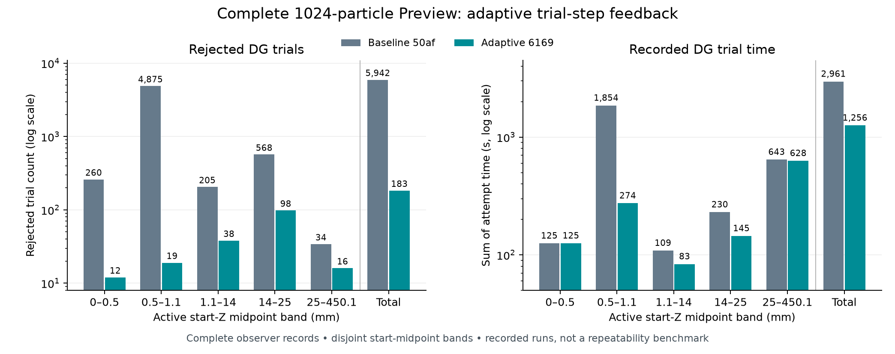

# Existing complete Preview: independent rejection comparison

Both records contain one actual 1024-original-particle positive-current source,
and the five saved initial-source arrays match exactly. This audit only reads
saved data; it does not run physics or touch the running High calculation.

| Metric | Baseline 50af | Adaptive 6169 |
|---|---:|---:|
| Accepted steps | 3,502 | 3,801 |
| Trial attempts | 9,444 | 3,984 |
| Rejected trials | 5,942 | 183 |
| Observed surface-step DG calls | 22,390 | 11,769 |
| Recorded attempt time | 2,961.117 s | 1,255.557 s |
| Rejected-attempt time | 1,998.585 s | 62.292 s |
| Worker time to result callback | 3210.534 s | 1512.922 s |
| Outer invocation including callback persistence | 3213.832 s | 1526.433 s |

Rejections fall by 96.92%; observed surface-step DG
calls fall by 47.44%. The accepted
step count increases by 8.54%.
Observed worker-to-callback time improves by a factor of
2.122. These are
two recorded executions, not a repeatability benchmark or a controller-only
runtime guarantee. The first full call took 5.456 s
and 18.656 s respectively, including cold-start work.

The old 0.5-1.1 mm hotspot drops from 4,875 rejects to 19. Remaining rejects
are: 12 at 0-0.5 mm, 19 at 0.5-1.1 mm, 38 at 1.1-14 mm, 98 at 14-25 mm,
and 16 at 25-450.1 mm. The actual last rejection starts at midpoint
Z=42.709782 mm; none occur afterward. Of 134
accepted steps needing retries, 102 halve once, 18 twice, 11 three times and
three four times. No implicit failure or nonfinite trial occurred.

Every new accepted trial passes all four normalized gate budgets. Their
largest accepted ratios are: total momentum 0.053813, XYZ position 0.985363,
transverse momentum 0.997578 and XY position 0.478462. Remaining failed-gate
counts (overlapping) are 177 transverse, 44 XYZ, one XY and zero total momentum.
The exclusive dominant counts are 175 transverse and eight XYZ. The largest
rejected transverse ratio is 25.817682; it was rejected, not accepted.

The new next-step initial proposal is always at most 1.25 times the previous
accepted dt, and never grows immediately after a retried step. Every trial
also respects the original physics cap, while the original four gates and
exact halving remain active. Recorded group clocks are exactly continuous.
This directly confirms removal of the old reset-and-halve sawtooth.

The accepted meshes differ. This is a work/decision audit, not a new
trajectory-accuracy or particle-count convergence certificate. Normal Preview
automatic scan calibration remains as executed; no Preview/High field-matched
convergence or material/coherent imaging claim is made here.

Reproduce this audit by running `audit_preview_retries.py` with the repository
Python environment after placing its new products aside; output files are
new-only. Original evidence and frozen source/runner files are never edited.
