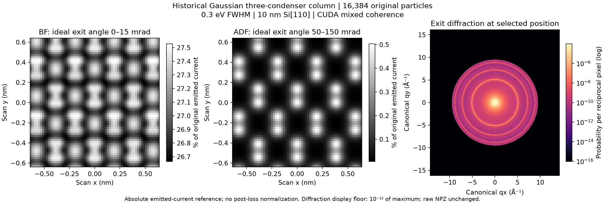

# Copper round-lens workflow and cache corrections

This maintenance change preserves the existing optical controls, field formulas,
coil quadrature order, source energy law and accuracy tolerances. It does not
retune or qualify an optical operating point.

## Corrections

1. Incident-field dependencies now retain every downstream copper-coil tail,
   including actual winding geometry, reference ampere-turns and physical pose.
   Changes invalidate the incident beam and dependent elastic, EDS and specimen
   products instead of rebuilding only post-specimen transport.
2. Magnetic scenes and the executed Gun field capture recognize the immutable
   copper-coil source. Finite display envelopes never truncate its all-Z field.
3. Posed copper-coil fields can be frozen for Preview/High accuracy memory
   admission and diagnostics without substituting a Gaussian profile.
4. Aberration and canonical-transfer cache identities include the selected
   round-lens law and Gaussian length coupling. Derived runtime caches do not
   change captured input identities.
5. Historical input-only working points admit validated additive coil metadata
   while rejecting changes to existing values, types, geometry and source
   inputs. Both missing and explicitly stored historical default-field formats
   restore exactly. A Gaussian foil-thickness edit retains the other original
   part records and the fixed upper specimen face. Historical calculated
   results do not acquire current-solver reuse authority through this migration.
6. Direct and imported-boundary mixed STEM entries enforce the same coherent
   model admission. Copper-coil wave requests remain explicitly unsupported.
   A historical classical CPU transport policy does not replace the independent
   CUDA-only contract of a newly requested mixed STEM wave calculation.
7. Selecting another lens in Model Inspector refreshes the actual selected
   copper-coil NI instead of displaying an inactive mapped-field recipe.

## Frozen implementation and software validation

The tested raw Python source identity is
`508dbecbcbbef6132b8b880adad4635e3ad3f18d9bca9cc3c1147c1894344456`.
No default configuration, profile or numerical tolerance file is changed.

- Final targeted regression: **319 passed**, 149.78 s. This includes historical
  working-point/Si loading, fixed upper-surface thickness edits, source-prefix
  preservation, incremental particle reuse, exact cache invalidation, posed
  copper consumers, model controls and mocked CUDA admission.
- Final wave-policy subset: **101 passed**, 11.25 s.
- Built wheel SHA-256:
  `ddf59ccad93fba1698443de5fe47bb6c600a2263e49094fb61eb5122a8c0b2e2`.
  A separate standard virtual environment, launched outside the checkout,
  loaded the installed Si CIF and a historical input-only working point.
  Installed source bytes match the frozen implementation above.
- Independent final read-only review found no further blocking defect.
- A separate exact single-point certificate changes Diffraction lens by one
  percentage point: its specimen-plane Bz changes from
  `4.547947429248456e-5 T` to `4.719600474322941e-5 T`; Gun, incident,
  elastic, EDS, specimen-region and column dependencies all invalidate.
  Doubling its reference NI doubles Bz and invalidates the same dependencies.

These checks do not establish source-count, field-quadrature or optical-focus
convergence, magnetic-material fidelity, or real-instrument accuracy.

## Real execution validation

Execution records are retained under `outputs/copper-fixes-20261114/`.
The user selected completion of the CUDA scan and bounded copper verification
after the strict native copper cold start proved too slow for this round.

### Copper particles

Official Preview and High accuracy admission and worker construction are
checked with the same 1024 original positive-current source particles,
0.3 eV configured energy width,
unchanged default lens controls and the saved default 0.5 mm step. Only the
explicit field-model selection and numerical validation count differ from a
fresh default state. No source-count growth, focus correction, lost-current
restoration or historical partial-transport relabelling is allowed.
The Gun retains its own original 0.2 mm tracing-step ceiling; the 0.5 mm value
above is the column step. Adaptive steps may be smaller than either ceiling.

An independent emission-only check confirms 1024 unique positive-current IDs,
unit total source weight and launch kinetic energies from 0.01509457 to
0.70134915 eV. The launch convention is the declared 0.3 eV mean plus the saved
signed energy offset. The observed finite-N RMS-equivalent FWHM is
0.29689412 eV; it is not rescaled to force the configured continuous-law
0.3 eV width. This source check is not a completed transport result.

Earlier 3000-particle and pre-freeze 1024-particle attempts were interrupted
before a complete result. Their inputs and progress logs remain separate and
are not successful final-code execution evidence.

The final frozen-code real Preview worker advanced 515 accepted Gun steps with
1024/1024 particles active. Its last logged envelope was
`0.662688--0.678160 mm`, elapsed 4595.13 s. It was stopped at the user's request.
No complete Gun exit, specimen probe, Preview product or High accuracy
transport product was published, and no partial history is relabelled as one.
The bounded result covers actual admission, source emission and sustained
native E/B integration; Preview/High accuracy field/memory controls and stale
cache rejection are separately covered by the targeted regressions. Complete
copper optical transport, source-count/focus convergence and interactive
cold-start speed remain unqualified.

Six additional no-propagation admissions passed on the final input: original
pose, a detached Objective lens 0.001 mm X offset and a detached 0.1 mrad Y
tilt, each at Preview and High accuracy. They exercise the actual workflow
admission, memory estimate and worker construction. Thirteen round-lens
sources capture as copper-coil potentials; serialization preserves their A/B
queries exactly, without changing input identities or optical/source controls.

### CUDA mixed coherence

CUDA allocation and FFT were verified on an NVIDIA GeForce RTX 5090 with CuPy
14.2.0. Copper-coil coherent requests were rejected before wave preparation.

The retained 16384-original-particle boundary belongs to a historical Gaussian
three-condenser assembly, with 0.3 eV and 10 nm Si[110]. Its original phase-space,
weights, energies, current, source digest and clipping are preserved. It is not
a new dual-condenser or copper-coil optical qualification.

A real CUDA mixed-state lift succeeded with 70 represented propagation modes.
The general field-aware single-probe exit attempt was correctly refused at the
default 24 GiB device resource ceiling. An explicit 30 GiB resource-only retry
then reached the host-memory guard: approximately 73.08 GB additional memory was
needed versus 66.39 GB available. Neither attempt weakened accuracy budgets or
fell back to CPU; neither completed specimen-exit propagation.

The existing mixed STEM route completed from the same validated boundary in
**5030.34 s (83.84 minutes)**. It used the original coherence and ideal exit-angle
windows, BF 0--15 mrad and ADF 50--150 mrad. The explicit material-level plan was
`1760:400,1920:800,2080:1600`; the first comparison qualified, selecting the
1760-by-1760 grid and 400 slices against the 1920/800 reference. Only the first
comparison was executed; the 2080/1600 proposal was not needed. The actual
finite-CIF expanded-domain reference used a 2112-by-2200 grid.

| Check | Observed | Unchanged limit |
| --- | ---: | ---: |
| Combined BF grid/slice/field modulation error | 2.86110% | 5% |
| Combined ADF grid/slice/field modulation error | 1.80200% | 5% |
| Raw diffraction relative L1 change | 0.167391% | 5% |
| Independent periodic/resident difference | 6.5201e-11 | 5e-7 |
| Absolute emitted-current/loss balance residual | 7.77156e-16 | 1e-9 |

All **27 independent completion checks passed**, including real CUDA with no
CPU fallback, original boundary-file and phase-space/energy/weight/ID hashes,
the original Gun loss ledger, numerical admission and finite float64 output.
The 64-by-64 BF/ADF arrays and 1760-by-1760 diffraction array are complete.
There are 16384 original positive-current particles, 5192 surviving/effective
particles at the sample boundary, and 70 retained mixed propagation components.
The reference current remains 10 microamperes. Source and numerical losses are
reported separately rather than restored.

Compared with the prior completed scan of the same original boundary, maximum
absolute BF/ADF fraction changes are respectively `1.11e-16` and `3.47e-18`;
the diffraction array is byte-identical. This supports the intended numerical
invariance of these maintenance changes; it is not new optical qualification.

The [artifact manifest](validation/artifact-manifest.json) binds the curated
reports, source-emission evidence and exact detector arrays. Full original
diffraction and native outputs remain in the unchanged local execution archive.
