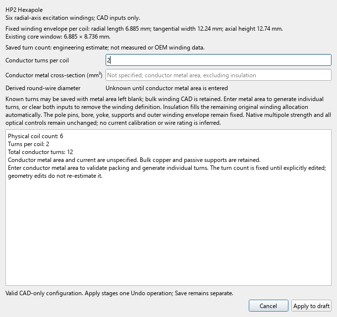

# Corrector initial turns and current-to-field study

Date: 2026-11-15. Scope: the currently used Probe Corrector initialization,
source/field/CAD/UI checks, and ideal vacuum-coil research. No finite-source
particle trial, focus adjustment, coherent calculation or experimental coil
qualification was performed. Optical settings, source energy distribution,
boundaries, numerical tolerances and native field providers are unchanged.

## Installed turn initialization

The existing nominal allocation is **9 mm2 per turn**, including insulation
and unused winding-pack space. For a radial rectangular winding use
`radial_pack_length * min(tangential_side_band, axial_side_band)`, since every
closed turn crosses the narrowest side. Round section/9 to the nearest integer,
with halves upward and a minimum of one turn. This is an explicitly assumed
common turn density, not measured or manufacturer data.

| Component | Pack section (mm2) | Fixed turns | Status |
| --- | ---: | ---: | --- |
| ADL | Retained round-lens section | 23 | Retained unchanged |
| TL22 / TL21 / TL12 | Retained round-lens section | 19 each | Retained unchanged |
| HP1 | 6.885 x 1.991 = 13.708035 | 2 per coil; 12 across six | New engineering initial value |
| HP2 | 6.885 x 2.002 = 13.783770 | 2 per coil; 12 across six | New engineering initial value |

All three Probe Corrector column variants receive the same explicit HP count.
Conductor metal area, diameter and HP current remain undefined. Actual allocated
section after rounding is 6.8540175 and 6.891885 mm2/turn. These values are not
wire metal areas. The small N follows this coarse common-allocation assumption
and this CAD's small radial winding pack; it is not evidence that a real
corrector has two-turn coils. Saved N no longer follows geometry edits.

The editor now supports N with unknown metal area. It retains the complete
previous bulk CAD; supplying area enables the existing validated individual-turn
recipe and automatic insulation filling inside fixed bounds. Area without N
is rejected. Clear, Undo, save/reload and unchanged estimated provenance are
preserved. See the [input guide](../../PROBE_CORRECTOR_INTERNAL_CAD.md).



QPH1/QPH2/QPC/QPol and other unverified control hosts do not acquire fabricated
material coils or independent physical turn counts. A channel's optical
envelope does not establish its physical winding allocation. The separate
Image Corrector generic CAD path is outside this installed Probe recipe.

## Current and magnetic field

The physically defined ideal-vacuum source is a sum of closed-loop Biot-Savart
fields: `B(r) = sum(I_j * b_j(r))`, where `b_j` is calculated at 1 A using the
declared turns, paths and winding senses. Field strength is independent of
electron energy. Beam momentum enters only when converting field to optical
response. Magnetic poles, permeability, saturation, resistance, heating and
drive electronics are excluded. This follows the
[vacuum current-source integral](https://openstax.org/books/university-physics-volume-2/pages/12-1-the-biot-savart-law).

**Deflector:** current produces a dipole field; the reference small-angle
response depends on signed integrated transverse B. Native column controls
currently use mrad and infer a uniform finite field from the reference beam
momentum. They are not amperes. The Gun Deflector uses mT. At the executed
default 300 keV, `B*rho=0.0021006577809314134 T m`; native DPH2 +1 mrad X means
By=+0.525164445 mT over 4 mm. A declared representative closed-saddle centreline
needs 2.6413 or 2.7501 A-turn per opposed-pair channel for that integrated field,
depending on radial layer. Each value includes both saddles, with N defined
per saddle. Physical deflector N is still unknown, so this is not an ampere
calibration. Full derivation, circuit senses and convergence are in the
[deflector study](deflector-study.md).

**Stigmator:** the two electrical channels produce independent quadrupole
gradients, not two dipole kicks. An eight-coil arrangement with alternating
four-coil groups and a 45-degree offset is supported by
[JEOL's explanation](https://www.jeol.com/words/semterms/20201020.111014.php).
The existing controls are percentages with normalized strength in m^-2.
Signed gradient satisfies `G=(p/q)*K`, with electron `q=-e`; the magnitude is
`|G|=(p/e)*|K|`. A reference strength of 300 m^-2 at 300 keV is 0.630197334 T/m.
Native stigmator currents have not been calibrated. The Gun Stigmator instead
accepts a magnetic gradient in T/m.

A closed rectangular centreline model from the current bulk CAD, using explicit
alternating winding senses, gives these **research-only** amplitude scales:

| Material stigmator | Centre gradient per A-turn (T/m) | Centreline field FWHM (mm) | Native effective FWHM (mm) |
| --- | ---: | ---: | ---: |
| Condenser | 0.001261804594 | 21.1 | 6 |
| Objective | 0.001261804594 | 21.1 | 6 |
| Diffraction | 0.0000891691291 | 29.1 | 8 |

The signed two-channel response matrix is approximately `[[0,+c],[-c,0]]` in
this declared current convention. Its phase differs from the optical field
names. This is a single representative line per coil, not a homogenized pack,
known wire path, measured gain or installed field source. The
[stigmator study](stigmator-study.md) records complete circuits, units, matrices,
derivative convergence and the native gradient comparison.

Matching an integrated dipole field or a peak quadrupole gradient cannot
generally reproduce the previous complete axial profile. The different
stigmator widths demonstrate why replacing the native field would change the
working point. This task retains the native runtime providers. A future
current-source mode needs declared circuits/N, signed unit-current matrices,
an explicit matching condition, full-field fringe validation and cache
dependencies on source geometry, directions, pose and integration settings.

## Executed verification

- **294 targeted tests passed**, zero failures/errors/skips: 148 input/CAD/UI
  tests and 146 persistence/material regression tests. Existing Pydantic
  deprecation warnings are unrelated to the winding behavior.
- Six installed assembly combinations: **78 native field records** (12
  nonzero), full optical states and all 31 existing material records per HP
  compare exactly with the previous curated receipt. The three raw TOML
  definitions differ only by authorized HP turn metadata.
- Deflector closed-circuit 3D quadrature converges under order doubling; a
  separate full-axis scalar integration agrees with its analytic field
  integral within 6.30e-12 relative. These are centreline-model checks.
- Stigmator finite straight segments use analytic integration; an independent
  square-loop analytic field agrees. Halving the transverse derivative step
  changes the final response by at most 2.23e-9 relative. No real winding or
  full electron-optical performance is thereby qualified.
- Six detached nonzero native stigmator cases (three components, each channel
  at 100%) verify the signed normalized-strength-to-gradient conversion;
  original controls and full state remain exact.
- Source emission and source transport entry points are patched to fail in
  the field-only scripts. No particle or coherent/CUDA run was requested or
  performed for this CAD and field-source study.

Reproduction uses the project `.venv`:

```powershell
.venv/Scripts/python.exe docs/development/corrector_windings_20261115/validate_field_equivalence.py
.venv/Scripts/python.exe docs/development/corrector_windings_20261115/check_deflector_fields.py
.venv/Scripts/python.exe docs/development/corrector_windings_20261115/study_stigmator_current.py
$env:QT_QPA_PLATFORM='offscreen'
.venv/Scripts/python.exe docs/development/corrector_windings_20261115/render_default_dialog.py
```

The [manifest](validation/manifest.json) binds the installed source definitions,
preserved originals, research scripts and validation receipts. Historical
validation reports retain their original inputs and results.
