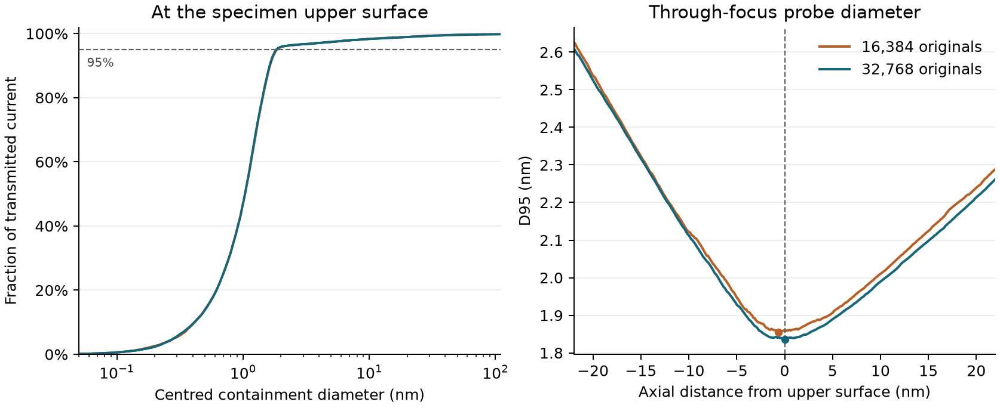

# Parked 30 mrad ideal-coil Nanoprobe

**The selected profile gives a 1.83575 nm D95 at 29.84604 mrad.** All
32,768 original particles reached the specimen upper surface, carrying
10.000 µA. Both the full-column survey and native near-surface replay
placed the smallest observed D95 on that surface, with neighbouring
observations at −0.125 and +0.125 nm.

The specimen upper surface is at 1599.1999975 mm. The comparison uses a
300 kV cold field emitter with 0.300 eV energy FWHM, the Normal Nanoprobe
range, a 100 µm C2 aperture and a parked scan and descan. The specimen is
retracted for the vacuum through-focus measurement. The electrical model
uses prescribed currents in vacuum. Fixed winding geometry and original
turn counts apply to every entry.

Open the [parked optical profile](../../../profiles/ideal-coil-nanoprobe-30mrad-parked.toml)
in the desktop with **File > Open profile**. The
[current recipe](working-point/currents.json) lists every winding group in
axial order and the four hexapoles' commands. The
[measurement](working-point/measurement.json) links the optical metrics,
original population, input identity and checksums.



## What was varied and measured

C1 lens, C2 lens, C3 lens, Adapter lens, the three round probe-corrector
transfer lenses, Mini Condenser and the two Objective windings supplied the
round-field controls. HP2 and HP1 and the normal/skew channels of HPC and
HPol supplied the six multipole controls. The four installed quadrupoles
were left at zero for this centred, stationary study. The winding basis
includes all 39 current groups, including the four fixed downstream lenses.
The two Objective windings retain 580 physical turns each. The current
recipe is specific to ideal prescribed-current coils. For example, it
includes kiloampere signed round-group currents in the corrector.

The fit used the measured gun exit distribution, its position–slope
correlations, individual energies, and the angular response to C2 lens and
C3 lens currents. It optimized the nonlinear pupil, then ranked the
current-weighted D95 of the complete trial population while adjusting
Objective focus. Each changed field used a fresh emitter calculation for
its score at the specimen. This is a finite search over current settings.

D95, D90 and D50 are centred diameters enclosing the stated fraction of
transmitted current. Alpha95 is the angular containment semi-angle about
the current-weighted three-dimensional chief direction. The target was
29.7–30.3 mrad with the D95 minimum bracketed within 1 nm of the fixed upper
surface. Every transmitted positive-current particle enters these
statistics. RMS is a radius. The separate 50 pm radius disk is centred on
the fixed optical axis.

## Recovered and retuned settings

| Setting | Positive originals | Alpha95 (mrad) | Surface D95 (nm) | Axial position of smallest D95 (nm from surface) |
| --- | ---: | ---: | ---: | ---: |
| Interrupted high-angle seed, resumed to completion | 1,024 | 29.8544 | 521.1293 | −5387.79 |
| Gun-fringe constrained fit | 8,192 | 30.0177 | 2.3510 | 0.00 |
| Same currents with increased sampling | 16,384 | 30.1002 | 2.4823 | −3.00 |
| Weak-fringe fit before final pupil correction | 16,384 | 30.1878 | 2.0901 | +2.75 |
| Corrected weak-fringe fit | 16,384 | 29.8693 | 1.8875 | 0.00 |
| Corrected weak-fringe fit | 32,768 | 29.8257 | 1.8678 | −0.25 |
| Joint winding and hexapole refinement | 16,384 | 29.8996 | 1.8611 | −0.875 |
| Joint winding and hexapole refinement | 32,768 | 29.8501 | 1.8390 | −0.375 |
| Selected final Objective trim | 32,768 | 29.8460 | 1.83575 | 0.000 |

The recovered high-angle seed had 10 µA at the surface; its narrowest local
D95 was 330.614 nm several micrometres upstream. The unretuned desktop
ideal-coil configuration measured 178.442 nm at 0.1794 mrad. The difference
between the two baselines matters when assessing a fixed 30 mrad target.
The final physical trim multiplied the Objective group currents by
1 − 2.01398e−8. The trim used a differential focus response of −15.64 nm
per ppm of Objective excitation. Its surface value and focus placement
were then remeasured from a fresh original gun in the changed all-Z field.
The diameter difference between the last two settings is smaller than the
observed variation on doubling the source population.

## Source-count, focus and current

For the final electrical settings, all 32,768 emitted originals survived.
Their effective count was 32,768 and the transmitted current was 10.000 µA.
Holding all currents fixed gave the following nested observations with a
0.025 mm maximum transport step and a 0.125 nm fine axial spacing.

| Originals | Alpha95 (mrad) | D95 (nm) | D90 (nm) | D50 (nm) | RMS radius (nm) | D95 waist offset (nm) |
| ---: | ---: | ---: | ---: | ---: | ---: | ---: |
| 4,096 | 29.45133 | 1.81609 | 1.61528 | 1.03421 | 5.8222 | −0.250 |
| 8,192 | 29.71996 | 1.82150 | 1.62006 | 1.03715 | 5.4892 | +0.125 |
| 16,384 | 29.89618 | 1.85977 | 1.63488 | 1.03585 | 10.4539 | −0.625 |
| 32,768 | 29.84604 | 1.83575 | 1.62531 | 1.03732 | 9.0739 | 0.000 |

The final nested source doubling changed D95 by 1.29% and alpha95 by 0.168%.
At 32,768 originals the 0.05 mm / 0.25 nm run gave D95 = 1.835737 nm.
The 0.025 mm / 0.125 nm run gave 1.835748 nm. The latter brackets the
D95 minimum between −0.125 and +0.125 nm relative to the surface. The RMS
minimum was at +22.875 nm and the surface RMS radius varied by about 13%
on the final source doubling. The low-current outer tail has appreciable
sampling uncertainty.

A separate cold 16,384-particle gun and column, at the same final currents,
gave D95 = 1.86093 nm and alpha95 = 29.89930 mrad. The 32,768-particle
result differed from this independently propagated beam by 1.35% in D95
and 0.178% in alpha95. Original IDs, launch positions, directions, energies
and emission times matched exactly for the common prefix. Each complete
run represented the same absolute 10 µA source.
[Source-growth check](validation/source-growth.json) ·
[Independent 16,384-particle surface](validation/independent-16384-surface.npz)

The surface contained 0.05768 µA in the fixed-axis 50 pm radius disk. Its
observed maximum, 0.96588 µA, occurred at −112.5 nm. This difference matters
if using the profile for a central-brightness objective. The sampled axial
range was ±120 µm, with fine spacing over the central ±120 nm.

The finite two-dimensional source-image test found one waist between C2 lens
and C3 lens at 753.5 mm, zero between C3 lens and Adapter lens, one in the
central corrector transfer-lens interval at 1195.0 mm, and one in the physical
scan pair at 1406.2 mm. It found zero extra waists from 1512.5 mm to the
specimen upper surface. The smallest certified mechanical clearance was
47.76 µm at the 50 µm radius C2 aperture. This study measures a stationary
classical probe; driven scan and specimen-image resolution require separate
measurements.

## Field and trajectory checks

The gun used the native emitter, electrostatics, contact detection,
time integration and exit solver. Only the all-column magnetic field in
the gun volume was tabulated. Each recipe was compared with the original
winding evaluator at 2,048 independent off-grid positions. A separate
2,048-particle direct-gun comparison found maximum per-coordinate differences
of 31.54 pm at the gun exit, 7.39e−11 rad in slope, 3.24e−8 eV in kinetic
energy and 1.24e−17 s in flight time. IDs, original launch geometry,
absolute weights and stopping history matched. Gun controls and emitted
particle counts were independent of the field interpolation.
[Gun validation](validation/gun-interpolation.json)

At the joint winding and hexapole settings, a second independent direct
gun used 1,024 originals. Repeating it with the magnetic interpolant and
transporting both complete outputs through the identical column changed
surface D95 by 0.000519 nm and alpha95 by 0.000718 mrad. Both D95 minima
fell at −7.375 nm for this small cohort. This comparison isolates the gun
evaluation method at fixed source count.
[Matched gun exits](validation/joint-gun-native.json) ·
[Effect at the specimen](validation/joint-gun-at-specimen.json)

The column propagated the full relativistic mechanical phase using the
captured bilinear electric potential and off-axis magnetic fields derived
from the actual round-winding quadrature and the finite hexapoles. The
round field includes axial derivatives through order eleven. A swept
radius bound includes endpoints and Runge–Kutta stages for every active
mechanical boundary. A non-positive clearance rejects this accelerated
calculation. Positions, mechanical slopes, kinetic energies, flight times,
original IDs and absolute weights are archived at the specimen surface.
At the selected setting 5,500 on-trajectory comparisons included the
outermost ray at 1,000 axial positions. The largest magnetic discrepancy
was 1.19e−12 T or less and the electric fields agreed to the stored precision.
Independent analytic checks used vacuum drift, a uniform axial magnetic
field and uniform electrostatic acceleration to check transverse sign,
fourth-order step refinement, energy gain and flight time.
[Analytic limits](validation/analytic-limits.json) ·
[Targeted regression results](validation/classical-regression.json)

Three full-column checks use the production full-field Lorentz solver. A
full-column replay of the recovered high-angle seed reproduced its
native D95 to 0.00055 nm using the same 1,024 original trajectories.
For the gun-fringe constrained corrector fit, a second matched full-column
replay differed by 0.000237 nm in D95 and 0.000000067 mrad in alpha95.
For the weak-fringe fit, a third replay of 1,024 matched trajectories
differed by 0.000236 nm in D95 and 0.000000071 mrad in alpha95.
At the selected setting the complete population was also replayed from
10 µm upstream to 5 µm downstream of the upper surface, using the
unchanged native field evaluator. The local replay shares the incident
phase at its entrance. Its focus bracket and the independent full-column
cohort comparisons are in the numerical evidence.
[Recovered seed comparison](validation/resumed-seed-native.json) ·
[Gun-fringe constrained full-column comparison](validation/anchored-native-column.json) ·
[Weak-fringe full-column comparison](validation/weak-fringe-native-column.json) ·
[Measured candidate comparisons](validation/candidates.json) ·
[Conditional fits and physical current settings](validation/search-settings.json.gz)

## Reproduction

Use the project Python environment from the repository root. The compressed
input snapshot records the original paths, external input bytes and executing
solver identity. The desktop TOML and current recipe can be loaded in a fresh
checkout. Running the commands below captures a new input identity on the
local installation. The [portable input package](working-point/portable-input.temwp)
can also be restored through **Working Points > Import**. Its embedded
configuration and complete numerical field were checked against the
executed setting. [Desktop profile round trip](validation/desktop-profile.json)

Both formats were also loaded in the original working checkout. All 41
field providers had identical numerical coefficients, and the geometry,
gauge, original emission IDs, positions, directions, normals and weights
matched the published checkout. At 3,500 independent positions B, E and
the scalar potential agreed exactly. The installation path and source-byte
fingerprints give each checkout its own capture identity.
[Cross-checkout restoration](validation/profile-portability.json)

```powershell
$study = "docs/development/default_ideal_coil_probe_20261117"
$work = "outputs/reproduce-parked-30mrad"
$recipe = "$study/working-point/currents.json"
New-Item -ItemType Directory -Force $work | Out-Null
.venv/Scripts/python.exe "$study/stationary_pupil.py" $recipe "$work/basis.npz" --spacing-mm .125
.venv/Scripts/python.exe "$study/trial.py" "$work/gun" --recipe $recipe --particles 32768 --step-mm .025 --tabulated-gun --gun-only
.venv/Scripts/python.exe "$study/observe_stationary.py" "$work/basis.npz" $recipe "$work/gun" "$work/optics" --step-mm .025 --focus-spacing-nm .125 --witness --native-focus
.venv/Scripts/python.exe "$study/export_profile.py" "$work/gun" "$work/parked.toml"
```

The independent column field witness uses the CUDA sampler. The two
nominally identical full-population gun paths can also be studied by
starting with 16,384 originals, running the column with `--save-column`,
extending the gun with `append_gun.py`, and passing the earlier observation
directory to `--parent-column` at the same mesh. Prefix reuse verifies
the gun checksum, solver, fields, source phase, absolute weight scaling,
mesh, mechanical boundaries and saved trajectory bytes. Added particles
are transported individually.
