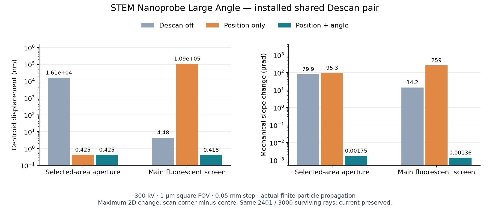

# STEM Nanoprobe Large Angle: Descan and Lower Objective

Date: 2026-10-18. Validation scope: **C3 + Probe Corrector, STEM Nanoprobe Large Angle, 300 kV, Diffraction projection, 1 µm square scan field**. All work used background code, without desktop interaction.

## Conclusions and operating point

The shared Image/Diffraction–Descan position adopted in the previous round suits this Large Angle operating point; no further hardware movement is needed. Upper/lower coil centres remain at global **1674.4 / 1699.4 mm**, with 15 mm coil length and 25 mm centre spacing. Descan is the dynamic channel of the same two-stage deflector; static Image/Diffraction alignment and shared peak limits are unchanged. The selected-area aperture and main fluorescent screen remain at **1824.4 / 2714.15 mm**.

After rerunning **Position and angle** calibration in the current mode, finite-particle propagation maintained subnanometre scan-centroid stability and mechanical incidence-angle changes below 0.002 µrad at both observation planes. These numerical results apply to the bounded operating point, not all fields of view, particle counts, specimens or real-instrument accuracy.

Large Angle must be loaded through its actual mode preset. Changing only the `nanoprobe_range` label does not change the optical system. C2, C3, ADL and TL12 excitations in this run were **25.2577272%, 46.0598152%, 79.8069434%, 49.9770148%**, respectively; Objective was **68.9801%**. C3 is strongly excited, and the actual finite beam has crossovers in both C2–C3 and C3–ADL.

## Displacement and incidence angle: actual finite electron beam

A fresh set of 3000 physical Tip samples was generated for this Large Angle run. Comparing two calibration constraints, Descan on/off, the scan centre and four corners, with 0.1 / 0.05 mm integration steps, gave **40 main GPU comparison cases using actual production field plans**, each with additional local waist-refinement replay. The last corner for each constraint was also replayed on CPU. All comparisons reuse the same executed upstream states, weights, energies and particle IDs.

After input and particle-provenance checks, the current joint calibration's centre and one corner were replayed and matched the main batch item by item. The accepted Normal held AC and Descan drives were then restored in Large Angle, and the centre and four corners were replayed at 0.05 mm without resolving any held drive.

The table uses 0.05 mm data and gives the **maximum 2D vector change** from scan centre to the four corners, not a single-axis peak or the full change between opposite corners.

| Descan state | SAA displacement / nm | SAA mechanical-angle change / µrad | Main-screen displacement / nm | Main-screen mechanical-angle change / µrad |
|---|---:|---:|---:|---:|
| Off | 16130.430 | 79.9407 | 4.47552 | 14.1533 |
| Position-only calibration | 0.424794 | 95.2761 | 108669.534 | 258.517 |
| Reused Normal held joint calibration | 41.024331 | 0.110059 | 106.375346 | 0.289027 |
| Joint position-and-angle calibration | **0.424867** | **0.00174968** | **0.418449** | **0.00136140** |



Position-only control removes SAA centroid motion without controlling incidence angle, causing downstream screen motion. With Descan off, screen displacement in this Diffraction optical path is already relatively small, but SAA displacement and screen incidence angle still change. Joint calibration handles these quantities together. The physical reason for separately controlling position and angle with a two-stage imaging-side deflector is described in [JEOL's de-scan explanation](https://www.jeol.com/words/emterms/20160713.103817.php); this project's positions and numbers come from actual simulated propagation.

All 40 propagations retained exactly the same **2401 / 3000 particles, corresponding to 80.0333% of source current**, with no additional clipping from Descan adjustment. The difference from the previous Normal run's 2662 survivors is a real upstream Large Angle propagation difference; blocked particles were not restored, centroids were not recentered and current was not forcibly normalized.

Absolute central-beam centroids are retained: approximately `(−1.963635, +0.424234) µm` at SAA and `(−0.667780, −4.259660) µm` at the screen; corresponding mean mechanical slopes are approximately `(−6.03708, +1.30434) µrad` and `(−1.86125, −11.87353) µrad`. Central-beam RMS radii at SAA/screen are approximately **440.133 / 944.585 µm**. Subnanometre scan residuals mean the pattern is nearly stationary during scanning, not that the beam itself has subnanometre size.

## Held calibration after switching from Normal

Retaining Normal held drives when switching to Large Angle preserves the real mismatch. TL12 changes from 36.0045587% to 49.9770148%; its finite field support **1315.2–1417.4 mm** overlaps the AC coils. At the upper AC centre, 1387.5 mm, TL12 axial field changes from approximately **1.40615 mT** to **1.95184 mT**, changing the AC response.

In first-order response validation, the old Normal held calibration in Large Angle produced maximum single-axis SAA/screen scan displacements of approximately **40.5525 / 106.0372 nm**, and single-axis mechanical-angle peaks of **0.108572 / 0.288031 µrad**. Relative error in the specimen scan-position mapping was approximately **0.05355%**. These are single-axis first-order metrics, distinct from the finite-beam 2D metrics above.

Actual finite-particle replay also confirmed the mismatch: maximum 2D SAA/screen displacements were **41.0243 / 106.3753 nm**, and mechanical-angle changes **0.110059 / 0.289027 µrad**. Survivor IDs, current and the original Normal held matrices were unchanged. Recomputing the complete Large Angle calibration reduced displacements to approximately 0.425 / 0.418 nm as above.

Recalibration changed the AC command matrix by approximately **0.09599%** and upper/lower coupling by **0.08183%**. With the same downstream lenses and desired specimen scan mapping, the new physical Descan drives are nearly identical to Normal's joint calibration. This does not make the two modes' upstream beams or held calibrations interchangeable.

To operate: after switching to Large Angle, choose **Position and angle**, then **Calibrate and hold** to resolve both AC and Descan. Held drives can be retained to study mismatch; the program does not implicitly refit them. **Calibrate Descan (keep AC)** alone does not correct the old AC specimen-scan mapping.

## Common tilt centres and finite-beam waists

After AC recalibration, first-order trajectories of the scan centroids share intersections at global **Z≈1605.193496, 1625.735134 mm**, with nonzero mechanical slopes. They lie in the Lower Objective region. The lower pole shoe spans 1601.9–1663.9 mm and is centred at 1632.9 mm; these definitions are distinct.

Extending the Descan-induced SAA phase-space increment upstream through the same linear optical system gives the opposite slope to AC and nearly zero position increment at those intersections. The scaled transfer-basis condition number is approximately **162.314**; summed AC and equivalent Descan position/slope responses are below **7×10⁻⁹ nm, 2×10⁻⁹ µrad**, respectively. This is a linear consistency check dependent on joint SAA cancellation, not independent particle-waist evidence. The actual Descan field's direct response at these upstream points is zero; it must not be interpreted as influencing electrons that have already passed.

After compensation, downstream first-order scan trajectories coincide. Each zero-response section cannot be called a new independent tilt centre. Finite-beam crossovers are assessed separately using the same surviving population's 2D envelope and centred position–slope covariance:

- C2–C3: executed observation point **Z≈668.19107 mm**, 2D RMS radius approximately 0.00923 nm.
- C3–ADL: executed observation point **Z≈1017.93389 mm**, 2D RMS radius approximately 0.05516 nm.
- Post-specimen radial RMS waist inside Lower Objective: **Z≈1612.47754 mm, bracketed by ±0.01 mm**. Exact observations at the centre and ±0.005 / ±0.01 mm gave central RMS radii of approximately **0.216127 / 0.216131 nm** at 0.05 / 0.025 mm steps. Centred position–slope covariance for the same 2401 particles was negative before and positive after the waist. This finite waist is distinct from the shared scan intersections at 1605.19 / 1625.74 mm.

Both upstream waists showed convergence followed by divergence in exact observation brackets of approximately ±0.01 mm. The 0.1 / 0.05 mm steps used the same 2401 positive-weight particles and gave consistent topology. These tiny radii are geometric-particle waists without a wave diffraction limit; printed Z decimal places are not position confidence intervals.

## Numerical and reuse boundaries

In the 0.1→0.05 mm comparison, joint calibration's maximum absolute centroid changes at SAA/screen were **0.00562 / 0.00320 nm**, with mechanical-slope changes of approximately **0.0000272 / 0.0000101 µrad**. CPU/GPU centroid differences for joint calibration were at most **3.45×10⁻¹⁰ nm**, with identical current and survivor IDs.

The first-order position study also checked original versus current installation: maximum single-axis physical drive under joint calibration is approximately **0.242460 mrad** currently versus **0.559525 mrad** originally, a reduction of approximately **56.7%**. These are integrated nominal deflection angles in the model, not coil currents. The scaled solve condition number rises from approximately 6.85 to 62.98; movement reduces drive, not the condition number. The 0.1 / 0.05 mm step and 0.5 / 1 / 2 µrad derivative-perturbation checks support the current solution. No mechanical position was changed again, so this round makes no new CAD-clearance certification claim.

This round improves research-script mode selection and evidence boundaries: it rejects cross-Normal/Large Angle reuse of study files, candidates and upstream particles, and fixes the validation script's dynamic addition of a nonexistent wobble field to Descan, which made exported parameters unreadable. Original particle propagation did not consume that field, so physical results are unaffected.

Saved upstream particles now bind a complete numerical digest to actual upstream propagation dependencies: original IDs, positions, slopes, weights, energies, survival states and Z, plus actual field plans, source, apertures and column walls. Upstream field-profile or aperture changes reject reuse; CPU/GPU selection and purely downstream Descan changes are not misrepresented as upstream physics changes. New calculations record inputs and digests at execution. The earlier original batch in this round uses explicitly labelled retrospective association: starting from its saved original gun exit, independent propagation with the original 2200 observation nodes and 0.05 mm step to Z=1379.999 mm reproduced every saved prefix position/slope bit for bit, along with IDs, weights, energies and 2401 survivors, before establishing the validation record. Retrospective digests are not labelled contemporaneous evidence.

Validation covers vacuum electron-optical propagation in the current field model, excluding specimen scattering, detector pixel intensities, coherent-wave phase plates, other projection modes, particle-count convergence and real-instrument calibration. SAA remains classified as mixed; joint calibration does not rename it an image plane.

## Operating point and reproduction

Load `configs/design_candidates/nanoprobe_large_angle_descan_position_angle_20261018.toml`; the accompanying `.temwp` is a complete input package containing configuration and held drives. Publication packages were regenerated from a clean checkout of this scoped commit; both formats were checked for rereading and restoration of shared hardware and calibration. Old-package reread evidence in the original research directory retains its original identity. Restoration validates archived-input integrity and permits a currently compatible implementation to read inputs without rewriting their original implementation identity. The package contains no saved particle calculation results; all physics must be recalculated. It does not replace default mode presets or the Normal operating point.

```powershell
.venv/Scripts/python.exe scripts/study_descan_phase_space.py --nanoprobe-range large_angle --output outputs/descan_large_angle_repeat/linear --baseline-pair-center-mm 1786.9 --shifts -100 0 --pivot-audit --backward-equivalent-pivot-audit --validate-all-candidates --compare-normal-held
.venv/Scripts/python.exe scripts/validate_descan_transport.py --nanoprobe-range large_angle --output outputs/descan_large_angle_repeat/particles --compare-constraints --upstream-checkpoints --backend gpu --step-mm 0.1 --step-refinement --compare-backend cpu --no-chief-diagnostics
.venv/Scripts/python.exe scripts/validate_descan_transport.py --nanoprobe-range large_angle --output outputs/descan_large_angle_repeat/installed --replay-prefix-source outputs/descan_large_angle_repeat/particles --backend gpu
.venv/Scripts/python.exe scripts/validate_descan_transport.py --nanoprobe-range large_angle --output outputs/descan_large_angle_repeat/held --replay-prefix-source outputs/descan_large_angle_repeat/particles --normal-held-study outputs/descan_large_angle_repeat/linear/study.json --backend gpu
```

Evidence directory: `outputs/descan_large_angle_20261018/`:

- `linear/study.json`: first-order solves, position comparisons, perturbation/step checks, common intersections and Normal held comparison.
- `particles/report.json`, `particles/summary.json`: 40 main production-propagation cases and local refinement, raw absolute centroids/angles/currents, matching-ID and CPU/GPU comparisons.
- `particles/installed-sealed/report.json`: current-installation replay after input/numerical checks, and finite-waist bracketing inside Lower Objective.
- `particles/normal-held/report.json`: five-point actual propagation retaining Normal held drives.
- `particles/prefix-provenance.json`, `particles/prefix-reconstruction-validation.json`: upstream-input and particle-integrity checks, plus historical association established by independent replay.
- `topology/topology-comparison.json`: rerun upstream 2D waists and step comparison.
- `topology/mode-and-held-scan-audit.json`: actual mode excitations and TL12–AC field overlap.
- `profile-roundtrip.json`: TOML and input Working Point restoration checks.
- `core-regression.xml`: 444 regressions covering scan, held calibration, finite fields, shared hardware, modes, topology, input packages and caches.
- `final-protocol-regression.xml`: 39 regressions covering mode protocols, parameter rereading, cross-mode rejection, virtual extension and particle-provenance misuse prevention.
- `final-test-summary.json`: disjoint test identities across both groups, totalling **483 passed, 0 failed, 0 errors, 0 skipped**.

## Independent scope validation before upload

After separately checking out the staged contents, all 40 main GPU cases and 2 CPU corner comparisons were rerun from a fresh 3000-particle Tip source. The upstream prefix and 290 arrays in the 40 case files were bitwise identical; the maximum difference among 598076 numerical observables shared with the original study was zero. There were still 2401 survivors and current fraction 0.8003333333333333. Comparison excluded timing, source-code identity and descriptive metadata, without rewriting the original study's identity. The new prefix recorded provenance during calculation.

The [publication verification record](descan-publication-verification-2026-10-18.json) retains SHA256 hashes of both reports, source identities, comparison scope and numerical results. This independent version includes only Descan and the required gun-geometric-field integration accuracy, cache criteria and mode-cache changes; it does not depend on the original workspace's Image imaging, optional source sampling or auxiliary-structure reconstruction. Normal and Large Angle TOML/input-only Working Points were generated from this version and reread to verify original held drives and shared-deflector relationships; input packages were also restored successfully in a second independent checkout.

Final related regressions in the independent checkout were **683 distinct tests passed, 0 failed, 0 errors, 0 skipped**. The first run found an existing cache-test replacement function missing the existing interface's `preserve_playback` keyword. After the one-line correction, all 38 tests in the cache module were rerun and passed. Final totals replace the first cache-module results with this rerun rather than adding duplicate tests. The verification record retains SHA256 hashes of both initial and corrected test records, plus automatic acceptance-registration checks.
