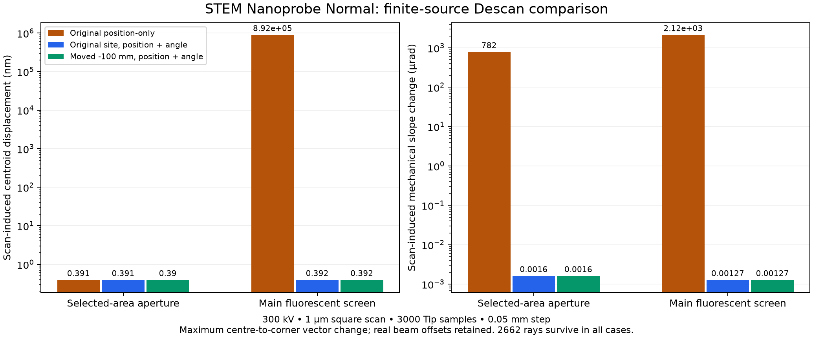

# STEM Nanoprobe Normal：Descan 与 Lower Objective

日期：2026-10-18。范围为 **C3 + Probe Corrector、STEM Nanoprobe Normal、300 kV、Diffraction 投影、1 µm 方形扫描视场**。所有检查均通过后台代码完成。

## 已采用的修改

1. `C3_ProbeCorrector.toml` 中 Image/Diffraction 双级偏转器整体上移 100 mm；Descan 继续作为同一硬件的动态通道，没有增加第二套线圈。其他 column 变体未改位置。
2. 新增 **Position and angle** 校准：联合求解上下两级的 X/Y 驱动，抵消选定平面的扫描位移和机械入射角增量。历史 **Position at selected plane** 模式继续可用。
3. 保存实际 Descan 命令、上下级耦合和已接受的约束。旧 held 记录仍恢复原来的 `-AC` 命令；选择新约束不会自动改写旧校准。扩大 FOV 时检查静态 Image/Diffraction 对准量加扫描峰值，超限则回滚。
4. 下游截面读数显示已计算的扫描位移和机械角度变化。数值为扫描造成的变化，绝对束心与真实倾角仍由实际粒子记录保留。

| 项目 | 原位置 / 数值 | 更新后 |
|---|---:|---:|
| 上级线圈中心，全局 Z / mm | 1774.4 | 1674.4 |
| 下级线圈中心，全局 Z / mm | 1799.4 | 1699.4 |
| 双级本体范围，全局 Z / mm | 1766.9–1806.9 | 1666.9–1706.9 |
| 线圈长度 / 中心间距 / mm | 15 / 25 | 15 / 25 |
| 选区光阑 Z / mm | 1824.4 | 1824.4 |
| 主荧光屏 Z / mm | 2714.15 | 2714.15 |
| 原位置联合校准的峰值驱动 / mrad | 0.559525 | 新位置 0.242460 |

这里的驱动是模型中的积分名义偏转角，不能直接当作线圈电流。位置属于工程建模选择，不是厂商测量尺寸。

## 为什么只匹配一个位置不够

原方案固定 Descan 的上级命令为反向 AC，只求下级耦合，使选区光阑上的束心重合；这没有同时约束入射角。实际有限电子束验证中，它在选区光阑保持约 0.39 nm 的扫描位移，却留下约 782 µrad 的角度变化；主荧光屏随即出现约 0.892 mm 的移动。

新的局部响应求解为 `[U L] [Ku; Kl] = -P_ac`，四行依次是 X、Y 位置和 X、Y 机械斜率。`U`、`L` 来自实际有限长度线圈及沿途透镜场的传播导数。位置行以线圈间距作尺度归一化，检查条件数后求解；不以伪逆掩盖不可控轴。AC 的已接受驱动、透镜激发和物理 Image/Diffraction 静态对准均保留。

这与 JEOL 对 [de-scan](https://www.jeol.com/words/emterms/20160713.103817.php) 的双级成像侧偏转器说明一致：检测器处的位置与角度是需要分别控制的量。具体安装坐标和驱动值来自本项目传播与装配计算。

## 有限电子束结果

从当前配置重新运行 3000 个物理 Tip 采样，所有方案复用同一个已经执行的上游粒子状态、权重、能量和 ID。比较扫描中心及四角，Descan 开/关，积分步长 0.1 / 0.05 mm，共 60 次 GPU 传播，另有三组 CPU 重放。下表是四角相对该方案扫描中心的最大二维矢量变化，采用 0.05 mm 数据。

| 观测量 | 原位置、仅位置校准 | 原位置、位置与角度校准 | 新位置、位置与角度校准 |
|---|---:|---:|---:|
| 选区光阑位移 / nm | 0.390513 | 0.390513 | 0.390432 |
| 选区光阑机械角变化 / µrad | 782.081 | 0.00160476 | 0.00160413 |
| 主荧光屏位移 / nm | 892006.671 | 0.391971 | 0.391977 |
| 主荧光屏机械角变化 / µrad | 2122.018 | 0.00126705 | 0.00126713 |



**屏幕稳定性的主要改善来自联合驱动求解。** 移位使峰值驱动从 0.559525 降至 0.242460 mrad，降低约 56.7%；没有把两种位置之间极小的残差差别当作新的束心精度提升。移动后的尺度化条件数约 62.98，高于原位置的 6.85，仍通过扰动和步长验证。更靠上的 −102 mm 候选驱动仅再降低约 2.7%，但装配余量更小，因此采用 −100 mm。

所有 60 次传播都保留相同的 2662 个存活粒子，源电流比例 0.887333；Descan 调整没有新增截断。未强制归零束心、去倾斜或归一化电流。例如新方案中心束在选区光阑的实际束心约为 `(−0.823789, +0.984893) µm`，主荧光屏约为 `(−2.009288, −1.886446) µm`，这些偏移仍在数据中。

选区光阑和屏幕的中心束 RMS 半径约为 417.447 / 895.893 µm。小的扫描位移残差表示图样基本不随扫描移动，不表示这些平面上的束斑缩小至亚纳米。

## 共同倾转中心与 crossover

- 当前 AC-only 扫描束心在样品下游存在两个共同交点：全局 **Z≈1605.1935、1625.7351 mm**；交点处扫描斜率非零。它们是不同扫描束心轨迹的交点。
- 同一中心束的电流加权 RMS 包络有一个样品之后的局部束腰：**Z≈1612.48 mm，位置括定 ±0.01 mm**。在该点及 ±0.005 / ±0.01 mm 处进行精确积分观测，并将步长从 0.05 减至 0.025 mm；中心 RMS 半径约 0.22708 nm。中心化的 `x·tx + y·ty` 协方差在束腰前为负、后为正，且使用相同粒子群，支持实际有限束斑局部收敛后发散的判断。
- 该束腰与上述共同交点不同。它也不等于 Lower Objective 的几何中心。
- 联合 Descan 补偿后，下游的一阶扫描束心轨迹重合。因此不能将每个零响应平面都标成独立 tilt 中心，也不能由此推断下游每个平面都是 crossover。

原研究中的强激发 C3 数值不能直接用于这里的 Normal：本次 C3 为 9.2079848%，Objective 为 68.9801%。Lower Objective 下极靴范围是 1601.9–1663.9 mm，极靴中心为 1632.9 mm；下轭铁中心 1729.4 mm 和下部场参考 1600.55 mm 是不同定义，不能混用。

## 装配与数值验证

- 新本体上端距离下极靴出口 3 mm，下端距离物镜消像散器分配区入口 25 mm。
- 原研究工作区中的较完整三维重建模型含 20 个实体，对 15 个邻件进行 300 对精确几何检查，无体积相交；最小材料间隙为 3.38136 mm。其 STEP 回读为 20 个有效实体，该研究配置与候选、STEP 的 40 次对称差体积均为零。未把未建模的管件或厂商公差计入已验证范围。
- 本次 Descan 范围提交仅包含共享偏转器的位置调整，未包含上述辅助支撑结构重建；所提交版本仍采用原来的 8 个铜线圈实体。20 实体的间隙与 STEP 结果是原研究模型的历史证据，不是本次范围提交的 CAD 验证。
- 新位置的 0.1→0.05 mm 最大绝对束心变化：选区光阑 0.004762 nm，屏幕 0.002714 nm；这与扫描中心差分残差是不同指标。
- 新位置 CPU/GPU 对比最大束心差为 7.29×10⁻¹⁰ nm，机械斜率差 2.75×10⁻¹² µrad，同一存活群和电流。
- 在实际更新后的安装配置中再次运行生产场计划与真实孔径截断，中心和一角与诊断候选符合，束心差不超过 1.35×10⁻⁹ nm。这一步没有替换为候选场提供器。

这些是当前模拟场模型和限定工作点的数值结果。没有做实机标定、样品散射、探测器像素强度或其他工作模式的光学验收；SAA 在此工作点仍分类为 mixed，校准不会将它重命名为共轭像平面。

## 使用与重现

在扫描校准区选择 **Position and angle**。已有 held AC 时使用 **Calibrate Descan (keep AC)**；需要重新求 AC 时使用 **Calibrate and hold**。改变透镜后 held 驱动不会自动消除物理变化，需要明确重新校准。

也可加载 `configs/design_candidates/nanoprobe_normal_descan_position_angle_20261018.toml`；对应 `.temwp` 是可导入 Working Points 的完整输入包，包含更新后位置及已保持的驱动，没有冒充保存的粒子计算结果。发布包从本次范围提交的干净检出重新生成，与较完整原研究工作区的旧包区分。输入包恢复会校验归档输入完整性并保留原始实现身份；允许当前兼容实现读取输入，但所有物理结果仍需重新计算，不复用历史计算。

稳定重现历史位置的一阶研究：

```powershell
.venv/Scripts/python.exe scripts/study_descan_phase_space.py --output outputs/descan_repeat --baseline-pair-center-mm 1786.9 --shifts 0 -102 -100 -90 -80 -76 --pivot-audit
.venv/Scripts/python.exe scripts/validate_descan_transport.py --output outputs/descan_repeat_particles --study outputs/descan_repeat/study.json --shifts -100 0 --backend gpu --step-mm 0.1 --step-refinement --compare-backend cpu --no-chief-diagnostics
.venv/Scripts/python.exe scripts/validate_descan_transport.py --output outputs/descan_repeat_installed --replay-prefix-source outputs/descan_repeat_particles --backend gpu
```

有限粒子比较、安装重放和精确束腰括定由 `scripts/validate_descan_transport.py` 完成。
历史 `legacy0` 由研究文件中的原位置与原驱动明确构建，不随新默认安装位置改变。
主批次没有重用旧日期的电子源；安装复核只在源设置、透镜、AC、固定观测站和粒子 ID 检查通过后重用该批次的前缀。
主要原始证据保存在：

- `outputs/descan_optimization_20261018/all_candidates.json`：位置、步长和扰动研究。
- `outputs/descan_transport_physical_20261018/report.json`：实际粒子记录、绝对束心/斜率/电流、步长与匹配 ID 比较。
- `outputs/descan_transport_physical_20261018/installed/installed-replay.json`：实际安装重放及精确束腰括定。
- `outputs/descan_optimization_20261018/mechanical-candidate-minus100.json`：实体间隙。
- `outputs/descan_optimization_20261018/production-minus100-identity-validation.json`：原研究工作区 20 实体配置与候选/STEP 一致性，不代表本次范围提交的 CAD 结构。
- `outputs/descan_optimization_20261018/image-diffraction-minus100.step`：更新后的共享偏转器三维模型。
- `outputs/descan_optimization_20261018/final-geometry-scan-regression.xml`：225 项最终位置/扫描回归。
- `outputs/descan_optimization_20261018/final-held-cache-regression.xml`：190 项最终保持校准、缓存、共享硬件、配置和尺寸回归。两组不重复，合计 **415 项通过**。
