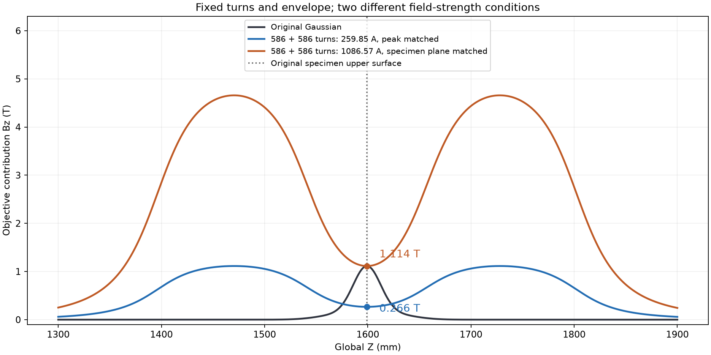
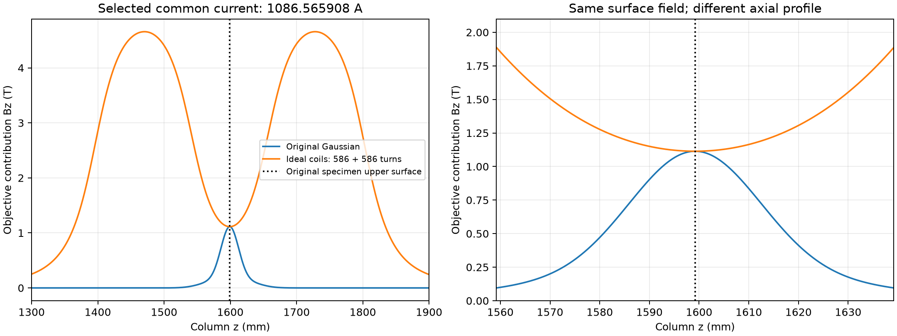

# Fixed physical Objective turns and alternative current calibrations

Date: 2026-11-15.

## Adopted physical turn counts

The current default column now saves **upper 586 + lower 586 = total 1172**
conductor turns. The upper value is the adopted estimate from the user's
cut-face photograph, with an image estimate range 580-590. The user explicitly
states that one copper cross-section counts as one turn. The lower value is a
user-authorized symmetry assumption, not a separate photographic measurement.
Both region counts remain fixed when current is changed or axial lengths are
edited. They are not increased to compensate for an ideal-field mismatch.

Only the current default `C3_ProbeCorrector.toml` Objective winding is assigned
these counts. Other lens windings and other catalog variants are not assigned
586 turns without their own evidence. The original geometry and the legacy
3000 A-turn reference remain saved. The selected conductor current is recorded
below. Gaussian controls, source parameters and solver tolerances are
unchanged, verified against the complete prior standard-startup state.

## What the two current conditions mean

The fixed original ideal-source envelope produces two broad lobes. The old
Gaussian peaks near the specimen, between those lobes. A scalar current scales
the ideal field everywhere; it cannot move the lobes or change their width.

| Condition | Actual common current A | I100 setting A | Ideal global peak T | Bz at original specimen surface T |
| --- | ---: | ---: | ---: | ---: |
| Match the global peak magnitude | 259.846098376 | 376.708079437 | 1.113835010 | 0.266367350 |
| Match at the original specimen upper surface | 1086.565908295 | 1575.233028526 | 4.657584457 | 1.113835010 |

The original Objective contribution at the specimen surface is about 1.113835 T.
If that local field is the quantity to preserve, the second condition is the
appropriate scalar calibration. If only the largest field anywhere is being
compared, the first condition matches that quantity. Neither matches the whole
Bz(z) profile, its integrated focusing strength or the old focus automatically.
All values are Objective contributions, not an all-column probe qualification.



The preceding alternative-calibration evidence was recorded while the matching
choice was pending. It remains preserved unchanged. The user subsequently
selected the specimen-upper-surface condition below.

## Selected specimen-surface calibration

The default column now saves **I100 = 1575.2330285262728 A** on the existing
Objective owner, without changing its excitation control. At the standard
Nanoprobe/Diffraction setting of 68.97810600833917%, each series region carries
**1086.565908295224 A** and has **636727.6222610013 A-turn**. Upper and lower
each retain 586 turns, the original ID 60 mm / OD 132 mm and 145 mm occupied
axial length. Wire diameter remains unknown; no conductor rating is inferred.

| Quantity | Result |
| --- | ---: |
| Original specimen upper surface z | 1599.1999975 mm |
| Original Gaussian Objective Bz there | 1.113835009791199 T |
| Selected ideal Objective Bz there | 1.1138350097911989 T |
| Relative matching error | -1.99e-16 |
| Ideal upper lobe maximum | 4.657584457374018 T at 1470.446617 mm |
| Ideal lower lobe maximum | 4.657584457374002 T at 1727.953374 mm |

These are the **Objective contribution**, not total all-column Bz. Current
scales the existing ideal field; the two-lobe shape is not forced to the
Gaussian profile. Matching one surface field does not preserve the integrated
focusing power, the waist or the old working point. This run deliberately
does not trace or focus a beam. Magnetic pole pieces, ferromagnetism,
saturation, resistance, heating and current limits are absent from the model.



The exact previous standard-startup optical/source/numerical state is retained.
The round-lens model selector is global, so this field-only validation uses a
detached ideal-model state and captures Objective individually. The saved
electrical reference is active whenever ideal prescribed-current coils are
selected; the original Gaussian startup choice remains unchanged. No other
lens is given a new calibration. All 12 other enabled ideal sources compare
exactly before and after the Objective current edit.

The default quadrature order remains 12. The captured field coefficients
exactly reproduce the selected earlier candidate; serialization roundtrip is
exact and the current edit changes the ideal cache identity. Independent
integration of the continuous rectangular winding (analytic axial integral,
adaptive radial quadrature) gives 1086.5659082949037 A for the same target,
differing by only 3.20e-10 A. On 121 axial points from 1300 to 1900 mm, the
order-12 field differs from that integral by at most 0.003613% of the sampled
peak. This is a discretization diagnostic, not a new tolerance or a claim of
binary64 accuracy across the whole profile. The surface matching check keeps
relative tolerance 2e-14 and zero absolute tolerance.

The [selected-current record](validation_selected/selected-current.json),
[independent receipt](validation_selected/independent/receipt.json) and
[evidence manifest](validation_selected/manifest.json) retain the inputs and
checks. **150 targeted component tests passed**, with zero failures or skips,
covering the selected field, fixed counts, cache identity, inactive legacy
reference, explicit winding inputs, old-input compatibility and current
parameter provenance. No finite-source particle, CUDA wave or focus
qualification is claimed.

```powershell
.venv/Scripts/python.exe -u docs/development/fixed_objective_turns_20261115/validate_selected_current.py
```

## Implementation

- Turn count N is now a valid electrical input independently of wire diameter.
  Missing wire size retains envelope CAD; conductor size, metal area and packing
  are not fabricated.
- `winding_interval_turn_counts` contains positive integer counts in occupied
  axial-interval order and must sum to `winding_turn_count`. Actual interval
  count is validated against authoritative geometry.
- With explicit current, each region receives exactly N_region times current,
  even after interval lengths change. Legacy uniform counts retain their old
  floating-point field coefficients when no new current is prescribed.
- Detailed conductor CAD, when requested with a known diameter, preserves the
  fixed per-interval counts and rejects insufficient or ambiguous allocations
  rather than reallocating turns.
- Configure winding supports blank diameter and explicit regional counts, with
  one atomic draft transaction, Undo, save/reload and stale-draft rejection.
  Changing current does not change N.
- Regional count changes participate in captured geometry and cache identity.
  Unknown wire diameter and metal area are explicitly null in field provenance.
- Finite large ideal currents are allowed. No resistance, saturation, heating or
  conductor current-rating constraint is added. The earlier 3 A/mm-squared
  design budget is not used to resize these physical turns or their envelope.

The accepted modelling rule is also recorded in `agent.md`: fit ideal current,
keep physical turns and their uncertainty/provenance, and report field-shape and
focus differences separately.

## Validation and reproduction

Six targeted test reports contain **467 unique test cases with latest status passed**. The earlier field report retains one failed test-only list/tuple assertion; it was corrected to the immutable tuple contract and passes in the final report. Numeric field behaviour and tolerance were not weakened.

Coverage includes N-only sources, high finite current, fixed 586/586 counts,
nonuniform interval lengths, exact preservation of legacy field coefficients,
cache invalidation, unknown-wire CAD, fixed detailed-CAD allocation, dialog
validation, atomic edits/Undo, old working-point inputs and existing round-lens
models. Component checks forbid source emission/transport. No finite-source,
material/FEM or coherent propagation is claimed.

The historical calibration driver independently checks both scalar field targets against
captured potentials, retains all curves and confirms the unchanged complete
standard-startup optical/source state. It changes current only in detached
copies and writes a separate alternatives-replay directory. The [historical calibration record](validation/calibration.json) separates photo
provenance, symmetry assumption and pending current selection. Evidence hashes
are in the [manifest](validation/manifest.json).

```powershell
.venv/Scripts/python.exe -u docs/development/fixed_objective_turns_20261115/calibrate.py
```
