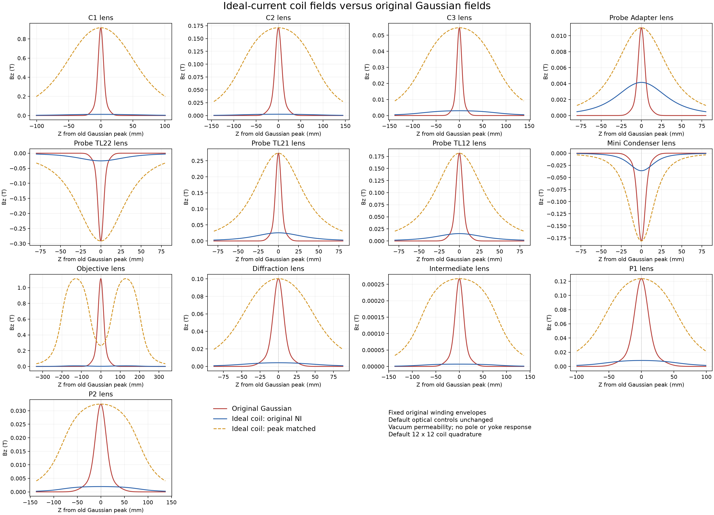
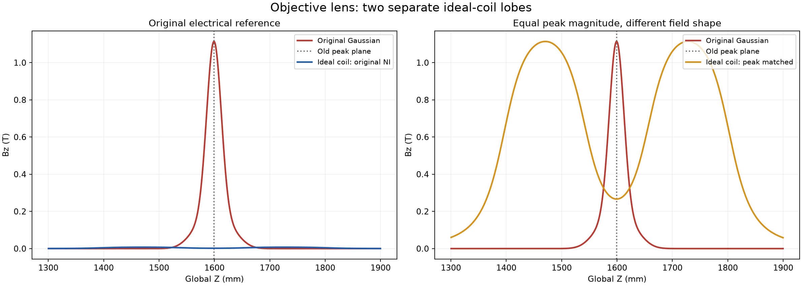

# Fixed-envelope ideal-current coil field study

Date: 2026-11-15.

## Scope and preserved defaults

Following the scope change, further nonlinear material work was stopped. This
study uses only uniformly homogenized ideal prescribed-current round coils in
vacuum. Magnetic permeability is mu0 everywhere. Yokes, pole pieces, saturation,
B-H response, resistance and heating do not contribute. Previously completed
material-study outputs remain unchanged in their separate output directory.

The default FEG / C3 + Probe Corrector / No Energy Filter assembly, Normal
Nanoprobe/Diffraction optical controls, Gaussian parameters, source energy law,
physical dimensions and propagation tolerances are preserved. Only detached
comparison states select the compatibility key `copper_coil`. The application
startup/default model is not changed. All 834 protected source/input files have
unchanged SHA-256 values, and the baseline state is unchanged after calculation.
No source particles, coherent waves or material/FEM solves were executed by this
ideal-field study.

The original reference is 3000 A turn at 100% excitation for each owner, scaled
by its existing percentage and polarity. It is an engineering initialization,
not an electrical calibration of the old Gaussian field. No unknown historical
turn count, wire size or current is filled into the default manifests.

## Axial field comparison

Every row compares the original isolated Gaussian component to its corresponding
isolated ideal coil, with the original winding ID, OD and occupied axial
intervals. Default coil quadrature remains 12 by 12. Peak matching changes only
the detached source NI; it cannot change a fixed-envelope field shape. The
saved curves include original Gaussian, original-NI ideal coil, peak-matched
ideal coil and a separate integral-B-squared-matched ideal coil.

Widths below are FWHM of the connected half-maximum region containing the
selected peak. Split sources retain every half-maximum region explicitly.
The saved `peak_search_candidates` list includes optimization brackets on
near-duplicate merged grid coordinates; its length is not a physical peak count.
Half-maximum regions and the independently verified Objective lobes are reported
separately. The fitted per-source NI values are also not a jointly matched
whole-column field: broad ideal sources overlap, so matching their isolated
peaks does not match the sum of all Gaussian fields.

| Lens | Gaussian peak T | Gaussian FWHM mm | Ideal peak at original NI T | Ideal main-lobe FWHM mm | Half-max regions |
| --- | ---: | ---: | ---: | ---: | ---: |
| C1 lens | 0.916992366 | 10.1107 | 0.0126561283 | 125.9027 | 1 |
| C2 lens | 0.171015159 | 17.6937 | 0.00255421233 | 180.5248 | 1 |
| C3 lens | 0.0546727952 | 12.7395 | 0.00298623727 | 172.9859 | 1 |
| Probe Adapter lens | 0.0110051202 | 9.9085 | 0.00415711122 | 71.2543 | 1 |
| Probe TL22 lens | 0.291389194 | 8.4930 | 0.0254610436 | 68.8082 | 1 |
| Probe TL21 lens | 0.273683577 | 8.4930 | 0.0254967454 | 68.7431 | 1 |
| Probe TL12 lens | 0.181607478 | 9.9085 | 0.0152906472 | 68.8232 | 1 |
| Mini Condenser lens | 0.181115939 | 11.3240 | 0.0361620639 | 35.9409 | 1 |
| Objective lens | 1.11383501 | 34.1603 | 0.00756849577 | 158.7364 | 2 |
| Diffraction lens | 0.100267769 | 16.9860 | 0.004205568 | 109.7685 | 1 |
| Intermediate lens | 0.000267217803 | 21.2324 | 7.01279357e-06 | 171.2426 | 1 |
| P1 lens | 0.12369359 | 25.4789 | 0.00840351074 | 124.0398 | 1 |
| P2 lens | 0.0324437803 | 28.3099 | 0.00196432788 | 171.2426 | 1 |



### Objective split source

The original Gaussian has one peak near 1599.2 mm and FWHM 34.1603 mm. The
production q12 ideal source has two broad peaks near 1470.4466 and 1727.9534 mm,
with two separate half-maximum intervals, each about 158.7364 mm wide. The
bounding span of the two intervals is not a single-lobe FWHM.

Matching the global peak magnitude to 1.113835 T needs about 304539.627 A turn,
but the field at the old Gaussian peak plane is then only 0.266367 T. Its
integral of Bz squared is about 9.73146 times the Gaussian integral. Thus equal
peak magnitude does not establish an equivalent lens or restore the old focus.
No particle-focus or aberration qualification is claimed.



## Turns and cross-section budgets

Assumptions retained from the accepted discussion: conductor current density
J=3 A/mm squared and metal fill fraction f=0.60. Wire turns are chosen as
integers and actual current is reduced slightly to retain the required NI.

For a chosen **workpoint actual-current** limit I:

- N = ceil(abs(NI)/I).
- Actual current = abs(NI)/N; wire area = actual current/J.
- Whole winding-pack radial-axial area = abs(NI)/(J*f).
- I100 setting = actual current/(excitation_percent/100), with polarity separate.

The Objective limit is 3 A; other round-lens workpoint limits are 1 A. Objective
turns and areas are totals across both occupied regions, not per region.

| Lens | Peak-matched NI A turn | Workpoint current limit A | Total turns | Pack area mm squared | Required I100 setting A |
| --- | ---: | ---: | ---: | ---: | ---: |
| C1 lens | 112304.34233 | 1 | 112305 | 62391.301 | 1.93547 |
| C2 lens | 27917.95958 | 1 | 27918 | 15509.978 | 7.19473 |
| C3 lens | 8616.72748 | 1 | 8617 | 4787.071 | 6.374 |
| Probe Adapter lens | 794.18998 | 1 | 795 | 441.217 | 9.98981 |
| Probe TL22 lens | 20576.60995 | 1 | 20577 | 11431.450 | 1.66854 |
| Probe TL21 lens | 19306.90563 | 1 | 19307 | 10726.059 | 1.6679 |
| Probe TL12 lens | 12828.81688 | 1 | 12829 | 7127.120 | 2.77739 |
| Mini Condenser lens | 6594.09694 | 1 | 6595 | 3663.387 | 2.27829 |
| Objective lens | 304539.62730 | 3 | 101514 | 169188.682 | 4.34917 |
| Diffraction lens | 10426.64258 | 1 | 10427 | 5792.579 | 6.8596 |
| Intermediate lens | 40.10403 | 1 | 41 | 22.280 | 2788.12 |
| P1 lens | 14180.51645 | 1 | 14181 | 7878.065 | 3.11387 |
| P2 lens | 4869.16097 | 1 | 4870 | 2705.089 | 10.1744 |

At nominal actual currents, a 3 A conductor needs about 1 mm squared bare metal
area (diameter 1.128 mm), and 1 A needs about 0.333 mm squared (diameter 0.651 mm).
The whole winding area remains independent of the chosen current when NI, J and
fill fraction are fixed: lower current trades smaller wire for more turns.

The optional sensitivity bounds J=2 to 5 A/mm squared and f=0.50 to 0.70 give
0.514286 to 1.8 times the nominal pack area. These are arithmetic design
assumptions, not thermally qualified current ratings.

### A few amperes over the full excitation range is a different condition

If the requested 3 A / 1 A limits instead apply to **I100**, the existing optical
percentages must also be retained in the turn and conductor-size budget. N is
then ceil(abs(NI)/(I100_limit*percent/100)), and the wire is sized for I100.
The full-excitation pack budget is abs(NI)/((percent/100)*J*f).

| Lens | I100 limit A | Total turns | Workpoint actual current A | Pack area sized at I100 mm squared |
| --- | ---: | ---: | ---: | ---: |
| C1 lens | 1 | 217364 | 0.5166649 | 120757.357 |
| C2 lens | 1 | 200863 | 0.1389901 | 111590.278 |
| C3 lens | 1 | 54925 | 0.1568817 | 30513.759 |
| Probe Adapter lens | 1 | 7942 | 0.09999874 | 4412.167 |
| Probe TL22 lens | 1 | 34334 | 0.5993071 | 19074.185 |
| Probe TL21 lens | 1 | 32203 | 0.5995375 | 17890.099 |
| Probe TL12 lens | 1 | 35632 | 0.3600364 | 19795.050 |
| Mini Condenser lens | 1 | 15026 | 0.4388458 | 8347.419 |
| Objective lens | 3 | 147168 | 2.069333 | 245278.816 |
| Diffraction lens | 1 | 71526 | 0.1457742 | 39736.118 |
| Intermediate lens | 1 | 114313 | 0.0003508265 | 63507.217 |
| P1 lens | 1 | 44158 | 0.3211313 | 24532.126 |
| P2 lens | 1 | 49550 | 0.09826763 | 27527.465 |

For example, Objective workpoint current near 3 A needs 101514 turns and an I100
setting near 4.34917 A. Limiting I100 itself to 3 A instead needs 147168 turns,
with workpoint current near 2.06933 A. Intermediate workpoint current near 1 A
would require I100 near 2788 A because its optical percentage is very small;
that budget must not be described as a one-ampere full-range supply design.
The full-range one-ampere alternative is provided separately above.

All areas are **budgets using NI evaluated at the original field envelope**.
They are not new CAD dimensions. If an area does not fit the original envelope,
the assumed J/f and that target cannot all be satisfied within that envelope.
Increasing the physical envelope changes field per NI and requires a new solve;
none of these budgets is silently installed as a geometrically self-consistent
redesign or a new operating point.

## Numerical checks and limits

- The axial shortcut was checked against each unchanged public vector-field
  sampler at selected positions using the existing same-operator criterion
  rtol=4e-14 / absolute tolerance 1e-20 T.
- An independent analytic axial/radial integral checks all 13 winding envelopes.
  Its analytic formula agrees with independent 96-point radial integration to
  a maximum peak-normalized error about 6.05e-15.
- Against that analytic reference, unchanged q12 has maximum absolute error
  normalized by source peak 1.05009e-4 (0.0105009%); Objective is 0.0036583%.
  Validation-only q24 and q32 reduce the worst errors to about 1.2011e-8 and
  3.1271e-11. Neither setting is applied to defaults or used to relabel q12 data.
- These quadrature errors are not the same metric as the strict same-operator
  path comparison above. No tolerance is relaxed to call them identical.
- The prior explicit-N/I versus legacy normalization last-bit finding remains
  separately recorded in the coil inventory audit. This study retains the
  original captured NI for baseline fields and does not change that code.

The analytic Objective reference gives peaks near 1470.399664 and 1728.000336 mm,
central Bz=0.001809963 T, and two FWHM regions each 158.733597 mm wide. Its small
difference from production q12 is recorded as numerical quadrature error.

## Evidence and reproduction

[Machine-readable summary](validation/summary.csv),
[full metrics](validation/results.json), and
[independent analytic check](validation/analytic-crosscheck.json) retain the
field/current conventions. The [manifest](validation/manifest.json) hashes all
curated evidence and the original raw arrays. Full field samples remain at
`outputs/ideal-coil-fields-20261115/curves.npz` with their exact byte hash in the
manifest; the reproducible [run.py](run.py) rebuilds them from unchanged inputs.

```powershell
.venv/Scripts/python.exe -u docs/development/ideal_coil_fields_20261115/run.py
```

The existing raw material-study results are retained separately. They are not
inputs to this ideal-current field calculation and are not treated as part of
its validation or resumed after the requested scope change.
