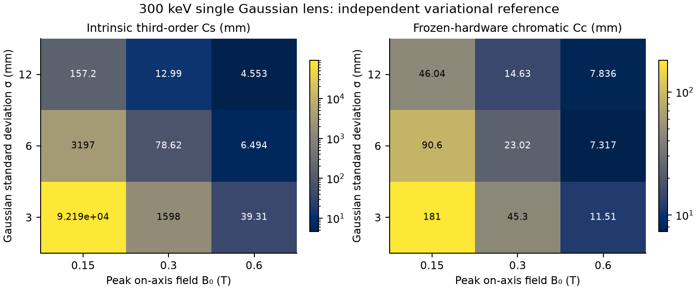
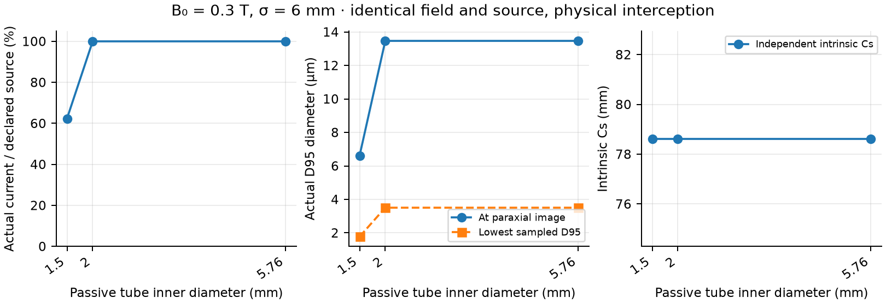
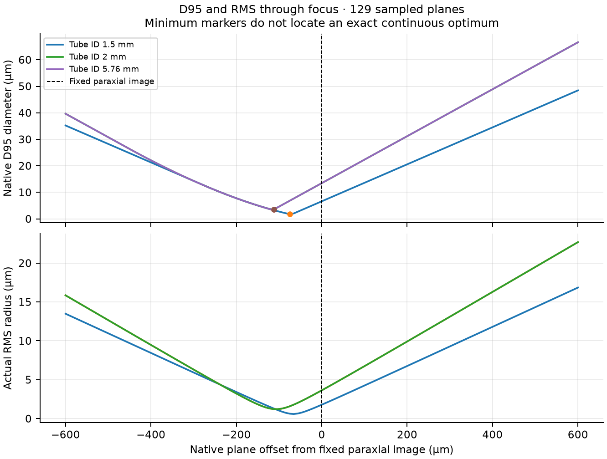
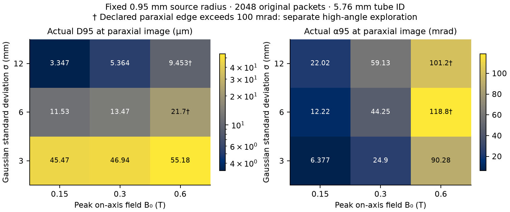
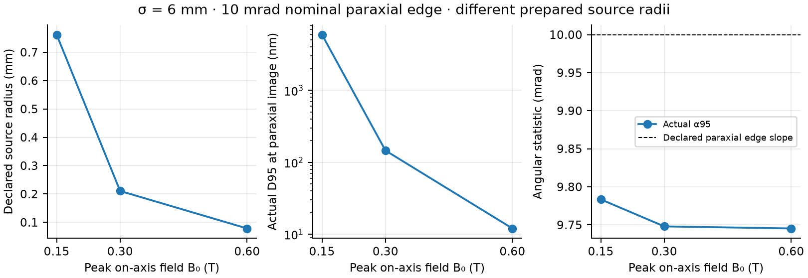
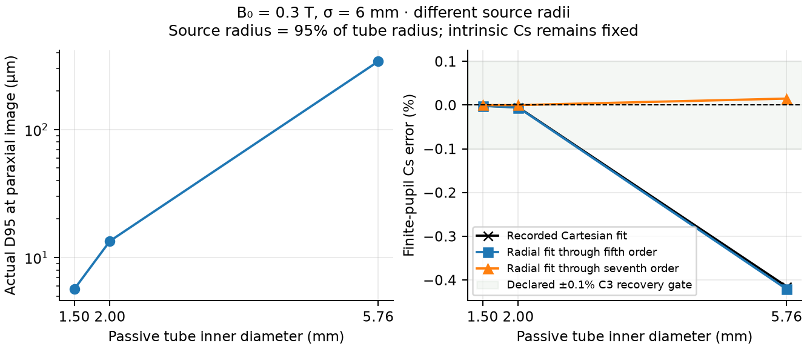
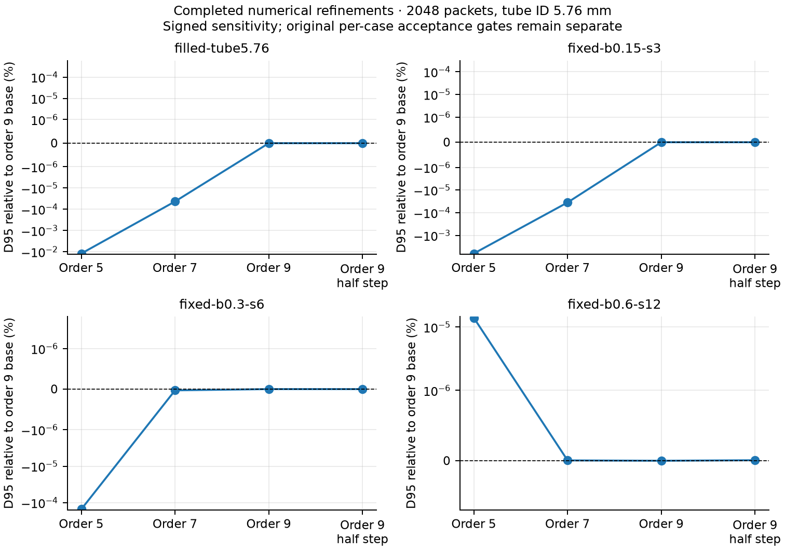

# Intrinsic aberrations of an ideal Gaussian magnetic lens, 2026-11-13

A prescribed, round Gaussian magnetic lens has **nonzero intrinsic spherical
aberration** even when no empirical Cs action, iron geometry, winding model or
material imperfection is added. At 300 keV, the B peak = 0.3 T, σ = 6 mm
reference gives **Cs = 78.620670881 mm**. The nine declared
B/σ combinations, finite-source tube tests and separate source-boundary
comparisons below establish results for this numerical model. They do not
identify a universal minimum-Cs lens, a TEM working point, or an optimized
diffraction-limited probe.

The experiment and acceptance checks were declared in [the study plan](study-plan.md)
before finite-source execution. There are 14 primary cases plus 12 numerical
refinements, each built from an original 1024-particle transport and a second
1024-particle extension. The independent [variational reference](variational-reference/report.json)
has no emitted finite source. No coherent-wave or material-field solve is
performed and no application optical preset is retuned.

## Field and reference definitions

The axial profile is `B(z) = B_peak exp(-z²/(2 σ²))`, centred at Z = 0 and
explicitly continued to all Z. **σ is the Gaussian standard deviation**:
FWHM is 2.35482 σ, not σ, and neither quantity is a hard field extent. The
declared peaks are 0.15, 0.3 and 0.6 T; σ is 3, 6 or 12 mm. A near-axis
regular vector-potential expansion begins

```
A_phi = r B(z)/2 - r³ B''(z)/16 + r⁵ B''''(z)/384 + ...
B = curl(A)
```

The regular expansion is described by
[Khan and Jagannathan, equations 1-2](https://arxiv.org/html/2009.13943v2).
The new finite-source calculations retain odd radial powers through order 9,
with orders 5 and 7 used in separate refinements. A finite truncation has a
remaining current-free curl residual; it must not be called an exact global
Maxwell solution. [The implementation receipt](implementation-reference/high_order_round_lens.py)
and per-case field dictionaries specify the numerical law.

The expectation of intrinsic aberrations is consistent with
[CEOS's statement of Scherzer's theorem](https://www.ceos-gmbh.de/en/basics/scherzerstheorem)
for round, static lens fields without space charge. These references motivate
the model and interpretation; neither publication predicts the numerical
Gaussian Cs values reported here. No external image is reproduced.

At E0 = 300000 eV, the first paraxial image is obtained from the independent
linear ray equation. The source is at -8 σ with the declared zero-Larmor
entrance matrix. That fixed field, initial ray family and image plane are
retained for Cs/Cc measurements. The displacement convention is

```
delta_r = -Cs * theta * |theta|² + Cc * theta * (delta_E/E0)
```

Here theta is the declared outward image-space **paraxial pupil slope**,
not the actual finite-source α95. Third-order variational Lorentz equations
give Cs independently of the finite-pupil fits; Cc uses frozen-hardware energy
perturbations without refocusing each energy. This is a classical reference,
not a quantum calculation from the cited paper.

| B peak (T) | σ (mm) | Intrinsic Cs (mm) | Frozen-hardware Cc (mm) | First paraxial image Z (mm) |
| --- | --- | --- | --- | --- |
| 0.15 | 3 | 92190.338 | 181.02469 | 148.72185 |
| 0.15 | 6 | 3196.7938 | 90.596497 | 76.088632 |
| 0.15 | 12 | 157.24134 | 46.039756 | 41.067873 |
| 0.3 | 3 | 1598.3969 | 45.298249 | 38.044316 |
| 0.3 | 6 | 78.620671 | 23.019878 | 20.533936 |
| 0.3 | 12 | 12.987323 | 14.633539 | 11.296251 |
| 0.6 | 3 | 39.310335 | 11.509939 | 10.266968 |
| 0.6 | 6 | 6.4936613 | 7.3167695 | 5.6481253 |
| 0.6 | 12 | 4.5534143 | 7.8364737 | -0.58372015 |

Image Z is measured from the field centre, not a pole face. Several first
images lie inside substantial field; the strongest/widest case even has
negative image Z. These must not be read as focal distances from a hard field
edge. There is no monotonic or global-optimum conclusion beyond the declared
parameter/reference family. Equal B_peak × σ cases satisfy the recorded
dimensionless scaling checks; changing σ at fixed peak also changes lens
strength, rather than merely rescaling an otherwise identical lens.



## Prepared source, physical tube and current

The synthetic beam is monochromatic at 300 keV and has zero incoherent
emittance. Its declared current is 1 µA. The fixed-source family uses a
uniform-area disk of radius 0.95 mm and the fixed paraxial entrance matrix;
it is not an FEG, a 0.3 eV spread distribution or an experimental brightness
model. Samples use fixed inverse-CDF Halton coordinates with persistent IDs.
Increasing N from 1024 to 2048 appends particles without changing existing
positions, directions, energy, clocks, source boundary or trajectories.

The original 1024 raw partition retains its historical weights 1/1024.
The published 2048 population explicitly uses 1/2048 for every original ID at
the same 1 µA source current. This new population normalization does not
rewrite the earlier raw record and never restores intercepted current.
Each newly transported partition has 1024 original positive-current packets;
larger-population observables reuse the exact completed prefix.

The passive tube IDs are 1.5, 2 and 5.76 mm. Its magnetic feedback is
deliberately absent: changing the tube never changes the prescribed field.
The original vacuum characteristics continue numerically after contact for
the independently declared vacuum aberration fit; **that continuation is
counterfactual**. Only the prefix before first wall contact is a physical
trajectory for a tube view. Contact is classified over each DOP853 dense
polynomial, including exit/re-entry and tangent cases, rather than just saved
endpoints. Complete contact phases, source IDs, bounds and status ledgers are
retained. Unresolved contacts must be rejected, not treated as ordinary losses.

The [real-column inventory](vacuum-tube-inventory.json) supplies context only:
the reconstructed C1 lens/C2 lens-to-Objective continuous pipe is ID 5.76 mm
(radius 2.88 mm), despite 20 mm main lens bores. Some carrier and sample-stage
passages are ID 5 mm. The inserted C2 optical stop is a different boundary.
The ideal experiment does not reconstruct all these actual devices. A tube
diameter does not stand for a ferromagnetic pole bore in a solved material
model, and tube clipping is not evidence that intrinsic Cs has improved.

At B peak = 0.3 T and σ = 6 mm the identical fixed source and field give:

| Tube ID (mm) | Current transmission (%) | D95 at paraxial image (nm) | Lowest sampled D95 (nm) | Its offset (µm) | Neighbour bracket (µm) | Sampled RMS-minimum offset (µm) |
| --- | --- | --- | --- | --- | --- | --- |
| 1.5 | 62.3535156 | 6615.9801432 | 1778.8594395 | -75 | [-84.375, -65.625] | -65.625 |
| 2 | 100.0000000 | 13466.8763838 | 3504.8246419 | -112.5 | [-121.875, -103.125] | -103.125 |
| 5.76 | 100.0000000 | 13466.8763838 | 3504.8246419 | -112.5 | [-121.875, -103.125] | -103.125 |

D95 is the diameter containing 95% of the **actual transmitted current**
about its current-weighted centroid; RMS radius uses the full transmitted
second moment. Both are geometric ray statistics, not wave or diffraction
resolution. The 1.5 mm tube reduces transmitted current and D95, while the
independent intrinsic Cs remains 78.620671 mm. The
vacuum Cs fit uses the complete predeclared source, never a wall-selected
population.



The native focus scan has **129 executed planes**. Its lowest sampled D95
and neighbouring bracket are secondary observations, not exact continuous
best focus or a precision-qualified optimized probe. The base scan spacing
is 9.375 µm. D95 and RMS minima are separately observed; neither replaces the
fixed paraxial image used for the principal size comparisons.



## Comparisons answer different questions

The nine **fixed-source** cases keep radius 0.95 mm and use the 5.76 mm tube
for this table. Actual convergence changes substantially, so D95 does not
have to decrease monotonically with stronger peak field.

| B peak (T) | σ (mm) | Paraxial edge slope (mrad) | Actual α95 (mrad) | Actual D95 at reference (nm) |
| --- | --- | --- | --- | --- |
| 0.15 | 3 | 6.387106 | 6.376867 | 45471.971 |
| 0.15 | 6 | 12.46512 | 12.22194 | 11525.328 |
| 0.15 | 12 | 22.55895 | 22.01902 | 3346.8639 |
| 0.3 | 3 | 24.93024 | 24.90394 | 46939.854 |
| 0.3 | 6 | 45.11791 | 44.2538 | 13466.876 |
| 0.3 | 12 | 60.58641 | 59.13009 | 5364.3023 |
| 0.6 | 3 | 90.23582 | 90.27588 | 55175.551 |
| 0.6 | 6 | 121.1728 | 118.8018 | 21698.289 |
| 0.6 | 12 | 103.6679 | 101.1709 | 9452.673 |



The **matched-edge** family instead changes the prepared source radius to
obtain a 10 mrad nominal paraxial edge slope at σ = 6 mm. This is an explicit
source-boundary change, not the same beam compared at different fields.
An edge slope is not a 95%-current containment angle; actual α95 is reported.

| B peak (T) | Prepared source radius (mm) | Intrinsic Cs (mm) | Actual α95 (mrad) | Actual D95 at reference (nm) |
| --- | --- | --- | --- | --- |
| 0.15 | 0.76212652 | 3196.7938 | 9.7834124 | 5937.99923 |
| 0.3 | 0.21055941 | 78.620671 | 9.7479289 | 145.534374 |
| 0.6 | 0.078400426 | 6.4936613 | 9.7452236 | 12.0169611 |

The approximately 12 nm value is an actual geometric diameter at its
specified paraxial reference plane. It is not a globally optimized probe,
a native continuous-focus minimum or a wave-resolution result.



The **equal tube-filling** family uses source radii 0.7125, 0.95 and 2.736 mm
for tube IDs 1.5, 2 and 5.76 mm respectively: each source fills 95% of the
tube radius at entrance. Field and σ remain fixed, but source boundaries
differ. The middle point reuses the already executed base source, rather
than transporting duplicate particles to inflate a sample count.

For the largest source, the recorded Cartesian fit's C3 recovery error is
**0.4148405%**, exceeding the declared
0.1% reference gate. Both its 1024- and 2048-particle failure records remain
failures. An independent radial fit through seventh order gives C3 error
0.0149242%, supporting higher-order finite-pupil
contamination of the lower-order fit. This does **not** qualify C5 or C7, make
the failed fit pass, or change the independent intrinsic Cs coefficient.



## High-angle scope and numerical checks

The following primary cases exceed the earlier benchmark's 100 mrad nominal
pupil-slope scope. Their new finite-geometric results are explicitly labelled
exploration; the earlier benchmark's range is not silently extended.

| Primary case | Declared paraxial edge slope (mrad) | Actual α95 at widest declared tube (mrad) |
| --- | --- | --- |
| fixed-b0.6-s6 | 121.17281 | 118.80181 |
| fixed-b0.6-s12 | 103.66788 | 101.1709 |
| filled-tube5.76 | 129.93957 | 133.81951 |

All 14 primary cases satisfy the declared 1024-to-2048 source-count comparison
gates. The largest paraxial-image D95 change is 0.01989743% and
the largest recorded Cartesian C3 change is 0.0061594646%. These are
observed numerical sensitivities, not a proof of continuous-source error or
experimental accuracy. No intercepted or tail packet is deleted from the
declared vacuum fit.

All sampled primary field-grid/path checks pass their stated gates. The
largest order-7 versus order-9 sampled B difference, normalized by B_peak
(dimensionless), is 1.331207e-06;
the largest normalized order-9 curl residual is 5.4632735e-07. These are
sampled estimates, not rigorous global field-error bounds. Twelve separate
refinements cover four representative sources at orders 5 and 7 and with a
halved maximum step. The four actual half-step integrations pass their
declared gates and use genuinely finer accepted meshes. Order-5/7 trajectory
differences are preserved as diagnostics, not relabelled integration-step
passes.



The independent [array audit](audit-summary.json) checks all 26 raw case
inventories, original IDs/weights, directions, energy and flight clocks,
physical current ledgers, actual D95/RMS/α95, whole-source fit recovery,
12 refinement source/observation matches and the retained failures. The
[validation summary](validation-summary.json) also records 45 passing
targeted software tests. This is not a claim that the full application suite
was run or that every fit acceptance gate passed.

## Reproduction and retained evidence

The [declared requests](case-inventory.json), original
[primary plan](declared-requests/requests.json) and
[refinement plan](declared-requests/requests-refinement.json) preserve every
input. Each finite-source directory contains original report/request/field
bytes, the complete source, exact complete wall ledgers, and selected original
phase rows from both 1024-particle partitions. All original IDs and historical
weights remain present. Selection includes paraxial image, D95/RMS observed
minima and neighbours, focus endpoints and representative path planes. All
129 focus scalar records and moments at every original checkpoint are kept.

Selected phase arrays are byte-checked against the corresponding original
partition rows. Every reported focus statistic and absolute current balance
is independently recomputed by the curator at relative tolerance 2e-13.
[The verification receipt](selected-phase-verification.json) declares the
selection. Raw full-file origins and SHA256 hashes are retained in the
[scientific manifest](artifact_manifest.json); the roughly 384 MiB raw
characteristic collection is not duplicated. The compact selection is **not
the complete trajectory or a retained dense interpolant**. Original dense
polynomial contact evidence is represented by its exact computed ledger,
receipts and independent tests; recomputing dense trajectories requires a
replay of the original model.

The byte-preserved research drivers are under `drivers/`; implementation
references are under `implementation-reference/`. The three original finite
research helper paths are `scripts/study_ideal_lens_aberrations.py`,
`scripts/ideal_lens_beam.py` and `scripts/ideal_lens_wall.py`. Their path-based
imports and receipts expect the original repository layout: for replay,
restore those exact bytes to those recorded paths in a checkout with the
recorded source identity. The archived copies are provenance evidence, not
an assertion that moving them to an arbitrary directory preserves import
semantics. The independent reference driver originally lives under
`outputs/ideal-lens-aberration-20261113/ideal_lens_reference.py` and expects
the same source tree. The curator and plotting drivers only read completed
data and do not perform a new physical calculation.

After activating the recorded project environment and restoring the exact
helper bytes/source version, a canonical replay from the repository root is:

```
python scripts/study_ideal_lens_aberrations.py --requests docs/development/ideal_lens_aberration_20261113/declared-requests/requests.json --reference docs/development/ideal_lens_aberration_20261113/variational-reference/report.json --output outputs/ideal-lens-replay/finite-source
```

Use a fresh output directory. The optional second command adds the distinct
declared refinement cases to that same output root:

```
python scripts/study_ideal_lens_aberrations.py --requests docs/development/ideal_lens_aberration_20261113/declared-requests/requests-refinement.json --reference docs/development/ideal_lens_aberration_20261113/variational-reference/report.json --output outputs/ideal-lens-replay/finite-source
```

All figures are newly generated from the retained numerical observations;
PNG, vector SVG and standalone PDF versions are included. Archiving and
successful integrity checks do not remove the declared high-angle, finite-
pupil, source-count, coarse-focus or material-model limitations.
