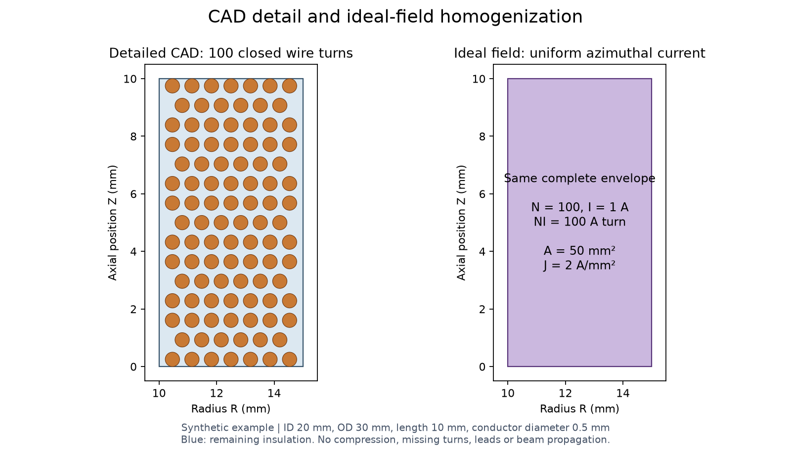

# Explicit winding definition and ideal-field conversion

The [feature guide](../../IDEAL_CURRENT_WINDINGS.md) describes inputs, editing,
the retained source envelope and current convention. This change does not
assign unmeasured turn counts to historical operating points or alter their
original NI/current controls.

The final targeted simulator suite passed **472 tests**, with zero failures
or errors. It covers layout limits and volume closure, N/I field equivalence,
wire-size independence at fixed ideal envelope and NI, current-driven cache
invalidation, native potential roundtrip, atomic editing/undo/save, old inputs,
parameter explanations and existing CAD/model-editor behaviour.

The separate CadQuery 2.6.1 checks exercised analytic torus/insulation volume,
contacts, complete material leaves and STEP roundtrip. A production-catalog
100-turn example subsequently exported and reread both its unit and module
STEP files successfully: each retains **101 material leaves**, comprising all
100 wire turns and the remaining insulation.

The example is synthetic: ID 20 mm, OD 30 mm, length 10 mm, 100 turns, bare
wire diameter 0.5 mm and prescribed current 1 A at 100% excitation. Its full
equivalent area is 50 mm squared, total NI is 100 A turn and homogeneous
current density is 2 A/mm squared. The actual metal area is 19.6349541 mm
squared and is not used to compress the field envelope.

The [configuration dialog](validation/configuration-dialog.png) displays this
mapping before applying one undoable draft transaction. Source inputs and
checksums are in [the evidence manifest](validation/manifest.json); STEP files
remain under `outputs/ideal-winding-20261115/example-100-turns/step/`.

These are component/CAD checks. No new finite-source particle trajectory,
coherent propagation or Si scan is claimed by this feature validation. Optical
parameters, source energy distribution and propagation tolerances remain
unchanged; the ideal field changes only when its explicit inputs change.
