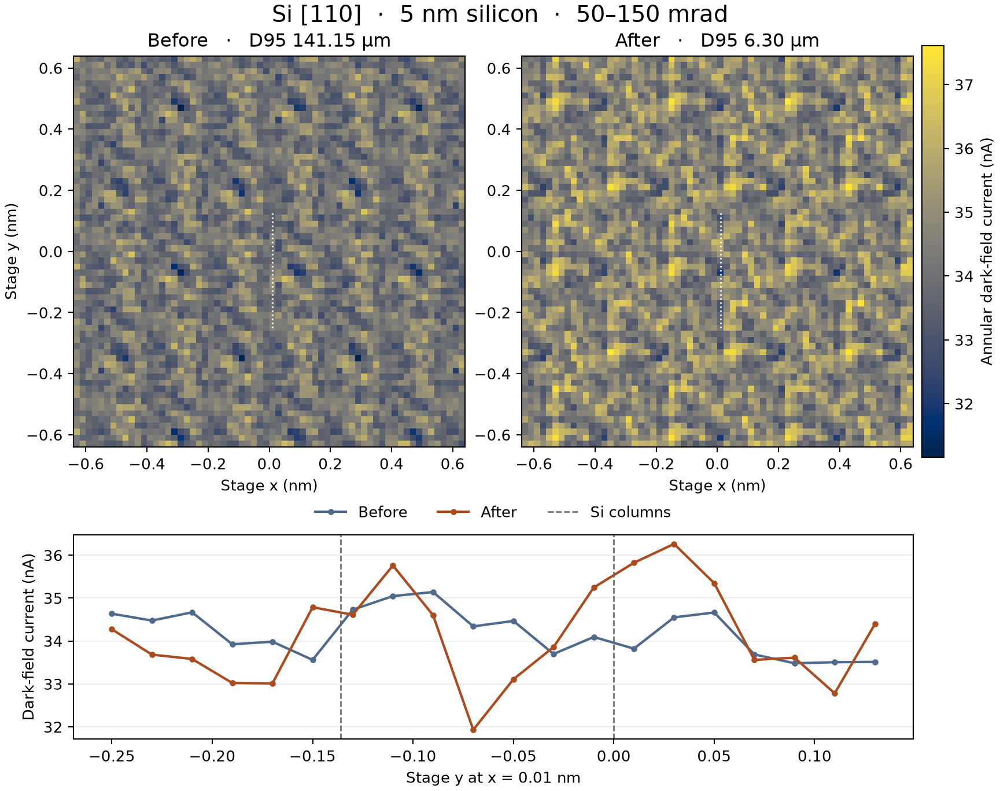

# Material-aware objective tuning on Si [110]

The adjusted illumination reached a 30.00 mrad convergence semi-angle and a 6.30 µm D95 on the specimen upper surface. It transmitted 9.987 µA through the fixed column. The full-source silicon scan did not resolve the 0.1361 nm column pair.



## What changed at the specimen

| Quantity | Before | After |
| --- | ---: | ---: |
| Objective excitation, signed ampere-turns | −3000 | −4500 |
| Current through each 580-turn section in series (A) | −2.5862 | −3.8793 |
| C2 lens current multiplier | 0.938506 | 0.993085 |
| Mini Condenser current multiplier | 0.331953 | 0.360806 |
| Current-weighted convergence semi-angle α95 (mrad) | 29.1027 | 30.0000 |
| Current-weighted D95 diameter (µm) | 141.149 | 6.300 |
| RMS radius (µm) | 41.736 | 3.231 |
| Incident current (µA) | 9.98169 | 9.98657 |
| Surviving particles out of 32,768 | 32,708 | 32,724 |
| Sampled current within 50 pm of the fixed axis (nA) | 0 | 0 |

D95 encloses 95% of the transmitted current around its centroid. The core aperture stays on the optic axis. Each source particle carries 0.3052 nA, which limits the sensitivity of the zero core readings. The final D95 minimum was bracketed at −0.5, 0 and +0.5 nm about the surface. The RMS waist was 35.5 µm downstream. The highest sampled 50 pm core current was 1.221 nA at +268.8 µm in the vacuum continuation. The two transverse axes each had one crossover between C2 and C3 around 753–754 mm. Neither had an additional crossover between C3 and the adapter lens or between the Mini Condenser and the specimen surface. [Through-focus measurements](evidence/after/focus.json) · [Axial profiles](evidence/after/focus.npz)

## Fields and current selection

The installed objective uses the photo-based upper pole and its mirrored lower pole, open bores, sleeves, return plates, flange and yoke. The terminal 40 mm of vacuum tube uses relative permeability 1. The nonlinear axisymmetric calculation used the digitized ARMCO pure-iron initial magnetization curve for the objective iron, including magnetic bodies without an individual override. Geometry, material assignments and winding counts were fixed throughout the comparison. At positive excitations of 3000 and 4500 ampere-turns, the computed objective-only axial field at the sample was +1.578 and +2.287 mT. The peak fields in the iron were 0.445 and 0.607 T. The transport used the reversed objective polarity relative to the upstream winding fields. [Installed material assignments and manufacturer sources](../../references/column-magnetic-hardware/README.md#pole-materials) · [Nonlinear field solves](evidence/study.json)

Both runs used a 300 kV gun-exit distribution at 450 mm, 0.30 eV energy spread FWHM, 10 µA emitted current, a 100 µm C2 aperture and a 9 µA minimum transmitted current. Every tuning trial propagated the original 32,768 positive-current particles with their weights, energies and mechanical interception. The specimen upper surface was at 1599.1999975 mm. C2 sets convergence and the Mini Condenser places the D95 minimum. The C3 multiplier stayed at 0.576193. A coarse sweep used objective excitations of magnitude 1500, 3000, 4500, 6000 and 7500 ampere-turns. The 1500 trial reached 28.27 mrad. The four trials in the 29.7–30.3 mrad band gave D95 values of 6.93, 6.84, 6.91 and 7.09 µm. The 4500 candidate proceeded to the refined field and specimen-plane fits. [Gun and winding reference](../default_ideal_coil_probe_20261117/working-point) · [Signed winding-group currents and trial measurements](evidence/study.json)

The other round lenses used prescribed-current winding fields. Their coupling to the objective iron was omitted. The main comparison used zero multipole excitation. Applying 12%, 35% and 100% of the previous hexapole settings at fixed illumination increased D95. Independent corrector calibration and full three-dimensional nonlinear multipole fields remain open. Some inherited relay group currents reach 15.5 kA in this idealized excitation model. Hardware application would need measured current limits and lens calibration.

## Numerical sensitivity

The primary field mesh used 218 radial by 804 axial nodes (175,272 nodes) with interfaces and additional divisions through the bore, along the pole noses and across the gap. The column transport used a maximum 0.10 mm axial step and explicit observations at the specimen. At the final currents the following changes were made independently.

| Change at fixed final currents | D95 at the specimen (µm) | α95 (mrad) |
| --- | ---: | ---: |
| Primary mesh, 32 added subdivisions | 6.30032 | 30.00000 |
| Halve the trajectory step | 6.30032 | 30.00000 |
| Reduce the added subdivisions to 18 | 6.52441 | 29.98257 |
| Increase outer boundary padding from 8 to 9 | 6.30950 | 29.99948 |
| Redistribute resolution on an independent 264 × 733 mesh | 6.83771 | 30.01125 |

Refitting C2 and Mini on the independent mesh gave 6.010 µm at 30.00 mrad. This spread between meshes limits the significant figures of the probe size. Both complete before/after scan pairs gave the same doublet result. [Independent scan pair](evidence/alternate-mesh) · [Field parameters and fixed-current sensitivity](evidence/study.json)

## Silicon scan and interpretation

Each 64 × 64 scan translated a 5 nm periodic Si [110] specimen in 20 pm steps under the measured entrance distribution. The classical screened-Rutherford elastic model binned the exit current into four angular channels, including bright field at 0–15 mrad and annular dark field at 50–150 mrad. The images share the same colour scale in nA. The registered profile crosses the crystallographic column pair at the nearest native scan line, x = +0.01 nm. Refining the angular quadrature changed any pixel current by at most 2.34 × 10⁻¹⁶ A. The four-channel current sum agreed with the incident current to within 6.7 × 10⁻¹⁹ A for both scans. [Silicon structure](../../../tests/fixtures/cif/Si.cif) · [Before scan](evidence/before/report.json) · [After scan](evidence/after/report.json)

With the adjusted currents, the first 1024 or 2048 original particles each gave two registered peaks 0.14 nm apart. Both peaks did not persist as a resolved pair with all 32,768 particles. The improved D95 and angle therefore support a better focused incident distribution on this branch. Atomic-column resolution, coherent scattering in silicon and the contribution of pole shape alone remain unestablished. The next discriminating measurements are on-axis fields across the gap at several known winding currents, actual pole and tube joint dimensions, and the corrector excitation-to-aberration response.

## Reproduce the field, transport and images

From the repository root with its Python environment and a usable CUDA device, run the command below. It reconstructs the field maps, propagates the authenticated gun-exit distribution, compares all particle identities, weights, losses and phase coordinates, and verifies all four absolute-current rasters against the archive. `--from-entrance` replays the two silicon scans directly from the saved specimen entrances. Output goes under `outputs/material_objective_si110_20261120`.

```text
python docs/development/material_objective_si110_20261120/replay.py
```

The field arrays store radius and axial position in metres and azimuthal magnetic vector potential in T·m. The electrostatic capture includes its execution identity, which can change between checkouts. The replay separately verifies the digest of its numeric axes and values. The entrance arrays store coordinates in metres, transverse slopes, energy in eV, flight time in seconds, original IDs, weights and loss flags. The scan arrays contain stage coordinates in nm and unnormalized channel currents in A. [Before acquisition](evidence/before) · [After acquisition](evidence/after) · [Archive checksums](evidence/checksums.json)
