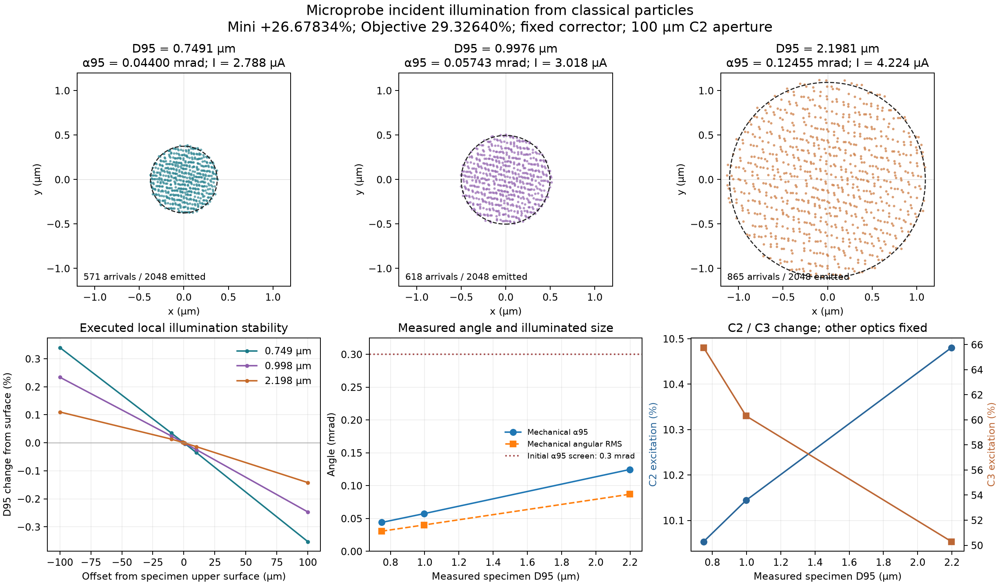

# Microprobe basic illumination calibration — 2026-11-11

## Result and qualification boundary

The current FEG / C3 + Probe Corrector configuration supports a measured basic
Microprobe illumination family with specimen-plane D95 approximately
0.75–2.2 µm and mechanical alpha95 below the user-selected initial 0.3 mrad
screen. The three points were executed with 2048 original positive-current
source particles and a 0.1 mm column step. They are independent candidate
profiles, not replacement global defaults or jointly qualified corrector presets.

The smallest measured diameter, 0.749087 µm, is 0.122% below its nominal
0.75 µm label. Report the measured values rather than declaring an exact endpoint
fit. Only these three operating points have been executed; joining them on a
plot does not qualify an interpolated zoom control.

## Starting configuration and controls

The starting point is
[the current 30 mrad Nanoprobe candidate](../fege_focus_20261110/normal-nanoprobe-si110.toml),
with the new FEG extractor. This study does not load a historical Microprobe
preset. The static calculation uses unified finite electric and magnetic fields,
CPU execution and at most two column threads. No coherent propagation was run.

- Reverse Mini Condenser polarity and preserve its magnitude: the software
  convention is Nanoprobe negative, Microprobe positive, with magnitude
  **26.678337967960122%**. This is the model's wiring convention, not an OEM
  current-sign calibration.
- Keep Upper Objective at **29.3264011126%**, C1 at **51.666666666666664%**,
  and the current corrector drives fixed.
- Jointly vary **C2 and C3** to control illumination size and parallelism.
  The complete input snapshots confirm that these are the only changed physical
  controls between the polarity-only baseline and the three candidates.
- Keep the C2 aperture diameter at **100 µm**, all other physical apertures,
  the extractor/gun controls and the complete source law unchanged.
- Select stationary TEM illumination with raster and wobble inactive.

The Mini mode and C3 Normal/Large angle selection remain different controls.
C3 percentage alone does not identify an extra-crossover branch. At the bounded
axial sampling used here, none of the candidates has a C3-to-ADL waist.

## Measured family at the specimen upper surface

All statistics below are evaluated at **1599.1999998000001 mm** from the emitter,
the unchanged upper surface of the original 0.4 nm Si[110] specimen geometry.
The incident optics diagnostic uses vacuum at this geometry to exclude specimen
scattering. The stored operating profiles restore the original Si specimen.

| Nominal D95 | C2 (%) | C3 (%) | Measured D95 (µm) | RMS radius (µm) | alpha95 (mrad) | Angular RMS (mrad) |
| --- | ---: | ---: | ---: | ---: | ---: | ---: |
| 0.75 µm | 10.0533908611 | 65.7626097756 | 0.749087348 | 0.265823091 | 0.043995120 | 0.030658042 |
| 1.00 µm | 10.1443291684 | 60.3085227801 | 0.997581321 | 0.352182622 | 0.057427025 | 0.040159902 |
| 2.20 µm | 10.4805730607 | 50.2917792506 | 2.198142686 | 0.768184580 | 0.124545383 | 0.086865098 |

D95 is twice the radius about the current-weighted centroid containing 95% of
the current that actually reaches this plane. It is not 95% of the emitted
current and not twice the RMS radius. RMS radius is the current-weighted second
moment of radial position. Alpha95 contains 95% of the transmitted current in
mechanical direction about its current-weighted chief direction; angular RMS
is the corresponding second-moment angular statistic. No constant conversion
between RMS and a 95% containment statistic is assumed.

| Nominal D95 | D95 containment disk area (µm²) | Sample current (µA) | Source transmission | Arrivals / effective count | C2-intercepted current (µA) |
| --- | ---: | ---: | ---: | ---: | ---: |
| 0.75 µm | 0.440712 | 2.788086 | 27.8809% | 571 / 571 | 7.211914 |
| 1.00 µm | 0.781604 | 3.017578 | 30.1758% | 618 / 618 | 6.982422 |
| 2.20 µm | 3.794911 | 4.223633 | 42.2363% | 865 / 865 | 5.776367 |

The largest-to-smallest D95 containment area ratio is approximately **8.61**.
This disk is a containment measure, not a hard illumination edge. Original
source current is 10 µA; all 2048 particles reach the gun exit. All measured
downstream losses occur at the physical C2 aperture. Gun and C1 interception
are zero for these fixed controls. Source weights are never renormalized after
clipping. This does not qualify a Gun Lens or C1 current-control family.

## Parallelism, immersion field and nearby planes

At the specimen, Bz is approximately **0.47355 T**. Mechanical angular spread
is predominantly azimuthal rotation in this immersion field. The executed
mechanical angles in the table remain the primary result; small canonical
residuals are separate diagnostics and do not replace them.

| Nominal D95 | Radial angular RMS (mrad) | Tangential angular RMS (mrad) | Local canonical alpha95 diagnostic (mrad) | Radial curvature (m⁻¹) | D95 span across ±100 µm |
| --- | ---: | ---: | ---: | ---: | ---: |
| 0.75 µm | 0.006494 | 0.029962 | 0.012558 | −22.736 | 0.693% |
| 1.00 µm | 0.006045 | 0.039702 | 0.011751 | −15.981 | 0.481% |
| 2.20 µm | 0.007272 | 0.086560 | 0.014442 | −8.740 | 0.252% |

The canonical diagnostic uses the repository's signed-electron convention and
the frozen native magnetic potential. It is a local paraxial, gauge-dependent
quantity. It is not a measured mechanical cone or a universal lower bound.
Mechanical chief angles from the optical axis are below 0.00085 mrad here.
Actual nearby observations, not free-drift extrapolations, give the D95 spans.
The reported tangent RMS waist offsets must not be treated as actual focus
locations inside the Objective field. Microprobe parallel illumination does
not require a Nanoprobe-like minimum D95 waist at the sample.

## Numerical and particle checks

Both fresh gun calculations preserve the full original particle IDs, weights,
energies, first-arrival clocks and physical stop labels. There are 1024 and
2048 original positive-current launches respectively, with no zero-current
diagnostics counted toward the minimum. Independent receipt loading passes.

For the 1 µm candidate, the separately executed comparisons are:

| Comparison | D95 relative change | alpha95 relative change | Current relative change |
| --- | ---: | ---: | ---: |
| Step 0.2 → 0.1 mm, same 1024 original particles | −0.00000329% | +0.000834% | 0% |
| 1024 → 2048 particles, same 0.1 mm step | +0.1304% | −0.0743% | +0.6515% |

For the other two points, the 1024/0.2 mm to 2048/0.1 mm comparison changes
D95 by +0.0642% and −0.5409%, alpha95 by +0.0127% and −0.4227%, and current
by +0.5282% and −0.8028%, respectively. Those comparisons combine count and
step changes; the separate step test above only establishes the 1 µm point.
Two source counts and one step refinement do not establish arbitrary-precision
convergence or statistical confidence intervals.

The source remains the existing driven Gaussian–Schell classical particle
representation: 5 nm virtual-source FWHM, 0.3 eV nominal emission energy,
0.3 eV energy FWHM and an assumed 20 nm coherence length. This coherence value
is a source-design assumption, not a measured FEG performance claim. The
existing energy generator calibrates moments per batch, so 2048 is not a fully
nested phase-space extension of 1024; the count comparison uses the same
source law and does not claim paired trajectories.

No isolated distant electron is apparent in the final samples: maximum
centroid radius / R95 is 1.030–1.038, and maximum sampled mechanical angle /
alpha95 is 1.039–1.054. The complete largest-tail records retain original
source IDs and phase coordinates in the family audit. This bounded sample
inspection cannot exclude unsampled rare tails. All field ownership audits
pass and absolute current balances close without reweighting.

## Corrector matching remains open

Only reversing Mini at the original C2/C3 settings preserves the original
central and AC-region waists but produces D95 **6.21165 µm**, alpha95
**28.7303 mrad** and strongly diverging illumination at the sample. It is not
a usable parallel Microprobe point.

The C2/C3 candidates achieve the required basic illumination but move the
corrector source images. No waist is found in the original TL22-to-TL21 or
AC-upper-to-AC-lower comparison intervals at the recorded sampling. For the
1 µm point, waists instead appear near 1162.44 mm (ADL-to-TL22) and 1317.00 mm
(TL21-to-TL12). A further upstream waist occurs in the Mini-to-sample region.
Use the stored brackets rather than treating these coarse representative
locations as exact positions.

The precise CEOS comparison contract in the project concerns STEM Nanoprobe;
Microprobe also has an independently recorded historical topology. Neither
qualification transfers automatically to these new finite-field candidates.
The current results do not establish an aberration-corrected Microprobe or
validate a driven scan. Simultaneously preserving internal conjugacies and
this illumination family requires a separate explicit joint match with more
optical degrees of freedom. Fixed-corrector C2/C3 tuning does not demonstrate
that the full system is unsolvable.

Static field analysis also finds weak Mini/Objective overlap in the present
geometry: Mini polarity reversal changes the relevant integrated B² by only
about 0.581%. A real-system mode distinction cannot be assumed from polarity
labels without evaluating these actual overlapping fields. See
[model-review.json](model-review.json) for input-difference evidence and limits.

## Saved configurations and evidence

Load one of these standalone operating profiles:

- [Approximately 0.75 µm](microprobe-0p75um-si110.toml)
- [Approximately 1.00 µm](microprobe-1p00um-si110.toml)
- [Approximately 2.20 µm](microprobe-2p20um-si110.toml)

Each stores 2048 source particles, the 0.1 mm step, the current source/corrector,
Microprobe polarity and original Si[110] specimen settings. The original local
absolute CIF path is retained so loading works independently of the process
working directory on this workstation; rebind that file if moving the checkout.
All three profiles pass mode, source-budget, surface-reference and optical-drive
round-trip checks. Independent complete TOML save/read/save checks on all three
profiles have no semantic differences. Re-emitting each restored source
reproduces the seven archived launch arrays exactly, and the CIF reads from a
different working directory. See
[profile-family-verification.json](profile-family-verification.json).
Restoring the material profile does not add a specimen-scattering or image
calculation to this incident-optics validation.

The preserved physical orientation quaternion maps crystal [110] onto the
beam direction. The original zone-axis/in-plane input hints still contain
[001]/[100]; they are legacy metadata and are not the physical orientation
owner. These hints are retained from the source configuration and documented
in the independent verification report.

[results.json](results.json) contains the family and comparison metrics.
The `column` subdirectories retain unmodified execution reports, topology/tail
audits, actual sample-neighborhood phase arrays and compressed full snapshots.
The `extractor` subdirectories retain original launches, gun exit/emission
arrays and verification receipts. Full trajectories remain under the original
local `outputs/microprobe-20261111` paths; their hashes and sizes are recorded
in [artifact_manifest.json](artifact_manifest.json).

The `drivers` directory preserves executed driver text and its recorded
original location. To rerun, restore each driver to that location first; these
scripts intentionally use their original repository-relative layout. New runs
must produce new input snapshots and receipts rather than overwrite this
archive. Exact source-identity checks reject receipts from other implementations.
