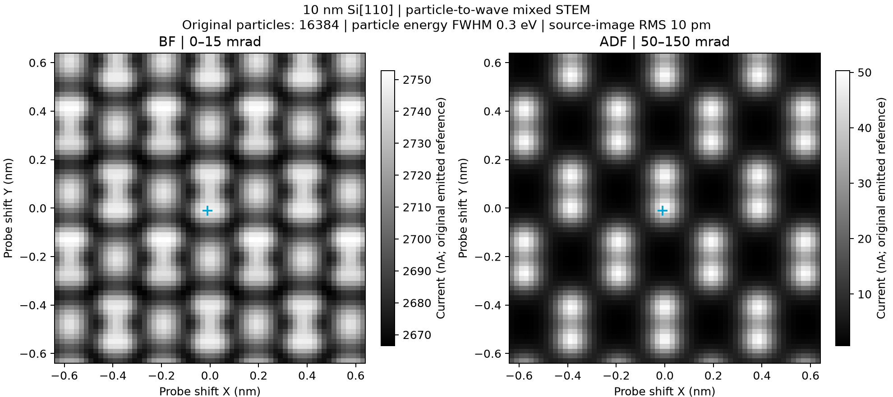
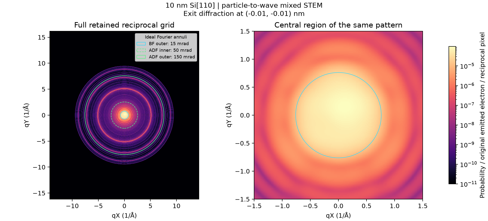

# CUDA mixed coherent Si[110], 10 nm

This is an executed local mixed coherent STEM acquisition, not a synthetic
image or a Tip-origin coherent calculation. The current default lens and
corrector controls, 0.3 eV source FWHM, 0.025 mm particle step and 10 pm
source-image coherence RMS were retained. The 10 nm foil starts at the original
upper surface, Z = 1599.1999998000001 mm, and extends in +Z.
The translated, fully occupied P1 CIF preserves the original entrance lattice
termination without editing the bundled CIF. The default working-point bytes
are unchanged; their hash is recorded in `final-validation.json`.

## Executed source and images

- Original positive-current particles: 16384.
- Surviving positive particles at the entrance: 5192.
- Effective surviving particle count: 5192.
- Emitted current: 10 microampere.
- Specimen incident current: 3.1689453125 microampere.
- Raster: 64 by 64, 0.02 nm pitch.

| Ideal exit-angle window | Minimum (nA) | Mean (nA) | Maximum (nA) |
| --- | ---: | ---: | ---: |
| BF, 0-15 mrad | 2666.5713 | 2706.70948 | 2752.81232 |
| ADF, 50-150 mrad | 0.703898307 | 14.3665837 | 50.3164169 |





All channels retain the original-emission denominator and upstream losses.
Display contrast does not renormalize either detector or diffraction data.
The BF/ADF spatial correlation is 0.60560519.

## Numerical acceptance

The earlier 1560/200, 1760/400, 1920/800 ladder failed its unchanged 5% combined
BF/ADF modulation budget: its last ADF result was 5.71179665%. It is retained
as `earlier-unqualified-attempt.json`, not presented as a qualified scan.
The subsequent 1920/800 to 2160/1600 refinement also failed: BF 10.0944%
and ADF 12.6948%, retained in `second-unqualified-attempt.json`.
Independent static tests found non-monotonic common-band coefficients and
2.59-3.44% half-pixel translation covariance errors in the radial-table
potential representation; same-grid axial integration changed far less.
Those static diagnostics identify a discretization defect but do not alone
explain the complete detector-observable differences.

The final material path integrates the same continuous finite-depth Lobato
potential analytically before Fourier sampling. It retains the selected
finite atomic sites and the finite slice bounds. Its compact periodic storage
avoids duplicating an entire crystal tile at every depth. Arithmetic,
registration and finite padding-image errors contribute to the unchanged
BF/ADF and raw diffraction budgets. No lens, source law or acceptance
tolerance was changed to obtain numerical acceptance.

`analytic-static-sampling` records the final original-CIF registration,
common-band and translation checks. `analytic-full-depth-static` retains an
earlier 800/1600-depth static check using the historical rounded basis before
the separately recorded common numerical offset was recovered. That historical
check is not relabelled as a final-version scan or a final registration run.

The final refinement reused the exact validated classical boundary, preserving
all original phase-space arrays, IDs, weights and provenance; it did not
restart or relabel old Lorentz transport. Source-generation and wave-solver
implementations are recorded separately.

The accepted material plan and all component error terms are in
`acquisition/report.json`. Combined BF/ADF error divided by reference
modulation: {"adf": 0.018019991794484647, "bf": 0.0286109846105397}.
Combined raw diffraction relative L1 error:
0.00167391363325.
Maximum original-emission ledger residual:
7.77156117238e-16.
These include material/slice refinement, local field splitting and a larger
actual finite-specimen domain at held-out positions including raster corners.
An independent CUDA resident propagation also checks the reduced operator.
The existing 5% budgets and general source/column boundary tolerances were
not relaxed. Test execution counts overlap and must not be added together.

## Reading and replaying

In **Scanning Image**, select **Load mixed scan...** and open the `acquisition`
directory. Loading is read-only, needs no CUDA and does not replace the current
optical controls or construct a particle history. The six acquisition files
and their checksums contain raw detector currents, one raw diffraction array,
entrance ancestry, original gun data and complete captured input metadata.

The independently validated classical source can be reused for a new CUDA
wave calculation, for example from the repository root:

```powershell
.venv\Scripts\python.exe -m temsim.mixed_stem_cli --boundary docs/development/mixed_stem_si110_10nm_20261111/validated-particle-boundary --material-levels 1760:400,1920:800,2080:1600 --host-gib 48 --output outputs/new-si110-replay
```

New coherent execution still requires usable CUDA and must pass all numerical
gates. Source or lens changes require new classical transport. The multi-GB
classical `.temresult` remains in the local outputs directory; its original
hash is retained in `classical-source/status.json`. The compact checked boundary
provides the complete source required for this explicit later wave handoff.
The executed wave implementation is recorded in `acquisition/execution.json`.
The final application package additionally fixes the saved-frame status
summary and removes unused blank EOF lines from one source file (its Python
syntax tree is identical). `installation` records these source differences and
foreign-directory checks. The completed scientific arrays were not recomputed
or relabelled as having been produced by that later interface version.

## Physical scope

This is a finite periodic-domain, static elastic multislice calculation with
a qualified local axial-field split. BF and ADF are ideal specimen-exit
angular windows, not installed downstream detector-conjugacy predictions.
Diffraction is from one reported raster position near the centre, not a scan
average or a 4D-STEM cube. The 0.3 eV distribution is used in particle
transport; material propagation uses its current-weighted mean wavelength,
not separate energy modes. Missing inelastic data do not establish that real
inelastic scattering is absent. The held-out domain checks are not an isolated
probe boundary certificate at every scan pixel. See `docs/MIXED_STEM_SCAN.md`.
