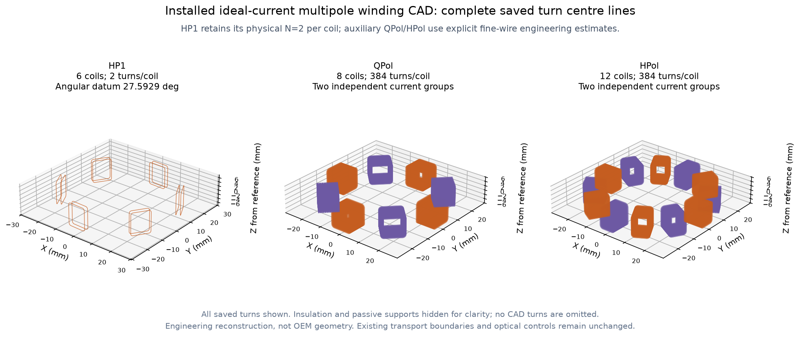
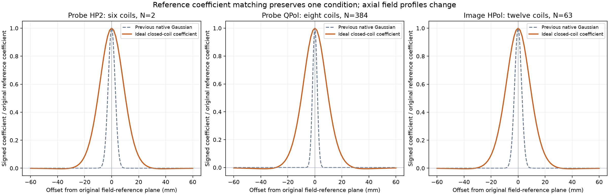

# Ideal-current corrector multipoles

The named HP1/HP2, QPol/QPC/QPH1/QPH2 and HPol/HPC sources now use explicit
closed vacuum-coil currents in **Ideal prescribed-current coils in vacuum**.
Their existing native operating controls map to fixed amperes. Detailed
winding CAD, metal-area inputs, insulation packing and signed current biases
share those source definitions. This completes the requested Probe and Image
families without changing the saved optical working point.

Scope is **40 raw definitions in five column files**, covering 12 distinct
component keys across assembly variants. The B-COR third hexapole HP3 was not
named in this task and retains its existing model. Monochromator and Energy
Filter magnetic models/settings are unchanged. Their regions can still see
the physical tails of other installed sources.

## Preserved inputs and modelling assumptions

| Winding family | Coils per component | Turns per coil | Metal area (mm2) |
| --- | ---: | ---: | ---: |
| Existing Probe HP1/HP2 | 6 | **2, unchanged** | 0.02 |
| Previously undefined Image HP1/HP2 | 6 | 19 | 0.02 |
| Probe auxiliary quadrupoles | 8 | 384 | 0.02 |
| Probe auxiliary hexapoles | 12 | 384 | 0.02 |
| Image QPol | 8 | 63 | 0.02 |
| Image HPol | 12 | 63 | 0.02 |

Radial wire-insulation thickness is an engineering assumption of 0.005 mm.
Diameter is derived from metal area, approximately 0.159577 mm. Existing
Probe HP turns and their original provenance remain authoritative. Image
main-HP turns use the same previously adopted 9 mm2 limiting-pack allocation
reference. Auxiliary initial turns use a nominal 60% metal fill and actual
insulated square-grid fit. These are model authoring assumptions, not OEM
measurements, manufacturing prescriptions or current ratings. No turn count
was increased to fit a requested field strength.

All original bore diameters, outer envelopes, axial bounds and optical
parameters remain unchanged. Auxiliary winding-only CAD occupies the
pre-existing logical envelope and adds no independent opaque cartridge or
new clipping boundary. The existing transport ownership remains in force.
Impossible packing and resource-limit violations fail explicitly rather than
shrinking conductors or omitting turns.



Every saved turn is present in CAD. The picture hides insulation and supports
for readability. Complete native meshes, including remaining insulation,
were executed for all six representative families in
`validation/final-native-cad-current.json`. The largest final case contains 4608 wire
turns and 1,769,856 triangles. Requested display faceting can be reduced
explicitly while preserving every turn; the four-million-triangle gate remains.

The first unreleased authoring stage placed Image QPol and HPol in overlapping
radial packs. They share an axial envelope. A direct metal intersection check
identified the overlap; final QPol and HPol now occupy separate radial
fractions 0.34..0.47 and 0.53..0.66 of that unchanged envelope. Their initial
counts were re-estimated before final current calibration. Complete pack
corner bounds give **0.887693 mm minimum radial clearance** for all four
co-located pairs. All 40 pack angular bounds and the 14 HP-DPH winding-pair
clearances pass. The bounded actual metal intersection is zero. These checks
are not a full instrument manufacturing/tolerance-stack qualification.

## Electrical conversion and phase

Each source follows `I = M @ u + bias`:

- Main HP has one signed ampere channel and six alternating radial coils.
- Auxiliary quadrupoles have two independent four-coil groups, 45 degrees
  apart. The native vector is normal/skew strength in m^-2.
- Auxiliary hexapoles have two independent six-coil groups, 30 degrees apart.
  The native vector is normal/skew strength in m^-3.

The saved matrix includes the charge sign, angular phase and native basis.
Its reference energy is 300 keV, using the unchanged project
`core.electron` constants. Matrices remain fixed when beam energy changes;
individual electron momentum governs response. Native percent controls first
resolve to their declared field coefficients and are not amperes.

Six radial coils at zero azimuth produce a skew magnetic sextupole in the
existing coordinate convention. Their previously uncalibrated mechanical
angular datum is now explicit: 30 degrees plus the reference native HP
orientation. CAD poles/formers/windings and the source share this datum.
Existing runtime HP orientation is retained as a physical internal-package
azimuth relative to the saved reference, rotating CAD and source together
without refitting current. Independent DPH steering sources keep their
existing orientations. A single six-coil HP has no independent skew-current
basis and rejects a nonzero separate HP skew command.

Auxiliary hexapoles implement normal/skew orientation changes by mixing their
two currents through the fixed matrix. Editing the independent winding datum
or geometry marks the old fit stale. No automatic focus or current refit
occurs. Metal-area edits repack CAD without compressing the homogenized
current-bearing envelope.

Legacy Image QPol had a scalar normal input. Its second electrical group is
explicitly a new engineering 45-degree quadrupole extension of that normal
reference, with zero native skew command and an independently editable ampere
bias. It is not labelled as a previously executed native knob or measured
second-channel calibration.

Default current readbacks, rather than reference gains, are recorded in
`validation/default-current-readbacks.json`. At the unchanged Nano Probe /
Diffraction settings, Probe HP1 is approximately **-80,899.0 A** and Probe HP2
**-134,526.1 A**. The detached Image-corrector defaults give approximately
-175,192.0 A and -105,022.0 A. These large values follow the adopted low turn
counts and the core-free vacuum model. They are prescribed mathematical
source currents, with no inferred heating, resistance, power-supply or real
instrument feasibility. Physical counts were retained instead of hiding this
cost by adding turns.

## Field calculation and calibration evidence

The source integrates closed radial circuits over the original current-pack
envelope with prescribed N and I. It retains full vector B, Coulomb-gauge A,
spatial derivatives and all axial tails. Magnetic cores, pole shoes,
permeability, saturation, leads, resistance and heating remain excluded.

The fitted conditions are the signed normal/skew quadrupole gradient in T/m,
or the sextupole quadratic-field coefficient in T/m2, at the original native
reference plane. A quadrupole or sextupole has zero ideal central B, so
matching central B alone would not calibrate its optical strength. Sextupole
calibration uses analytic second Cartesian derivatives of the Biot-Savart B
kernel; no finite-radius polynomial fit is substituted.

`validation/current-calibration-final.json` preserves all final matrices,
fixed counts, native targets and reference angles. The independent check uses
twice the integration orders (**24/48 versus installed 12/24**) and derives
native target coefficients from the old executor's A_z unit polynomials.
The Image QPol extension is identified separately. All 40 definitions pass
the additional field-only bound of 1e-8; maximum normalized discrepancy is
**5.0581e-14**. This numerical agreement is not experimental accuracy and does
not replace or relax any existing trajectory tolerance.



The signed normalized profiles show what is preserved and what changes:
the old reference coefficient matches, while axial widths and field integrals
change. Settings were held constant; no probe, focus, convergence or A1/Cs
performance is claimed from these plots. Profiles use detached unit native
commands, a 1.5 mm display spacing and the installed field quadrature, not a
finite-source simulation or an independent whole-profile convergence study.

## Integration, inputs and cache

The new current provider replaces its native multipole owner exactly once.
Disabling hexapoles removes the current hexapoles while preserving current
quadrupoles. Unified snapshots, serialization, whole-instrument/Gun B capture
and local magnetic diagnostics retain source ownership and remote axial tails.
All-Z cache dependencies include currents, N, geometry, native commands,
runtime HP orientation, source code and installation state. Replaced/imported
CAD leaves retained recipes inactive and does not falsely claim a current
provider in the capability inventory.

Physical Layout exposes **Configure winding...** and the generic dimension
editor for turns, metal area, radial enamel, angular datum and signed current
biases. Diameter and current-reference matrices are read-only. Draft edits
are atomic and support Undo, linked-catalog save/reload, field clearing,
provenance and stale-dialog protection. Clearing a recipe also clears its
current definition. Full details are in
[the multipole input guide](../../MULTIPOLE_CURRENT_WINDINGS.md).

The hardware readout now names the actual Probe A1 fine controls QPolx/QPoly;
it no longer mislabels the independent Condenser stigmator as that channel.
Image A1 fine retains its Objective stigmator mapping.

## Verification scope and reproduction

`validation/input-equivalence.json` checks **14 optical states, 336 native
field records and all declared runtime clipping/ownership inputs** against
the preserved baseline. Existing Probe HP counts remain exactly 2 in all six
raw records. The 0.3 eV default source width, source laws, boundaries and
solver tolerances remain unchanged. The other **31 configuration files**,
including Monochromator and Energy Filter definitions, are byte-identical.

Targeted regression receipts exercise winding geometry, exact turns,
independent magnetic derivatives, phases, energy independence, old-state
angle loading, source ownership, native/current selection, disabled sources,
UI persistence, hardware aliases, cache invalidation and explicit wave gates.
The final unique test count and exact source/output hashes are recorded in
`validation/manifest.json`.
The final combined suite passed **710 unique cases**, with zero failures,
errors or skips. Only dependency-level Pydantic deprecation warnings were
emitted. After that run, two UI help strings were updated to include the new
quadrupole/hexapole capability; archived source and normalized AST comparison
prove no numeric/control code changed, and actual offscreen description/menu
readback is preserved in `ui-help-finalization.json`.

No new finite-source particle run, Preview/High accuracy transport benchmark,
probe tuning or coherent/CUDA calculation was performed. The minimum source
population policy remains unchanged. Ideal-current coherent propagation is
still unqualified and rejected explicitly. The accelerating Gun uses its
existing frozen-time full-vector B capture, not a new time-dependent E+B
acceleration solve. Full-tail multipoles add field-evaluation cost; no new
end-to-end performance qualification is implied.

Use the project environment from the repository root:

```powershell
.venv/Scripts/python.exe docs/development/multipole_current_coils_20261115/validate_inputs.py
.venv/Scripts/python.exe docs/development/multipole_current_coils_20261115/validate_peak_fields.py
.venv/Scripts/python.exe docs/development/multipole_current_coils_20261115/render_field_profiles.py
.venv/Scripts/python.exe docs/development/multipole_current_coils_20261115/check_default_cad.py --final
.venv/Scripts/python.exe docs/development/multipole_current_coils_20261115/run_regressions.py
```

The baseline and authoring scripts are guarded one-time migrations. Do not
overwrite them during reproduction. Initial authoring receipts and bytes are
preserved under `validation/history/`; the first Image N156 stage and earlier
partial setup results do not describe the final installation. Bounded actual
CAD/STEP round trips are recorded separately from complete native meshes.
After final annotation formatting, Image meshes were refreshed to bind their
new complete-file hashes; unchanged Probe cases reuse exact matching source
hashes. Original mesh receipts remain preserved.

The working tree also contained the preceding round/transverse coil,
conductor-area and Gun maintenance work. Those dependencies and their scoped
receipts are retained in the same Git delivery rather than publishing new
multipole imports without their required implementation.
