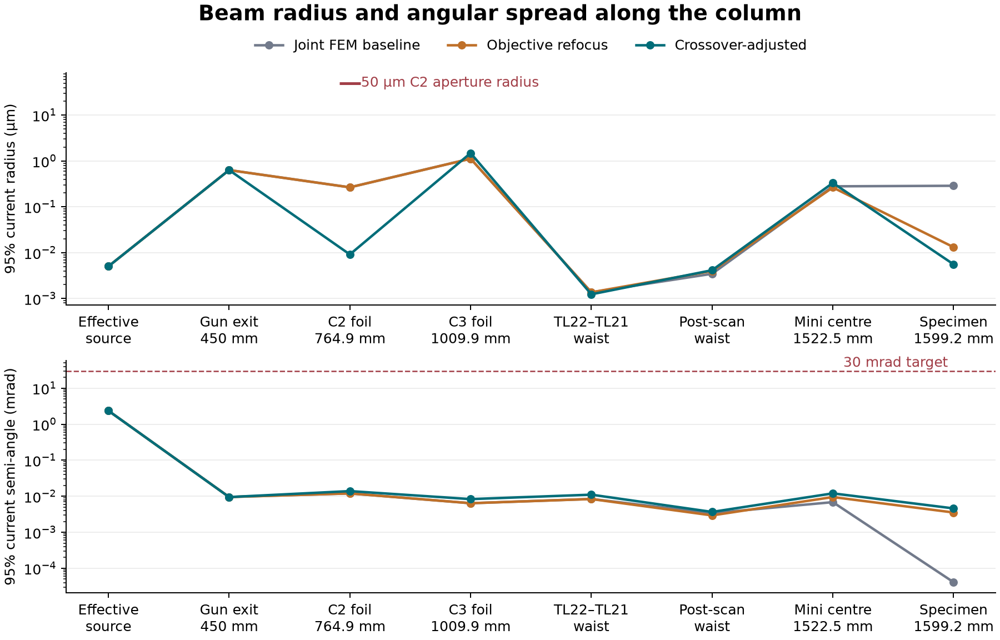

# Why the Nanoprobe Normal illumination cone is narrow

With the C2–C3 crossover 1.007 mm beyond the C2 lens exit, an objective-only adjustment places the sampled D95 minimum on the specimen upper surface. The 95% current semi-angle is **7.040 µrad** and D95 is **11.208 nm**. A weak-C3 control reached 0.44738 mrad at the specimen with a diverging beam and displaced downstream waists. The 30 mrad imaging target remains open. [Condenser comparison and focus measurements](c1-zoom/README.md)

The earlier joint-field baseline delivers **4.604 µrad at the specimen for 95% of the transmitted current**. The largest sampled angle is 8.274 µrad. All 16,384 original electrons reach the upper surface at 1599.1999975 mm, carrying 15.0 µA in this run. Four intermediate beam waists form at 524.722, 765.552, 1208.284 and 1424.770 mm. The 95% current diameter at the surface is 11.13 nm. These measurements use the absolute trajectories in the stationary, unscanned column. [Tracking record](relay-edge/tracking.json) · [Full-column rays](relay-edge/full-column-rays.png)

## Changing the column and the gun exit separately

The archived one-supply test isolates the effect of moving the TL12 crossover. Scaling its three signed winding currents together to 0.300463 moved the waist from the scan-coil interval to the Mini Condenser–objective front focal plane at 1490.37 mm. The scan drive was zero. The gun exit, condenser settings, Mini, objective and C2 foil were held fixed. For 32,768 original particles the specimen semi-angle fell from 26.704 to 0.15378 mrad while transmitted current changed only from 13.914 to 13.920 µA. A point at the front focal plane generates a nearly collimated outgoing bundle. This single-supply experiment explains why imposing that coincidence collapsed the cone in the archived model. [Single-supply measurements](../cescor_direct_probe_20261121/evidence/downstream-waist.json)

The following control uses the same 16,384 original IDs and archived absolute weights for every row. Their incident current is 7.5 µA because they are the first half of the archived 32,768-particle population. Each row retains its own physical losses. The historical specimen data are the saved particle landings. Both current-column rows were propagated in the same nonlinear field with the same hardware and currents. Only the joint distribution of position, direction and energy at 450 mm was exchanged between these two runs. [Paired results and numerical checks](exit-control.json) · [Archived 30 mrad study](../cescor_direct_probe_20261121/illuminated-normal.md)

| Gun exit at 450 mm | Downstream column | C2 foil entrance radius, 95% (µm) | Specimen semi-angle, 95% (mrad) | Current reaching specimen in paired control (µA) |
| --- | --- | ---: | ---: | ---: |
| Archived | Archived | 53.626 | 26.7106 | 6.9571 |
| Archived | Current joint field | 0.46535 | 0.056802 | 7.5000 |
| Relaunched in current field | Current joint field | 0.00915 | 0.004604 | 7.5000 |

Changing the downstream column reduced the semi-angle 470-fold for the fixed archived entrance. Replacing the entrance on that column reduced it another 12.3-fold. The two ratios refer to this order of substitution. The archived branch used independently driven, multi-kiloampere C1 and C2 model windings and inherited a gun exit computed in a different fringe field. The mixed row isolates sensitivity to the column and is not a physical emitter-to-specimen operating point. At the Mini Condenser, the archived run illuminated an RMS radius of 855.69 µm among its 30,396 eventual survivors. The current run illuminates 0.18474 µm RMS. [Archived excitation and handoff](../cescor_direct_probe_20261121/illuminated-normal.md) · [Fixed-exit replay](exit-control.json)

## How the current-bearing rays reach the objective

The semi-angle is the weighted 95th percentile of the mechanical angle to the optic axis, calculated as `atan(hypot(dx/dz, dy/dz))`. The listed radii are weighted about the same fixed axis. D95 is a diameter about the current centroid. The horizontal axis in the figure lists successive optical stations. [Station-by-station phase measurements](angle-origin.json)

| Plane | z (mm) | 95% current radius (µm) | 95% current semi-angle (µrad) |
| --- | ---: | ---: | ---: |
| Effective emission boundary | 0.00 | 0.00503 | 2,368 |
| 300 keV gun exit | 450.00 | 0.63369 | 9.497 |
| C2 foil entrance | 764.90 | 0.00915 | 13.900 |
| C2–C3 waist | 765.55 | 0.00079 | 13.900 |
| C3 foil entrance | 1009.90 | 1.48632 | 8.336 |
| TL22–TL21 waist | 1208.28 | 0.00124 | 11.071 |
| Waist after the lower scan coil | 1424.77 | 0.00415 | 3.675 |
| Mini Condenser centre | 1522.50 | 0.33219 | 12.035 |
| Upper objective pole entrance | 1534.50 | 0.30114 | 7.354 |
| Specimen upper surface | 1599.20 | 0.00557 | 4.604 |



The launch model assigns a 5 nm FWHM virtual source, 1 mrad angular sigma and a 3 mrad cutoff at a mean emission energy of 0.3 eV. Acceleration and the extraction optics transform that launch distribution before the 300 keV boundary. The archived 450 mm bundle actually had a *smaller* marginal angular spread of 0.619 µrad than the current 9.497 µrad. Its larger downstream result depends on how position and direction are correlated and transferred. A gun-exit divergence in isolation cannot predict the specimen cone. [Emission model](../../../src/temsim/optics/electron_gun/emitter.py) · [Measured launch and exit](angle-origin.json) · [Exit exchange](exit-control.json)

The 100 µm C2 aperture has a 50 µm radius. Its entrance lies 0.652 mm before the C2–C3 waist. Multiplying this distance by the 13.90 µrad local fan gives 9.06 nm, close to the actual 9.15 nm 95% radius at the foil. The largest incident radius was 15.69 nm. Moving the C2–C3 waist from 787.144 to 765.552 mm in the joint-field trials reduced the foil footprint while the specimen semi-angle **increased** from 3.540 to 4.604 µrad. Both trials transmitted the full beam. Selecting a waist location leaves the angular spread at that waist as a separate measurement. [Aperture faces](relay-edge/pupil.json) · [Objective-only reference](objective-only/tracking.json)

In the crossover-adjusted trial the downstream angular transfer coefficient from the post-scan waist to the specimen is −1.251. With a 3.675 µrad input fan, its absolute angular magnification predicts 4.60 µrad. Propagating both position and canonical slope in the round, first-order field gives 2.55606 µrad RMS at the specimen. The full three-dimensional particle trace gives 2.55596 µrad RMS. The earlier joint-field baseline placed the waist close to the combined front focal plane and gave an angular transfer coefficient of only +0.00143. That explains the exceptionally small 0.0411 µrad specimen cone in that earlier trial. The current field has appreciable angular transfer, but the post-scan fan remains narrow. [Transfer coefficients and native comparison](angle-origin.json)

At the current excitation the first-order Mini-centre-to-specimen distance-to-angle coefficient is 71.45 mm. A point probe with a 30 mrad edge would back-project to about 2.14 mm in radius at the Mini centre. The actual 95% radius there is 0.332 µm. In the same first-order back-projection the two C2 foil faces individually suggest edge angles of 30.89 and 48.33 mrad, while the 2 mm radius C3 foil gives a tighter geometric acceptance of 6.40 mrad. These are geometric extrapolations conditional on the current lens settings. The verified particle field extends to a radius of 50 µm. A millimetre-scale off-axis field calculation is required to test such hypothetical rays. The original electrons stayed within the verified field and passed the physical stops. [Aperture and field-domain audit](relay-edge/pupil.json)

## Focus and Si [110]

| Joint-field working point | Source particles | Specimen semi-angle, 95% (µrad) | Specimen D95 (nm) | Observation |
| --- | ---: | ---: | ---: | --- |
| Parent | 16,384 | 0.0411 | 575.47 | Near-collimation from the post-scan waist |
| Objective change only | 8,192 | 3.540 | 26.36 | Four intermediate waists |
| Finer objective focus | 16,384 | 3.686 | 6.39 | Sampled D95 minimum 35 µm above the surface |
| C2, C3, TL12 and objective changed | 16,384 | 4.604 | 11.13 | Four intermediate waists, beam still converging at the surface |
| Higher angular magnification trial | 8,192 | 112.550 | 1,508.66 | Third waist at 1262.13 mm, downstream of the required TL22–TL21 gap |

The four-waist trial has C1 −30 A, C2 +17.1495 A, C3 +6.7000 A, ADL +10 A, TL22 −145 A, TL21 +330 A, TL12 −95.1496 A, Mini +226.7015 A and series objective current −1.22688 A. All four scan winding currents are zero. The reported specimen probe is measured on the physical upper surface before scattering. A separate vacuum continuation brackets the minimum sampled D95 at **0.87 mm beyond the surface** on a 10 µm grid. D95 then falls to 6.61 nm, with the semi-angle still 4.604 µrad. [Crossover-adjusted currents](relay-edge/tracking.json) · [Two-sided surface focus check](relay-edge/surface-focus.json) · [Vacuum continuation](exit-control.json) · [Fine objective focus check](objective-focus/surface-focus.json)

The 50–150 mrad ADF scan used the actual positions, slopes and absolute weights of every surviving electron on a 5 nm thick Si [110] specimen. At 20 pm/pixel the periodic 0.13609 nm projected Si pair produced no reproducible double peak, and the ADF contrast correlation between disjoint halves of the source was −0.079. This classical elastic scan fails the doublet test. A separate CUDA coherent-source check measured eigenemittances at the gun exit of 0.0113 times the minimum admitted by the covariance-matched Gaussian wave model. Atomic-resolution coherent imaging therefore remains unverified for this source. [Surface probe and scan](relay-edge/probe-and-si110.png) · [Classical scan and noise controls](relay-edge/si110/scan.json) · [Coherent-source check](relay-edge/wave-boundary.json)

## Reproducing the comparison

The trial uses one common nonlinear magnetic solution for the installed windings and 94 ferromagnetic regions. The same solution enters the gun trace, together with the electrostatic gun field. The raw field and emitted-particle snapshots referenced by the tracking records are in the local `outputs/material-relay-20261122` directory. The field receipt records the mesh identifier, field table radius and solution SHA-256. [Magnetic assembly](../cescor_direct_probe_20261121/material-relay.md) · [Current field receipt](relay-edge/tracking.json)

Run the commands below from this directory in the project environment with usable CUDA and the saved trial inputs. The station and exit checks repropagate the actual particles. Numerical refinement from 50 to 25 µm maximum axial step gives 4.60355 µrad, compared with 4.60387 µrad at the original step. The nested 8,192 and 16,384 source prefixes give 4.59904 and 4.60387 µrad on the original mesh. [Numerical checks](exit-control.json)

```text
python angle_origin.py
python exit_control.py
python pupil_audit.py relay-edge
python silicon_scan.py relay-edge
python render.py relay-edge
```
