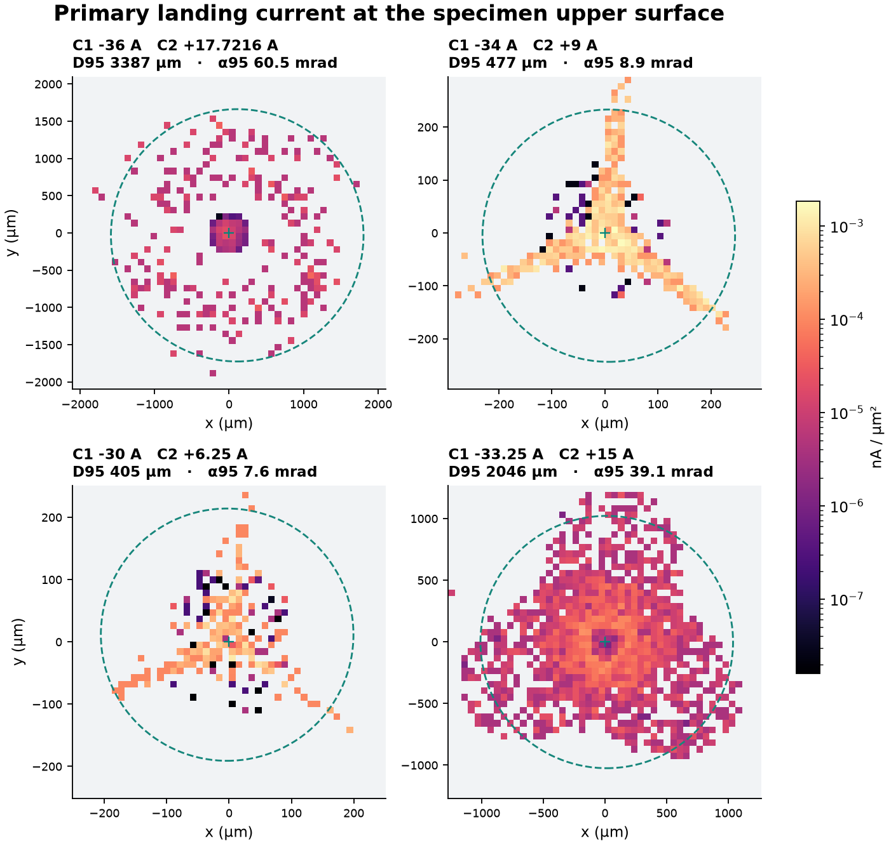
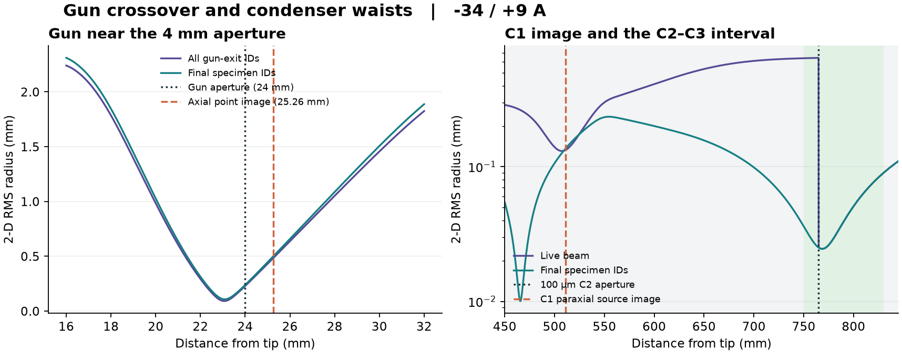
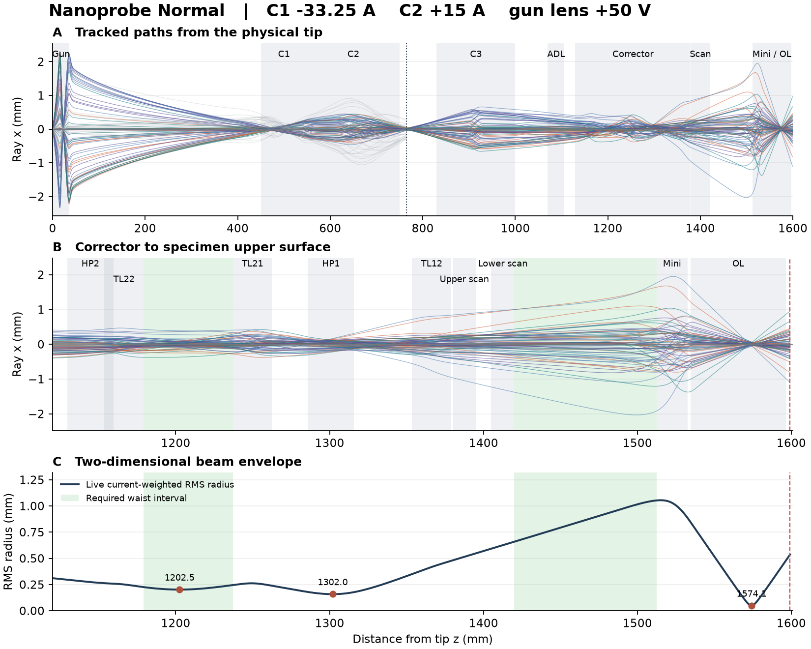
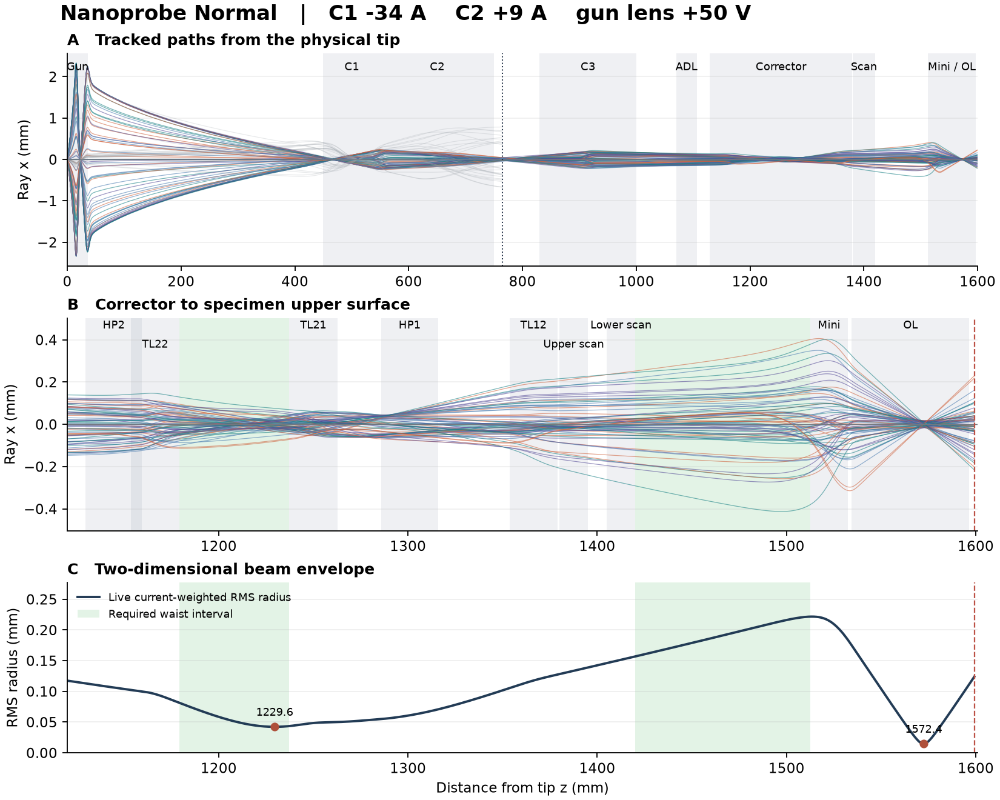
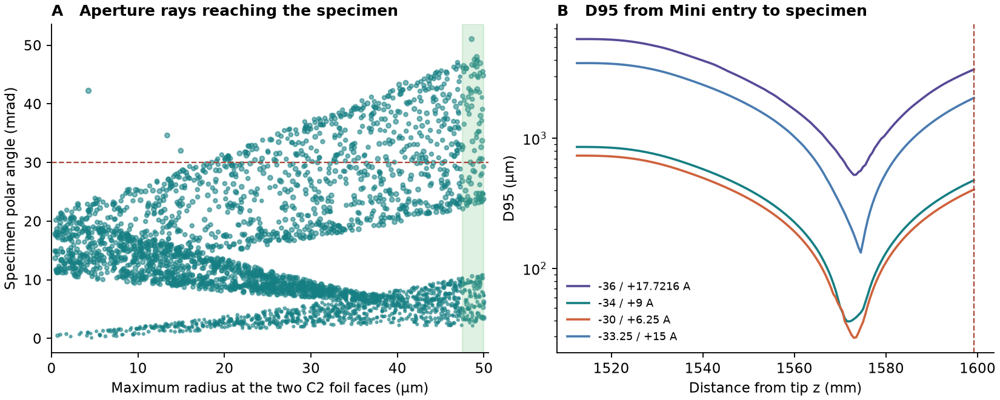

# C1 and C2 after a real cold-gun crossover

These zero-scan Nanoprobe Normal trials start at the physical tip. The reference and every current pair use the same gun-lens bias of +50 V relative to the tip, a +4 kV extractor, a conducting 4 mm aperture at 24 mm, a separate +4 kV anode and a 300 kV column. The C2 foil has a 100 µm diameter and both foil faces intercept particles. The emitting cap supplies 15 µA with the same stratified Murphy–Good distribution in each trial. Its microscopic geometry, initial energies and angular law are modelling inputs. The comparison uses the actual upstream fields and the signed currents of the installed windings. [Gun construction and source references](../fei-gun-control/README.md) · [Required crossover intervals and conjugacies](../../../NANOPROBE_NORMAL_CROSSOVERS.md)

The gun forms one real paraxial image at **25.26 mm**. Independent ±1 µrad perturbations in x and y agree. Halving the integration step moved the image by 0.0025 mm. The current-weighted RMS minimum of the finite bundle reaching the 450 mm outlet is **23.1 mm** on the 0.1 mm observation grid. The finite bundle has angular and source-size spread, so its minimum and the axial point image are distinct measurements. At +500 V the point image is at 41.44 mm. [Voltage comparison](gun-images.json) · [Finite gun bundle](rim-control/gun-waists.json)

## What was held fixed

Only the electrical C1 and C2 supplies changed. C3 was +6.472 A, ADL +10 A, TL22 −145 A, TL21 +330 A, TL12 −95.14963537 A, Mini Condenser +226.70154583 A and both objective packs −1.243412 A. HP2 was +70 A and HP1 +16 A. Both axes of both scan coils were at zero. Each tested supply vector used a converged nonlinear magnetic solution with 94 material regions, including the pole pieces and return paths. The mesh has 6,841,872 tetrahedra, of which 1,843,774 carry material moments. The vacuum calculation adds the impressed windings and the material response with the model's threefold symmetry. The gun includes transverse and longitudinal electric acceleration. The gun potential joins the column potential in their common grounded tube at 490 mm with a maximum mismatch of 0.44 µV. This is a simulated field and geometry. [Magnetic solution and vacuum-field sampling](volume.py) · [Particle transport and first-hit accounting](column_trace.py)

## Specimen measurements

The specimen upper surface is at **1599.1999975 mm**. D95 is twice the 95th current percentile of radius around the two-dimensional landing centroid. The angular column gives the 95th current percentile of the polar angle to the mean beam direction. The rim statistic is the weighted median of the actual specimen arrivals passing at 47.5–50 µm radius on at least one C2 foil face. A finite-emittance source can give more than one landing angle at the same foil radius. The sign of the RMS radius slope and the upstream D95 profile show whether the beam is converging at the specimen.

| C1 / C2 (A) | Original tip particles | Sample D95 (µm) | Current angle α95 (mrad) | Rim median (mrad) | Sample current (nA) | Measured record |
| --- | ---: | ---: | ---: | ---: | ---: | --- |
| −36 / +17.72155 | 262,144 | 3,387 | 60.49 | 33.23 | 16.87 | [Old currents with the new gun](before/result.json) |
| −34 / +9 | 524,288 | 476.5 | 8.92 | 3.45 | 16.65 | [Closest intermediate topology](upper-relay-512k/result.json) |
| −30 / +6.25 | 1,048,576 | 405.1 | 7.64 | 2.62 | 3.50 | [Smaller-spot trial](size-1m/result.json) |
| −38 / +13.75 | 262,144 | 1,721 | 32.92 | 5.85 | 45.42 | [Current-angle control](angle-control/result.json) |
| −33.25 / +14.50 | 262,144 | 1,405 | 27.26 | 4.72 | 27.20 | [Lower C2 setting](rim-control/result.json) |
| −33.25 / +14.75 | 524,288 | 1,690 | 32.22 | 20.62 | 31.77 | [Intermediate C2 setting](angle-balance/result.json) |
| −33.25 / +15.00 | 1,048,576 | 2,046 | 39.06 | **30.61** | 39.43 | [Physical aperture-edge control](rim-1m/result.json) |

At −33.25/+15 A, 192 specimen arrivals passed within 2.5 µm of the foil edge. Their angles span 2.17–51.05 mrad. Narrowing the band to the outermost 1.0 or 0.5 µm gives medians of 30.24 and 29.29 mrad, respectively. All sampled current at the specimen has a positive radial velocity relative to the moving current centroid. The smallest sampled D95 in the Mini-to-specimen segment is 132.6 µm at 1574.5 mm, 24.7 mm before the specimen. The edge angle is reproducibly near 30 mrad while the beam is already expanding at the upper surface. [Edge-band, field and sampling checks](rim-1m/validation.json)

At −34/+9 A, D95 is 464.8, 483.6 and 476.5 µm on the 131,072, 262,144 and 524,288 prefixes. For −30/+6.25 A it grows from 288.8 to 346.5 to 405.1 µm on the 262,144, 524,288 and 1,048,576 prefixes. The latter trial has 306 surviving primaries with an effective weighted count of 184, and its full live beam loses the C2–C3 waist. Its apparent diameter advantage is sensitive to sampling. [Crossover-priority prefixes](upper-relay-512k/validation.json) · [Smaller-spot prefixes](size-1m/validation.json)



Each pixel contains absolute primary current divided by its physical area. The colour scale is shared, the spatial scales are labelled for each case, and the dashed circle encloses 95% of the measured current around its centroid. No interpolation or recentring was used to generate the maps. The axes cross at the design axis. No simulated primary landed within a fixed 50 pm radius of this axis in the reported broad-source cases. At the available sampling this does not give a resolved picoampere-scale measurement of a bright core.

## Intermediate crossovers and specimen focus

The longitudinal coordinate starts at the tip. A live waist is a change from negative to positive in the two-dimensional current-weighted covariance of transverse position and slope relative to the centroid. The saved records also contain the x and y roots and an independent calculation using exactly the same final specimen IDs at every plane. Physical stops change the live cohort. In particular, an upstream waist found by following only the eventual arrivals can be absent in the live beam at that same location. Use the live beam for the operating-mode count. The C1 paraxial source image was also measured independently from the gun image with both a position fan and an angle fan.

At **−34/+9 A** the C1 point image of the gun crossover is at **511.01 mm** with an absolute transverse magnification of **0.1727** in both axes. Its full-current envelope minimum is at 507.46 mm. Exactly one live radial minimum falls between C2 and C3 at **768.62 mm**, and the C3 exit through ADL to TL22 is clear. The next minimum is at **1229.55 mm** in the transfer-lens gap. In the TL21-to-TL12 section the y width has a shallow minimum at 1263.99 mm and the radial envelope stays open. Between the lower scan exit and Mini entry the live RMS radius grows from **156.8 to 221.6 µm**. There is no source waist in that interval. Inside the upper objective the radial waist is at 1572.44 mm, and the smallest sampled D95 is 39.2 µm at 1572.0 mm. The specimen is another 27.2 mm downstream of that D95 minimum. [Independent C1 point image](upper-relay-512k/c1-image.json) · [Transverse and radial roots](upper-relay-512k/result.json) · [Source-cohort and field checks](upper-relay-512k/validation.json)



| C1 / C2 (A) | C1 live waist (mm) | C2–C3 750–830 mm | TL22–TL21 1179.1–1237.2 mm | Lower scan–Mini 1420–1512.5 mm | Other live radial waists before the specimen (mm) |
| --- | ---: | ---: | ---: | ---: | --- |
| −36 / +17.72155 | 506.14 | none | none | none | 749.30, 1147.93, 1304.76, 1573.81 |
| **−34 / +9** | **507.46** | **768.62** | **1229.55** | **none** | **1572.44** |
| −30 / +6.25 | 514.20 | none | 1224.41 | none | 1270.50, 1572.84 |
| −33.25 / +14.75 | 510.26 | 767.30 | 1207.68 | none | 1299.59, 1574.05 |
| −33.25 / +15.00 | 510.45 | 767.22 | 1202.49 | none | 1302.04, 1574.13 |

Across the traced working points the missing post-scan waist and positive specimen-plane radius slope prevent a focused 30 mrad operating point. For the −34/+9 A setting, the first remaining transport error in beam order is after the lower scan winding. The two desired paraxial relay conjugacies and the independent scan-pivot calibration are optical conditions in their own right. A missing finite-source waist does not measure a shift of the scan pivot.







## Search and numerical checks

The first-order Larmor search screened 6,626 pairs. In the fixed specimen cohort, 28 had all four requested intermediate roots in the linear model. The second search propagated a finite physical gun packet using a first-order magnetic response through 1040 mm and the nonlinear vector field for the remaining column. Its extended, sign-reversed and final-arrival-only grids are overlapping screening runs. The wide grid covered C1 from −78 to about −11 A and C2 from +0.5 to about +44 A. A separate grid tested the opposite C1 and C2 polarities. The relaxed final-arrival search resolved 3,574 selected packets and found no post-scan live waist in the 1420–1512.5 mm interval. Candidate field changes in these screens are approximations. All operating points in the tables were relaunched at the tip and propagated through their own joint magnetic solution and the physical stops. The searched ranges do not establish a global infeasibility bound. [First-order survey](coarse-screen.npz) · [Wide current survey](expanded-survey.json) · [Reversed C1](reversed-c1-survey.json) · [Reversed C2](reverse-survey.json) · [Relaxed source-cohort search](transmitted-survey.json)

The incident phase space accounts for a large part of the change with respect to the older narrow source. With the old currents, the RMS beam radius at the HP2 midplane grows from **0.501 µm** in the archived narrow source to **561 µm** with the real gun crossover and finite-emission model. Replaying 16,384 original narrow-source particles in the wide-bore tracker recovers all four former waists within 0.067 mm, including the former 1423 mm post-scan waist. Surface D95 is 11.27 nm versus the saved 11.21 nm. This control establishes sensitivity to the incident phase space at identical magnetic excitation. It does not isolate an individual hexapole aberration. [Narrow-packet replay](narrow-replay.json) · [Original narrow source](../c1-zoom-near-c2-focused/tracking.json)

The nominal 1 mm C1 aperture provides another observational check on this gun model. In the −34/+9 A trial it intercepts **2.138 µA** of the 15 µA emitted at the tip. The 450 mm outlet receives 0.274 µA, and 16.65 nA reaches the specimen. A real instrument in which the C1 aperture clears the beam would require a different incident phase space or gun geometry. The data here retain those interceptions and their absolute weights.

Three nested transverse fits cover radii up to 0.8, 1.9 and 2.88 mm. They preserve the exact on-axis field, blend continuously across the two interfaces and are checked against the direct winding-plus-material field. At each radius the routine checks 540 off-grid vacuum points. Near the magnetic bore wall the outer fit's worst independent error is 0.054 T. Its weight drops to zero inside the inner fits. The validation files report a second comparison at about 840 sites on measured paths including large radii, along with the current balance, original IDs and successively doubled source counts. No extrapolated trajectory was counted as a physical exit. Reducing the column integration step from 0.075 to 0.035 mm for −38/+13.75 A retained all 887 specimen IDs and changed D95 by less than 0.001 µm. [Step refinement](angle-step/result.json) · [Reference path and sampling checks](before/validation.json) · [Angular control checks](angle-control/validation.json) · [Small-spot sampling checks](size-1m/validation.json)

The study leaves the instrument preset available with its previous calibration. The simulated post-scan source image and the specimen-focus requirements must hold before any of these controls can serve as a 30 mrad Si[110] imaging setting. The retained particle data are classical primary arrivals. A Si[110] scan or an experimental calibration has not been used to qualify the controls.

## Replaying a working point

From the repository root, use the project's CUDA-capable Python environment and the existing material-relay and FEI electrostatic study inputs. This example uses the original source count for the crossover-priority case.

```powershell
$study = 'docs/development/nanoprobe_si110_20261122/fei-condenser'
.\.venv\Scripts\python.exe "$study/column_trace.py" -34 9 upper-relay-512k --count 524288 --nested --step 0.06
.\.venv\Scripts\python.exe "$study/gun_bundle.py" upper-relay-512k
.\.venv\Scripts\python.exe "$study/source_image.py" upper-relay-512k
.\.venv\Scripts\python.exe "$study/validate.py" upper-relay-512k
```

The per-case archives retain original tip IDs, absolute weights, both foil-face phase spaces, physical losses, specimen landings, envelope moments and sampled ray coordinates. The full magnetic solutions and tip trajectories are local caches under `outputs/material-relay-20261122` and `outputs/fei-condenser-20261123`. The comparison verifies the material circuit, geometry, source and mesh identities, the signed fixed currents and the solution checksum of the gun and all three column field tables for every row. [Machine-readable cross-case checks and collector currents](comparison.json)
