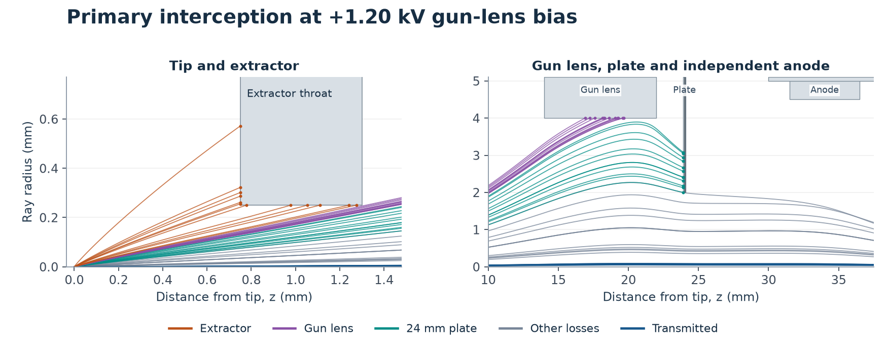
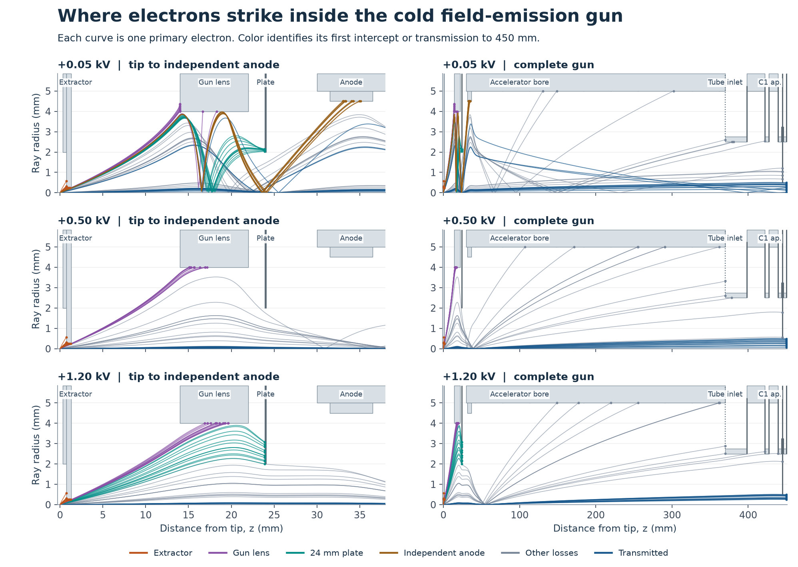
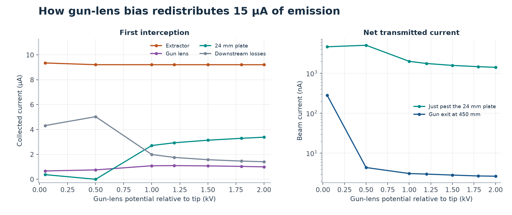

# Cold FEG gun-lens voltage and first-intercept current

This gun-only comparison launches 15 µA of primary electrons from a physical tip and tracks to the 450 mm exit of the Nanoprobe Normal gun. It introduces the 24 mm gun aperture into the electrostatic solve and installs a separate +4 kV anode. The case is opt-in. The archived operating point remains available in the [preceding gun study](../gun-lens-24mm/README.md).

## Results

At +1.20 kV the extractor intercepts 61.4% of all emission. Of the 5.79 µA passing that stage, the gun lens collects 1.10 µA, and the 24 mm plate collects 2.93 µA. Only 1.76 µA clears the plate. Further downstream the accelerator bore collects 1.34 µA, about 0.264 µA misses the first outlet tube, and the C1 aperture intercepts 0.074 µA. Other accelerator rings and outlet walls account for the remaining losses. The 450 mm exit receives 2.99 nA in 1,229 primary rays with an effective count of 183. Each row sums to the original 15 µA when all first hits and transmitted current in the ledger are combined. [Exact current balance and exit angles](sweep.csv) · [Every individual collector](all-collectors.csv)

| Gun lens (kV) | Extractor (µA) | Gun lens (µA) | 24 mm plate (µA) | Anode (µA) | Past plate (µA) | 450 mm exit (nA) |
| ---: | ---: | ---: | ---: | ---: | ---: | ---: |
| +0.05 | 9.349 | 0.669 | 0.372 | 0.014 | 4.611 | 279 |
| +0.50 | 9.211 | 0.753 | 0 | 0 | 5.036 | 4.36 |
| +1.00 | 9.210 | 1.086 | 2.713 | 0 | 1.992 | 3.09 |
| +1.20 | 9.209 | 1.098 | 2.934 | 0 | 1.760 | 2.99 |
| +1.50 | 9.209 | 1.076 | 3.140 | 0 | 1.575 | 2.83 |
| +1.80 | 9.208 | 1.033 | 3.294 | 0 | 1.465 | 2.68 |
| +2.00 | 9.207 | 1.000 | 3.382 | 0 | 1.411 | 2.65 |

Zero denotes zero intercepted primaries in that sample. The extractor is the largest individual collector at every bias sampled. At +0.50 kV the 24 mm foil collects no simulated current, yet the accelerator bore alone collects 4.35 µA. The lens therefore controls the angles and positions of the electrons that reach the next restrictions even at a bias for which the gun aperture clears the beam. At +0.05 kV the anode collects 14 nA and the C1 aperture collects 2.13 µA. Mechanical acceptance after the 24 mm plate makes its transmitted current a poor proxy for gun-exit current. The instrument's BCM is specified at the X-CFEG entrance aperture and the user-facing control has a separate uncalibrated scale. [Thermo Fisher measurement definition](https://documents.thermofisher.com/TFS-Assets/MSD/Application-Notes/xcfeg-application-note-an0171.pdf#page=3)





The lines show radius versus axial position on representative forward paths. Dots show first impact or exit. Line density is selected for visibility; the ledger uses the entire weighted population. For each pictured bias, the 1,024 replayed original IDs reproduce their archived first-hit labels and terminal states exactly. [Coordinates, absolute weights and original IDs used for the figures](representative-trajectories.npz)

The gun lens has a flat entry face at 14 mm and a 4 mm bore radius through to 22 mm. At +1.20 kV the outermost of the 98,391 rays arriving at the entry plane is at 3.357 mm radius. The 4,247 rays eventually intercepted by this lens are still moving radially outward at entry. Their first wall impacts occur at z = 16.682–20.563 mm and account for 1.098 µA. At +0.05 kV the maximum arrival radius increases to 4.463 mm. The upstream face intercepts 0.484 µA and the bore wall intercepts 0.184 µA. All 1,785 original IDs that strike the face at +0.05 kV strike the bore wall at +1.20 kV. Separate counts for all seven biases use the archived first intersections. Replaying the same 131,072 original rays at the two illustrated biases measures the radius on first arrival at exactly 14 mm. [Matched trajectories near the entry face](gun-lens-impact-faces.png) · [Current by surface and entry-plane measurements](gun-lens-impact-faces.json)



At +1.20 kV, with positive z downstream, the computed on-axis electric field is +0.211 MV/m at z = 8 mm and −0.533 MV/m at z = 22 mm. Electrons slow in the first region and accelerate in the second. At z = 18 mm and r = 0.10 mm the radial component is +3.08 kV/m, giving an inward force. The on-axis potential at the 24 mm plate is +3.554 kV and at the anode midplane it is +6.087 kV; the metal on each of those components is held at +4.000 kV. The downstream acceleration stage penetrates the anode opening. [Axial potential and force](axial-electric-field.png) · [Signed electric-field samples](axial-field.csv)

At +1.20 kV, tying the plate to the gun lens instead gives 2.049 µA on the lens, 2.821 µA on the plate and 2.015 nA at the exit. Keeping the plate at +4 kV and substituting the alternate angular source gives 6.909 µA on the extractor, 1.363 µA on the lens, 4.037 µA on the plate and 4.969 nA at the exit. Both comparisons use the same refined mesh, step limits, and 131,072 original particles per distribution. The archived narrow effective source previously delivered the entire 15 µA at 450 mm. With the broad source and the former electrical topology at +1.20 kV, a matched 65,536-particle standard-mesh control gives 4.50 nA at 450 mm. The new plate and anode contribute to the difference, and the old source already excluded much of the oblique emission. [Control results](controls.csv) · [Previous narrow-source acceptance test](../gun-lens-24mm/electrode-audit.md)

## Electrode geometry and supplies

The FEI example gives approximately +4.5 kV on the extractor, an independent adjustable +0.05 to +2 kV electrostatic lens, and approximately +4 kV on the anode, all relative to the emitter. The extractor in this trial is held at the requested +4.0 kV. Figure 2 is a schematic of a compound source lens with a permanent magnet. This control borrows the electrode topology and sets the gun-region magnetic field from the existing Nanoprobe Normal column. The SmCo pre-lens in the patent is outside this electrostatic comparison. The 24 mm plate connection, the production electrode contours and the conversion between the operator's gun-lens number and electrode voltage are unknown. [FEI patent, Fig. 2 and description](https://patents.google.com/patent/US20180323036A1/en) · [Patent drawing](https://patentimages.storage.googleapis.com/d9/cb/c3/22c5c473cc9860/US20180323036A1.pdf#page=3) · [X-CFEG operator controls, p. 3](https://documents.thermofisher.com/TFS-Assets/MSD/Application-Notes/xcfeg-application-note-an0171.pdf#page=3)

| Component | Axial interval from tip | Clear diameter | Supply relative to tip |
| --- | ---: | ---: | ---: |
| Tungsten tip | Apex at 0 mm | Apex radius 100 nm, shank half-angle 5° | 0 V |
| Extractor recess and throat | 0.30–0.75 and 0.75–1.30 mm | 4.0 and 0.50 mm | +4.0 kV |
| Gun lens | 14–22 mm | 8.0 mm | +0.05 to +2.0 kV |
| Gun aperture | 23.90–24.10 mm | 4.0 mm | +4.0 kV in the main sweep |
| Independent anode | 31.5–36.5 mm | 9.0 mm | +4.0 kV |
| Accelerator rings | First centre 42 mm, last centre 362 mm | 10.0 mm | +33.6 to +300 kV |
| Outlet beam tube | Starts at 370 mm | First clear diameter 5.0 mm | +300 kV |
| C1 aperture | Centred at 445 mm | 1.0 mm | Mechanical collector in the grounded flight tube |
| Gun exit | 450 mm | In the flight tube | Observation plane |

The anode centre is positioned approximately 16 mm after the gun-lens midplane, using the relative scale of Fig. 2. Anode dimensions are axisymmetric estimates. The 24 mm aperture is represented by an annulus of 17.5 mm outer radius from the nominal mechanism envelope. The electrical potential is imposed on metal at radii outside the bore. The on-axis potential inside the opening is a solution variable. All ten accelerator ring potentials are held fixed during the sweep by referencing the divider to the fixed +4 kV supply. The two +4 kV collectors remain distinct physical surfaces.

## Source and transport

The reference source has a spherical tungsten cap and a uniform 4.35 eV work function. A smooth-tip cosine local-field law and the Murphy–Good tunnelling current density give the relative emission. The polar probability is proportional to the current density times the spherical area element, integrated from 0 to 80° in surface-normal angle. The angular Jacobian uses the actual spherical cap of this simulation. The cited paper derives its example distribution for a locally parabolic tip. The launch momentum further includes an exponential transverse-energy distribution with a linearized tunnelling-barrier energy scale, independent transverse azimuth, and 0.2 eV initial outward normal energy. The latter is a simulation launch assumption. Sites and momenta therefore have distinct angular distributions. Real W(310) facets can have substantial azimuthal structure. [Biswas, field-emission distributions](https://arxiv.org/pdf/1801.09508) · [Yanagisawa et al., tungsten facet work functions](https://www.physik.uzh.ch/groups/osterwalder/zz_publications_old/PRB_81_Hiro.pdf) · [JEOL, cold field-emission tip](https://www.jeol.com/words/semterms/20121024.062458.php)

The reference angular law uses 8.545 V/nm, the extractor-dominated apex field of the reference mesh at +1.2 kV. It is fixed across all voltages and mesh comparisons. The cumulative half-current angle on the cap is 20.72°, and the 95% angle is 40.07°. For a uniformly clean 100 nm cap the integral before source normalization is 15.08 mA. The physical emission area, facet pattern, and absolute apex field are uncalibrated. The 15 µA budget is imposed once, at emission. An alternate source uses a 4.751 V/nm emission law whose integral over the same cap equals 15 µA. This sensitivity changes the launch distribution only. Both distributions propagate in the solved joint electric field. These are independent-particle primary currents. Space charge, secondary emission and charge returning from surfaces are outside this calculation.

Each main row uses the same 131,072 distinct positive-weight source IDs. Eight importance strata resolve both the bright central acceptance and the broad rejected population. Importance weights give 59,540 effective original particles. All physical currents use the original weight of each electron. Each particle propagates with three relativistic momentum components, the full electrostatic force including its axial component, and the existing column fringe magnetic field. The joint potential is solved with the simulator's conductor-conforming axisymmetric finite elements and differentiated to obtain the radial and axial forces. For the broader source the archived material-volume field was resampled over the actual gun acceptance. Six-component initial phase space, first-hit labels, impact radius and z, and transmitted phase space are available in the [particle archive](source-and-first-hits.npz). Momentum components in that archive are normalized by electron mass times the speed of light.

First-hit detection intersects a swept trajectory segment with the entrance, exit and cylindrical walls of each finite annulus. A ray missing the outside rim of the flight tube at 370 mm is recorded as outside the outlet entrance; the final housing that would collect it is unspecified. The accelerator bore between powered rings also has a distinct mechanical loss category. Primary hits, positive current magnitudes, particle counts and effective counts for every electrode, stage and mechanical loss are in the [full collector ledger](all-collectors.csv).

## Numerical evidence

The standard mesh has 932,891 vertices and the refined mesh 1,380,070 for the main electrode topology. The standard maximum step above 2 mm is 50 µm through the gun-lens region and 220 µm in the accelerator. The main sweep halves those limits; adaptive tip steps are much smaller. The fine mesh uses 72 cells per apex radius and 195 graded tip nodes. Independent comparisons cover field mesh, propagation step, source sampling, aperture wiring, and angular emission law. With the cut-cell field compressed for tracking, comparison at 1,280 locations with the simulator's native interpolator gives a maximum component difference below 0.00008 V/m. Six geometric cases check the first-hit owner and location, including forward and backward passage, a cylindrical wall and a clear hole. [Field and intersection checks](solver-checks.json) · [Numerical and physical controls](controls.csv)

The Nanoprobe Normal magnetic solution includes the archived impressed windings and material moments. A wide-bore interpolation was checked against 336 direct volume evaluations, with maximum vector discrepancies of 5.4 × 10⁻¹³ T up to 35 mm and 3.1 × 10⁻⁷ T across the full gun. The magnetic field at the exit is about 0.075 T. These checks qualify the interpolation of the existing volume solution. [Volume verification](magnetic-check.json)

At +1.20 kV and 131,072 particles, refining the field and halving the trajectory step changes the exit from 2.972 to 2.988 nA. At the same physical bias, increasing the refined-mesh population from 65,536 to 131,072 changes exit current from 3.044 to 2.988 nA. At +0.05 kV the corresponding coarse-to-fine change at full population is appreciably larger, from 248 to 279 nA. At 32,768 particles a further step halving on the fine mesh moves the +0.05 kV result from 289.60 to 290.89 nA and the +1.20 kV result from 3.282 to 3.267 nA. The low-bias point is particularly sensitive to its optical transfer. The maximum exit energy-balance discrepancy for the +1.20 kV main run is below 0.00041 eV. Interpolation of the analytic emission surface on the fine conforming grid leaves a maximum launch potential of 0.24 V. These numerical checks do not include uncertainty in the tip emission law, geometry or electrical connections.

## Reproduction

Run the project Python environment from this directory. The study reads the archived Nanoprobe Normal settings and validates their input digests. The retained wide-bore magnetic table is sufficient for the electrical and transport runs. Rebuilding that table with `check_magnet.py` also needs the archived material-volume solution in the local outputs directory.

```powershell
python gun_field.py
python gun_field.py --fine
python scan.py --fine --scale 0.5 --n 131072
python verify.py
python representatives.py
python report.py
python lens_faces.py
```

The `--wiring lens` option on the field builder and scanner puts the conducting plate at the gun-lens voltage. The `previous` wiring omits the two added electrostatic boundaries and retains the physical 24 mm aperture and the same fixed ring supplies. The `--source-current-fit` scan option selects the alternative current-matched emission law. Each run saves the request digest, collector current, particle population and available nested prefixes. Full per-trajectory end states, times and sampled paths are also retained in `outputs/fei-gun-acceptance-20261123`.
