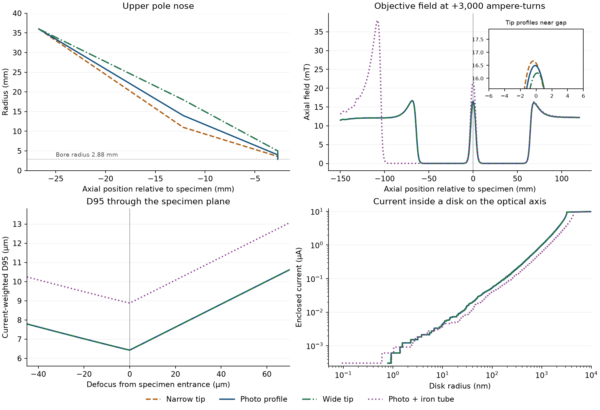

# Upper objective pole contour and terminal tube study

On the matched 300 kV branch, all four geometries transmitted more than 9.97 µA and placed the minimum current-weighted D95 at the specimen entrance at about 29.94 mrad. The three nonmagnetic-tube tips spanned 0.53 nm in D95 around a 6.43 µm probe. For the photo contour, changing the terminal tube to reference pure iron increased the sample field by 31% and the refocused D95 by 38%. The calculation resolves a tube-material effect on this branch. It does not resolve an advantage for any of the three tip profiles.



| Upper tip and tube | Tip face / knee OD (mm) | Sample Bz at +3000 At (mT) | Axial flux at tube joint (µWb) | Sample α95 (mrad) | Transmitted (µA) | Sample D95 (µm) | Current in 100 nm radius (nA) |
| --- | --- | ---: | ---: | ---: | ---: | ---: | ---: |
| Narrow, nonmagnetic | 7.2 / 22 | 16.584 | 6.657 | 29.9421 | 9.9823 | 6.42965 | 53.10 |
| Photo, nonmagnetic | 8 / 28 | 16.484 | 6.668 | 29.9427 | 9.9823 | 6.42985 | 53.10 |
| Wide, nonmagnetic | 10 / 36 | 16.193 | 6.684 | 29.9435 | 9.9823 | 6.43018 | 53.10 |
| Photo, pure-iron tube | 8 / 28 | 21.583 | 77.334 | 29.9396 | 9.9783 | 8.88117 | 40.28 |

The fixed-axis bright-core disk of 50 pm radius contained zero of the 32,768 original packets at the specimen in every run. A single packet represents 0.3052 nA. The 100 nm column gives a separately measured, larger-radius comparison. D95 is a diameter about the transmitted-current centroid. The RMS values in the data are radii. All angles use the actual current-weighted chief direction.

## Geometry and fields

The five unique supplied photographs constrain the visible exterior. The model uses nominal absolute dimensions. The rear shank OD is 22 mm, the connector and mating tube OD are 19.2 mm, the flange OD is 96 mm and the rear recess opening is 50 mm. The 5.76 mm minimum beam bore and 5.4 mm pole gap remain common. Only the last 24 mm of the upper nose change, with the knee 9.5 mm upstream of the pole face. The lower pole and both coil envelopes are common to every solve.

The nonlinear axisymmetric magnetostatic FEM includes both objective poles, the catalog yoke, the two winding sections and the final 40 mm of tube wall. The excitation uses 580 turns per section and a uniform same-sense current. At 3000 At its magnitude is 2.586 A per turn. The magnetic regions use the repository's single-valued FEMM pure-iron B–H reference. The comparison uses relative permeability 1 for the other tube. The faces make an ideal annular contact. The quoted joint flux integrates Bz across the common metal annulus from radius 3.6 to 9.6 mm at the upstream connector plane. The axis-field square integral in the data spans ±210 mm about the entrance.

The actual tube alloy, interface gaps and magnetic return are unknown. The pole has a maximum OD of 96 mm inside a yoke with 140 mm ID. The nominal assembly does not specify a steel bridge across this radial space. The comparison captures local flux redistribution in that assembly. Other column lenses retain their prescribed winding fields. Their magnetisation of the objective steel and full-column nonlinear magnetic coupling are outside this model.

## Matched particle experiment

The common entrance is the authenticated 450 mm gun-exit checkpoint from the parked reference. It contains the original identities, weights, positions, mechanical slopes, flight times and energy offsets for a 10 µA source with 0.30 eV energy spread FWHM. This boundary condition isolates the downstream column. Changes in gun emission from the altered downstream fringe field would require a new gun solve. Every reported sample comparison propagates all 32,768 positive-current packets through the electrostatic field, the winding fields and the FEM bore field, with physical loss at the installed apertures and bores.

The C2 aperture diameter is 100 µm. The acceptance band is 29.7–30.3 mrad with at least 9 µA transmitted. The specimen entrance is at 1599.1999975 mm. The field comparison uses +3000 At. The optical branch uses −3000 At for all four objectives relative to the other lenses. An odd, single-valued material law permits this reversal at fixed field magnitude.

The eight signed vacuum-objective winding groups of the older preset are replaced by the single, uniformly driven FEM objective. The common optical branch uses a fixed C1, C3 and relay prescription and zero hexapole excitation. The three contour comparisons also share exactly the same C2 current pattern. Mini places each D95 minimum on the entrance. The tube comparison adjusts C2 to match the photo case angle and refocuses with Mini. The absolute upstream group currents follow the parked recipe multiplied by the saved factors. These are numerical working points with uncalibrated hardware current limits.

Restoring the saved hexapole excitations at the otherwise fixed photo-case controls produced 36.10 mrad and 7.45 µA. This single-change control misses the angle and current gates and is excluded from the contour ranking.

The final measurements use a 0.10 mm maximum Lorentz step and explicit checkpoints near the entrance. The vacuum continuation samples both sides of the specimen plane. Every case has its smallest observed D95 at zero offset, bracketed by −0.5 and +0.5 nm with constant transmitted current. C2 to C3 contains one two-axis covariance sign change, C3 to ADL contains none and Mini to the entrance has no additional upstream waist. The RMS minima lie roughly 38 µm downstream for the three contours and 53 µm downstream for the iron-tube case. This study measures a classical incident probe; coherent diffraction and specimen scattering require a separate calculation.

## Numerical sensitivity and attribution

The final field mesh spans the upstream tube entrance, the pole gap and the rear of the lower pole with a local 0.30 mm axial step and 0.12 mm radial step near the bore. Its adjacent mesh uses 0.50 and 0.20 mm. Geometry boundaries add exact coordinates to both meshes. After refocusing, the photo contour changed from 6.569 to 6.430 µm and the iron-tube case from 8.931 to 8.881 µm. The tube increase persisted on both meshes. Earlier meshes with a shorter axial refinement window changed the order of the three near-identical contours. The absolute probe sizes and sub-nanometre differences between contours therefore carry quite different numerical uncertainties.

The recorded controls were replayed with half the Lorentz step. The independent CPU Lorentz check covers 1,024 original packets for each endpoint of the material contrast, including every intercepted packet. It compares the first absorbing step and the exit phase of survivors with the GPU result. The results also include fixed-control original-identity prefix statistics. These diagnostics preserve source weights and do not turn a partial prefix into a new 10 µA beam.

The archived all-vacuum, signed-current operating point gave a 1.836 nm D95. It uses a different objective field, excitation pattern and corrector setting. It cannot establish the size achievable with the proposed physical objective. The present comparison supports a sensitivity to the modeled return path and tube joint. It cannot establish a global best probe or attribute the hardware resolution to the photographed tip.

## Data and replay

- [Comparison table](comparison.csv) contains the common-excitation field, flux and specimen metrics.
- [Numerical results](results.json) contains each control vector, field and particle convergence checks, packet-count sensitivity, loss counts and axial waist brackets.
- The generated files in `outputs/objective_pole_study_20261119` include the R–Z potentials and native per-particle sample states. Each primary archive filename and SHA-256 appear in the numerical results. Its phase columns are x and y in metres, two dimensionless mechanical slopes and flight time in seconds. A loss step of −1 identifies a surviving particle.

From the repository root, the following command reconstructs missing input tables as needed and replays all four saved working points. It compares the resulting sample metrics and measured waist brackets with the published values.

```powershell
.\.venv\Scripts\python docs/development/objective_pole_study_20261119/replay.py
```
