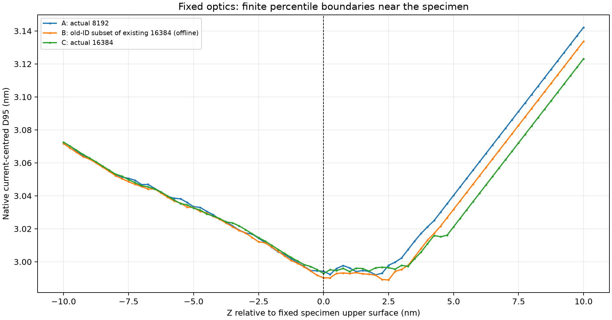
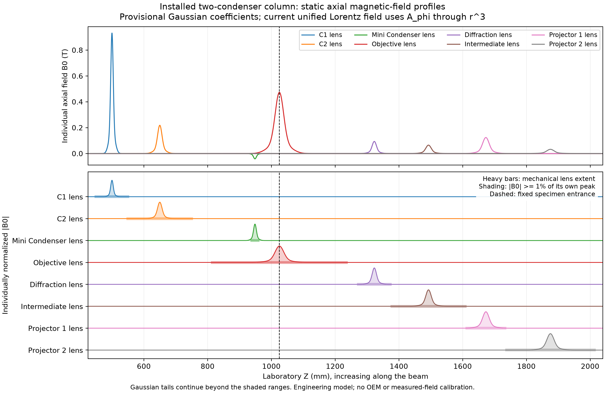

# Source-count focus diagnosis and nested particle growth

This archive separates completed **historical-source optical measurements**
from the new **software source/reuse contract**. No new physical calculation
qualifies the new source in this archive. The user stopped further source-count
growth; the 32,768-particle attempt was interrupted during its gun calculation
and produced no completed gun, column result or focus observation.

## Historical fixed-control measurements

The instrument is the physical two-condenser assembly: C1 lens, C2 lens,
Mini Condenser lens and Objective lens, with no installed C3 lens or probe
corrector. The complete original accepted optical controls were retained,
including C1 lens 52.5%, C2 lens 17.75%, Mini Condenser lens -10% signed and
Objective lens 29.292665862003528%. The physical C2 aperture is 70 um.

The source has a 0.300 eV requested RMS-equivalent FWHM. Si[110] thickness is
10 nm with its original upper surface fixed at 1025.1999975 mm and its lattice
reference retained. Focus diagnostics retract the material while retaining
that exact entrance reference and the same physical lens fields. They are
classical vacuum Lorentz observations, not coherent-wave probe sizes or STEM
acquisitions.

| Original particles | Step (mm) | Surface D95 (nm) | Alpha95 (mrad) | Transmitted particles | Current (uA) | D95 minimum offset (nm) | Observed neighbour bracket (nm) |
|---:|---:|---:|---:|---:|---:|---:|---|
| 8192 | 0.05 | 2.994233491776 | 10.168966887442 | 7757 | 9.468994140625 | +2 | +1.75 to +2.25 |
| 16384 | 0.05 | 2.992877891874 | 10.162452767368 | 15514 | 9.468994140625 | 0 | -0.25 to +0.25 |
| 16384 | 0.025 | 2.992869742286 | 10.162452767937 | 15514 | 9.468994140625 | 0 | -0.25 to +0.25 |

The existing +/-1 nm full-bracket criterion was preserved. The 8192 trial
fails it. The two 16384 step checks pass for that finite population, but do
not establish a continuous-source or source-count-converged focus. RMS-radius
minima are independently at +74 nm, bracketed by +72 and +76 nm. They must not
be described as being at the D95 minimum.

Both original populations retain unique physical source points and IDs.
There was no duplicated phase space, lost-current restoration or independent
refocusing of the lower-count result. No lens excitation was changed during
this round because the fixed 16384 population already had its observed D95
minimum at the entrance.

## Why the observed minimum changed

Independent comparisons established identical optical controls, mechanical
boundaries, all twenty actual potential-source identities and sampled phi,
E, A and B. The 8192 and 16384 column integration meshes are bitwise equal.
Halving the fixed-source column step changes surface D95 by only 0.0002723%.
This does not prove an identical adaptive gun time mesh: the old source
algorithm uses population-dependent launch-energy normalization and a common
adaptive time-step acceptance rule.

The historical default has nested Halton position/direction coordinates, but
its energy map recentres and rescales the complete requested batch. The same
old source ID therefore changes energy when the count changes. The observed
maximum old-ID gun-exit energy difference is 0.001284531 eV. This can affect
the sub-eV extraction part as well as downstream chromatic response.

An offline decomposition uses only already executed arrays:

| Dataset | Observed D95 minimum offset (nm) |
|---|---:|
| A: actual historical 8192 result | +2.0 |
| B: the same old 8192 IDs selected from the 16384 trajectories | +2.5 |
| C: complete historical 16384 result | 0 |

B is a conditional statistical diagnostic, not an independently executed
physical beam; its actual retained source measure is not restored to the
current of A. A-to-B includes the count-dependent old-particle energy/path
change. B-to-C isolates adding the remaining executed population and changing
the conditional order statistic. The full 2 nm difference must not be assigned
to energy calibration alone.

D95 is an exact weighted 95% order statistic without quantile smoothing.
Near the minimum, rays on either side of the 95% rank are converging and
diverging at different rates. Changing Z by 0.25 nm changes their radii by
about 1.2-2.6 pm in opposite directions and changes the boundary ID. Two shallow
8192 minima differ in diameter by only about 0.26 pm. Fixing the centroid to
its entrance value leaves the A/B/C minimum locations unchanged. Source
sampling and the order statistic, rather than an optical-axis or centring
change, explain the sensitive argmin despite stable approximately 3 nm sizes.

## New source and reuse contract

New planar FEG defaults explicitly select `tip-halton-prefix-cdf512-v1`.
The original Halton coordinates are retained. A fixed continuous Young/logistic
energy calibration and monotone linear interpolation table depend only on
physical emission parameters, never the requested count. Existing source IDs,
positions, directions, energies, emission times and boundaries are exact
prefixes. The default table has 262145 nodes; the interpolation certificate,
including roundoff allowance, is below 2.99e-11 eV.

Finite populations are no longer forced individually to have exactly the
requested energy moments. The source parameter remains 0.300 eV while its
finite sampling error remains observable. Zero-width energy distributions
retain exact constant energies.

Compatible prior transport is a verified execution cache. Added particles
undergo real integration. Old native gun time histories remain separate
partitions and are not resampled into a fabricated new integration mesh.
Larger results carry their proper 1/N source measure and retain all physical
interception flags; earlier raw weights and results are not rewritten.

Source, field, boundary, implementation and numerical dependencies are checked.
A changed source family is a new experiment. A finer column step cannot reuse
coarse column trajectories as high-accuracy output; compatible gun work can
still be retained. Material/dynamic/unsupported paths keep their existing
recalculation requirements. This contract removes old-particle source changes;
it does not guarantee that adding genuine samples leaves the D95 argmin fixed.

Historical `sampling=None` inputs retain their original version for
reproduction. To start the new nested source through the GUI, open **Physical
Layout > Tip parameters**, choose **Use nested source sampling (new
calculation)**, apply it, and calculate. This explicit action retains optical
controls and source parameters and does not relabel historical transport.

## Lens geometry and field-model audit

The [lens audit](installed-lens-model-audit.md) lists every installed lens,
separate main/pole/coil bores, axial peak field, FWHM, 1%-of-peak display range
and native support. The actual unified round field uses Gaussian B0(z) with
A_phi through r cubed; it is not a magnetic-material FEM solve. Field tails
are evaluated outside the display range.

Legal static C2 lens main-bore and coil-ID changes left common-interior A and
B samples bitwise unchanged. Actual pole-body edits failed linked mechanical
constraints and were not forced to run. No physical bore-to-Cs experiment was
claimed. A controlled bore study requires consistent linked geometry,
ampere-turns, material/B-H assignment, mesh/boundary convergence and matched
optical conditions. The current assembly has no completed FEM recipes.

## Provenance and verification limits

The historical producer Python identity is
`b2900cf7e79501458a6c463558ef134002bce351694617833ca8d65a111871e8`.
Commit `a5cdebe` has the matching Python source. Historical inputs and reports
are gzip copies preserving their exact original bytes. Selected native phase
files retain every original ID and weight at explicitly listed executed
planes. They are diagnostic extracts, not complete restart checkpoints. The
full local raw histories remain untouched at the paths recorded in the
[manifest](artifact-manifest.json).

The source-interpolation certificate and test XMLs describe pure-array,
configuration and software checks. They do not qualify a new physical focus,
new CUDA mixed-coherent scan or experimental microscope field. The stopped
32768 record is explicitly `USER_INTERRUPTED_NO_RESULT`.

Final verification passed **343 unique software test cases**: source laws,
mocked append-only transport, static geometry, Qt state transitions, exact
numeric persistence, source budgets and package inputs. A wheel was built and
installed into a separate virtual environment outside the checkout. From an
unrelated working directory it loaded the installed Si CIF and new sampling
modules; the installed solver bytes matched the tested checkout. See
[the validation record](validation/final-validation.json).

Run `python docs/development/particle_source_growth_20261113/verify_evidence.py`
from a configured project environment to check the recorded bytes and thirty
selected native observations without tracing particles or propagating waves.
