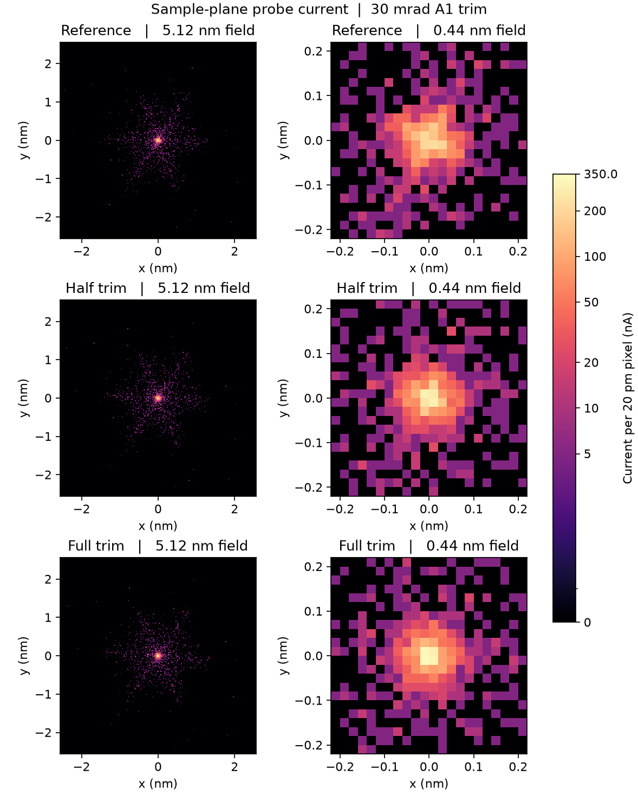

# Two-axis A1 trim at the 30 mrad joint working point

This experiment starts from the [29.719 mrad joint setting](../probe_joint_20261101/extend-joint-01-focus1/result.json).
The target is the signed pair of specimen-plane geometric A1 components.
The source-to-specimen calculation carries the same 2000 original particles
through the nonlinear unified fields at every setting. It keeps the original
identities, positions at emission, energies, weights and apertures. The full
and quarter nominal-energy optical pencils carry zero current and provide
independent-pupil checks of fitted coefficients.

## Drive identification

The installed condenser stigmator is centered at 1451.5 mm. Its X and Y
commands excite distributed quadrupole fields at mechanical angles of 0°
and 45°. Perturbing each command by ±0.003 percentage point gave rank two
in the sampled magnetic field and in the measured A1 response. The field
response columns have a normalized dot product of 5.2e-17.

| Specimen A1 response (nm per percentage point) | X command | Y command |
| --- | ---: | ---: |
| Real component | −214.435 | +184.074 |
| Imaginary component | −184.074 | −214.435 |

The matrix condition number is 1.000000002. The quarter-pupil fit
independently reproduces the two columns. Only the condenser-stigmator
field digest changes in the signed tests. All four tests retain the same
10.00 µA with a measured 2-D waist at −0.1 nm relative to the entrance.
This establishes independently controllable A1 directions in the simulator.
The project has no measured ampere gain or DAC resolution for these circuits.

The initial stigmator settings are X = +0.000503084515% and
Y = +0.012000878806%. Solving the two measured equations for zero A1 gives
increments of −0.000503084531 and −0.012000878803 percentage point.
The half and full settings are the midpoint and endpoint of that signed move.
The full setting brings both drives to numerical zero.

[Field measurement](physical-channel-audit.json) · [Signed response matrix and collateral terms](response.json) ·
[All four signed measurement images](response-probes.png)

## Observations

| Sample entrance observable | 30 mrad reference | Half trim | Full trim |
| --- | ---: | ---: | ---: |
| A1 magnitude (nm) | 3.39449 | 1.69724 | <0.001 |
| Core current inside 50 pm (µA) | 2.405 | 2.545 | 2.595 |
| Brightest 20 pm pixel (nA) | 215 | 290 | 330 |
| D95 (nm) | 2.44648 | 2.44012 | 2.43633 |
| RMS radius (nm) | 1.578245 | 1.577784 | 1.577801 |
| Core M4 | 0.23612 | 0.13674 | 0.01214 |
| Alpha95 (mrad) | 29.719141 | 29.719153 | 29.719165 |
| Transmitted / effective particles | 2000 / 2000 | 2000 / 2000 | 2000 / 2000 |
| Specimen current (µA) | 10.000 | 10.000 | 10.000 |
| Measured waist offset (nm, positive downstream) | −0.1 | −0.1 | −0.1 |
| Signed spherical C3 (mm) | −0.202929 | −0.202929 | −0.202929 |
| A5 magnitude (mm) | 34.459617 | 34.459617 | 34.459617 |

The original A1 pair is (+2.10117, −2.66601) nm. The full and quarter
pencil fits put its corrected magnitude below 0.001 nm, conservatively
rounded for this fixed-source model. The added core current is 0.190 µA
(7.90%). Its normalized fourth angular moment decreases by 94.86%.
D95 falls by 0.01015 nm and RMS radius by 0.00044 nm. The largest change
is in the brightness and shape of the core. Outside 1 nm the current
changes from 0.965 to 0.955 µA and its normalized sixth moment goes from
0.421 to 0.440. The outer sixfold structure remains visible.

The geometric change in C3 is +3.1e-9 mm and the magnitude of the *vector
change* in A5 is 5.4e-8 mm. At 30 mrad the associated characteristic edge
changes are below 0.0001 pm for both terms. Only the condenser-stigmator
field changes in either trim round. Under these controlled conditions, much
of the observed **central** fourfold intensity responds to the A1 correction.
Halving the maximum integration step from 0.05 to 0.025 mm reproduced the
waist offset, 50 pm disk current and 330 nA peak pixel. D95 changed by
0.000012 nm. The corrected working point also passes the Normal-mode
crossover checks and restores to the same instrument input digest.

The current images use the same fixed optical axis, 20 pm square bins and
absolute color scale. The full view is 5.12 nm wide and the core view is
0.44 nm wide. Every image retains the original phase-space and absolute
current arrays including the tails outside the displayed area. The core
current is integrated over a fixed 50 pm radius disk. Core M4 is the
magnitude of the current-weighted mean of exp(4iφ) over a 0.1 nm radius
disk, using native particle coordinates before binning. M4 describes the
angular current distribution and A1 measures a signed geometric coefficient.

Each through-focus scan brackets the full Mini Condenser / Objective
region, resolves convergence and divergence on both transverse axes and
refines the waist location at 0.1 nm spacing. The entrance must lie inside
the finite 2-D waist region, within 0.25 nm of its representative plane.
The resulting measurement reports the actual crossover and the D95, RMS
and core-current extrema separately.

[Machine-readable round comparison](comparison.json) · [Focus-verified image records](image-verification.json) ·
[Full corrected probe image](a1-corrected/incident-probe.png) · [Raw current](a1-corrected/current.npz) ·
[Corrected optical inputs](a1-corrected/a1-trim-inputs.temwp) · [Smaller-step repeat](a1-corrected-fine/result.json) ·
[Normal-mode crossover sequence](a1-corrected/topology.json)

## Reproduction

From the repository root, run `scripts/correct_joint_probe_a1.py audit`,
then its `probe-channel --index N` operation for indices 0 through 3.
Run `solve` to measure the two-axis response. Use
`correct --name a1-half --fraction .5`, then `correct --name a1-corrected`
and `correct --name a1-corrected-fine --step .025`. The default axial
integration step is 0.05 mm. Each trial reserves a fresh directory. Run
`topology --name a1-corrected` to check the Normal-mode crossover sequence.
`scripts/report_joint_a1.py` verifies the optical fields, original source,
focus, numerical repeat, probe images and input package. Historical working
points remain available at their original paths.
