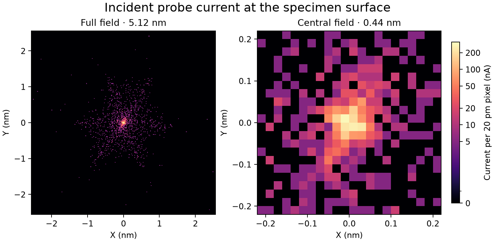

# Fixed-axis A5 continuation

This study starts at the previously accepted A5 working point. The request is
to establish a physically defensible drive subset, measure the protected A5
response, then reduce A5 and the outer sixfold tail if a feasible direction
exists. This is a classical unified-field simulation, not a hardware run.

## Outcome

The installed scalar model drives provide a resolved local A5 response after
protecting A2, C3 and convergence. The bounded continuation produces a small
coupled improvement, but **no replacement of the accepted A5 working point**.
The review candidate is `native-mid-polished`: A5 decreases by 0.299%, outer
sixfold current by 3.537%, and the native RMS waist is at the specimen surface.
It fails the stricter independent-A5 study gates because D4/C5 change, the
inner threefold tail increases, and A5 improves by less than the study's 1%
target. All failed trials and gates remain archived.

| Native specimen observable | Accepted baseline | Review candidate |
| --- | ---: | ---: |
| Full-pupil geometric A5 magnitude (mm) | 33.468393 | 33.368338 |
| Original / transmitted particles | 2000 / 2000 | 2000 / 2000 |
| Absolute transmitted current (uA) | 10.000 | 10.000 |
| Alpha95 (mrad) | 29.777010 | 29.764821 |
| Current inside the fixed axial 50 pm radius (uA) | 2.330 | 2.365 |
| D95 (nm) | 2.502302 | 2.495350 |
| RMS radius (nm) | 1.709907 | 1.697956 |
| Native 2D waist offset from specimen (nm) | -0.1 | 0.0 |
| Current outside 1 nm (uA) | 1.200 | 1.175 |
| Absolute sixth-harmonic current outside 1 nm (uA) | 0.508446 | 0.490462 |
| Absolute threefold current, 0.1-1 nm annulus (uA) | 0.099117 | 0.109611 |
| Absolute D95/RMS minimum-plane separation (nm) | 23.6 | 26.2 |

The A2 and C3 vector changes correspond to 4.611 and 3.785 pm at 30 mrad,
within the 5 pm primary protection budget. D4 and C5 change by 28.669 and
24.340 pm. Thus protecting A2 alone does not guarantee an unchanged
three-lobed current tail: higher-order terms and their propagation also
matter. These coefficients are whole-column geometric measurements in the
declared outgoing mechanical-slope convention, not coherent wave estimates.

The radial-shell sixth-magnitude sum also decreases, so the outer M6 reduction
is not obtained solely by cancellation between rotated radial shells. The
full-field image still contains sixfold structure. The D95/RMS axial
separation is allowed to be nonzero, but it has increased here; the candidate
does not achieve simultaneous global minima of all probe measures.



[Measured outcome and physical drive values](outcome.json) |
[All trial metrics](trial-ledger.csv) |
[Every executed image](IMAGE_HISTORY.md) |
[Native-focus strict gates](native-mid-polished/gates.json) |
[Restore-tested candidate inputs, NOT ACCEPTED](native-mid-polished/review-candidate-inputs.temwp)

The portable candidate contains inputs only; the separately archived current
arrays are its executed evidence. The original accepted portable package is
unchanged. No default instrument preset or solver source was modified.

## What the physical degrees of freedom establish

The eight installed scalar excitations change only their own field provider,
retain interception geometry and have eight distinguishable sampled field
directions. This is model evidence; independent supplies, winding gains and
magnetostatic realizability remain unverified. Auxiliary fields inherited
from the accepted point remain present and frozen.

Signed full/half steps give 32 physical response trials. With C1, both A2
components, C3 and alpha95 exactly protected in the local linear model, the
remaining A5 response has two resolved components. For seven drives their
scaled singular values are 10.991 and 0.02318 pm (ratio about 474). Including
Mini gives 11.751 and 0.64025 pm (ratio about 18.4), above the 0.00293 pm
rank threshold inferred from full/half derivative differences. The diagnostic
step scaling defines these values; the ratio is not a universal hardware
condition number. Response rank alone does not qualify a finite correction
with all collateral aberrations held fixed.

The tested route therefore uses fixed-angle HP1/HP2 strength and transfer-lens
matching, with physical Mini/shared-Objective focus compensation. No new
HPC/HPol quadrature, rotated main pole, independent upper-only supply or
virtual DP12 is introduced. See the revised
[channel rules](../PROBE_ABERRATION_CHANNEL_RULES.md#current-fixed-axis-a5-rule).

## Executed candidate sequence

1. `baseline` exactly reproduces the accepted source, specimen phase arrays
   and PNG. `baseline-fine` repeats the same setting at half integration step.
2. `response-*` are 32 isolated signed scalar measurements. They are deliberately
   not refocused; their specimen images are diagnostic, not proposed settings.
3. `candidate-a5` is the strict seven-drive pilot: focus/RMS and small collateral
   violations reject it. Its failures motivated measuring Mini as an eighth
   installed scalar, not silently changing the focus model.
4. `native-requested-small` and `native-requested-mid` are separate coupled
   candidates. `native-small-focused` and `native-mid-focused` execute explicit
   shared-Objective changes to place their actual waists at the specimen.
   Their threefold tails increase; their larger pre-focus outer-tail gains
   are not reported as gains at the final focused specimen plane.
5. `native-mid-polished` is a bounded local compensation of the mid candidate.
   It reduces the threefold increase, but does not remove it. Its propagated
   data, not the optimizer's smoothed surrogate, supply every reported metric.
   `native-mid-polished-fine` repeats that exact setting at half integration step.

The analytical proposal files explicitly identify predictions and optimizer
failures. No proposed coordinates are rendered as a physical current image.
All executed images share the same source and fixed absolute display scale;
metrics outside the displayed square still include the full transmitted beam.

## Verification and limits

The selected candidate retains Normal topology: one C2-C3 waist, none between
C3 and ADL, one between TL22 and TL21, and one in the AC-coil interval. These
intervals were repropagated with the same 2000 originals and at most 0.5 mm
observation spacing. The Mini-to-specimen search separately resolves one
native two-dimensional waist at the surface, with no distinct earlier waist.
See [topology](native-mid-polished/topology.json) and
[through-focus evidence](native-mid-polished/through-focus.json).

The baseline and candidate are each repeated at 0.025 mm instead of 0.05 mm
maximum integration step, using the same particles and optical inputs.
[Integration comparison](integration-comparison.json) records exact changes,
and the full/quarter optical pencils provide separate pupil-scale checks.
This is a bounded step-sensitivity check, not proof of convergence under every
discretization or source distribution.

Ten targeted pure-array/mocked tests pass for driver restrictions, protected
response rank, derivative uncertainty, shell cancellation, native-envelope
focus, coefficient projection and baseline rendering/lineage utilities.
Only existing Pydantic deprecation warnings occur. Every completed input
recipe, current weight, source ID and PNG checksum is checked in
[archive verification](archive-verification.json). The review input package
restores the exact measured input digest.

No particle count increase, coherent calculation, hardware calibration or
atomic-resolution image validation was performed. This study does not prove
global infeasibility; further selective A5 control needs a better-qualified
drive map or a newly measured response around a chosen working point.

## Frozen inputs and drive scope

Use the [archived baseline](../probe_stage12_20261101/inputs/baseline.json),
the identical 2,000 original positive-current particles, their absolute weights,
IDs, energies and clocks, 300 kV, the unchanged 100 um C2 aperture, and the
Normal optical branch. The archived full/quarter zero-current pencils only
measure optical coefficients. They contribute no current, and do not replace
or enlarge the physical source population. No coherent calculation is used.

The initial seven-drive subset is HP1/HP2 scalar strengths at fixed orientation,
ADL, TL22/TL21/TL12, and the shared Objective percentage. The Objective drive
scales both existing field lobes. It does not assume an independently powered
upper objective. HPC/HPol, all installation angles, quadrupoles and dipoles,
C2/C3, Mini Condenser, field profiles and geometry stay fixed.

This subset uses installed model bodies and ordinary scalar excitations.
Electrical gains, independent supplies and magnetostatic realization remain
unverified. The accepted auxiliary fields remain present and frozen; this
continuation cannot retrospectively certify their hardware realization.
See [the drive audit](driver-audit.json).

After the first measured candidate displaced the native waist and increased
RMS, the already installed Mini Condenser scalar excitation was added as an
eighth drive. Its Nanoprobe mode, polarity, profile and geometry remain fixed.
This extension tests the explicitly requested Mini/Objective joint focusing
role; it does not assume Mini is an independently qualified TL11 equivalent.
The [initial seven-drive audit](driver-audit-seven.json) and
[initial response](protected-response-seven.json) remain separate evidence.

The initial pilot also demonstrates why preserving the fitted C1 coefficient
does not preserve the finite-source RMS waist after other aberrations change.
The subsequent native-focus design uses the measured finite-source envelope
response for physical focus compensation. C1 is explicitly recorded as a
focus adjustment rather than held under the collateral-aberration budget;
the A2/C3 and all other protected coefficient budgets remain unchanged. No
coordinate refocus is applied to an image. Each proposal requires a complete
new propagation and a separately resolved two-dimensional crossover.

The strict proposal search did not find a feasible 1% A5 improvement within
its tested local bounds. Separate `requested` design records then retained
the explicit A2/C3/angle/current protections while allowing D4 and C5 to vary
as measured collateral terms. Those candidates were still evaluated against
the unchanged strict gates. No failed optimizer is treated as a feasible
candidate, and no local search failure proves global physical impossibility.

## Predeclared comparison and acceptance gates

The 1% material-improvement threshold and the 5 pm all-other-term isolation
budget below are investigator study targets, not numerical requirements
specified by the user. A measured smaller improvement can be reported, but
does not retroactively pass these stricter targets. The original accepted
setting is preserved unless a replacement is separately accepted.

- Measure signed full and half diagnostic steps at the accepted point. Use
  the fixed laboratory outgoing mechanical-slope coefficient convention and
  compare vector changes at 30 mrad. Keep both components of directional terms.
- Protect A2 and C3 within 5 pm equivalent edge displacement from the accepted
  baseline. Also check all other measured terms against the previous 5 pm
  collateral budget, with explicitly executed C1 focus placement recorded
  separately in the native-focus branch. A candidate exceeding the remaining
  protected budget is not accepted as an A5-only correction.
- Keep current-weighted alpha95 in 29.7 to 30.3 mrad and preserve the original
  10 uA current and every transmitted original ID. No clipping, recentering,
  source modification or survivor renormalization may supply the improvement.
- Seek at least 1% reduction of both |A5| and absolute sixth-harmonic current
  beyond 1 nm, beyond the measured integration/fit uncertainty. Outer absolute
  current, summed outer-shell sixth magnitudes, D95 and RMS must not increase.
  Core current within the commanded 50 pm disk must not decrease by more than
  one original equal-current particle (5 nA). This is a fixed-population
  comparison, not a particle-count convergence claim.
- Evaluate each correction candidate at its free two-dimensional crossover
  and at the native specimen surface. If explicit physical focus placement
  is needed, save and re-execute that setting separately. The representative
  2D waist must be within 0.25 nm of the specimen, with a resolved bracket.
  D95/RMS minima are recorded independently, not forced to coincide.
- Final acceptance requires the Normal topology: C2-C3 one waist, C3-ADL
  none, TL22-TL21 one, and the AC coil interval one. Mini plus Objective must
  focus directly at the specimen with no distinct preceding waist.
- Validate a candidate with a smaller integration step and the independent
  quarter-pupil fit. Preserve the starting point if no candidate passes.

All scalar-response images are diagnostics with deliberate uncompensated
perturbations, not accepted working points. Every executed trial saves its
native fixed-scale current PNG, raw current kernel, original-ID surface
arrays, exact input recipe, coefficient pencils and measurements. Full optical
snapshots and checkpoint histories remain in the corresponding local `outputs`
directory. The recipe reconstructs the input from the already tracked portable
baseline and the declared scalar changes; the recorded digest verifies it.
The current image uses the same 5.12 nm full field, 0.44 nm central field,
20 pm pixels and absolute color scale as the accepted baseline.

## Reproduction

From the repository root in the project environment:

```powershell
& .venv/Scripts/python.exe scripts/calibrate_physical_a5.py audit
& .venv/Scripts/python.exe scripts/calibrate_physical_a5.py run --name baseline
& .venv/Scripts/python.exe scripts/calibrate_physical_a5.py calibrate
& .venv/Scripts/python.exe scripts/calibrate_physical_a5.py calibrate --half
```

Runs require new trial directories. Each measurement explicitly identifies
the original source and executed field snapshot. Do not overwrite a trial.

The choice to examine hexapole strength and transfer-lens matching is supported
by the published coupled origins of A5, not a manufacturer drive-current map.
[Muller et al. 2006, pp. 451-453](https://www.ceos-gmbh.de/en/produkte/stemkorrektoren/dcor-ascor/Mueller2006a.pdf#page=10).
