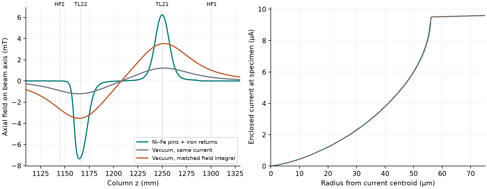
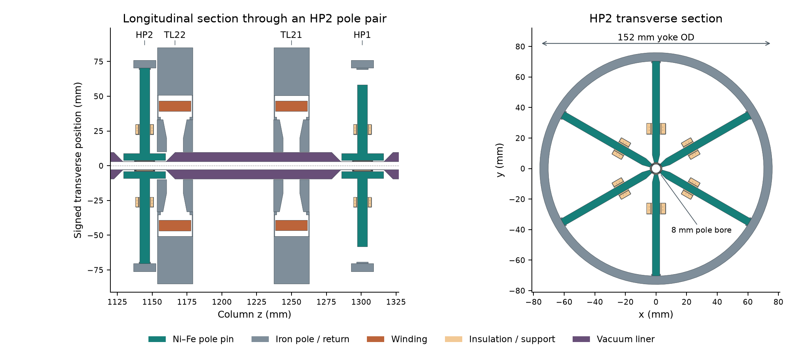

# CESCOR probe corrector with material-dependent excitation

The installed hexapoles and transfer doublet generate a substantially stronger field with their magnetic circuit assembled. Matching its axial field-squared integral takes 5.00 A per transfer winding with the iron circuit and 14.53 A in vacuum. At a matched 30 mrad specimen semi-angle the corresponding D95 diameters are 112.58 and 112.21 µm. The refitted column produces an extra crossover about 63 mm above the specimen. These settings fail the direct Nanoprobe illumination requirement.



## Installed hardware

The published CESCOR description gives a 4 mm bore radius, a 30 mm axial pole length and nickel–iron pole pins. The photograph identifies a 152 mm yoke OD. The three installed probe-corrector variants now use these dimensions. The reconstruction uses the solid PERMENORM 5000 H2 alloy, 47.5 wt% Ni with the balance Fe, as a representative grade. The initial B–H curve is digitized from the manufacturer's solid-material data. The exact CEOS alloy grade and heat treatment are unknown. [Müller et al., pp. 443–444, Figs. 2–3](https://www.ceos-gmbh.de/en/produkte/stemkorrektoren/dcor-ascor/Mueller2006a.pdf#page=3) · [VAC solid-material initial magnetization curve, p. 1](https://vacuumschmelze.com/03_Documents/Brochures/Datasheet%20PERMENORM%205000%20H2%20Solid.pdf#page=1) · [Digitized curve](../../../configs/materials/magnetic/permenorm_5000_h2.toml)

| Part in beam order | Installed centre z (mm) | Axial extent or nominal interface |
| --- | ---: | --- |
| HP2 | 1144.50 | Pole noses 1129.50–1159.50 mm. Nominal return yoke 1136.50–1152.50 mm. |
| TL22 | 1166.35 | Existing shoulder sleeves and return plates, one at each end. |
| TL21 | 1249.95 | Existing shoulder sleeves and return plates, one at each end. |
| HP1 | 1300.85 | Pole noses 1285.85–1315.85 mm. Nominal return yoke 1292.85–1308.85 mm. |



At the closest neighbouring station the HP2 yoke ends 1.10 mm before TL22. The HP2 pole noses extend axially into the TL22 entrance and clear its inner pole surface radially by approximately 0.67 mm in the nominal model. The longitudinal cut passes through an HP2 pole pair. HP1 has a different azimuth, so the same cut intersects its pin stems off centre.

The HP yokes have a nominal 16 mm axial length and 5.61 mm radial wall. Each of the six radial pins has its own two-turn winding. The transfer coils retain 19 turns each. Both transfer lenses retain a 2 mm sleeve radial wall, a 2 mm shoulder engagement and a 0.4 mm return plate. These joint dimensions and the installed centres are nominal. The 5 mm tip taper, locally reduced 6 mm OD liner and 6.2–7.8 mm steering winding envelope are fit assumptions. The liner keeps its 5.76 mm electron passage. Each supported steering insert has 0.06 mm radial clearance to the liner and another 0.06 mm to the pole tips. [CAD dimensions and nominal interfaces](../../references/column-magnetic-hardware/README.md)

## What enters the field and ray calculation

The three-dimensional tetrahedral solve contains all 40 magnetic bodies. Each HP contributes six pins, six pole-root sleeves and one yoke. Each TL contributes two poles, two sleeves, two return plates and one yoke. The four winding excitations use their signed physical currents and closed-turn geometry. All 12 pole pins use PERMENORM. The other active magnetic regions use ARMCO pure iron in this run. Material choices come from the saved column. The problem assumes initially demagnetized isotropic materials, ideal mating surfaces, nominal centred hardware and static excitation. Hysteresis, joint reluctance from surface finish, manufacturing offsets and thermal current ratings remain unmeasured.

The solver uses a continuous piecewise-linear reduced scalar magnetic potential with a zero far-boundary value. Air and materials share the same mesh. Local refinement follows pole noses, material interfaces and the beam vacuum. The transport field combines the exact impressed winding prescription with a harmonic continuation of the solved scalar potential into the bore. The matched run used all three magnetic field components at each Runge–Kutta stage and consistent physical interception. The lab z origin of the solved module is 450 mm. The electric field and the original gun-exit phase space are shared with the previous objective study.

There are 767,368 tetrahedra in the coarser mesh and 1,088,545 in the refined mesh. The nominal material sizes are 6.0 and 3.8 mm, the on-axis targets are 0.86 and 0.54 mm, and the exterior padding is 160 and 195 mm. The respective field tables use approximately 0.75 and 0.50 mm axial spacing. These refinements together change the axial peak by 0.072% and the field-squared integral by 0.18%. The fine mesh converged in 17 Newton iterations with relative residual 5.57 × 10⁻⁸. Its maximum inductions are 1.260 T in the nickel–iron pins and 1.635 T in the ARMCO circuit, both within the respective supplied curves.

An independent check against the discontinuous native FEM gradients at 256 off-grid vacuum points gave a 0.48 mT RMS difference and 3.52 mT maximum. Both the mesh and the field reconstruction contribute to this difference. Direct tetrahedral dipole quadrature inside the bore showed larger local errors and was excluded from the particle fields. The bore coefficients and the probe comparison have numerical sensitivity, especially for small aberration differences. [Field diagnostics and mesh identities](evidence/comparison.json)

## Winding current and probe comparison

Each 300 keV case uses the same 32,768 original positive-current source particles, 10 µA emission, 100 µm C2 aperture and 9 µA minimum transmitted current. All particles reach the upper surface at z = 1599.1999975 mm with their original IDs, weights and energy offsets. The HP1/HP2 currents are +1/−1 A per winding throughout. The separate nonlinear ARMCO objective uses −36,000 At, equivalent to −31.0345 A through its two 580-turn series sections. The C2 lens and Mini Condenser current groups are refitted for the surface D95 waist and convergence in each column. Complete signed group currents appear in the evidence file. [Gun checkpoint and original current normalization](../default_ideal_coil_probe_20261117/working-point/gun.json)

| Corrector | TL21 / TL22 (A) | Peak absolute axial field (mT) | ∫ Bz² dz (10⁻⁶ T² m) | Semi-angle (mrad) | D95 (µm) | RMS radius (µm) | Current at surface (µA) |
| --- | ---: | ---: | ---: | ---: | ---: | ---: | ---: |
| Ni–Fe pins and iron circuit | +5.000 / −5.000 | 7.357 | 1.12673 | 30.000 | 112.580 | 60.161 | 10.000 |
| Vacuum, same currents | +5.000 / −5.000 | 1.215 | 0.13339 | 30.000 | 112.209 | 59.985 | 10.000 |
| Vacuum, same axial field-squared integral | +14.532 / −14.532 | 3.531 | 1.12673 | 30.000 | 112.208 | 59.983 | 10.000 |

The axial integral measures primarily the round transfer lenses. To check the hexapoles independently, the field was also sampled on a 1.8 mm radius ring and projected onto the transverse sextupole harmonic. Its peak magnitude over each 30 mm pole is 137.0 T/m² in HP1 and 138.2 T/m² in HP2. Both vacuum values are about 0.068 T/m². Moving the sampling ring from 1.2 to 2.4 mm changes these material peaks by less than 0.4%. The net spherical-aberration correction depends on the intervening transfer and the beam trajectory. [Signed axial field samples in SI](evidence/axial-fields.npz) · [Complete currents, source-prefix checks and ring projections](evidence/comparison.json)

The D95 through-focus minimum fell within 1 nm of the surface in each case. Halving the maximum particle step from 0.10 to 0.05 mm placed the material minimum in the [−0.5, +0.5] nm bracket. The coarser field gave 112.573 µm at the surface. The nested 8,192 and 16,384 material-case source prefixes give 112.563 and 112.644 µm respectively at the final controls. At the specimen surface the 50 pm radius disk on the optical axis contains zero sampled packets in all three full runs. The equal-integral vacuum case registered a single packet of 0.305 nA at 281.5 µm upstream. The other two cases have zero sampled packets in this disk throughout the scan. The smallest measured RMS radius is at the downstream edge of the ±300 µm scan, so its axial minimum lies unresolved. [Material entrance and focus series](evidence/material.npz) · [Vacuum at the same currents](evidence/vacuum_same_current.npz) · [Vacuum at the same integral](evidence/vacuum_equal_integral.npz)

The new high-angle branch has two x/y crossovers between C2 and C3, no crossover from C3 to ADL and an additional crossover at 1536.00–1536.75 mm between Mini and the specimen. The archived column contract requires one, zero and zero respectively. A bounded six-control first-order search at several objective settings found direct aperture-admitted pencils near 7–8.3 mrad. This search establishes neither a universal angle bound nor a shape-limited minimum size. The material-case Mini still requires ideal signed groups of +6883, −8575 and +9300 A. These are model excitations pending calibration. Lower TL current for the same axial integral does not imply a smaller focused probe or a realizable complete set of excitations.

The preceding objective study obtained 6.300 µm D95 at 30 mrad and 9.987 µA with −3.879 A in the objective. That operating point kept the HP excitation off and used independently driven ideal subwindings with different signs within each transfer coil. Its smaller D95 cannot be attributed to the CESCOR pole geometry. The current test isolates the magnetic circuit using identical HP/TL winding geometry in all three cases. No new silicon acquisition was used to qualify this failed direct branch. [Previous objective study and Si [110] scan](../material_objective_si110_20261120/README.md)

The separate 3,000-particle Gaussian calibration check still reports 30.6982 mrad against its 30.0 ± 0.3 mrad acceptance interval. Independent runs on the preceding `633105a` source and the revised checkout produced identical specimen positions, slopes, survival masks and weights for all 3,000 particles. Both runs had 2,328 survivors and a 0.61767 nm D95 under that earlier optical model.

## Run or replay

Model Inspector → Pole materials → Probe corrector → **Calculate probe corrector field…** reads the saved installed geometry and four signed winding currents. It writes a separate fixed-current magnetic solution. The desktop's usual Gaussian and prescribed-coil settings continue to select their existing calculation methods. The commands below reproduce the separate classical comparison with the repository Python environment, the optional `corrector-fem` dependency, and a usable CUDA device for field sampling and particle tracking. The sparse FEM solver itself also offers CPU execution.

These PowerShell commands use the repository root as the working directory. In a source installation, `python -m pip install -e ".[corrector-fem,gpu]"` installs the mesher and the CUDA dependencies for this comparison. A CPU-only operating-point solve needs the `corrector-fem` extra.

```powershell
$work = 'outputs/cescor-20261121'
$study = 'docs/development/probe_corrector_cescor_20261121'
python -m temsim.corrector_field_cli solve "$work/solution.npz" --hp1 1 --hp2 -1 --tl21 5 --tl22 -5 --mesh-mm 3.8 --padding-mm 195 --mesh-cache "$work/meshes" --backend cuda
python -m temsim.corrector_field_cli sample "$work/solution.npz" "$work/material-map.npz" --step-mm 0.5
python -m temsim.corrector_field_cli sample "$work/solution.npz" "$work/vacuum-map.npz" --step-mm 0.75 --vacuum-only
python -m temsim.corrector_field_cli sample "$work/solution.npz" "$work/equal-map.npz" --step-mm 0.5 --vacuum-only --transfer-scale 2.90637037685
python "$study/compare.py" "$work/material-map.npz" "$work/material-replay.json" --objective-ni -36000 --step-mm 0.1 --seed "$study/evidence/comparison.json" --seed-case material --observe
python "$study/compare.py" "$work/vacuum-map.npz" "$work/vacuum-replay.json" --objective-ni -36000 --step-mm 0.1 --seed "$study/evidence/comparison.json" --seed-case vacuum_same_current --observe
python "$study/compare.py" "$work/equal-map.npz" "$work/equal-replay.json" --objective-ni -36000 --step-mm 0.1 --seed "$study/evidence/comparison.json" --seed-case vacuum_equal_integral --observe
```

The comparison rebuilds missing column and objective inputs from the stored winding recipes and verifies the electrostatic grid digest. Field tables store `B_zyx_T[z,y,x,:]` with Cartesian components in tesla, SI sampling axes and a 2.88 mm registered beam radius. Evidence NPZ files contain SI specimen phase space, original IDs, loss records, weights, energy offsets, through-focus profiles and independent x/y envelope moments. Running `seeds.py` on a field table starts a new first-order branch search. A physical comparison always transports the full original source.
