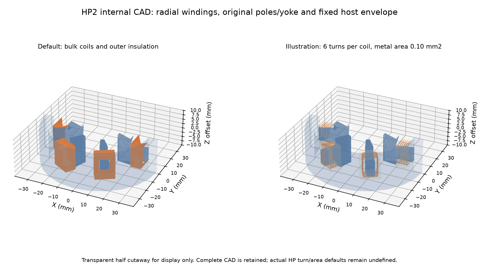
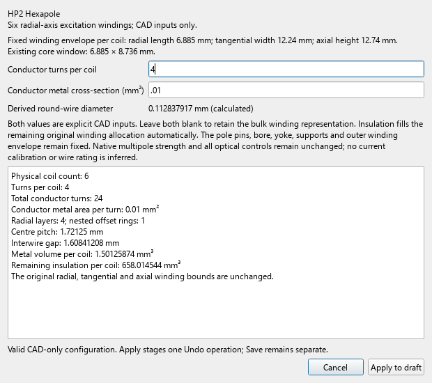

# Probe Corrector internal detail and radial winding CAD

Date: 2026-11-15.

The user requested richer internals and confirmed that actual HP1/HP2 turns,
metal area and current must remain unknown until data is supplied. This change
enriches passive defaults and enables explicit radial-turn CAD without changing
the native optical fields.

## Default and optional construction

Each HP adds six **0.15 mm** transparent outer coil-insulation jackets. The
three Probe Corrector column variants cover six HP hosts, now **31 regions**
each. The original 25 pole, copper, yoke, former and bedding records remain exact.
The dimension is an explicit engineering assumption, not a manufacturer detail.

Jackets preserve radial bounds 22.71..29.595 mm and former end interfaces. Their
maximum corner radius 30.251891 mm leaves 1.638109 mm to the yoke. Axial host
margin is 2.565/2.580 mm for HP1/HP2; the 60-degree neighbour-cell margin is
6.841625 mm. The 20 mm beam-clearance bore remains fixed. These are reconstructed
clearances, not measured manufacturing tolerances. See the
[independent receipt](validation/independent-jacket-clearances.json).

With explicit N per coil and conductor metal area, the new recipe replaces the
six bulk frames with radial-axis round-wire rounded rectangular loops and their
remaining insulation. Outer frame, core window and original iron/supports stay
fixed. Native strength remains in m^-3; no electrical calibration is inferred.



The right panel uses illustrative **6 turns per coil and 0.10 mm2**, giving 36
turn regions and 67 total regions. It is not a default or measured prescription.
Transparency and half-cutaway are display-only; complete CAD remains saved.
Actual HP turn, area and current defaults remain undefined.

Both **Configure winding...** and actual **Dimensions** edits support N/area,
read-only derived diameter, packing readbacks, atomic rejection, Undo,
persistence and clearing back to bulk. No-op input preserves values/provenance.



See the [input/API guide](../../PROBE_CORRECTOR_INTERNAL_CAD.md). ADL and the
round transfer lenses keep their existing hardware and metal-area inputs;
DPH/DP and unconfirmed physical control hosts retain their existing definitions.

## Verification

**442 currently collected targeted tests pass**, with no failures or skips.
They cover native closed meshes, sixfold symmetry, original material records,
containment, wire/insulation volume closure, no interpenetration, invalid packing,
resource guards, actual Qt input paths and old round-winding compatibility.
The [test summary](validation/test-summary.json) retains final case statuses.

All six FEG Probe Corrector column/recording combinations preserve their full
optical/source/numerical state. Compatible C3+ProbeCorrector cases use the
current Nanoprobe/Diffraction preset; Image Corrector/B-COR variants retain
manifest controls rather than claiming an uncalibrated Nanoprobe preset.
**78 frozen native-field records**, including 12 nonzero records, retain exact
coefficients, placement and sampled B arrays. The [receipt](validation/summary.json)
and full snapshots preserve the evidence; no default N/area/current is invented.

In the existing isolated CAD runtime, an actual HP1 one-coil example with
**two turns and 0.05 mm2** passes BRep validity and STEP export/import. Each wire
and remaining-insulation body is a valid single solid. Metal volume is
3.74009109733 mm3; metal plus insulation closes the original 655.8920892 mm3
frame within 1e-8 mm3. The [STEP receipt](validation/radial-step-receipt.json)
is bounded evidence, not a full-column export or manufacturing qualification.

A stale neighbour test still assumed DP22/TL22 zero gap despite the documented
2026-10-21 isolation fix. Before/current records and posed solids are exact:
the full material gap is 0.10 mm, copper gap 0.14 mm at 32/64/128 facets, with no
overlap. The test now checks those saved clearances while retaining HP2's true
zero-gap face contact. No production geometry or precision threshold changed;
see the [diagnostic](validation/dp22-existing-clearance-audit.json).

No source emission, finite-source trial, focus adjustment, current calibration,
material solve or coherent/CUDA propagation occurs. Existing execution policies
and all operating parameters remain unchanged.

## Reproduction

The [manifest](validation/manifest.json) records input/code/output hashes.
`before` preserves the original three definitions and all six states. The field
driver defaults to read-only checks, resolves curated inputs on a fresh checkout
and refuses to overwrite its original baseline with `--apply`.

```powershell
.venv/Scripts/python.exe -u docs/development/probe_corrector_details_20261115/validate_details.py
.venv/Scripts/python.exe docs/development/probe_corrector_details_20261115/render_details.py
$env:QT_QPA_PLATFORM='offscreen'
.venv/Scripts/python.exe -m pytest -q tests/test_cad_probe_winding.py tests/test_probe_winding_inputs.py tests/test_probe_hexapole_support.py
```
