# Joint-search specimen-current image history

Every image is native unified-field propagation of the same original 2000 positive-current particles.
Focus suffixes are separately executed shared-Objective changes. Initial or failed candidates remain visible.

## baseline

D95 2.502302 nm; RMS radius 1.709907 nm; core 2.330 uA.
Measured crossover offset: -0.100 nm.

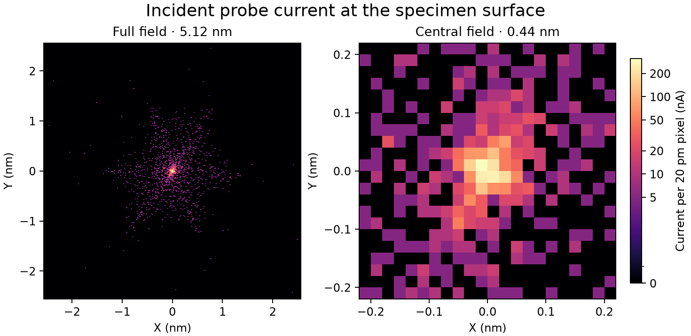

[Measurements](baseline/result.json) | [Exact input recipe](baseline/input-recipe.json)

## explore-small-01

D95 1.961330 nm; RMS radius 1.650587 nm; core 1.160 uA.
Measured crossover offset: -13.500 nm.

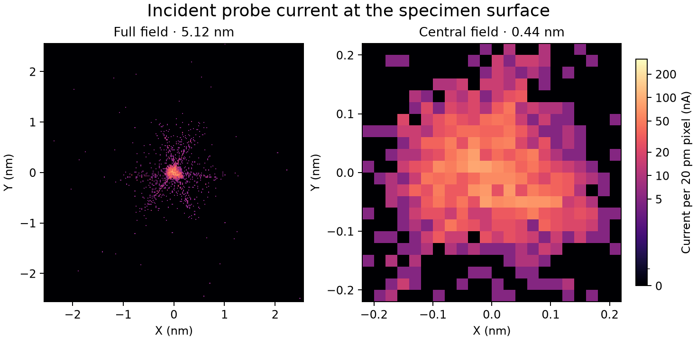

[Measurements](explore-small-01/result.json) | [Exact input recipe](explore-small-01/input-recipe.json)

## explore-small-03

D95 2.023533 nm; RMS radius 1.639032 nm; core 1.300 uA.
Measured crossover offset: -11.800 nm.

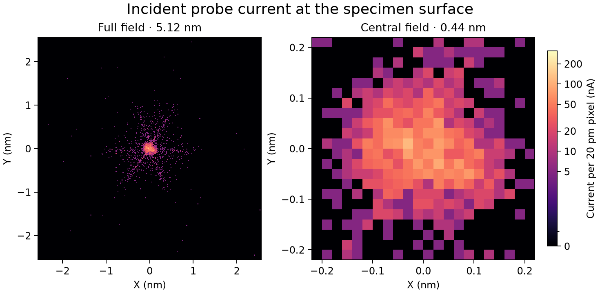

[Measurements](explore-small-03/result.json) | [Exact input recipe](explore-small-03/input-recipe.json)

## explore-small-02

D95 1.942120 nm; RMS radius 1.650716 nm; core 1.005 uA.
Measured crossover offset: -14.300 nm.

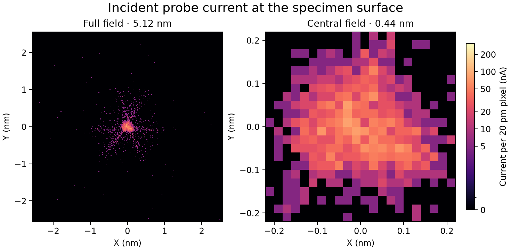

[Measurements](explore-small-02/result.json) | [Exact input recipe](explore-small-02/input-recipe.json)

## explore-wide-01

D95 2.793811 nm; RMS radius 1.860347 nm; core 0.035 uA.
Measured crossover offset: -54.600 nm.

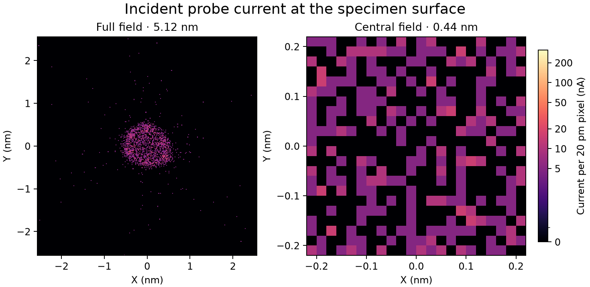

[Measurements](explore-wide-01/result.json) | [Exact input recipe](explore-wide-01/input-recipe.json)

## explore-wide-02

D95 1.637709 nm; RMS radius 1.681400 nm; core 0.565 uA.
Measured crossover offset: -23.900 nm.

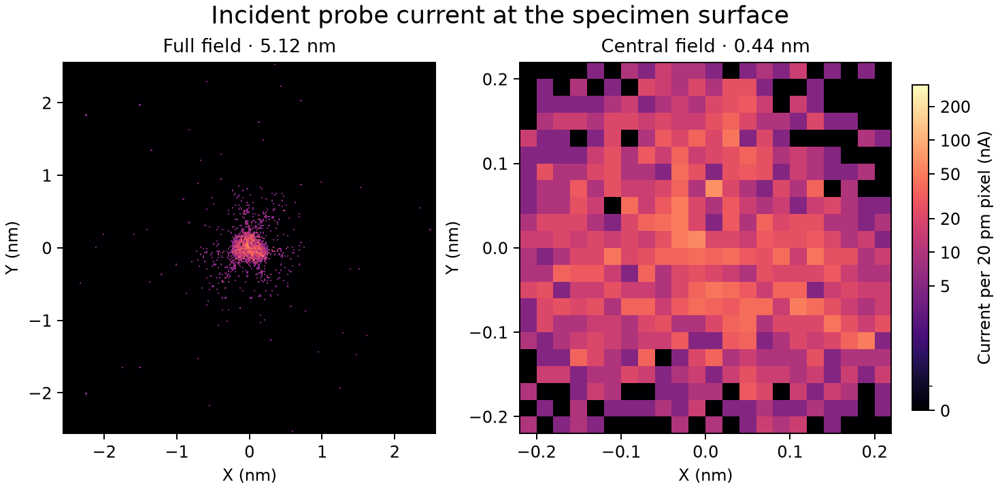

[Measurements](explore-wide-02/result.json) | [Exact input recipe](explore-wide-02/input-recipe.json)

## explore-small-01-focus1

D95 2.531202 nm; RMS radius 1.635259 nm; core 2.355 uA.
Measured crossover offset: 0.000 nm.

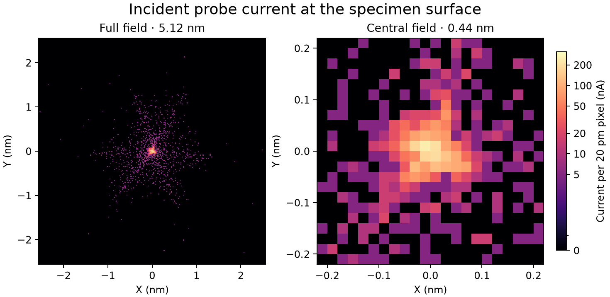

[Measurements](explore-small-01-focus1/result.json) | [Exact input recipe](explore-small-01-focus1/input-recipe.json)

## explore-small-03-focus1

D95 2.523414 nm; RMS radius 1.627239 nm; core 2.380 uA.
Measured crossover offset: 0.000 nm.

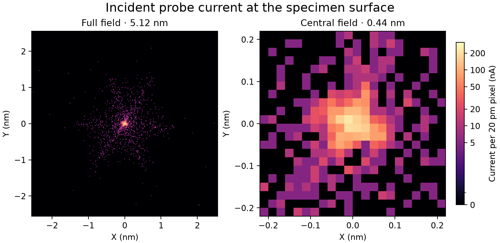

[Measurements](explore-small-03-focus1/result.json) | [Exact input recipe](explore-small-03-focus1/input-recipe.json)

## explore-small-02-focus1

D95 2.538135 nm; RMS radius 1.633580 nm; core 2.300 uA.
Measured crossover offset: 0.000 nm.

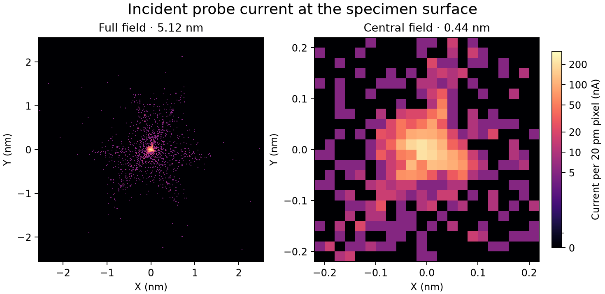

[Measurements](explore-small-02-focus1/result.json) | [Exact input recipe](explore-small-02-focus1/input-recipe.json)

## explore-wide-02-focus1

D95 2.525103 nm; RMS radius 1.633748 nm; core 2.360 uA.
Measured crossover offset: -0.100 nm.

[Measurements](explore-wide-02-focus1/result.json) | [Exact input recipe](explore-wide-02-focus1/input-recipe.json)

## explore-wide-01-focus1

D95 2.505637 nm; RMS radius 1.623685 nm; core 2.385 uA.
Measured crossover offset: -0.100 nm.

[Measurements](explore-wide-01-focus1/result.json) | [Exact input recipe](explore-wide-01-focus1/input-recipe.json)

## refine-small-02

D95 2.603314 nm; RMS radius 1.612082 nm; core 2.370 uA.
Measured crossover offset: 2.700 nm.

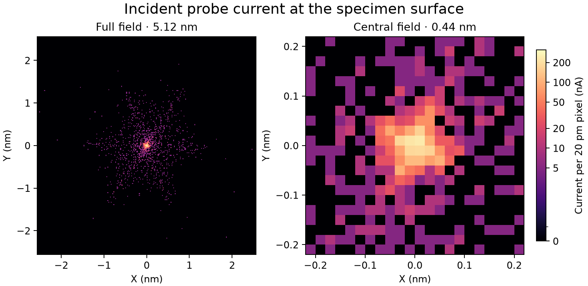

[Measurements](refine-small-02/result.json) | [Exact input recipe](refine-small-02/input-recipe.json)

## refine-wide-02

D95 2.173159 nm; RMS radius 1.601691 nm; core 1.730 uA.
Measured crossover offset: -7.000 nm.

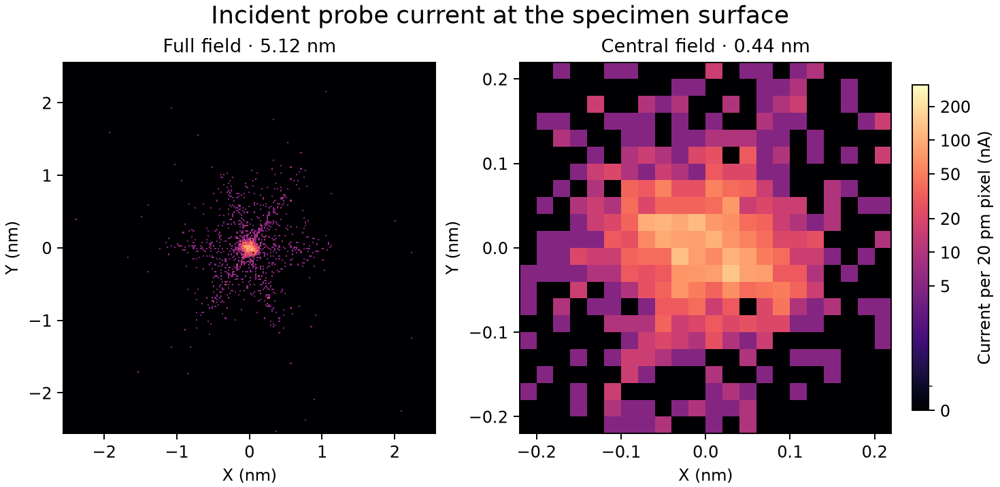

[Measurements](refine-wide-02/result.json) | [Exact input recipe](refine-wide-02/input-recipe.json)

## refine-wide-01

D95 2.203163 nm; RMS radius 1.604569 nm; core 1.795 uA.
Measured crossover offset: -6.400 nm.

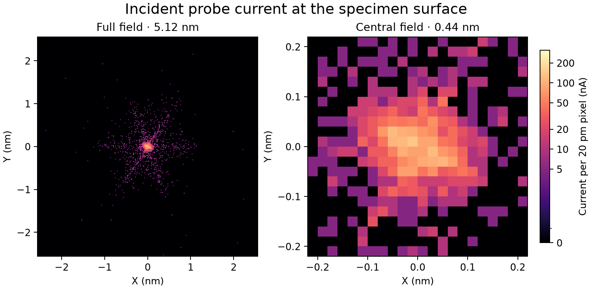

[Measurements](refine-wide-01/result.json) | [Exact input recipe](refine-wide-01/input-recipe.json)

## refine-small-01

D95 2.621982 nm; RMS radius 1.608125 nm; core 2.345 uA.
Measured crossover offset: 2.900 nm.

[Measurements](refine-small-01/result.json) | [Exact input recipe](refine-small-01/input-recipe.json)

## expand-wide-02

D95 3.456912 nm; RMS radius 1.939714 nm; core 0.025 uA.
Measured crossover offset: -67.300 nm.

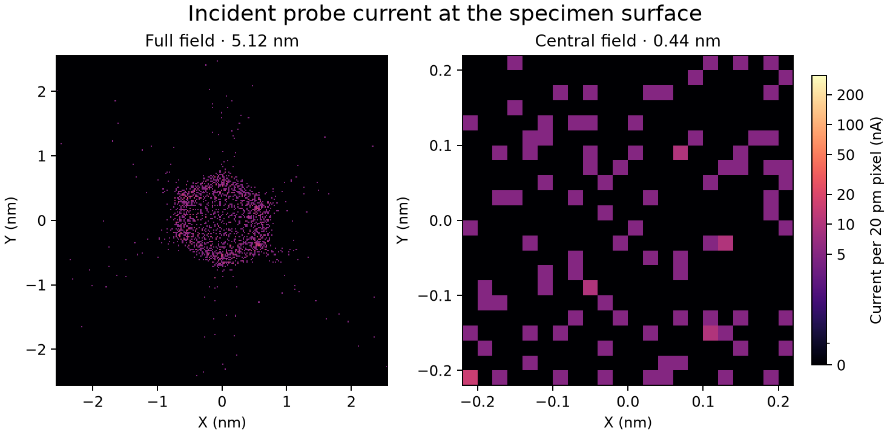

[Measurements](expand-wide-02/result.json) | [Exact input recipe](expand-wide-02/input-recipe.json)

## expand-wide-01

D95 3.857451 nm; RMS radius 2.020100 nm; core 0.020 uA.
Measured crossover offset: -75.300 nm.

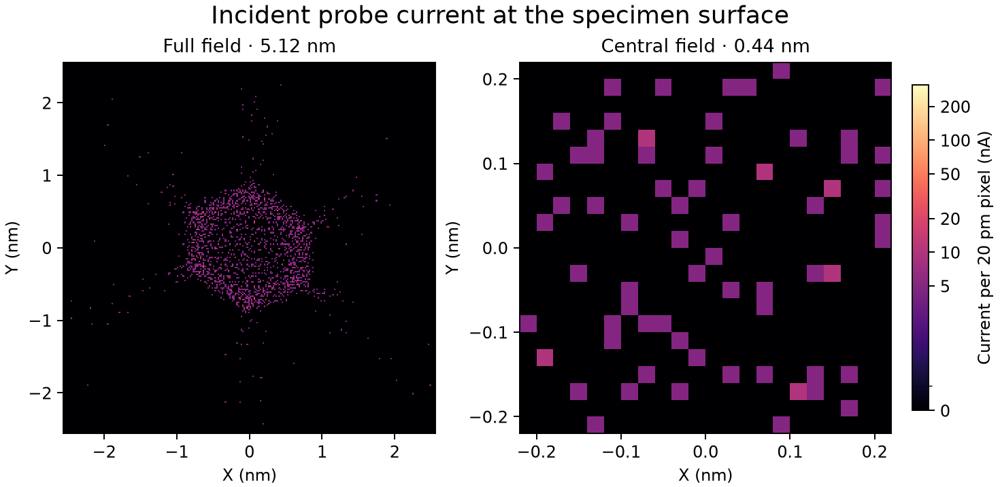

[Measurements](expand-wide-01/result.json) | [Exact input recipe](expand-wide-01/input-recipe.json)

## refine-wide-02-focus1

D95 2.488237 nm; RMS radius 1.597424 nm; core 2.320 uA.
Measured crossover offset: 0.000 nm.

[Measurements](refine-wide-02-focus1/result.json) | [Exact input recipe](refine-wide-02-focus1/input-recipe.json)

## refine-small-02-focus1

D95 2.484558 nm; RMS radius 1.611462 nm; core 2.320 uA.
Measured crossover offset: 0.000 nm.

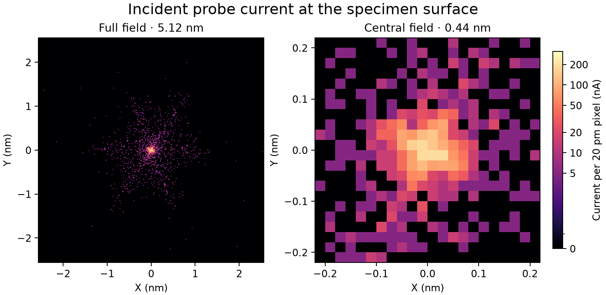

[Measurements](refine-small-02-focus1/result.json) | [Exact input recipe](refine-small-02-focus1/input-recipe.json)

## refine-small-01-focus1

D95 2.505536 nm; RMS radius 1.607406 nm; core 2.290 uA.
Measured crossover offset: 0.000 nm.

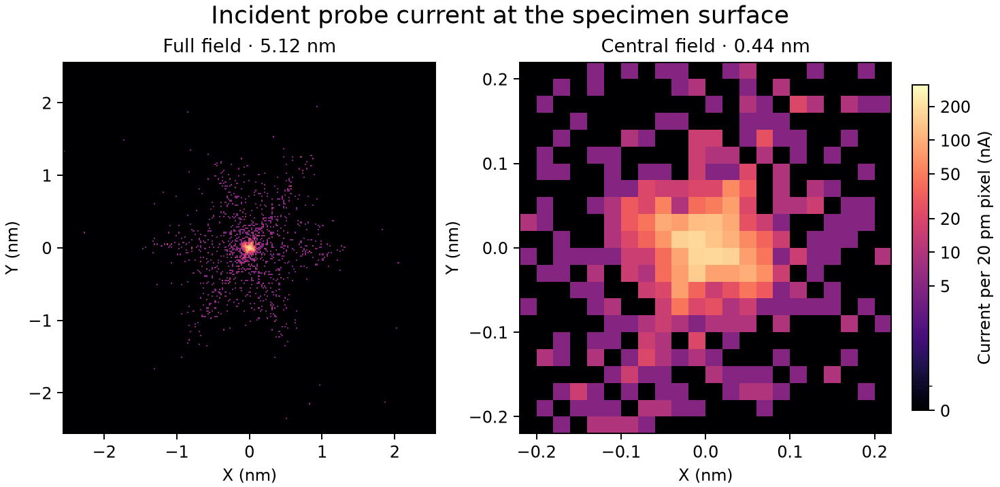

[Measurements](refine-small-01-focus1/result.json) | [Exact input recipe](refine-small-01-focus1/input-recipe.json)

## refine-wide-01-focus1

D95 2.482769 nm; RMS radius 1.601066 nm; core 2.365 uA.
Measured crossover offset: 0.000 nm.

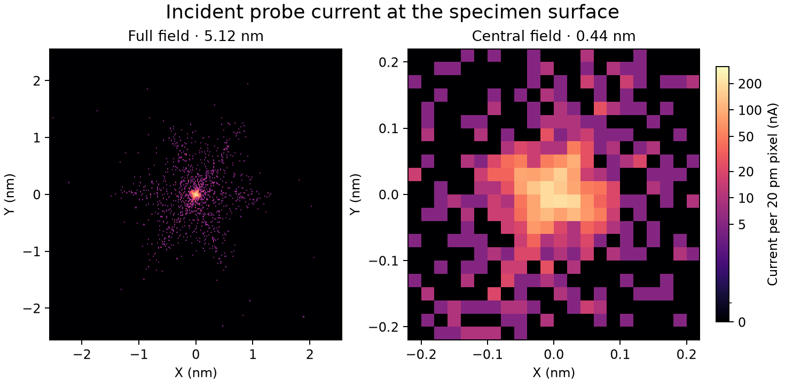

[Measurements](refine-wide-01-focus1/result.json) | [Exact input recipe](refine-wide-01-focus1/input-recipe.json)

## expand-wide-02-focus1

D95 2.440995 nm; RMS radius 1.584264 nm; core 2.355 uA.
Measured crossover offset: -0.200 nm.

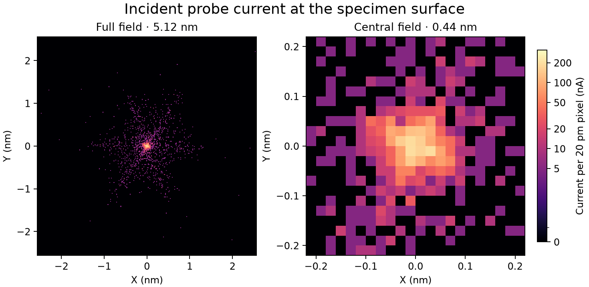

[Measurements](expand-wide-02-focus1/result.json) | [Exact input recipe](expand-wide-02-focus1/input-recipe.json)

## expand-wide-01-focus1

D95 2.455004 nm; RMS radius 1.585677 nm; core 2.355 uA.
Measured crossover offset: -0.200 nm.

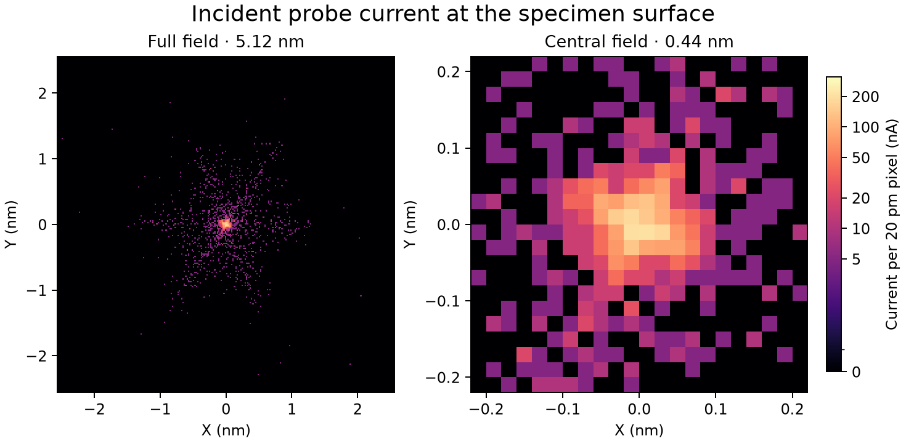

[Measurements](expand-wide-01-focus1/result.json) | [Exact input recipe](expand-wide-01-focus1/input-recipe.json)

## extend-joint-01

D95 2.321971 nm; RMS radius 1.757501 nm; core 0.090 uA.
Measured crossover offset: -46.500 nm.

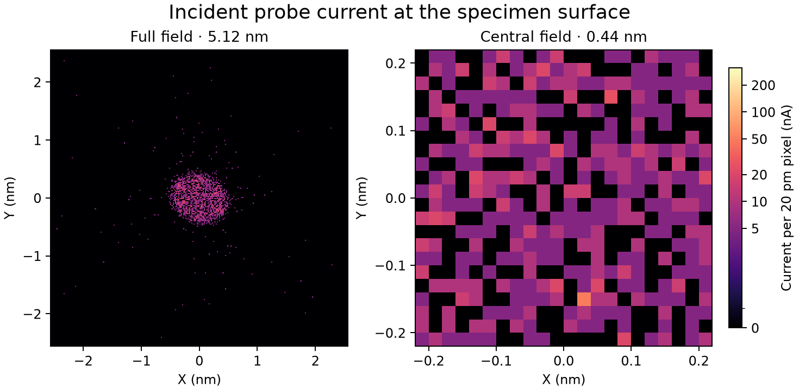

[Measurements](extend-joint-01/result.json) | [Exact input recipe](extend-joint-01/input-recipe.json)

## extend-joint-02

D95 2.366667 nm; RMS radius 1.764553 nm; core 0.095 uA.
Measured crossover offset: -46.700 nm.

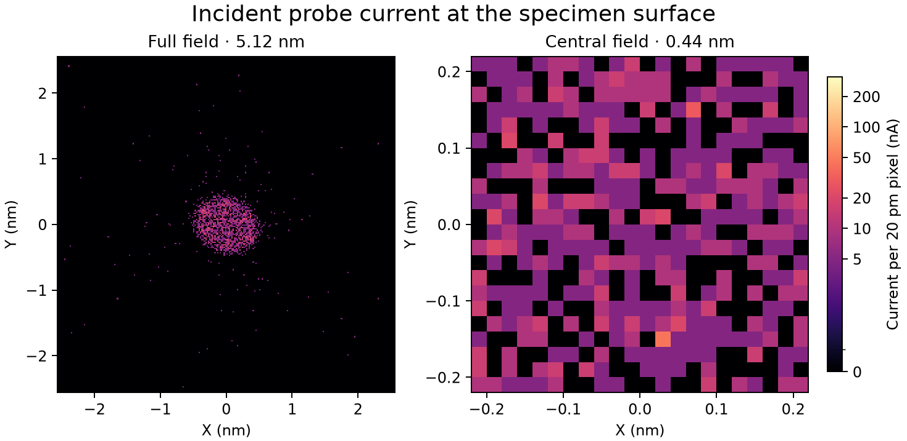

[Measurements](extend-joint-02/result.json) | [Exact input recipe](extend-joint-02/input-recipe.json)

## refine-wide-01-focus1-fine

D95 2.482752 nm; RMS radius 1.601066 nm; core 2.365 uA.
Measured crossover offset: 0.000 nm.

[Measurements](refine-wide-01-focus1-fine/result.json) | [Exact input recipe](refine-wide-01-focus1-fine/input-recipe.json)

## extend-joint-01-focus1

D95 2.446484 nm; RMS radius 1.578245 nm; core 2.405 uA.
Measured crossover offset: -0.100 nm.

[Measurements](extend-joint-01-focus1/result.json) | [Exact input recipe](extend-joint-01-focus1/input-recipe.json)

## extend-joint-02-focus1

D95 2.452112 nm; RMS radius 1.584801 nm; core 2.445 uA.
Measured crossover offset: -0.100 nm.

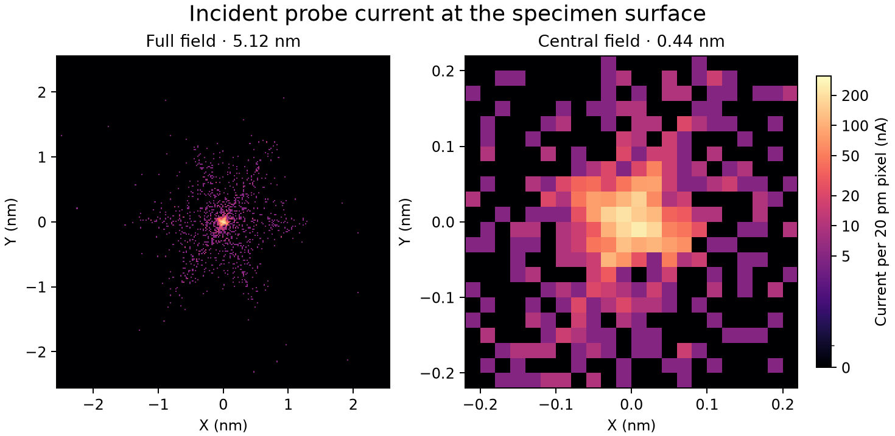

[Measurements](extend-joint-02-focus1/result.json) | [Exact input recipe](extend-joint-02-focus1/input-recipe.json)

## extend-joint-01-focus1-fine

D95 2.446470 nm; RMS radius 1.578245 nm; core 2.405 uA.
Measured crossover offset: -0.100 nm.

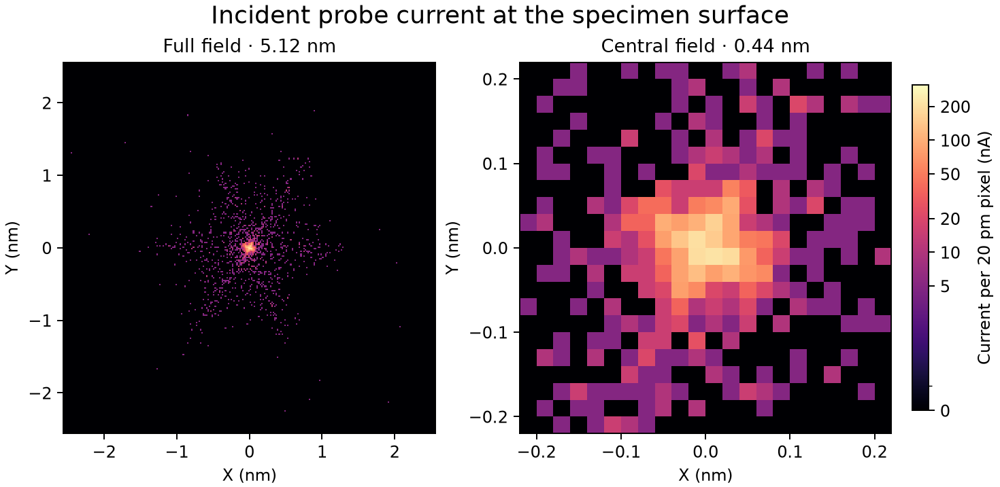

[Measurements](extend-joint-01-focus1-fine/result.json) | [Exact input recipe](extend-joint-01-focus1-fine/input-recipe.json)
