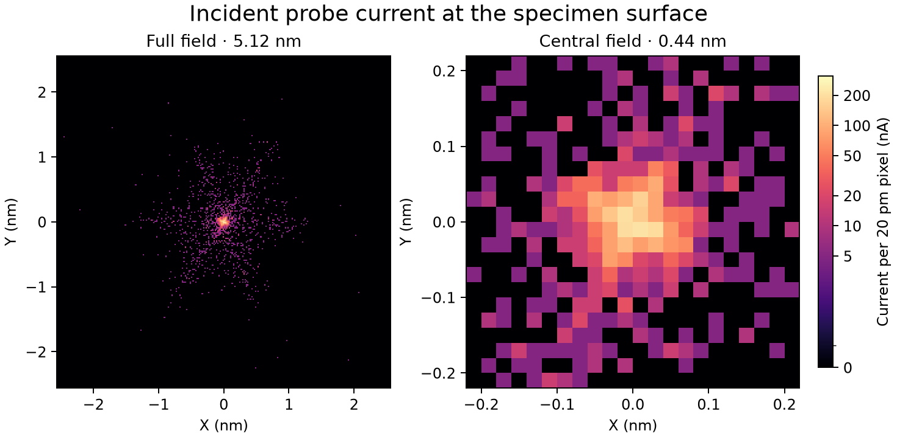

# Joint C3/C5/A5 multistart probe search

This study starts from the original accepted A5 point, not the unaccepted
coupled candidate of the preceding study. The accepted input package remains
unchanged. Every physical trial uses unified-field classical propagation of
the same 2000 original positive-current particles. The unchanged archived
zero-current full/quarter pencils only measure geometric aberrations.

## Measured outcome

The bounded multistart continuation finds several coupled settings that
improve all requested specimen-current objectives. The main comparison is
`extend-joint-01-focus1`, selected for its balance of core current, RMS and
shell-resolved tails. **The original accepted A5 point is unchanged.** This
is a fixed-cohort candidate, not proof of a global optimum or atomic resolution.

| Native specimen observable | Original accepted A5 point | Selected joint candidate |
| --- | ---: | ---: |
| Original / transmitted particles | 2000 / 2000 | 2000 / 2000 |
| Absolute transmitted current (uA) | 10.000 | 10.000 |
| Alpha95 (mrad) | 29.777010 | 29.719141 |
| Fixed axial 50 pm disk current (uA) | 2.330 | 2.405 |
| D50 (nm) | 0.614461 | 0.460637 |
| D95 (nm) | 2.502302 | 2.446484 |
| RMS radius (nm) | 1.709907 | 1.578245 |
| Inner 0.1-1 nm absolute third moment (uA) | 0.099117 | 0.022249 |
| Outer >1 nm absolute sixth moment (uA) | 0.508446 | 0.405871 |
| Absolute current outside 1 nm (uA) | 1.200 | 0.965 |
| Native 2D waist offset (nm) | -0.1 | -0.1 |
| Absolute D95/RMS minimum-plane separation (nm) | 23.6 | 27.8 |

Core current increases 3.22%, D95 decreases 2.23%, and RMS decreases 7.70%.
The inner third moment decreases 77.55% and the outer sixth moment 20.17%.
The corresponding radial-shell magnitude sums also decrease, by 47.63% and
18.07%, respectively. Thus total angular-moment cancellation between radial
shells is not the sole reason for the improvement. The angle changes by about
0.19%, within the declared approximately 30 mrad band, and no original current
is removed. Core disk current is not the maximum image-pixel current.



[Measured outcome and qualification](outcome.json) |
[Baseline and selected current comparison](baseline-vs-selected.png) |
[All executed images](IMAGE_HISTORY.md) |
[Complete trial ledger](trial-ledger.csv) |
[Candidate inputs](extend-joint-01-focus1/joint-candidate-inputs.temwp) |
[Step comparison](integration-comparison.json) |
[Normal topology](extend-joint-01-focus1/topology.json)

## Coupling and remaining limitations

The geometric C3 changes from -0.195387 to -0.202929 mm, and C5 from 211.444
to 208.381 mm. A2 and D4 magnitudes decrease substantially. However, **A5
increases from 33.468393 to 34.459617 mm**, about 2.96%. This is a genuine
improvement of the propagated current distribution through coupled changes;
it is not an isolated A5 correction or a cancellation of intrinsic A5.
All signed components remain in each trial's full/quarter-pupil fits.

The sixfold structure is still visible and D95 remains at the 2.4 nm scale.
The D95/RMS axial separation increases. In the selected constant-control
through-focus observation, the D95 minimum is about 1.549 nm at +27.7 nm,
but the axial core current there is only about 0.475 uA. Selecting that plane
on diameter alone would severely compromise the requested central current.
The native crossover and its specimen placement are recorded separately;
the study does not claim simultaneous global extrema of every observable.

The candidate with the lowest measured D95 among the final coarse trials is
`expand-wide-02-focus1` (2.440995 nm, core 2.355 uA). The candidate with the
largest core current among the fully focused, all-goal coarse candidates is
`extend-joint-02-focus1` (2.445 uA, D95 2.452112 nm). Neither dominates every
metric of the selected setting. Their images and inputs are retained in the
[measured candidate frontier](measured-pareto-candidates.json). These alternate
coarse candidates are not automatically given the selected candidate's finer
step and topology qualification.

The last extension increases core current but does not improve upon the
previous best D95. This batch ends with those measured tradeoffs rather than
claiming a universal optimum. The search domain and tested boundaries are
explicit, and some selected coordinates lie at the exploratory bounds.
Larger domains or additional qualified physical freedoms remain untested.

## Execution sequence

- A fresh baseline reproduces the original accepted source and surface data.
- Two initial spans, each with nine numerical starts, propose five distinct
  optical settings. All are physically propagated and separately refocused.
  Their substantial threefold growth rejects them as final candidates.
- New measured secants update responses around two executed regions. Eighteen
  numerical starts propose four refinement settings. A further nine starts
  propose two wider settings. Several refocused settings pass all probe goals.
- A final update around `expand-wide-02-focus1` uses nine more starts and two
  executed settings. This provides the selected core/tail compromise and a
  higher-core alternative. A failed numerical start is retained as a failure
  and is never executed as a feasible proposal.
- In total, 54 numerical optimization starts propose 13 distinct optical
  candidates. Each has a separate physical focus placement, giving 26
  candidate specimen images, plus the baseline and two finer-step repeats.
  Every image uses the same 2000 originals and fixed display scale.

Thirteen targeted pure-array/mocked tests pass. Only existing Pydantic
deprecation warnings occur. [Software checks](software-checks.json),
[source and archive verification](archive-verification.json), and the selected
portable-input restore check accompany the measured outcome. No solver source,
instrument preset, source distribution, hardware driver or coherent pipeline
was changed.

The selected candidate passes all measured probe goals at both 0.05 and
0.025 mm integration steps, the declared step-sensitivity budgets, and the
Normal crossover topology checks. All 29 input recipes, original source IDs,
absolute weights and image checksums verify. Its portable input package
restores the exact measured input digest. These checks qualify this fixed
source simulation comparison, not an unrestricted global or hardware optimum.

## Declared scope before measurements

- Freeze source positions, directions, IDs, weights, energies and clocks,
  physical apertures, field profiles, geometry, C2/C3 lens settings and all
  unqualified auxiliary drives. C3 below means the aberration coefficient,
  not the upstream C3 condenser lens.
- Use eight installed scalar excitations: fixed-angle HP1/HP2 strength,
  TL22/TL21/TL12, ADL, Mini Condenser, and shared Objective percentage. The
  latter drives both lobes; winding-current independence is still unverified.
- Jointly vary C3, C5, D4 and A5. The old independent-A5 5 pm collateral budget
  and 1% A5 target are not acceptance requirements for this new authorized
  coupled search. Record all coefficients, including A1/A2, after each run.
- Preserve all 2000 transmitted IDs and 10 uA absolute current; require
  29.7-30.3 mrad alpha95. No clipping, source changes, coordinate recentering
  or survivor renormalization may generate an improvement.
- Improve specimen current inside the fixed 50 pm radius, reduce native D95
  and RMS radius, and reduce both threefold and sixfold tails. Check the
  0.1-1 nm third harmonic, its radial-shell magnitude sum, the >1 nm sixth
  harmonic and its shell sum, and >1 nm absolute current. Record the full
  transmitted beam, not just the displayed square.
- Find the actual Mini/Objective two-dimensional crossover for every optical
  candidate, record its D95/RMS/core current, and execute shared-Objective
  compensation when needed. Use a 0.25 nm representative placement allowance
  with the measured bracket reported. D95 and RMS minimum-plane separation
  is a diagnostic and secondary objective, not an equality requirement.
  The user's latest actual-crossover workflow is retained; this does not claim
  that the separate D95-minimum or core-maximum plane coincides exactly.
- Preserve the Normal upstream and corrector crossover topology. Qualify a
  selected result with a halved integration step, smaller-pupil coefficient
  fit, exact source/archive verification and a restorable input package.
- Save every native specimen image, raw current kernel, source surface,
  recipe, coefficient pencil and crossover report. Surrogate predictions
  are never rendered or accepted as physical images.

## Search method

The initial source response is the previously measured 32 signed physical
perturbations, each using the same original particles. Local particle-response
surrogates propose inputs using RMS, D95, disk current and shell-resolved
angular moments. Smooth gates are used only to propose settings. Exact
unsmoothed propagated quantities decide acceptance.

Each design uses a zero and eight reproducible scrambled Sobol starts, with
three objective emphases. Different physical search spans explore matching
regions beyond a single A5 direction. Baseline diagnostic-step bounds are
HP1/HP2 +/-100, TL22/TL21/TL12 +/-150, ADL +/-100, and Objective/Mini +/-500;
the wide design multiplies these by three. The step units are those of the
[qualified scalar audit](../probe_a5_physical_20261101/driver-audit.json).
Physical model limits also apply. A2's proposed total edge magnitude is
bounded at 80 pm and A1 change at 30 pm for initial exploration. These are
declared proposal bounds, not claims of complete aberration cancellation.

Each proposed optical setting undergoes full propagation and free-waist
measurement. If needed, an explicitly recorded Objective increment is
executed with the same original source, up to three placements. An unresolved
crossover or exhausted placement loop does not pass. Independent settings
may execute concurrently, with bounded worker/thread counts.

This is a bounded multistart search. It cannot certify a mathematical global
optimum or hardware feasibility, and fixed source size does not establish
particle-count convergence. No coherent calculation is performed.

## Reproduction

From the repository root, using the project environment:

```powershell
.venv/Scripts/python.exe scripts/optimize_joint_probe.py run --name baseline
.venv/Scripts/python.exe scripts/optimize_joint_probe.py design --name explore-small --scale 1 --count 3
.venv/Scripts/python.exe scripts/optimize_joint_probe.py design --name explore-wide --scale 3 --count 3 --seed 219
.venv/Scripts/python.exe scripts/optimize_joint_probe.py batch --name explore-small
.venv/Scripts/python.exe scripts/optimize_joint_probe.py batch --name explore-wide
.venv/Scripts/python.exe scripts/optimize_joint_probe.py summary
```

Physical trials require new names and do not overwrite executed inputs.

The selected candidate's halved-step comparison uses 0.001 nm budgets for
D95/RMS changes, 0.001 mrad for alpha95, 0.005 uA (one original particle)
for the core and angular-current changes, and 0.1 pm for the maximum fitted
coefficient-component change at 30 mrad. Transmission and membership must be
unchanged. Both integration settings must independently pass the measured
probe goals. These are numerical step-sensitivity budgets, not relaxed probe
improvement targets or a source-sampling convergence claim.

## Adaptive response updates

The first five executed settings show why an initial local Jacobian cannot be
treated as globally accurate. Both A2 and native focus depart from their
predictions. Every one is explicitly refocused and retained, including failed
probe-quality comparisons. The next proposals use newly measured particle
and coefficient secants around two different executed settings. A truncated
least-squares correction updates sampled directions; other directions retain
the original measured Jacobian. The 1% singular-value truncation is a numerical
regularization choice, not a physical-rank qualification. Leave-one-out
position errors are archived with each refreshed response.

Local refinement uses 0.3 and 0.5 times the initial diagnostic-step bounds.
An additional extension uses three times those bounds around the wide-region
setting. Each new setting is still verified by independent full propagation,
actual crossover measurement and explicit physical focus placement. Failure
of a prediction does not become accepted image data.

## Full-cohort halo diagnostic

At the accepted baseline, 26 of the 2000 particles lie farther than 3 nm from
the beam centroid. They contribute about 87.8% of the mean-square radius.
The most distant original particle is approximately 41 nm from the centroid;
the source's maximum mechanical-slope magnitude about its chief is about
49 mrad. The reference coefficient pencil covers about 30 mrad. The measured
coefficients therefore do not independently validate extrapolation to every
far-angle source member. All probe optimization and acceptance metrics use
the full propagated original cohort, including those particles. None are
removed or reweighted. See [the diagnostic](baseline-halo-diagnostic.json).
