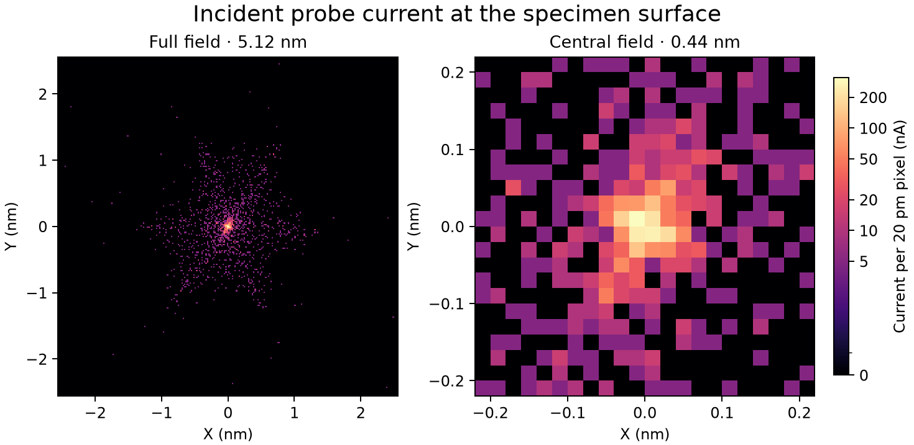

# Accepted A5 baseline reproduction and drive audit

The first two stages of the probe-corrector plan were executed at the accepted
A5 working point. Stage 1 replayed the original 2,000-particle gun outlet
through the complete downstream unified field with unchanged optics. Stage 2
sampled detached field perturbations to audit parameter independence and
physical drive evidence. The accepted operating point was not retuned.

## Step 1 Reproduction

| Native specimen observable | Reproduced value |
| --- | ---: |
| Specimen entrance and target | 1599.1999975 mm |
| Emitted / surviving / effective particles | 2,000 / 2,000 / 2,000 |
| Total transmitted current | 10.000 µA |
| Current inside the commanded 50 pm radius | 2.330 µA |
| D95 diameter | 2.502302 nm |
| RMS radius | 1.709907 nm |
| Current-weighted alpha95 | 29.777010 mrad |
| 2D waist representative relative to target | −0.1 nm |

Every original ID and absolute weight was preserved. At the target, positions,
slopes, kinetic energies, clocks and membership were exactly equal to the
accepted run. Absolute-current image pixels also matched exactly. Upstream
emission and gun transport use the previously executed, identity-checked
packet. The replay recalculated the column from its gun outlet.
[Reproduction receipt](step01/reproduction.json)



The 5.12 nm full field and 0.44 nm centre use 20 pm bins and the preceding
image's absolute-current color scale. Full surviving positions, individual
currents and out-of-display current remain in the [raw kernel](step01/current.npz).
The [image history](image-history.json) records the stage, input identity and
checksum. The [frozen reference](reference.json) identifies E at 1070.0 mm,
X at 1379.0 mm, the distinct core/HP/AC planes and specimen faces.
Its virtual pupil uses laboratory outgoing mechanical slopes, the accepted
chief and a frozen linear intercept map for the declared axial reference
family. An arbitrary four-dimensional transfer or canonical wavefront
reference has not been established by this study.

## Step 2 Drive inventory

Positive/negative perturbations on detached copies changed only the
corresponding field providers. Actual apertures and interception boundaries
stayed unchanged; source/owner uniqueness passed. The 29 sampled magnetic-field
columns have normalized rank 29 at relative threshold 1e-8. This is
effective field-space rank at the stated sampling. Electrical supply rank
and independently controllable aberrations require separate evidence.
[Audit](step02/audit.json) · [Drive table](step02/drive-inventory.csv)
· [Field responses](step02/field-response.npz)

| Group | Effective model coordinates | Physical evidence and unresolved information |
| --- | --- | --- |
| HP1 / HP2 | Two harmonics each through strength and orientation. | Main pole-body geometry exists. Independent normal/skew circuits and unit-current gains are unverified. An ideal single family of six equally spaced poles supplies one m=3 direction. |
| HPC / HPol | Two harmonics each through strength and orientation. | Both auxiliary host records remain unverified. Field location does not establish two independent electrical quadratures. |
| QPH1 / QPH2 / QPC / QPol | One scalar quadrupole each. | Each axis is fixed. These records have no runtime skew drive. Auxiliary host status is unverified. |
| DPH1 / DPH2 / DP11 / DP21 / DP22 | Two X/Y angle commands each. | Five modelled coil inserts supply five dipole providers. DPH inserts reference the main HP regions. Engineering winding geometry does not establish measured circuits, resolution or ampere calibration. |
| Condenser stigmator | Two percentage axes. | Two field axes exist. Winding, supply and resolution data remain unavailable. |
| ADL / TL22 / TL21 / TL12 | One percentage excitation each. | Finite lens fields are present; unit-current calibration remains unspecified. |
| Upper Objective amplitude | One upper-only effective scale in this study. | Full snapshots preserve this parameter. The ordinary runtime Objective percentage scales both lobes. A separate upper supply is unverified. |
| DP12 | Virtual optical reference. | AC X/Y commands act through the existing two scan-coil fields. DP12 contributes no extra field source or supply. |
| TL11 | No separately installed probe TL11. | The Mini Condenser exists; optical equivalence to TL11 requires the later conjugacy study. |

Physical supply count and the winding-to-field matrix remain unidentifiable
from available records. These are explicit audit findings, not hardware or
OEM qualification.

## Repeat and preserve subsequent steps

Run from the repository root in the project environment.

```powershell
& .venv/Scripts/python.exe scripts/reproduce_probe_baseline.py --output outputs/probe-baseline-replay-new
& .venv/Scripts/python.exe scripts/audit_probe_drives.py --output outputs/probe-drive-audit-new
```

Both require new output directories. The input bundle contains original and
portable working points, original source IDs/weights/gun handoff, accepted
target data, the reference pencil and checksums. The package identities
differ; their field, geometry and gun dependency signatures were verified
identical before replay.

Every solver Python file is verified. Git-only CRLF/LF changes are separately
identified using normalized per-file hashes and recorded in a new replay
identity. Other source changes or incompatible runtime dependencies reject
the contract.

The clean-checkout check additionally verifies the complete provider contents
and geometry. Raw implementation hashes inside the electrostatic provider and
its derived request receipts can change with Git line endings. Those specific
receipts are separated from an otherwise complete field-content digest.
Potential arrays, numerical settings, domains, geometry, magnetic providers,
source graph and archived external inputs remain checked. The new execution
records both the original and current gun dependency signatures.

A second complete replay from a clean Git checkout reproduced every target
position, slope, energy and clock exactly. Its absolute-current pixels and
rendered PNG match the first replay and accepted image exactly. This fresh
execution recorded 437 solver files whose line endings differed from the
original worktree. [Clean-checkout image](step01-clean-checkout/incident-probe.png)
· [Clean-checkout receipt](step01-clean-checkout/reproduction.json)

The final scoped regression run passed 152 tests. The earlier broader archive
suite included its pre-existing nine-particle physical fixture. That test is
recorded separately and supplies no optical acceptance evidence for these
stages. [Verification record](verification.json)

Save every subsequent generated PNG, raw absolute-current NPZ, source/input
identity, target/crossover metrics and history entry in a new stage directory
before showing the image. Commit curated evidence to Git. Bulk trajectories
and scratch trials remain local.
