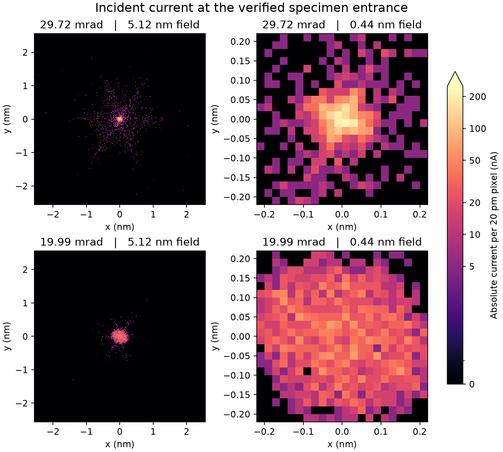

# 20 mrad zoom with the accepted-source joint corrector

The C2/C3 zoom moves the upstream source image by 17.260 mm while the
first source image after ADL moves by 0.275 mm. Switching the two main
hexapoles off at each focused setting measures their signed contribution
to geometric spherical aberration. Both comparisons give about −6.640 mm.
The 30 mrad reference retains a brighter central core on the specimen.
The focused [20 mrad working point](zoom-focused/zoom-inputs.temwp) restores
the verified optical inputs. Halving the integration step from 0.05 to
0.025 mm reproduced the measured waist offset and 50 pm disk current.
D95 changed by 0.0000103 nm. The [verification record](verification.json)
also checks source identities and current weights for all five trials.

| Quantity | Reference | 20 mrad test |
| --- | ---: | ---: |
| C2 / C3 lens excitation (%) | 16.424648 / 9.207985 | 14.482641 / 11.969657 |
| Shared Objective excitation (%) | 29.32587727 | 29.32591805 |
| Measured alpha95 (mrad) | 29.71914 | 19.98524 |
| Emitted / transmitted / effective particles | 2000 / 2000 / 2000 | 2000 / 2000 / 2000 |
| Specimen current (µA) | 10.000 | 10.000 |
| Measured 2-D waist offset from entrance (nm, positive downstream) | −0.1 | +0.1 |
| Current in a fixed axial disk of 50 pm radius (µA) | 2.405 | 0.720 |
| D95 at the entrance (nm) | 2.44648 | 0.69208 |
| RMS radius at the entrance (nm) | 1.57825 | 0.20267 |
| C3 with main hexapoles off (mm) | +6.436846 | +6.436931 |
| C3 with main hexapoles on (mm) | −0.202930 | −0.202829 |
| C3 on minus off (mm) | −6.639777 | −6.639760 |

## Focus and conjugates

The [original joint run](../probe_joint_20261101/extend-joint-01-focus-placement.json)
changed Objective excitation after observing a waist 46.5 nm upstream.
That correction placed its measured waist 0.1 nm upstream of the
1599.1999975 mm entrance. At the new C2/C3 settings the [first
measurement](zoom-first/result.json) puts the waist 23.4 nm downstream.
Adding 0.00004078 percentage point of Objective excitation brings it to
+0.1 nm. In the installed field model this drive scales both pole fields
together. The Mini Condenser stays at 26.677838%. Each complete Mini
Condenser through Objective search found one bounded two-dimensional waist.
Both surface planes are inside their respective measured waist brackets.
The local final observation step is 0.1 nm and the placement tolerance is
0.25 nm. D95 and the central-current maximum are measured independently.

| Observed crossover location (mm) | Reference | Focused 20 mrad | Shift (mm) |
| --- | ---: | ---: | ---: |
| C2 to C3 | 696.020 | 713.280 | +17.260 |
| C3 to ADL | none | none | — |
| ADL to TL22 | none | none | — |
| TL22 to TL21, first downstream source image | 1211.449 | 1211.723 | +0.275 |
| TL21 to TL12 | 1299.154 | 1300.722 | +1.568 |
| Between AC coils | 1408.745 | 1408.490 | −0.255 |

The full C2-to-lower-AC interval was observed at spacing at most 0.5 mm.
Physical replay around each bounded waist refined the axial spacing to
0.005 mm. The first downstream shift is about 1.6% of the upstream shift.
It is resolved and finite. The [reference](baseline-chain.json) and
[zoom](zoom-focused-chain.json) include both-direction brackets and native
diameter, RMS radius and current at each crossover.

## Aberration and intensity

The same 2000 original positive-current particles, energies, weights,
mechanical apertures and finite fields are used throughout. A first-order
proposal uses the on-axis fields of the three condensers. All reported
positions and currents use the executed nonlinear unified particle fields.
Each main-hexapole on/off pair shares its Objective setting and charged
particle source. Hash comparisons identify HP1 and HP2 as the sole changed
field providers within each pair. Geometric fits use separate zero-current
diagnostic pencils, a common 20 mrad mechanical-slope cut, disjoint training
and holdout rays, and degree nine. Full and quarter pencils give the same
negative HP difference to within 0.000002 mm in each comparison. Differences
between the two measured angles quantify this pair of settings.

Core angular moments use the original unbinned positions around the
commanded axis. Inside 0.1 nm, the normalized fourth moment is 0.236 at
29.72 mrad and 0.040 at 19.99 mrad. This is a Fourier amplitude divided by
the current in the disk, distinct from the fraction of beam current in any
one lobe. The fourfold geometric coefficient A3 gives a characteristic
edge displacement below 0.00003 pm at both settings, smaller than the
common-pupil holdout RMS. A1 is measurable at 3.3945 nm in both settings,
corresponding to about 101 and 68 pm at their respective pupil edges.
The intensity alone does not identify a unique cause of the fourfold shape.

Third- and fifth-order spherical transverse terms scale with the cube and
fifth power of the angle, respectively. Their signed edge terms at the two
alpha95 values are approximately −5.33 / +4.83 nm and −1.62 / +0.66 nm.
These are individual geometric expansion terms. The finite-source image
contains their sum with defocus and the other aberrations. The lower angle
therefore changes core current and halo even with closely matched hexapole
correction. The [CEOS aberration expansion](https://www.ceos-gmbh.de/en/produkte/stemkorrektoren/dcor-ascor/Mueller2006a.pdf)
gives the corresponding angular orders in the eikonal.

## Imaging consequence

![Si [110] after the 20 mrad focus check](zoom-focused/si110-scan/bf-df.png)

At 20 mrad the 2-D waist has a compact RMS envelope with a broad, weak
core. The separate native core maximum is 4.170 µA at −28.1 nm relative
to the specimen, where D95 is 1.789 nm. The native D95 minimum is 0.600
nm at +3.5 nm, where core current is 0.595 µA. Neither observation changes
the surface used for the scan. The 20 mrad image fails the same two-native-
peak check on the central Si pair that the [reference scan](../si110_joint_probe_scan_20261101/README.md)
passed. Both scans use the same 5 nm Si [110] slab, 20 pm raster, ideal
BF (0–15 mrad) and annular DF (50–150 mrad) exit windows. They use a
classical elastic screen without coherent propagation. The reference scan
was reproduced with identical raw arrays after adding the focus check.

[Numerical comparison](comparison.json) · [20 mrad raw scan](zoom-focused/si110-scan/scan.npz) ·
[BF TIFF](zoom-focused/si110-scan/bf.tiff) · [DF TIFF](zoom-focused/si110-scan/df.tiff) ·
[Native scan-line data](zoom-focused/si110-scan/native-profile.csv)

Probe images are archived for the [first zoom](zoom-first/incident-probe.png),
[refocused zoom](zoom-focused/incident-probe.png), [reference HP-off](baseline-hp-zero/incident-probe.png),
[zoom HP-off](zoom-hp-zero/incident-probe.png), and the
[smaller integration step](zoom-focused-fine/incident-probe.png). HP-off
images document fixed-plane controls and do not qualify for specimen scanning.

Reproduce the runs from the repository root using
`scripts/check_probe_zoom20.py propose`, then its `trial` and `topology`
actions. The reference uses `--factor 0`. The initial zoom uses the default
factor and the focused zoom adds `--objective 2.039` in units of 0.00002
percentage point. Use `--focus` to observe the final waist and
`--mute-hexapoles` for the matched HP-off control. Each optical trial
requires a fresh output name. The imaging admission and comparison use
`scripts/report_probe_zoom20.py admit` and `scripts/report_probe_zoom20.py compare`.
The scanner accepts the focused archive with
`scripts/scan_joint_probe_si110.py --probe docs/development/probe_zoom20/zoom-focused`.
