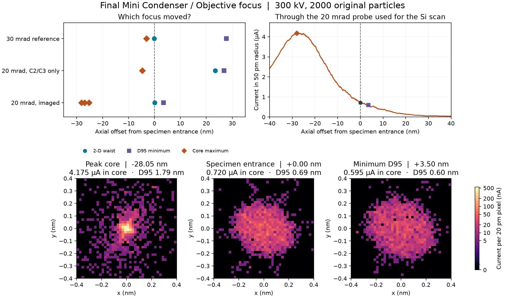

# Where the final probe focuses after a C2/C3 zoom

In the settings used for the earlier Si [110] image, changing C2/C3 alone
moved the final Mini Condenser / Objective 2-D envelope waist **23.5 nm
downstream**. The subsequent shared Objective adjustment returned the
envelope to the physical sample entrance but moved the brightest 50 pm
core upstream. The 20 mrad scan therefore compares different degrees of
core concentration in addition to changing the incident semiangle.



## Matched measurements for the Si images

The specimen upper face is at z = 1599.1999975 mm and is assigned zero
in the table. Positive offsets are downstream along the beam. Every
condition uses the original 2000 positive-current particles and 10 µA.
The Mini Condenser is fixed at 26.677838%. C2/C3 excitation changes
from 16.424648% / 9.207985% to 14.482641% / 11.969657%. The original
Objective is 29.32587727%. The envelope refocus adds 0.00004078 percentage
point to its shared drive. Both objective pole fields scale together.

| Setting | Envelope waist (nm) | Minimum D95 plane (nm) | 50 pm disk current maximum plane(s) (nm) | Surface disk current (µA) |
| --- | ---: | ---: | --- | ---: |
| 29.719 mrad, original Si scan | −0.1 | +27.7 | −3.1 | 2.405 |
| 19.985 mrad, only C2/C3 changed | +23.4 | +26.8 | −4.7 | 3.980 |
| 19.985 mrad, Objective refocused for the Si scan | +0.1 | +3.5 | −28.1, −26.9, −25.2 | 0.720 |

These are the executed original through-focus observations. The three
positions in the last row tie at 4.170 µA on that grid. The whole last
lens block was searched from 1522.5 to 1602.55 mm. Each run resolves one
two-dimensional converging-to-diverging region. Its representative plane
closely follows the minimum current-weighted RMS radius. The shift
of that representative from +23.4 to +0.1 nm is **−23.3 nm**. At fixed
Objective the D95 and brightest-core planes move only −0.9 and −1.6 nm,
respectively, between the two original condenser settings.

## Independent sampling of the imaged beam

The scan's input digest, incident surface positions, absolute current array
and original gun identity were checked against the archived optical data.
The [imaged probe](../probe_zoom20/zoom-focused/si110-scan/metrics.json)
predates the later A1 trim. An independent field replay sampled −40 to
+40 nm about the actual specimen at uniform 0.05 nm spacing. It reproduced
all source IDs and weights and the entrance positions to 1.1e-7 nm.

| Plane on the uniform grid | Offset (nm) | 50 pm core (µA) | D95 (nm) |
| --- | ---: | ---: | ---: |
| Highest sampled core current | −28.05 | 4.175 | 1.787 |
| Actual scanned entrance | 0 | 0.720 | 0.692 |
| Minimum D95 | +3.50 | 0.595 | 0.600 |

The sampled RMS minimum is +0.05 nm. The sampled peak exceeds the original
coarser-grid maximum by one particle's 5 nA weight. The practical core
displacement is approximately 28 nm. The surface retains only 17.2% of
the brightest-plane core current. Concentrating that core increases the
full D95 because it weights the tail of the same source population. These
are separate observables. A classical particle diameter or a brightest disk
does not measure microscope point resolution.

[Dense focus data](imaged-20-dense/axial-profile.npz) · [Measured current-plane particles](imaged-20-dense/planes.npz) ·
[Full comparison and matched field identities](comparison.json)

## Two direct control measurements

1. Starting from the [subsequent A1-corrected 30 mrad probe](../probe_a1_trim/a1-corrected/result.json),
   changing only the C2 and C3 field providers again moves the final
   2-D waist from −0.1 to +23.4 nm. At the new 19.9851 mrad entrance,
   current in 50 pm is 4.200 µA and D95 is 1.594 nm. The disk peaks at
   4.415 µA at −2.9, −2.8 and −2.7 nm on the recorded grid. Its large
   surface core coexists with the downstream whole-envelope waist.
   [New measured probe](current-a1-zoom-only/incident-probe.png) · [Full run](current-a1-zoom-only/result.json)
2. Returning separately to the historical 20 mrad condenser settings, an
   Objective-only adjustment in the opposite direction targets the surface
   **core current**. Its excitation is 29.32586908% compared with
   29.32591805% for the old Si scan. The physical surface is now one of
   the sampled disk maxima, with 4.170 µA, D95 = 1.786 nm and RMS radius
   = 0.373 nm. The envelope waist is +28.1 nm and minimum D95 is at
   +31.5 nm. All 2000 particles reach the specimen, with 19.9852 mrad
   alpha95 and 10.00 µA. This is a separate diagnostic operating point.
   [Surface image](historic-core-control/incident-probe.png) · [Full run](historic-core-control/result.json)

The old Si scan therefore establishes performance at the envelope focus it
actually used. The audit measures the focus-driven change in illumination.
It does not assign the entire BF/DF contrast difference to that change or
determine an experimental resolution from the finite-particle images.

Experimental comparison points include a 300 kV STEM experiment with a
28.9 mrad illumination half-angle that resolved 47 pm Ge columns
([Erni et al.](https://escholarship.org/content/qt3cs0m4vr/qt3cs0m4vr_noSplash_60f4ab2414ec8e5ebd88e9879fdba9c4.pdf))
and a specified 70 pm HAADF STEM resolution at 200 kV
([JEOL NEOARM](https://www.jeol.com/products/scientific/tem/JEM-ARM200F_NEOARM.php)).
The present study isolates longitudinal placement in a classical finite-source
model. Comparing achievable resolution would require a consistent specimen
and resolution criterion with diffraction, coherence and detector effects.

Reproduce with the repository environment:

```powershell
.venv/Scripts/python.exe scripts/audit_zoom_probe_focus.py dense-replay
.venv/Scripts/python.exe scripts/audit_zoom_probe_focus.py current-a1-zoom-only
.venv/Scripts/python.exe scripts/audit_zoom_probe_focus.py historic-core-control
.venv/Scripts/python.exe scripts/report_zoom_probe_focus.py
```

The two lens trials reserve fresh archive and work directories. The dense
replay uses a hash-verified checkpoint at the Mini Condenser if available,
or replays the original gun cohort from its outlet.
