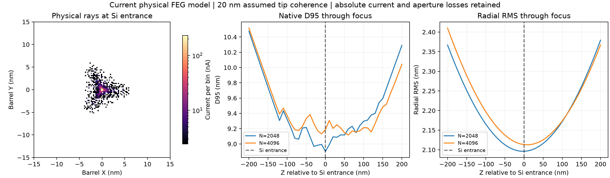
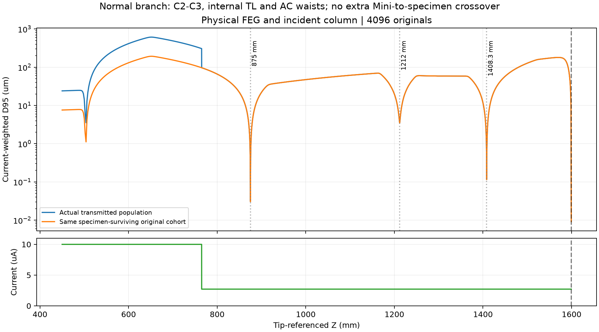
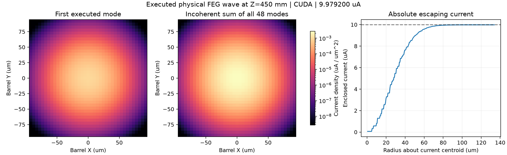

# Physical FEG nanoprobe and Si[110] hybrid calculation

This round deliberately tunes the installed scalar optical controls before a
global coherent calculation. It retains the current physical FEG geometry,
10 uA injected current, 5 nm tip intensity FWHM, the existing energy law, and
the 100 um C2 aperture. The 20 nm Gaussian-Schell coherence length is an
explicit, unmeasured source assumption. The default Flat tip remains selected.
No source is replaced downstream and no intercepted current is restored.

The specimen is the actual `tests/fixtures/cif/Si.cif`, with [110] along barrel
Z, [-110] along X, and [001] along Y. The first material validation thickness
is 0.4 nm. Frozen phonons are disabled. Missing calibrated inelastic constants
for the custom CIF remain explicitly inactive. The sample does not feed back
onto the imposed electromagnetic fields.

## Executed nanoprobe reference

| Original positive-current particles | Specimen survivors | Specimen current (uA) | D95 (nm) | Radial RMS (nm) | alpha95 (mrad) |
| --- | --- | --- | --- | --- | --- |
| 2048 | 556 | 2.71484375 | 8.90299601 | 2.09604573 | 7.80672253 |
| 4096 | 1114 | 2.71972656 | 9.18497777 | 2.11314650 | 7.82919815 |

Doubling the original source count changes D95 by 3.17%, current by 0.18%,
and alpha95 by 0.29%. The 2048-particle 0.05-to-0.025 mm integration-step
comparison changes D95 by 0.000121%, with identical original IDs, weights and
physical loss labels. All classical absolute-weight balance residuals are zero.

The 10 nm-spaced native D95 minimum is at the specimen for 2048 particles and
60 nm downstream for 4096 particles; the corresponding RMS minima are 0 and
10 nm downstream. The 4096 surface D95 is 0.74% above its observed minimum.
These finite-sampling differences are retained. This is a nanometre-scale
working point, not an atomic-resolution focus or an exactly determined
continuous D95 waist. The plotted current distribution is a geometric
reference, not a coherent specimen image.



The captured Normal branch has a C2-C3 source-image waist near 875 mm, no
C3-ADL crossover, one internal TL-pair waist near 1212 mm and one waist between
the AC coils near 1408.3 mm. There is no additional Mini-to-specimen crossover.
Both the actual population and the common specimen-surviving original cohort
were measured with their original weights. Additional upstream inspection
finds no gun-exit-to-C1 waist and one C1-C2 waist bracket of 502-506 mm.
The final focus scan is reported separately from these finite waist brackets.



## Controls and acquisition

Historical drive magnitudes were only an initial proposal. Their field
orientations differ from the current default installation. The final tuning
keeps the current mechanical pose and field-axis definitions, and compensates
the dominant second-order response using the existing HPC normal/skew
intrinsic drives. No learning table or empirical aberration kick is added.
The HPC vector magnitude is within its 1e9 m^-3 configured limit. All final
drives and proposal provenance are in `optical-controls.json`.

The camera remains at its actual 2986.65 mm tip-referenced position. Other
recording receivers are explicitly withdrawn for this camera acquisition;
mechanical bodies and apertures retain their interception. Scan/wobble drives
are explicitly disabled for a stationary acquisition; no dynamic field is
silently frozen. Sample-dependent objective reference planes are resolved
before publishing immutable input snapshots. Input identity checks remain
active throughout execution.

## Global coherent calculation

The requested calculation uses usable CUDA, three source energies and 48
spatial/energy modes. It retains the same physical gun and full coherent
field propagation up to 1 nm before the specimen, followed by a short
Herman-Kluk interval, real-material wave propagation and weighted exit rays
through the actual downstream column. It does not substitute independent
local crystal cells for global coherence.

The configured near-tip domain ends at 1000 nm and checks a 0.4 um transverse
radius. The sample observation domain is 64 nm with 2048 pixels per side.
The coherent-frame stride is 64 and the requested exit population is 8192.
Strict wave support, field, phase and memory checks remain active. Numerical
loss and physical aperture loss are separate; the geometric reference current
above must not be substituted for the executed coherent current.

All 48 source modes completed the CUDA gun calculation to Z = 450 mm, with
9.979200252 uA escaping from the 10 uA injection reference. Every saved mode
was read through the checksum-checked checkpoint store. This is an executed
gun result with the declared source coherence and gun-field approximation;
it is not a completed specimen or detector result.



The gun image conservatively bins the already executed complex mode grids.
It does not run new propagation or normalize the retained current. The image
record and full gun checkpoint metadata are in `gun_wave.json` and
`gun_wave_checkpoint.json`; large complex arrays remain in the local cache.

The final attempt stopped at the C1 numerical sampling/resource gate. Its
last throttled progress message was Z = 504.406018 mm; this is neither an exact
failure plane nor a complete resumable mode mixture. The order-4 spatial
compaction attempt had first stopped at the kinetic truncation phase budget.
Selecting order 8 passed that earlier limit, but the envelope subsequently
reached its Nyquist guard. Lossless refinement requested 9216 x 9216 cells
(35.4375 GiB estimated device work); the bounded retry still needed 7840 x 7840
cells (25.6454 GiB), above the configured 24 GiB device work budget. The rejected
optical operator was not applied. No error threshold or current was repaired.

The complete Si[110] diffraction, outgoing wave-derived particles and camera
result therefore remain **incomplete**. The timing of these differently
terminated attempts is not a full-column speedup benchmark. `execution_status.json`
and `coherent_attempts/` retain the exact requests, progress, failures and scope.
Only the complete 48-mode gun checkpoint at Z = 450 mm is a restart boundary.
The current round ended on this explicit resource rejection; no task-owned
calculation remains running. The next numerical work must address the C1
envelope bandwidth and carrier representation under the same error budgets
before claiming a physical-FEG specimen or detector result.

## Saved evidence and reproduction

- `comparison.json`, `step_comparison.json`: source-count and step comparisons.
- `upstream_topology.json`, `surface-focus4096/topology.json`: measured finite
  waist regions, original membership and explicit sampling bounds.
- Each archived trial contains its complete input snapshot, operating profile,
  actual original gun population and report. The main two trials also retain
  specimen-plane particle coordinates, IDs, weights and loss labels.
- Full column histories and large wave caches remain under the local
  `outputs/si110-global-hybrid-2026-11-09` directory. They are not replaced by
  the compact Git archive.

From the same checkout and project environment, reproduce the geometric
working point with a new output directory:

```powershell
.\.venv\Scripts\python.exe scripts/validate_physical_hybrid.py `
  --output outputs/si110-reproduction `
  --source-particles 4096 --step-mm .05 --coherence-length-nm 20 `
  --static-acquisition --camera-acquisition --silicon-110 `
  --optical-controls docs/development/si110_hybrid_20261109/optical-controls.json `
  --sample-width-nm 64 --sample-pixels 2048 `
  --focus-scan-half-width-nm 200 --focus-scan-step-nm 10 --topology
```

Add `--hybrid --near-tip-end-z-nm 1000 --near-tip-radius-um .4
--coherent-start-before-sample-nm 1 --frame-stride 64 --exit-particles 8192`
for the declared coherent trial. Completed coherent caches may be supplied
using `--wave-cache`; the normal exact-input and solver-code checks must pass.
`--classical-reference` only reuses a completed reference with identical
instrument inputs; the hybrid entry still traces the complete actual gun
population. Use a new output directory for each attempt.

The runner also exposes existing column strategies, rather than changing the
physical fields or source: `--column-exponential-method chebyshev` changes the
residual exponential evaluation; `--column-kinetic-order 8` selects the
existing higher-order positive-branch expansion without relaxing its phase
budget; `--column-segment-resampling` explicitly
selects the development spectral-resampling preview; and
`--column-spatial-compaction` selects the existing step-boundary spatial
projection. The last two are mutually exclusive. Both preserve the original
support probability/L2 limits and record numerical tail loss separately from
physical interception. No source-energy reduction or phase reselection is
enabled. These options do not themselves establish propagation convergence.
`--cancel-file PATH` requests graceful interruption when that file appears,
preserving already committed checkpoints and reporting cancellation honestly.
