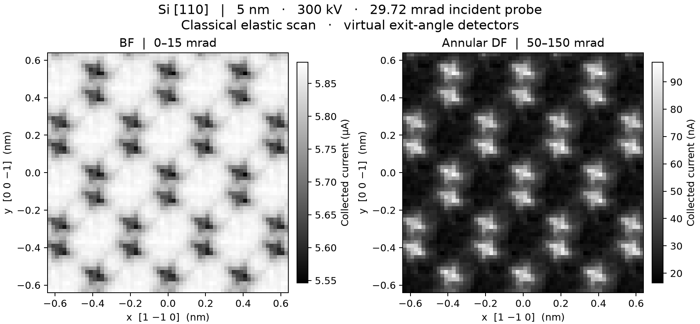

# Si [110] STEM scan with the selected joint probe



The previous calibration's [selected C3/C5/A5 candidate](../probe_joint_20261101/README.md)
illuminates a 5 nm silicon crystal. This is an offline, classical elastic
stage scan using **ideal specimen-exit angular detectors**. It is not the
readout of installed detector heads, a coherent diffraction calculation, or
a claim of instrumental resolution.

| Window about the fixed column axis | Vacuum | Si minimum | Si mean | Si maximum |
| --- | ---: | ---: | ---: | ---: |
| BF, 0–15 mrad (µA) | 5.890 | 5.546 | 5.819 | 5.882 |
| Annular DF, 50–150 mrad (nA) | 0 | 16.43 | 34.82 | 97.15 |

The largest incoming polar angle is 48.44 mrad, so no unscattered ray
reaches the DF annulus. The two maps use separate linear display scales
with no interpolation, smoothing, background subtraction or shot noise.
At x = +0.010 nm, a [native vertical pixel column](native-profile.csv) has
DF peaks of 84.02 and 90.20 nA, with 41.39 nA between them. The peaks are
seven pixels (0.140 nm) apart; the projected CIF pair is 0.13609 nm apart.
This is a contrast observation at the chosen sampling, not a fitted spot
width or a new acceptance result for the corrector.

## Acquisition and model

- **Illumination:** [extend-joint-01-focus1](../probe_joint_20261101/extend-joint-01-focus1/result.json),
  300 kV, alpha95 = 29.71914 mrad, incident D95 = 2.44648 nm, total incident
  current = 10.000 µA. All 2000 original, positive-current particles reach
  the entrance; effective count = 2000. Each pixel reuses their actual
  entrance XY, correlated mechanical slopes, energies and absolute currents.
  Source identity, weights, saved phase-space hash and surface plane are
  checked. Arrival times are retained in the source; the sample model is
  static. No optical control, focus, current weight or particle count changes.
- **Crystal and raster:** the repository's [diamond Si CIF](../../../tests/fixtures/cif/Si.cif)
  is oriented with +x = [1 −1 0], +y = [0 0 −1], +z = [110]. The slab is
  laterally periodic so the entire probe, including its long tails,
  illuminates crystal. A 5 nm slab is cut about the crystal origin and the
  entrance is placed at the original surface (z = 1599.1999975 mm).
  The relative stage raster is 64 × 64 pixels at 20 pm/pixel (1.28 nm wide).
  It does not simulate scan-coil motion or repeated column transport.
- **Scattering:** a local independent-atom density gives the optical depth
  of each straight incident ray through the foil. Each occupied Si site has
  a normalized isotropic Gaussian displacement distribution with one-axis
  RMS 0.0085 nm from the repository's [Si preset](../../../configs/specimens/10_si_110.toml).
  This width belongs to the atoms, not the probe. Integrating this density
  along the finite ray segment and multiplying by its energy-dependent
  [screened Rutherford cross section](../../../src/temsim/specimen/elastic_transport.py)
  gives dimensionless optical depth. The cross-section approximation is
  described by [Demers et al.](https://pmc.ncbi.nlm.nih.gov/articles/PMC3165039/).
- **Readout:** the probability of n elastic events in the projected screen
  is Poisson in that optical depth. Each event rotates the direction by the
  axisymmetric screened angular law. Zero-event rays use their actual
  direction; one-event cone probabilities are integrated analytically. For
  plural events, the Legendre moments of that angular law are raised to the
  nth power before integration over each detector window. The emitted source
  current is never renormalized. The 15–50 mrad gap and all angles above
  150 mrad, including backward directions, have their own current ledgers.
- **Limits:** path geometry is fixed to the incident line when sampling
  density; deflected rays are not moved laterally to new sites, and column
  fields are not integrated through the material. The model includes elastic
  angular redistribution, not crystal channeling, coherent interference,
  Bragg diffraction, inelastic loss, detector efficiency or detector noise.
  Real BF contrast, in particular, can differ. This study does not certify
  resolution or absolute signal accuracy on a microscope.

## Files and checks

[BF TIFF](bf.tiff) and [DF TIFF](df.tiff) are float64 absolute currents in
amperes, with row zero at minimum y. [Raw scan](scan.npz) includes axes, both
windows, both other angular regions, plural current and vacuum readout.
[Metrics](metrics.json) include the identities, numerical checks, and native
line measurements; [single-panel BF](bf.png) and [single-panel DF](df.png)
are available independently.

The largest pixel current closure error across four independently integrated
windows was 1.11e-19 A or less. Refining the angular calculation from 512 to
768 Legendre degrees and from 1024 to 1536 quadrature nodes changed every
window by less than 1.4e-15 A per pixel. The angular event-order tail is
below 7.0e-15 in probability. A direct Cartesian atom sum agreed with the
periodic depth kernel to 1.5e-14 in optical depth at the checked pixel for
the original cohort. Translating a scan position by a crystal repeat leaves
the ray optical depths unchanged to floating-point precision. The peak
predicted fraction with multiple events is 2.41% of incident current. These
checks cover numerical consistency within the chosen model.

Reproduce from the repository root:

```powershell
.venv/Scripts/python.exe scripts/scan_joint_probe_si110.py
.venv/Scripts/python.exe -m pytest -q tests/test_joint_si110_angular_screen.py
```
