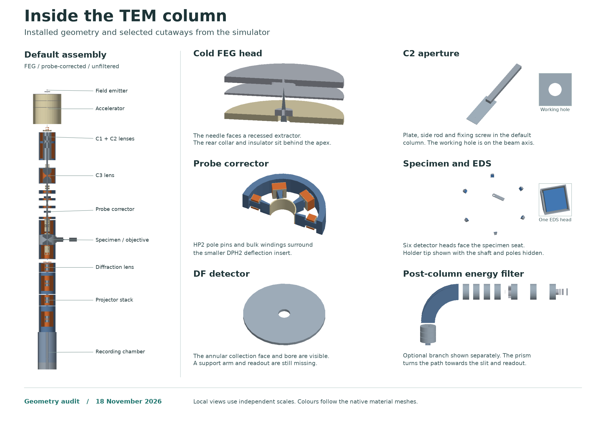

# TEM column schematic review

18 November 2026

The installed models already show the electron source, condenser and projector lenses, correctors, side-entry specimen holder and recording planes. In the whole-column view it is difficult to see how the specimen sits between the objective poles, how a side-mounted device reaches the beam and how a detector carries its signal out of the chamber. These are the most valuable additions for an instrument schematic. The existing detailed gun and hexapole interiors mainly need better sections and magnification.

The left view uses a single scale and the installed default positions. The six local views use independent magnifications. The filter comes from a separate, filter-equipped assembly. All pictured bodies and openings come from the simulator. The [illustrated part atlas](native-parts-atlas.pdf) shows all 183 keys with independent geometry. The [part register](parts.md) covers all 230 keys, including controls, references and optical assemblies, with a suggested detail for each.

## What to draw first

| Priority | View | What a reader should be able to identify |
| --- | --- | --- |
| First | Specimen chamber with a removable quadrant | Follow the side-entry holder through its guide to the grid and specimen upper surface. See both objective pole tips, the Mini Condenser and the path from the specimen to an EDS head. |
| First | Apertures and recording chamber in working and parked states | Recognise the working bore, the side that carries each movable element, the on-axis receiver and the path to a signal outlet. Identify fixed vacuum restrictions separately. |
| First | A selectable longitudinal section for each lens family and an end view for the correctors | Trace the axial bore, pole gap, winding and magnetic return. Count six poles on each principal hexapole and distinguish the physical AC scan stations from optical reference planes. |
| Next | Three source cutaways and the optional blanker | Follow emission, extraction and acceleration. On the installed option, locate the Wien unit, energy-selecting slit or blanking aperture and identify its purpose. |
| Next | Post-column filter with its own local beam path | Follow the bend, dispersion direction, two slit blades, shutter, deflector and selected Zebra strip. Locate the optional EFTEM output plane. |
| Next | Detachable vacuum and service layer | Follow one high-vacuum connection, the holder airlock and the shared backing path. Identify the coil electrical feed and coolant connection by different symbols. |
| Optional | Outer instrument view | Use removable enclosure panels, column supports, isolation base and representative service cabinet to establish the overall silhouette. Mark external routing and locations as illustrative. |

Use a solid section for configured hardware, a labelled outline for a construction inferred from the device family and a dashed arrow for an illustrative path. Give enlarged views a scale or an explicit magnification label. In the assembled view, differentiate the primary electron path, the X-ray sightline and the electrical readout at the point where they diverge. Proposed hoses, wiring and supports belong to the schematic layer. Quantitative field strength, ray clipping, detector acceptance and specimen focus each need their own physical inputs.

## Guns, monochromator and blanker

| Assembly | Present in the model | Detail to add or expose |
| --- | --- | --- |
| Cold FEG | W(310) tip with a curved apex, recessed extractor, emitter enclosure electrode, rear collar and insulator. A separate gun aperture follows the electrostatic gun lens. The accelerator has ten electrodes and nine insulating spacers. | Show a longitudinal tip inset with the emitting apex, extractor recess and through-hole in one view. Draw rear support posts, the flashing-current leads and a high-voltage feedthrough as family-level details. Label the separate gun aperture and the gun-exit C1 aperture along the beam direction. [FEI cold-emitter patent, Figs. 5–6](https://patents.google.com/patent/US8736170B1/en) |
| Thermionic gun | LaB6 cathode envelope, Wehnelt, gun lens and anode aperture. The accelerator has ten configured electrode centres and a single mechanical envelope. | Expose a LaB6 crystal, heater contacts and insulating seat. Mark the accelerator stages at the configured centres. Individual electrode thicknesses remain unknown. [JEOL thermionic gun](https://www.jeol.com/words/emterms/20121023.080758.php) |
| FEG with monochromator and optional NanoPulser | The Wien unit and upstream energy slit each appear as an envelope. Its slit is mechanically co-located with the C1 aperture. The optional downstream blanker has two separate electrostatic plates and a limiting aperture. | Use an end view to indicate the crossed electric and magnetic actions in the Wien filter and a side view of the selection edges in the existing carrier. Give the blanker its own plate feed and a small drawing of the deflected path into its aperture. The public Wien example illustrates one pole arrangement. The installed pole count is unknown. [JEOL Wien patent, Figs. 1–4](https://patents.google.com/patent/US6844548B2/en) · [Thermo Fisher Iliad datasheet](https://documents.thermofisher.com/TFS-Assets/MSD/Datasheets/iliad-ultra-datasheet-ds0510.pdf) |

## Round lenses and apertures

The C1 lens and C2 lens share a pole-piece cartridge. The default model distinguishes the two carrier sections, their inferred separator and the two excitation packs. Show a longitudinal section through both lenses with the vacuum bore and individual winding terminals labelled. Expose the pole nose, copper winding, magnetic return and nonmagnetic support on one example of each remaining lens family. Label unresolved magnetic interfaces. Where cooling plates already exist, add an illustrative external connection to those plates. The two-condenser column physically ends its condenser stack at the C2 lens. On the three-condenser column, Normal and Large Angle share installed hardware and change excitation. [Round-lens evidence and current sections](../../references/cad-round-lenses.md) · [JEOL objective lens section](https://www.jeol.com/words/emterms/20121023.060558.php)

The default C2 aperture and C3 aperture each have a strip, connection rod and fixing screw. Other columns containing the same aperture key draw only the strip. The objective and selected-area apertures also benefit from a side view through the selector and a magnified perpendicular view of the selected hole. Mark traversing/parked states only for movable devices. Confirm the mount and space for each variant before transferring a default-profile mechanism. The differential-pumping apertures should read as fixed vacuum restrictions. [Aperture evidence and user photograph provenance](../../references/cad-gun-filter-apertures.md)

## Correctors and steering

- **Probe corrector.** Each principal HP2/HP1 hexapole in the default column already has 25 regions, including six pole pins, six copper packs, formers, bedding and a return yoke. Five DPH/DP winding inserts have separate hosts. Use an end-on cut to show the sixfold geometry around the bore, and a longitudinal cut for the transfer lenses, small inserts and the two AC scan stations. Keep DP12 as a labelled optical reference. An overlay can identify a crossover from a named optical run at its calculated position. The material drawing alone cannot establish a crossover. [CEOS, Müller et al., Figs. 2–3](https://www.ceos-gmbh.de/en/produkte/stemkorrektoren/dcor-ascor/Mueller2006a.pdf#page=3) · [Project probe corrector](../../references/cad-probe-corrector.md)
- **Image correction.** Distinguish the two principal hexapoles of the installed CETCOR family from the three of the B-COR family. The B-COR variants also include TL31 and TL32. Compare their installed sequences below the specimen and label the existing steering inserts. Mark the SAD plane and control channels in an optical overlay. The records identify eight physical steering inserts for the image corrector. Additional trim-channel hosts require evidence before a new body can be assigned. [CEOS B-COR layout](https://www.ceos-gmbh.de/user/pages/02.products/Poster-internet.pdf) · [Image channel and host register](../../references/cad-image-corrector-channels.md)
- **Beam steering and stigmation.** Use an axial view to distinguish crossed X/Y windings from stigmator windings. A side view distinguishes the two axial stations. In the default column, four deflector groups have 20 regions each. Other sampled columns with those groups show eight winding regions. The condenser stigmator has 33 regions in the default column and eight elsewhere. Select a physical host once even where both image/diffraction and descan address it. Carry former, casing and registration details across variants only where the design supports them. [Multipole assemblies](../../references/cad-multipoles.md)

## Objective, specimen and analysis

| Area | Already visible in a suitable section | Detail that would explain the assembly |
| --- | --- | --- |
| Mini Condenser and objective | Nested Mini Condenser, upper and lower objective poles, split winding and return, and separate electronics sleeves. The default objective winding assembly has seven regions including insulation and two cooling plates. Other columns show the two winding packs. | Cut a quadrant through the existing parts. Label the Mini Condenser poles, the objective gap, the upper surface of the specimen and the side-entry clearance in the same view. A small current-direction marker can distinguish excitation settings. [Objective hardware record](../../references/cad-objective-upper-hardware.md) · [JEOL objective section](https://www.jeol.com/words/emterms/20121023.060558.php) |
| Holder, stage and specimen | The side-entry port already cuts through one side. The stage has a guide, flange and body. The holder has a handle, shaft and tip with a recessed specimen seat. The full-column specimen is an envelope. | Show the guide and seal in section. Enlarge the seat, the installed support grid, its clip and the specimen upper surface. Use the project grid catalogue for dimensions and indicate insertion and tilt directions for the selected holder. [Grid catalogue](../../../configs/specimen_supports/catalog.toml) · [Berkeley Lab NCEM holder inventory](https://foundry.lbl.gov/instrumentation/tem-holders/) |
| EDS and optional specimen cell | All six windowless EDS heads already contain a silicon die, insulating support and cold shield. The optional cell supplies two finite windows and two context guides when inserted. | Show one head in section, its signal exit, and specimen-to-head sightlines around the holder and poles. Mark these as illustrative sightlines. In a separate cell inset show the windows, fluid gap and sample plane. Use verified holder geometry before adding fluid fittings. [EDS reconstruction and evidence](../../references/cad-detectors.md) · [Holder and goniometer evidence](../../references/cad-stage-holder.md) |

## Projection, detection and spectroscopy

The diffraction, intermediate, P1 and P2 lenses already have distinct windings, yokes and pole pieces. Show one readable cut of each family, the selected-area aperture and the transition into the recording chamber. DF and HAADF are annular, BF and the fluorescent screen are disks, and the main camera is square. Each receiving element is currently a single nominal slab. Draw carriers, a screen frame, the camera package and a signal exit. Where the readout technology is unknown, use a generic output connection. A scintillator, light guide and photomultiplier are appropriate for the documented class of conventional annular detectors. [Recording geometry](../../references/cad-detectors.md) · [JEOL annular detector construction](https://www.jeol.com/words/emterms/20121023.005000.php)

The optional post-column filter already has two finite prism poles, ten multipole carrier envelopes, two energy-slit blades, a four-electrode dynamic-focus quadrupole, an electrostatic shutter, bias tube and camera deflector. Zebra has five scintillator strips, a backing, housing and an alignment guide. Show the configured 90-degree path and the dispersion direction in the branch frame, followed by a close-up of the selection slit and readout. The bend angle is a provisional project choice. Distinguish the alignment area from the five spectroscopy strips. The optional EFTEM output plane can be drawn as a reference plane. Retain a generic multipole carrier wherever the pole construction is undisclosed. [Project filter geometry](../../../configs/subassemblies/energy_filter.toml) · [Thermo Fisher Iliad datasheet, p. 2](https://documents.thermofisher.com/TFS-Assets/MSD/Datasheets/iliad-ultra-datasheet-ds0510.pdf#page=2)

## Vacuum services and instrument exterior

The column already synthesizes annular vacuum liners. The separate editable pumping diagram defines four ion getter pumps, a shared turbo pump, a dry scroll backing pump, a holder airlock and ten connections. Reuse that topology for an optional three-dimensional service view. Place isolation valves and shared lines according to the configured connections. Mark illustrative pump locations, high-voltage cabinet, cooling hoses and isolation feet accordingly. Make that layer removable so the beam path and specimen access remain visible. [Project pumping configuration](../../../configs/environments/vacuum_map.toml) · [JEOL evacuation system](https://www.jeol.com/words/emterms/20121023.050858.php)

## Repair status

| Finding in the initial review | Verified behaviour after repair |
| --- | --- |
| The field-vector overlay drew the fixed gun aperture and C1 aperture as solid strips. With 24 angular segments each had 12 triangles. | Both views read the captured opening and lateral offset. In the default Cold FEG assembly each view shows the same 4 mm through-hole for each aperture, with identical vertices and 112 triangles per plate after unit conversion. [Field overlay regression](../../../tests/test_field_vector_geometry.py) |
| Withdrawing the DF detector or disabling the objective aperture left the same material on the beam axis. | The assembled 3D view and rotating section clear the working position, label the part as retracted and restore it on reinsertion. The lateral parking position is unspecified in the modules. The component remains available for inspection in 3D Parts. [Insertion and section regression](../../../tests/test_physical_layout_modes.py) |
| Installing FEG + Mono, the plain three-condenser column, the electrostatic blanker and the Energy Filter together failed specimen validation. Installing the Mono gun first allowed the original inventory of 277 meshes to be inspected. | One-step installation and the reverse transition carry the foil with the sample stage. The configuration check preserves a deliberately offset 10 nm specimen and its objective drive. Fresh installation places the blanker plates at 520 mm, 20 mm beyond this gun's exit. [Configuration regression](../../../tests/test_assembly_gun_transition.py) · [Blanker regression](../../../tests/test_nanopulser_assembly.py) |

The repair checks passed 204 targeted geometry, interface and assembly tests, including a sweep of 60 hardware combinations. Separately, 18 historical specimen tests could not load the 10 November input-only working point. Its pinned column file differs from the current catalog, and restoring its original files in an isolated directory also exposed an unsupported saved state schema.

The atlas and inventory below count installed components at their nominal positions. The proposed mechanical details in the subsystem tables remain design work items.

## Coverage and limits

| Column | Gun | Optional blanker | Recording | Installed keys | Keys with meshes | Total meshes including liners |
| --- | --- | --- | --- | ---: | ---: | ---: |
| Three lenses + probe corrector (default) | Cold FEG | — | Plain | 133 | 107 | 467 |
| Two lenses | Thermionic | — | Plain | 79 | 70 | 193 |
| Three lenses | FEG + Mono | NanoPulser | Filter | 113 | 101 | 277 |
| Three lenses + CETCOR | Cold FEG | — | Filter | 161 | 132 | 357 |
| Three lenses + probe corrector + CETCOR | Cold FEG | — | Filter | 204 | 159 | 508 |
| Three lenses + B-COR | Thermionic | — | Plain | 152 | 123 | 325 |
| Three lenses + probe corrector + B-COR | FEG + Mono | — | Filter | 219 | 172 | 536 |

Each installed configuration was resolved with the live Physical Layout inputs. The native mesh and CAD specification checks used 24 angular segments. The index was reconciled against the expanded contents of all 13 module files. Of 230 distinct part keys, 183 have independent geometry, 20 are optical assemblies represented by children, 23 are control channels and four are reference entries. The native CAD specifications explicitly classify 23 distinct keys as envelopes in at least one sampled assembly. The register lists 14 synthesized liner-group identifiers separately. The optional cell was also inspected in both insertion states.

The seven runs reported zero mesh-health findings, CAD specification construction errors or missing declared material bodies. All 63 focused software tests passed across assembly geometry, the mesh checker, filter layout, vacuum routing and the cell display. The review establishes coverage of the supplied modules and visual representation. Exhaustive cross-combination assembly, clearances under motion, exact solid intersections, OEM dimensional fidelity and field or particle performance require separate evidence. [Native geometry inspector](../../../scripts/audit_column_model_details.py) · [Project CAD evidence policy](../../references/CAD_DETAIL_POLICY.md)
