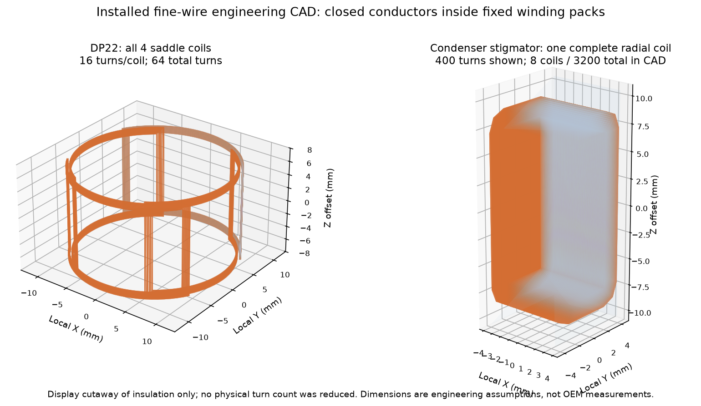
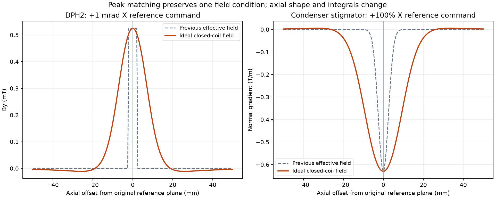

# Ideal transverse winding CAD and current calibration

Physical deflectors and material stigmators now have detailed fine-wire CAD,
fixed-envelope insulation packing, and explicit signed current-to-field
conversion in **Ideal prescribed-current coils in vacuum**. The initial turns
come from available pack dimensions and declared fine conductors. Current,
rather than turns or optical controls, is calibrated to the previous signed
field strength at the native reference planes.

This is a field/CAD/software validation. It does not qualify a finite-source
probe, focus, Preview/High accuracy transport, coherent CUDA imaging, thermal
rating, manufacturing process or a real instrument.

## Installed inputs and assumptions

There are **96 raw material-host definitions, 24 distinct component keys, in
12 source files**, including assembly variants. They are not 96 independent
pieces of hardware. The original files and 14 assembled optical states were
preserved before migration under `validation/before/`.

| Winding family | Metal area per wire (mm2) | Bare diameter (mm) | Initial turns per physical coil |
| --- | ---: | ---: | ---: |
| Condenser / Objective stigmator | 0.02 | 0.159577 | 400 |
| Diffraction stigmator | 0.02 | 0.159577 | 672 |
| Gun stigmator | 0.02 | 0.159577 | 784 |
| Condenser deflector | 0.01 | 0.112838 | 135 |
| Beam deflector | 0.01 | 0.112838 | 216 |
| AC / Image-Diffraction deflector | 0.01 | 0.112838 | 104 |
| Gun deflector | 0.01 | 0.112838 | 90 |
| Probe DPH1/DPH2 and DP11/DP21/DP22 | 0.01 | 0.112838 | 16 |
| Image DPH1/DPH2 | 0.0003 | 0.019544 | 3 |
| Other Image DP / ISH / DSH | 0.01 | 0.112838 | 2 |

These are engineering initializations, not OEM winding measurements. Nominal
metal fill is 60%; integer square packing and insulated-wire fit determine the
actual lower fill. Radial insulation thickness is 0.005 mm, or 0.002 mm for
the especially thin Image DPH pack. That existing pack has only 0.08 mm radial
depth and a limiting band near 0.04 mm, so the normal fine wire cannot fit.
Its smaller wire has no inferred electrical or manufacturing rating.

Every saved integer turn is represented. User edits accept turns, conductor
**metal cross-sectional area**, radial insulation thickness, and signed
additional currents. Diameter is read-only. Repacking fills the residual
winding volume with insulation while preserving the bore, outer envelope and
axial bounds. Impossible packing fails rather than resizing or omitting wire.
Previously undefined transverse turns are initialized explicitly; the existing
bounded adjustment policy for older fixed winding references is unchanged.



The drawing shows all 64 DP22 turns and one complete 400-turn radial winding.
The full Condenser stigmator CAD contains all eight windings, or 3200 turns.
Only insulation is cut away in this illustration. Existing support/bobbin,
carrier, sleeve and lead-opening features remain separate passive geometry.
Mechanical magnetic materials are not field sources in this model.

## Structure references

- [Nikon US5994704A](https://patents.google.com/patent/US5994704A/en),
  figures 1-3: opposed saddle windings, orthogonal pairs, concentric insulating
  carriers and registration features.
- [CEOS US20090079531A1](https://patents.google.com/patent/US20090079531A1/en),
  figures 1-8: cylindrical flexible-coil construction, insulated layers and
  selectable dipole/quadrupole winding connections.
- [CN102509689B](https://patents.google.com/patent/CN102509689B/en),
  figures 5-6, 9 and 12: eight radial coils on a slotted carrier, bobbins,
  adhesive, protective sleeve and lead passages.
- [JEOL stigmator description](https://www.jeol.com/words/semterms/20201020.111014.php):
  two four-coil groups with a 45-degree offset.

These references establish construction families. The saved round-wire CAD
does not claim the exact PCB stack or proprietary dimensions of a particular
commercial device. Unverified logical corrector channels do not acquire
invented material bodies or winding parameters. Existing HP1/HP2 definitions
and native corrector ownership remain unchanged.

## Electrical and field model

The saved relationship is `I = M @ u + bias`. The two-channel matrix maps one
station; a full four-channel matrix calibrates two-station deflectors jointly,
including magnetic tails crossing the other station. Column deflector `u` is
in mrad; column stigmator `u` is a percentage, with 100 meaning 100%; Gun
deflectors use mT and Gun stigmators use normal/skew gradients in T/m.
Signs and winding-axis phase are included in the matrix.

Examples at the 300 keV calibration energy are approximately 0.66144 A per
1 mrad X command for Probe DPH2, 1.14006 A for a 100% Condenser stigmator X
command, 0.70183 A/mT for the Gun deflector, and 6.67234 A/(T/m) for the Gun
stigmator. These are calibration gains, not a claim that those currents are
active by default. `validation/default-command-currents.json` records the
actual detached Nano Probe / Diffraction current readback at time zero.

The gains remain fixed when beam energy changes. Electron momentum still
governs response. Turn or current-bearing-envelope edits keep numeric current
values and mark calibration stale; no implicit current fit or refocusing
occurs. Wire-area edits at fixed N, I and envelope change discrete CAD rather
than the homogenized source distribution. Biases add amperes directly.
Dialog, atomic draft editing, Undo, linked-catalog save/reload and cache
dependencies follow the same electrical definitions.

Quasistatic Biot-Savart integration uses closed saddle or radial rectangular circuits
uniformly distributed over the original winding-pack envelope, with full
vector B and Coulomb-gauge A and analytic spatial derivatives. Default
pack/path quadrature orders are 12/24. Static and time-dependent routes use
the same current gains. Existing scan drives retain their waveform and
induced electric field `-dA/dt`. All axial tails are retained, including
remote-source diagnostics and Gun field capture.

The accelerating Gun still uses its existing frozen-time magnetic capture.
Its routing checks here prove static full-vector B access. They do not add a
joint time-dependent accelerating-Gun E+B solve: column scan drives reaching
that capture are frozen at the command time, and their induced E is not
injected into the Gun acceleration solver. Dynamic A/B/E evidence applies to
the unified column runtime, not a qualification of that missing joint source
operator.

The model assumes vacuum permeability and prescribed ideal currents. It
omits magnetic cores, pole shoes, material permeability, saturation,
resistance, heating, drive limits and discrete leads. It activates only with
the existing `copper_coil` compatibility key under unified execution. Gaussian
and unconfigured legacy sources retain their native fields; the startup
field selection is unchanged.

Matching a peak is not matching a complete field profile or optical action.
For the illustrative nonzero commands below, the new DPH2 axial FWHM is about
15.95 mm versus the old 4 mm effective window; the Condenser stigmator is
about 20.90 mm versus the old 6 mm profile. Field integrals also change.
No lens strength, focus, or source setting was retuned to hide this difference.



`field-profile-data.json` preserves signed fields, currents, analytic native
integrals and the coil integral over the displayed +/-50 mm interval. The
0.5 mm display grid and finite displayed integral are not independent FWHM
or all-space integral convergence claims.

## Validation and limits

- `input-equivalence.json`: all other values in 12 source files are exact;
  **14 optical states and 336 native field records** match the preserved
  baseline. Source energy distribution, boundaries, optical controls and
  solver tolerances are unchanged, including the 0.3 eV energy width.
- `current-calibration-final.json`: final fixed-N current matrices, reference
  planes and signed native targets. Momentum uses the unchanged native
  `core.electron` constants. Earlier calibration receipts are historical
  intermediate records, not installed current definitions.
- `independent-peak-field-checks.json`: all 96 definitions are checked with
  **24/48 quadrature**, twice the installed order. The declared additional
  field-only acceptance bound is 1e-8 of the native peak; this does not replace
  or relax any existing trajectory tolerance. The largest observed normalized
  discrepancy is **8.852e-14**. This is numerical agreement between field
  integrals and the prescribed calibration condition, not experimental accuracy.
- `all-installed-packing-bounds.json`: every insulated-wire section lies
  within its fixed pack. `final-native-cad.json` executes the final mesh code
  and final current input bytes for all seven complete default cases, preserving
  the earlier mesh receipts. Full default native meshes were executed for seven
  representative components, retaining all physical turns and exact prior
  passive regions. The largest tested case has 6272 wire turns and about
  2.41 million triangles. Dense display faceting reduction is explicit;
  analytic STEP wires are unchanged. The four-million-triangle gate rejects
  excess work instead of dropping turns.
- `cad-electrical-refinement-equivalence.json` reconstructs the exact source
  bytes used by the complete-mesh receipts and proves all seven current CAD
  SolidSpec sequences identical. The final momentum-constant correction only
  refines electrical gains; the original mesh receipts remain unmodified.
- `transverse-step-receipt.json`: actual bounded saddle and radial analytic
  BRep construction, STEP export and re-import in the optional CAD runtime.
  It is not a full dense instrument STEP export.
- Targeted regression receipts cover geometry, electrical conversion,
  finite-difference derivatives, rotation, symmetry, dynamic drives,
  serialized snapshots, remote tails, source ownership, cache invalidation,
  UI persistence and wave-admission boundaries. The final consolidated run
  and source/output hashes are indexed by `validation/manifest.json`.
  **770 unique cases passed, with zero failures, errors or skips.** The only
  emitted warnings are dependency-level Pydantic serialization deprecations.

The compatibility Gun paraxial reduction cannot represent a powered closed
winding's full fringe/Bz field and rejects it explicitly. The actual classical
Gun vector-field Lorentz route remains available. Existing coherent execution
for ideal prescribed-current coils remains unqualified and fails explicitly;
native multipoles are not silently substituted. No new finite-source,
Preview/High accuracy transport or CUDA coherent calculation was performed.

## Reproduction

Use the project virtual environment from the repository root:

```powershell
.venv/Scripts/python.exe docs/development/transverse_current_coils_20261115/validate_inputs.py
.venv/Scripts/python.exe docs/development/transverse_current_coils_20261115/validate_peak_fields.py
.venv/Scripts/python.exe docs/development/transverse_current_coils_20261115/render_field_profiles.py
.venv/Scripts/python.exe docs/development/transverse_current_coils_20261115/capture_default_currents.py
.venv/Scripts/python.exe docs/development/transverse_current_coils_20261115/check_default_cad.py --final
.venv/Scripts/python.exe docs/development/transverse_current_coils_20261115/run_regressions.py
```

These checks do not emit particles. `prepare_baseline.py` and the guarded
migration phases preserve one-time historical inputs and must not overwrite
their existing receipts. GUI usage is described in
[transverse winding and current inputs](../../TRANSVERSE_CURRENT_WINDINGS.md).
