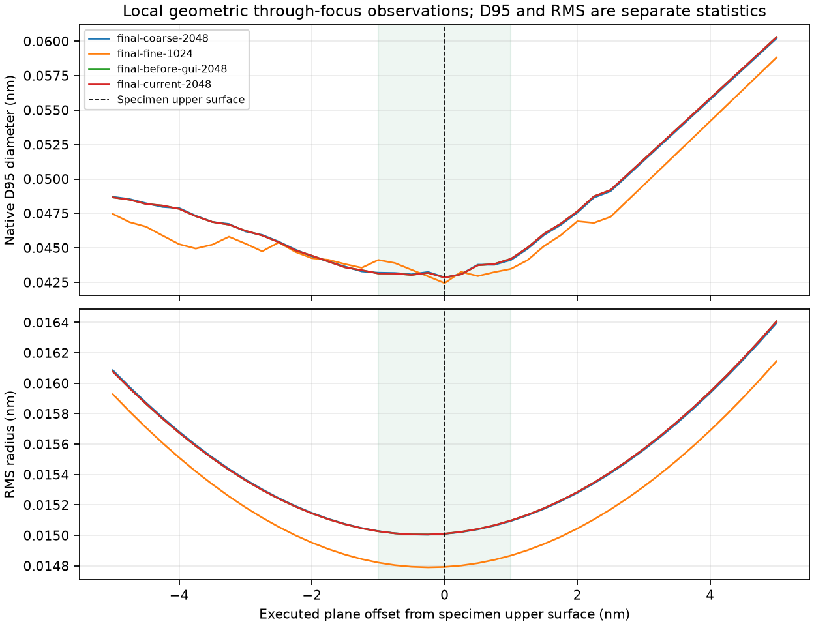
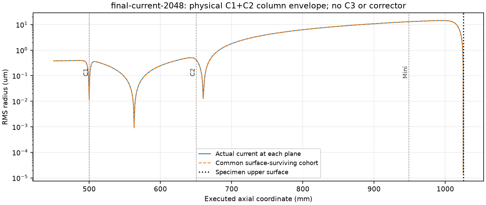
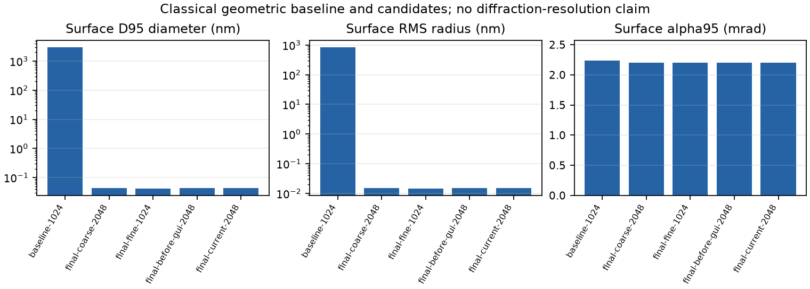

# Physical two-condenser Nanoprobe/Diffraction working point, 2026-11-12

The real C1+C2 column now has an independently measured Nanoprobe working
point that focuses on the specimen upper surface. It contains no C3 or probe
corrector and has one Nanoprobe branch, without Normal/Large angle selection.
An installed but de-energized C3 in a three-condenser column remains a separate
hardware configuration. See the [operating contract](../../OPTICAL_CONTROL_ROLES.md#physical-two-condenser-nanoprobe-requested-on-2026-11-12).

The original Objective setting focused approximately 650 um upstream and gave
D95 = 2994.557 nm at the specimen. The final setting gives **geometric
D95 = 0.04284650 nm**, **RMS radius = 0.01501112 nm**, **alpha95 =
2.199839 mrad** and **angular RMS = 1.240787 mrad** at the upper surface in
the preferred 2048-particle, 0.05 mm run. Every original particle survives;
the represented source and specimen currents are both 10 uA.

The sub-angstrom spatial values are **classical geometric ray-bundle statistics**,
not diffraction-limited probe diameters, coherent-wave resolution, microscope
information limits or experimental performance. No coherent calculation or
aberration-corrector qualification is included.

## Controls and physical inputs

| Device | Final excitation (%) |
| --- | ---: |
| C1 | 90.0 |
| C2 | 35.0 |
| Mini Condenser | -10.0 signed Nanoprobe excitation |
| Objective | 29.223518226455024 |
| Diffraction lens | 13.589999609390503 |
| Intermediate lens | 8.532044964017839 |
| Projector 1 | 32.1132572718703 |
| Projector 2 | 9.826874422815507 |

The original C2-module Objective default was 30.42591940608605%. C1, C2,
Mini magnitude, source law, apertures and all physical positions were held
fixed while adjusting incident focus. D/I were separately matched for the
C2 diffraction reference, retaining P1/P2 and the incident controls. These
are non-OEM engineering-model settings, not measured manufacturer currents.
Ordinary projection switching preserves deliberate incident defocus; applying
a stored complete lens preset is an explicit optical adjustment.

The instrument is FEG / C2 / No Energy Filter at 300 kV, with a real 100 um
C2 aperture. The captured specimen centre is 1025.2 mm, its active thickness
is 5 nm, and its upper surface is **1025.1999975 mm**. The formal Nanoprobe
mode pair retracts the fluorescent screen and camera while retaining the
STEM detector insertion states. The saved complete inputs retain those
actual insertion choices, rather than a manually relabelled projector state.

[The primary profile](two-condenser-nanoprobe-diffraction.toml) is an exact copy
of the current-implementation 2048-particle/0.05 mm diagnostic input. Its
specimen is retracted and raster/wobble are disabled to observe the incident
vacuum probe through the physical surface reference. Loading this complete
profile therefore restores those diagnostic choices as well as the optics.
The catalog working point changes only the stated operating controls; the
complete [input snapshot](trials/final-current-2048/inputs.json.gz) retains the
historical source, model and embedded manifest bytes.

## Focus, size and numerical checks

D95 is the diameter about the actual current-weighted transverse centroid
containing 95% of the current reaching a plane. RMS radius uses the entire
transmitted current's second moment. Alpha95 contains 95% of the angular
current about its chief direction; angular RMS is separate. This two-condenser
request introduces no 30 mrad target or corrected-column diameter cap.

| Original positive-current particles | Step (mm) | Surface D95 (nm) | Surface RMS radius (nm) | alpha95 (mrad) | Native D95 minimum offset (nm) | Native RMS minimum offset (nm) |
| ---: | ---: | ---: | ---: | ---: | ---: | ---: |
| 2048 | 0.1 | 0.0428637048 | 0.0150100498 | 2.19982154 | 0.0 | -0.25 |
| 2048 | 0.05 | 0.0428465047 | 0.0150111196 | 2.19983937 | 0.0 | -0.25 |
| 1024 | 0.05 | 0.0424449402 | 0.0147925917 | 2.19961849 | 0.0 | -0.25 |

All three full-source conditions pass the bounded direct-surface-focus gate.
Their executed native-D95 minimum is at the upper surface, with neighbouring
observation planes at -0.25 and +0.25 nm, within the declared +/-1 nm
engineering placement interval. Their RMS representative minimum is at
-0.25 nm, with neighbouring planes -0.5 and 0 nm. These brackets overlap:
the RMS-minus-D95 difference bracket is approximately -0.75 to +0.25 nm and
does not exclude zero. The discrete representative difference must not be
claimed as a resolved exact continuous separation.

Halving the integration step changes D95 by about -0.0401%. Increasing the
original source population from 1024 to 2048 at 0.05 mm changes D95 by about
+0.946%. The waist brackets remain unchanged. These are measured numerical
sensitivities, not proof of a continuous source distribution or experimental
accuracy. Every run retains all original IDs and absolute weights; emitted,
surviving and effective counts are respectively 1024/1024/1024 or
2048/2048/2048.

The final installed-component GUI fix was followed by a fresh complete
2048-particle/0.05 mm execution. All **25** observation arrays, including
source launch/exit data, phase, energy, flight time, weights, IDs and survival,
are identical in dtype, shape and original bytes to the preceding equivalent
physical run. The [comparison](current-implementation-comparison.json) keeps
the distinct implementation identities. Snapshot restoration and operating
profile round trips pass, and [123 current unique regression cases](validation-summary.json)
pass. No older observation or historical archive was rewritten.

## Crossover interpretation

The final Mini/Objective-support survey extends from 848.65 mm through the
complete final focus window. It resolves one bounded two-dimensional final
source-image region and no separate additional upstream source-image waist.
The native-D95 surface gate is checked independently. The narrower
Mini-to-surface interval ends on this finite final region and is unresolved
at its boundary; it must not be counted as either an additional source image
or proof of zero waists. Extending the observation through focus resolves it.

| Optical reference interval | Executed interpretation |
| --- | --- |
| Gun exit to C1 reference | The 500 mm boundary cuts a source-image region; the narrow interval is unresolved. A wider observation resolves the region inside C1. |
| C1 to C2 references | One bounded region represented at 563.0 mm, with 562.5-563.5 mm bounding planes. |
| C2 to Mini references | One bounded region represented near 660.0 mm, inside the physical C2 envelope. |
| Full final Mini/Objective support through focus | One final bounded region at the specimen focus; no distinct extra upstream region. |

An offline wider 450-650 mm survey resolves **two** independent upstream
regions, represented at 500.0 mm and 563.0 mm. The first lies inside the C1
mechanical envelope, 450-550 mm. The second lies inside the upstream C2
mechanical envelope, 550-750 mm, before its 650 mm optical reference. A
location between optical reference planes need not be in free drift between
physical housings. The full upstream phase, energy, clocks, masks, IDs and
weights are byte-identical between the original wider-survey trial and the
final 2048-particle/0.1 mm trial; see the [wide-interval observation](crossover-wide-interval.json)
and [final equivalence proof](crossover-wide-final-equivalence.json).

| Upstream region representative (mm) | Bounding planes (mm) | Local D95 (nm) | Local RMS radius (nm) | Local alpha95 (mrad) | Local angular RMS (mrad) |
| ---: | --- | ---: | ---: | ---: | ---: |
| 500.0 | 499.0-500.5 | 40.765779 | 11.497914 | 0.192310 | 0.108326 |
| 563.0 | 562.5-563.5 | 3.197172 | 0.916579 | 0.0117792 | 0.00663943 |

Those local D95 values are measured at RMS-based bounded-region representative
planes, not independently located native-D95 minima or exact common point
foci. Both use all 2048 particles and their full original current. No CEOS
corrector-interior or corrector-exit crossover pattern is imposed on absent
hardware, and no Normal/Large angle classification is inferred.

## Source integrity, tails and current

[The source audit](source-audit.json) and [same-count comparison](matched-source-comparison.json)
show that the optical adjustments preserve original source IDs, equal positive
weights and launch/gun-exit arrays. Actual C2 pupil radii reach approximately
13.3 um inside the real 50 um-radius aperture. The reported 100% transmission
therefore follows physical interception accounting; no tail was discarded or
its current restored. It is specific to this source and aperture setting, not
a general beam-current or aperture-filling calibration.

The preliminary focused 1024-particle population has a consequential
high-angle tail: its largest-radius particle contributes approximately 10%
of the radial second moment. At 2048 particles a second comparable tail is
resolved. This supports a source-law tail rather than one corrupt packet.
D95 can exclude an outer-current tail while that tail still affects RMS size
and RMS focus. The source/surface excerpts retain the original particles for
independent tail inspection.

This study uses the current classical default source without the historical
20 nm driven-Gaussian-Schell Tip boundary. The older Microprobe source had
roughly 21 mrad per-axis launch slopes and a 6.939 um RMS gun-exit radius;
the current launch directions are about 0.971 mrad per axis and the exit RMS
radius is about 0.379 um. The gun voltages match. That historical source was
used only for a declared zero-current focusing proposal and does not qualify
the current source width, current or aperture filling. No source-law change
was made between the present baseline and same-count adjusted observations.

## Independent downstream Diffraction reference

The inherited projector controls give a canonical position-response norm of
about 5.149866 and effective camera length 67.8653 mm for these incident
optics. D/I were independently changed to the controls above. Nine guarded
zero-current differential pencils verify the exact final Objective setting
under the production unified executor at 0.05 mm: all reach the TOML main-screen
reference, the canonical position-response norm is approximately
**8.39271e-7**, and the effective camera length is **49.999999175 mm**.
The same response, canonical basis and field/geometry receipts remain
byte-identical after the final GUI change; see the [current projector report](projector/CURRENT_IMPLEMENTATION.md).

Earlier 0.1/0.05 mm and half-increment differential checks belong to the nearby
Objective value 29.2235172%, not an identical final input. Their scope remains
separate in [the proposal report](projector/REPORT.md) and the
[exact final-point report](projector/FINAL_EXACT.md). The final reference uses
the actual vector-potential gradient to convert canonical input momenta to
mechanical slopes; no fitted downstream image map is inserted.

These zero-current pencils do not supply finite-source RMS, D95 or current.
They establish an on-axis differential reference at the named source and
main-screen planes, not finite-angle performance, detector collection angles,
a diffraction pattern, a scanning image, coherent resolution, another recording
module or an experimental camera-length calibration. The incident finite-source
focus verification is separate.

## Archived evidence and limits

[Measured results](measured-results.md), [machine-readable results](results.json)
and the [artifact manifest](artifact_manifest.json) identify every input and
observation. Original reports, requests and profiles retain their bytes;
complete snapshots are compressed with uncompressed-byte verification.
Manifest inputs are extracted from each snapshot's original embedded bytes,
verified and deduplicated by SHA-256. Current catalog contents are never
substituted for an earlier executed manifest.

Each main native-phase file preserves every original particle, ID and weight
at every requested through-focus plane and selected executed topology-bracket
planes. Full-grid weighted centroids/covariances are stored separately.
Supplementary source/surface excerpts have their own narrower stated scope.
These compact files are selected observations, not copies of every trajectory
row; original full-array paths, sizes and hashes remain recorded. Reanalysis
of the retained native phases reproduces the D95/RMS focus gates. Driver
copies are provenance/evidence, retaining their original workspace assumptions.

Only project-generated figures are included. No external book pages or
manufacturer diagrams were copied. Material scattering, coherent diffraction,
finite-source detector performance, source-current sensitivity, a convergence
zoom range and OEM or experimental calibration remain outside this working
point's qualification.

