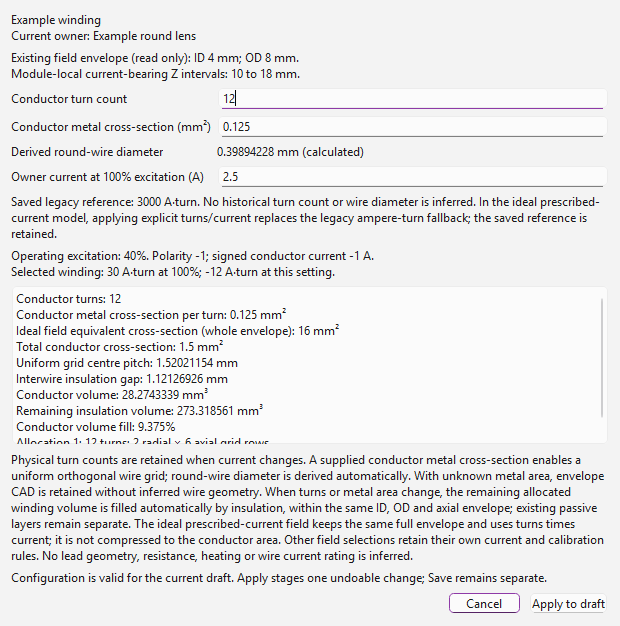
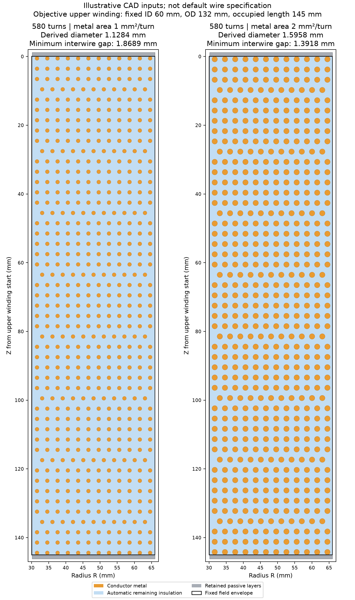

# Conductor metal area, adaptive insulation and bounded integer turn modelling

Date: 2026-11-15.

The user requested integer modelling dimensions, conductor-metal-area input,
automatic insulation adaptation and fixed winding envelopes. The subsequent
explicit permission allows this turn-count modelling adjustment to vary the
original counts by at most 20%.

## Current definition

The nominal winding-pack allocation is now **9 mm2 per turn**, including
insulation and residual space. Estimated turns use `round_half_up(A_pack/9)`;
this allocation is distinct from conductor metal area. The policy is stored in
`configs/physics/coil_winding_estimates.toml`, not inferred from a CAD screenshot.

All 78 round-lens definitions in nine files use the new estimate. **49** counts
change from the saved pre-migration inputs; the largest relative change is
**5%**, within the allowed 20%. Examples are C1 lens 303 to 300, C2 lens 546 to
540, C3 lens 515 to 510, and Probe TL22/TL12 20 to 19. Mini Condenser remains17.

Objective changes from the previously adopted **586/586 to 580/580**. This is
a 1.02389% explicit engineering adjustment, not a recount or a new measurement.
Its original upper-photo estimate and lower-symmetry assumption remain in the
source notes. The existing ID60/OD132 and 145 mm occupied length per region
give `36*145/580 = 9 mm2` allocated area per turn exactly. Original input files
and intermediate fixed-586 evidence remain preserved separately.

During this explicit authoring migration, each current reference changes by
`I100_new = (N_old*I100_old)/N_new` when N changes. The original per-region NI
and full ideal field therefore remain fixed within binary64 roundoff. The
default Objective I100 is **1591.5285426144758 A**, with actual current about
**1097.806245 A** at the unchanged 68.97810600833917% excitation. This preserves
its original specimen-upper-surface field condition; it does not make the ideal
profile equal to the old Gaussian or qualify focus.

## Area-only user input and CAD behavior

Users edit **N** and **conductor metal cross-section in mm squared**. The
canonical size field is `winding_wire_cross_section_mm2`; round-wire diameter
is calculated as `2*sqrt(A_metal/pi)` and displayed read-only. No insulation
fraction, diameter or per-turn cell dimension needs to be entered.

On N or metal-area edits, the supported balanced orthogonal R-Z grid repacks
the exact requested turns. The unoccupied conductor allocation becomes
insulation with every wire cavity removed. Winding ID, OD, occupied axial
intervals and existing passive insulation/cooling layers remain fixed. No turn
is dropped, conductor shrunk or envelope enlarged to force a fit. Unsupported
packing fails atomically and retains the previous draft. The grid does not
claim maximum hexagonal packing or a certified manufacturing insulation gap.

For one interval, total N and its only regional count are the same input; the
duplicated regional field is hidden and follows N. Split windings still require
consistent explicit regional counts and are not redistributed automatically.

Both **Configure winding...** and the generic **Dimensions** table use the same
validated area/N transaction. The actual table exposes editable N and metal
area, with legacy/derived diameter read-only. Undo, save/reload, clear-size,
stale-draft checks and no-op value/provenance preservation are covered.
Old diameter records remain readable and unchanged until a size edit; an actual
area edit writes area-only and removes the legacy alias. Conflicting simultaneous
size aliases are rejected. Size edits update their source records.



Manual N edits retain numeric current and mark any prior field calibration
obsolete. Manual area-only edits retain N, I and the ideal B field while updating
CAD and provenance. They do not repeat the special authoring migration's
inverse-current compensation or refocus a beam. The 20% permission bounds this
modelling migration; no permanent arbitrary lock is added to explicit future
user-authored definitions.

No default conductor metal area has been fabricated. Blank area retains envelope
CAD. **9 mm2 allocated area is not a 9 mm2 metal specification**: at the current
Objective N, the supported orthogonal layout rejects a 9 mm2 metal input rather
than silently changing the turn count or envelope.

## Independent CAD examples

Detached illustrative cases use the actual current Objective **580/580** turns
with **1 and 2 mm2** metal area, plus a separate **500/500, 2 mm2** CAD case.
These do not install a default wire specification. Independent circle-distance
checks find no wire overlap; metal, remaining insulation and retained inner
insulation close the original pack area/volume. Boundaries, conductor allocations
and existing passive layers are identical across cases. Tangency is accepted
only within the existing binary64 coordinate guard.



The [current CAD receipt](validation/independent-cad-current/receipt.json)
retains dimensions, regional turns, gaps and area/volume closure. The earlier
586/586 example is retained in `independent-cad` as an explicitly historical
illustration. No STEP export or real winding manufacture is claimed.

## Verification

- All **14** FEG column/recording combinations retain their entire optical,
  source and numerical state. Parsed input files retain every non-electrical
  field, including pack envelopes, Gaussian optics and physical boundaries.
- **196** isolated ideal-field array comparisons pass with the established
  `rtol=2e-14`, `atol=1e-20 T` operator-equivalence checks. The maximum change
  normalized to each sampled field peak is **2.916e-16**. Original q12
  quadrature and all propagation tolerances remain unchanged.
- Independent exact decimal/Fraction arithmetic verifies every integer N and
  its 20% bound. Every new I100 equals the NI-preserving expression above; the
  largest relative reference-NI change is **1.273e-16**. See the
  [independent input receipt](validation/independent-input/receipt.json).
- Changed N/current/area participates in the appropriate input identities;
  all 14 ideal-source cache identities change. With only metal area changed,
  magnetic coefficients and B arrays are exact while CAD/provenance updates.
- Regression checks cover core CAD, canonical/legacy area conversion, field
  consumers, actual Qt Dimensions edits, source metadata, persistence and the
  updated default/historical Objective contracts. **535 currently collected
  test cases pass**, with no failures or skips. Two earlier superseded case IDs
  are retained as historical evidence, excluded from that current count. The
  [test summary](validation/test-summary.json) records unique final statuses.

The initial full-state equality fixture was corrected to compare its serialized
tuple/list representation consistently; no numeric condition was relaxed.
Original evidence is retained rather than relabelled as a new input state.
This task executes no source emission, finite-source beam, focus adjustment,
material solve or coherent/CUDA calculation. The existing CUDA and minimum
source-particle policies remain intact.

## Reproduction

The [manifest](validation/manifest.json) records source/input/evidence hashes.
`before` contains the original nine inputs and all 14 complete states. The
intermediate nominal-only phase and subsequent explicit Objective permission
are recorded separately. The migration driver is read-only by default, resolves
curated inputs on a fresh checkout, and refuses to overwrite its saved baseline.

```powershell
.venv/Scripts/python.exe -u docs/development/wire_area_20261115/migrate_and_validate.py
$env:QT_QPA_PLATFORM='offscreen'
.venv/Scripts/python.exe -m pytest -q tests/test_coil_winding.py tests/test_cad_round_winding.py tests/test_catalog_ideal_coils.py tests/test_coil_winding_dialog.py tests/test_part_model_document.py
```
